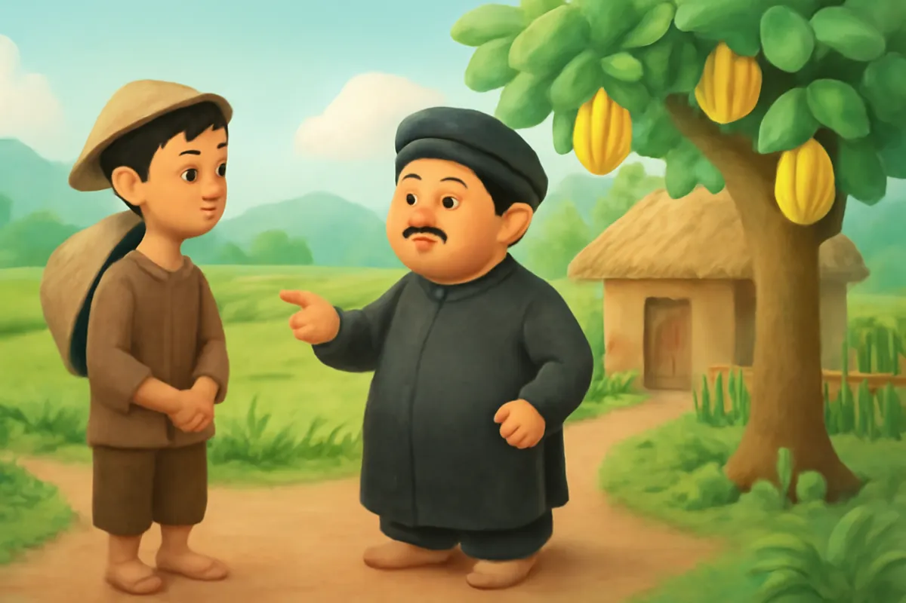
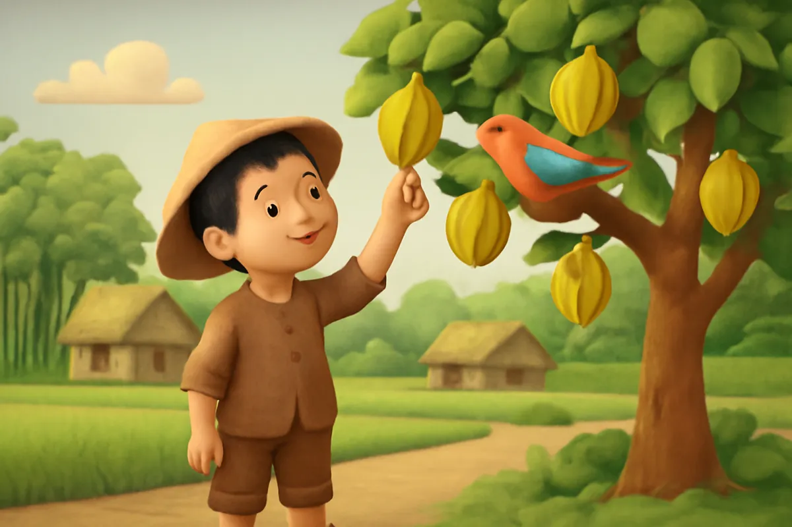
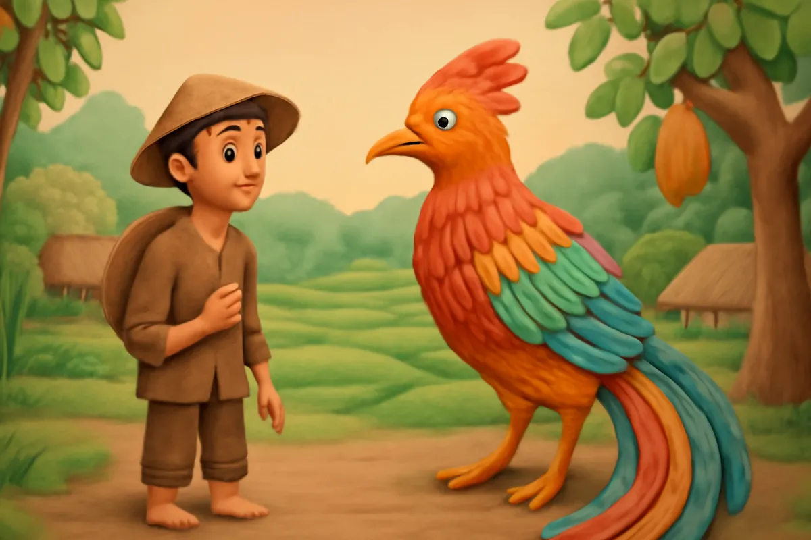
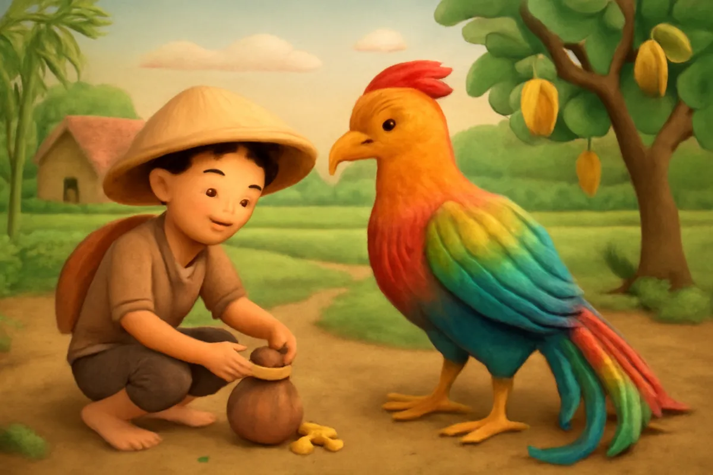
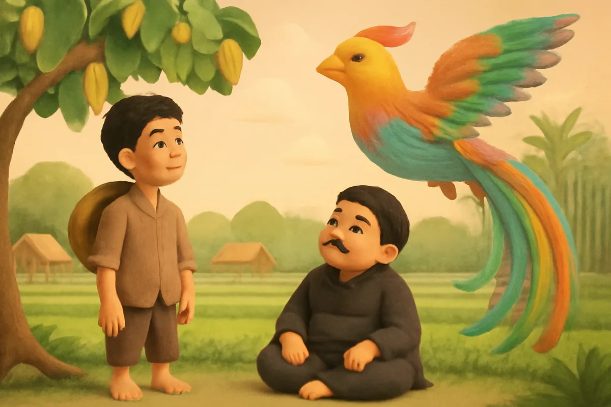
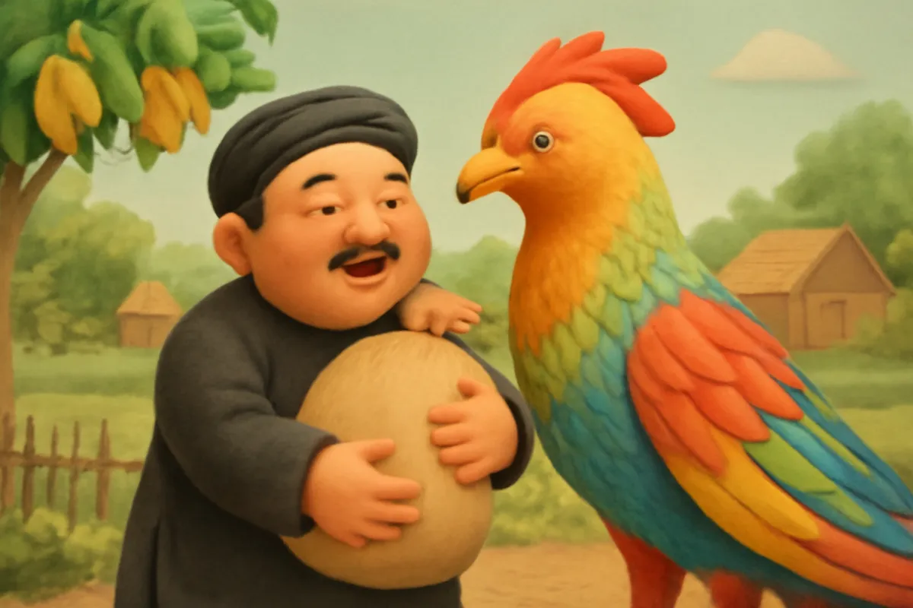
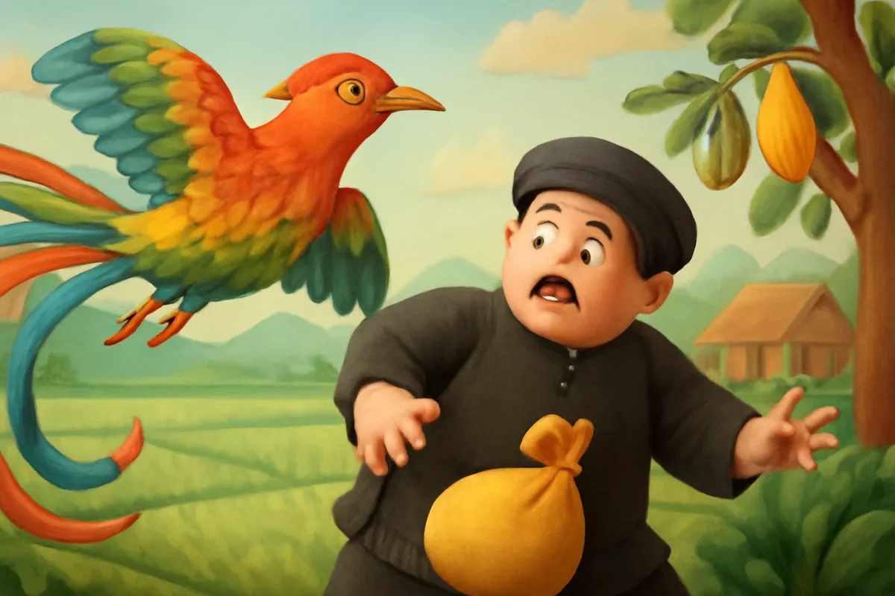
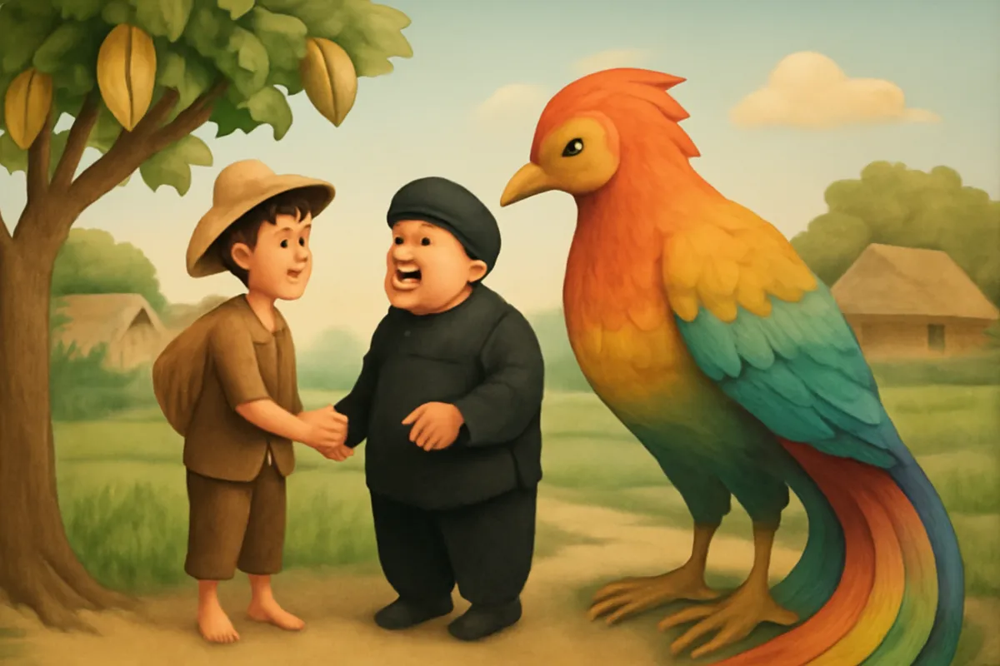

# Ăn khế trả vàng

| | |
| --- | --- |
| Mã truyện | `f0a30981-55e2-4c22-97d0-3d72e01282e1` |
| Nhóm | Truyện thư viện |
| Nguồn | manual |
| Tạo lúc | 2026-10-15T14:34:09.448749+00:00 |
| Cập nhật | 2026-10-16T04:19:16.744656+00:00 |
| Số trang | 8 |
| Ngôn ngữ | vi |
| Tuổi | 4–8 |
| Giọng kể | Viên - Narrative, Warm and Clear (northern) |
| Trạng thái | published |
| Đã xoá | không |

**Giới thiệu:** Người em hiền lành chỉ được chia cây khế. Chim thần ăn khế, trả vàng và chở người em ra đảo. Người anh tham lam may túi thật to và bị mất sạch vàng giữa biển.

**Bài học:** Sống hiền lành, biết đủ thì được hạnh phúc; tham lam sẽ mất tất cả.

## Nhân vật

- **Người Em** — Người em hiền lành, chăm chỉ, biết đủ (giọng: Quang — chú trầm ấm)
- **Người Anh** — Người anh tham lam, về sau biết lỗi (giọng: Thanh — ông hiền từ)
- **Chim Thần** — Con chim lạ biết nói, giữ lời hứa (giọng: Yuna — bé gái tinh nghịch)

## Trang 1

Ngày xưa, ở một làng nọ có hai anh em. Khi lớn lên, hai anh em chia nhà ra ở riêng.

Người anh tham lam, nhận hết nhà to, ruộng tốt và đàn trâu béo. Người anh chỉ chia cho em một túp lều nhỏ và một cây khế ở góc vườn.

**Người Anh:** Chú cứ lấy cây khế mà sống. Thế là công bằng lắm rồi!

Người em hiền lành, không nói gì, vui vẻ nhận phần.

🔊 [Nghe trang 1](../../../media/tts-cache/00dcbb39-17e7-43b4-b05d-7391707e72a5-405d6089-5a12-46c5-bb4a-9561e77e4ff8.mp3)

## Trang 2

Người em chăm chỉ tưới nước, bắt sâu cho cây khế. Mùa ấy, cây khế ra hoa tím biếc, rồi trĩu quả vàng ươm, ngọt lịm.

Một buổi sáng, có con chim lạ, lông óng ánh như cầu vồng, bay đến ăn khế. Nó ăn hết quả này đến quả khác.

**Người Em:** Chim ơi, nhà tôi chỉ có cây khế này thôi. Chim ăn hết thì tôi lấy gì mà sống?

🔊 [Nghe trang 2](../../../media/tts-cache/70013ed0-1edb-4479-8907-5843fa071720-a132aa0e-6eb3-45e5-9383-b36003e62e2c.mp3)

## Trang 3

Con chim bỗng cất tiếng nói, giọng trong như tiếng chuông.

**Chim Thần:** Ăn một quả, trả cục vàng. May túi ba gang, mang đi mà đựng.

Người em ngạc nhiên lắm. Tối hôm ấy, hai vợ chồng người em ngồi bên ngọn đèn dầu, cùng nhau may một chiếc túi nhỏ, dài đúng ba gang tay, như lời chim dặn.

**Người Em:** Chim đã hứa, chắc chắn chim sẽ quay lại.

🔊 [Nghe trang 3](../../../media/tts-cache/c94ee2a2-179d-4e1d-b86d-4bb5406f108d-6c611f3c-e682-44c8-a41c-e8acd159ceda.mp3)

## Trang 4

Sáng hôm sau, chim thần bay đến thật. Người em ngồi lên lưng chim. Chim bay qua núi cao, qua biển rộng, đến một hòn đảo có hang đầy vàng bạc lấp lánh.

**Chim Thần:** Anh lấy vàng đi, đựng vừa túi ba gang là đủ.

Người em chỉ nhặt đầy chiếc túi nhỏ, rồi cảm ơn chim. Từ đó, nhà người em đủ ăn đủ mặc. Anh còn đem gạo giúp những nhà nghèo trong xóm.

🔊 [Nghe trang 4](../../../media/tts-cache/183335ae-8e96-48fa-a08b-e66561388f23-9e1d85fc-0824-4b2e-8e6a-747153f2eb5e.mp3)

## Trang 5

Người anh nghe tin, vội vàng chạy sang nhà em.

**Người Anh:** Chú đổi cho anh cây khế đi. Anh cho chú cả nhà to, ruộng tốt của anh.

Người em thương anh, liền đồng ý đổi. Người anh mừng rỡ, ngày nào cũng ngồi dưới gốc khế, mắt dõi lên trời chờ chim thần.

**Người Anh:** Chim ơi, mau đến đây! Khế ngọt lắm, chim ăn đi cho anh nhờ!

🔊 [Nghe trang 5](../../../media/tts-cache/521750e9-25c0-4938-a0f0-8d2e4e7aefd8-aa31e00c-c007-453d-9292-504b9e636def.mp3)

## Trang 6

Rồi chim thần cũng bay đến ăn khế. Người anh giả vờ kêu ca y như em mình ngày trước. Chim thần lại nói:

**Chim Thần:** Ăn một quả, trả cục vàng. May túi ba gang, mang đi mà đựng.

Người anh chạy về bảo vợ may ngay một chiếc túi thật to, dài những mười hai gang tay.

**Người Anh:** Túi càng to, vàng càng nhiều. Lần này nhà mình giàu to rồi!

🔊 [Nghe trang 6](../../../media/tts-cache/eed30130-ab35-4f34-9a49-508cbda8001e-439bdf3d-37c6-4e2f-b96e-3e15946fc52a.mp3)

## Trang 7

Đến đảo vàng, người anh nhét vàng đầy túi, lại nhét thêm vào túi áo, túi quần. Lúc bay về, chim thần nặng quá, cánh mỗi lúc một chậm.

**Chim Thần:** Anh bỏ bớt vàng đi, kẻo nặng quá tôi không bay nổi!

**Người Anh:** Không được! Vàng của tôi, tôi không bỏ đâu!

Đến giữa biển, chim mỏi cánh, nghiêng mình. Chiếc túi vàng tuột khỏi vai người anh, rơi tõm xuống biển sâu.

🔊 [Nghe trang 7](../../../media/tts-cache/93074b42-677c-4f20-8239-c262aa8ec9f4-dd932094-cbb6-431a-bb9d-a18a8dca7dff.mp3)

## Trang 8

Người anh sợ hãi ôm chặt lấy cổ chim. Chim thần cố gắng đưa anh về tận bờ. Người anh về nhà tay trắng, quần áo ướt sũng.

**Người Anh:** Chú ơi, anh tham lam quá nên mới ra nông nỗi này. Anh xin lỗi chú.

**Người Em:** Anh em mình thương nhau là quý nhất. Anh về đây, mình cùng chăm cây khế nhé.

Từ đó, hai anh em sống hoà thuận, vui vẻ bên nhau.

🔊 [Nghe trang 8](../../../media/tts-cache/857862de-2099-4485-a391-192d2de051f5-70608438-8bf5-48b7-bee3-556cd13e1e4b.mp3)

---

Bản đầy đủ (mọi cột trong cơ sở dữ liệu): [story.json](story.json)
