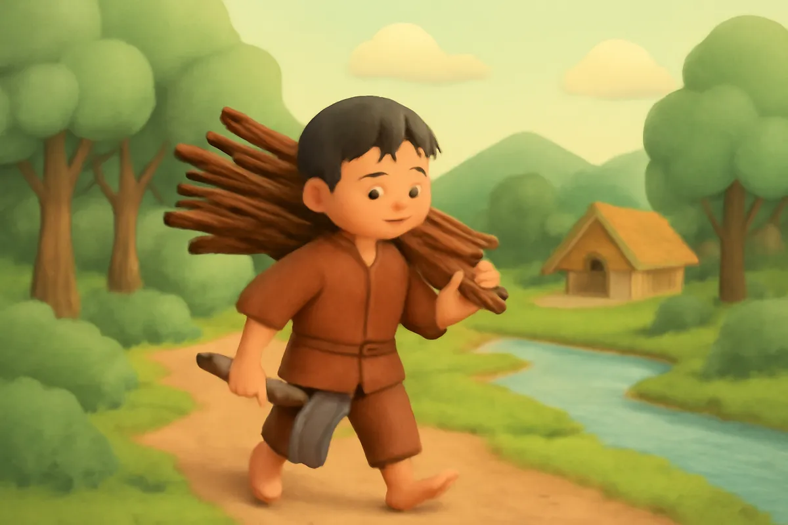
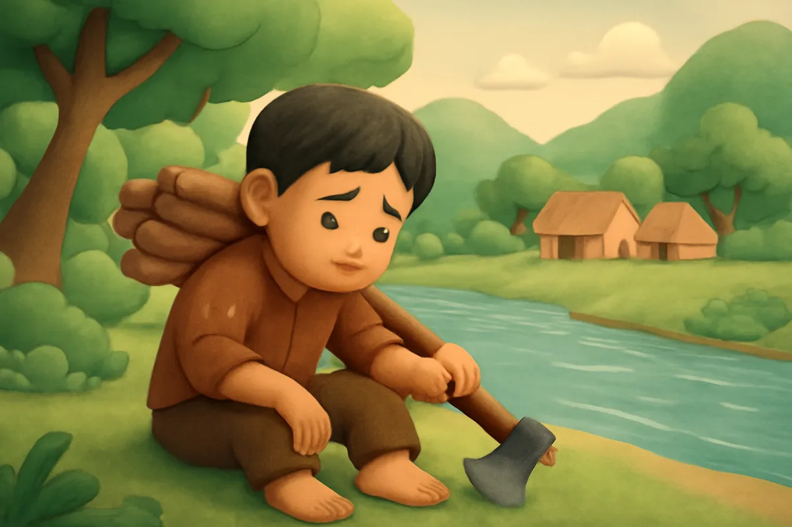
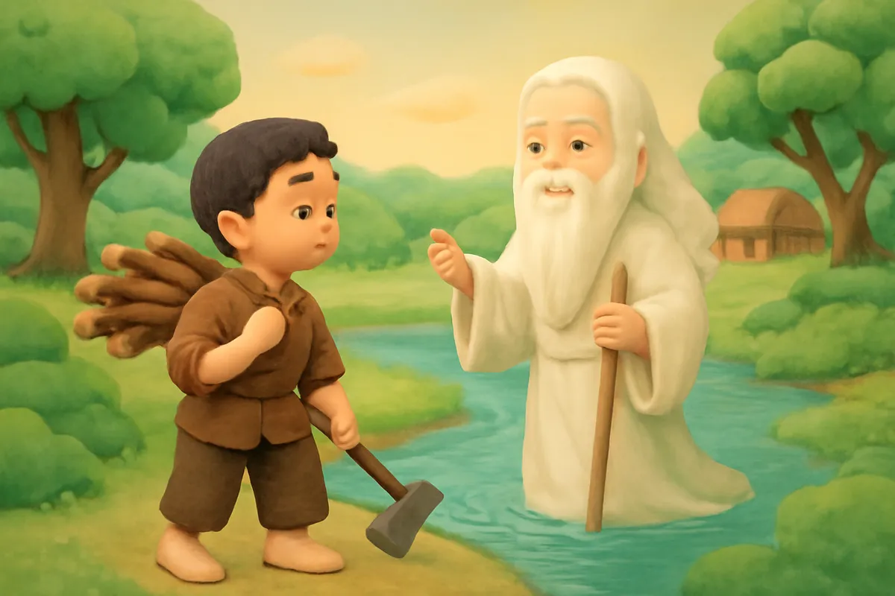
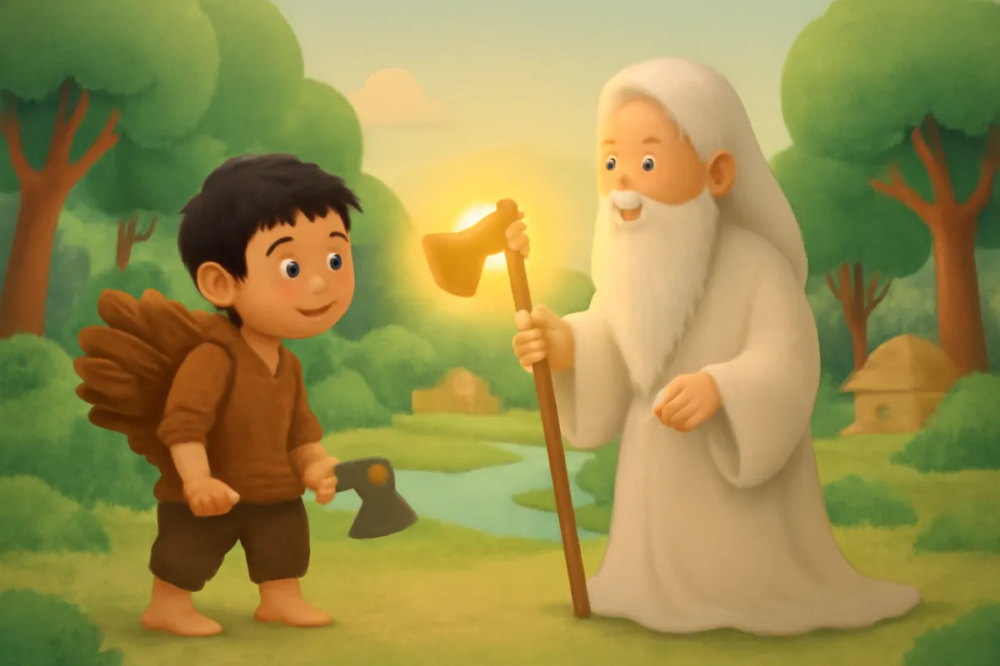
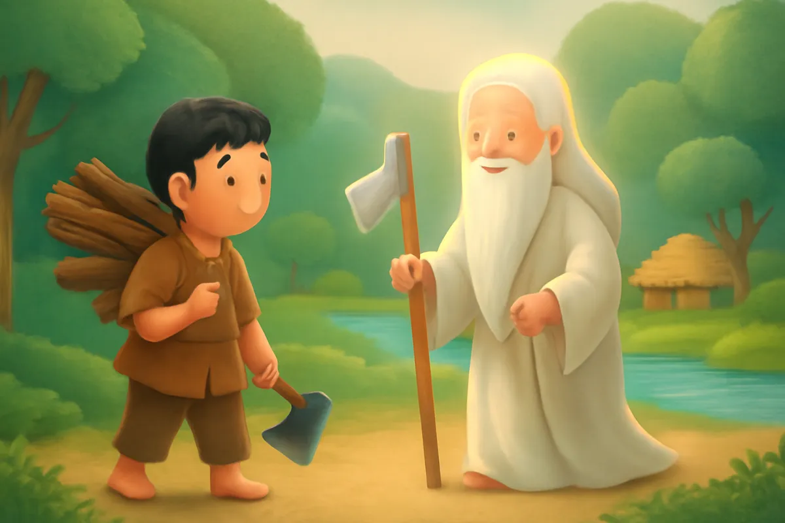
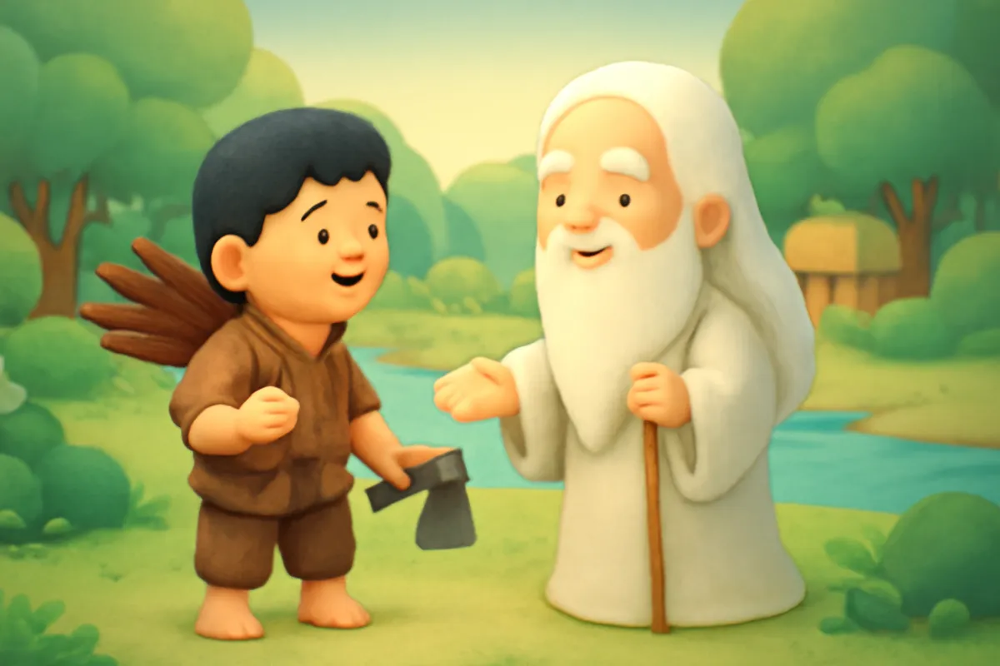
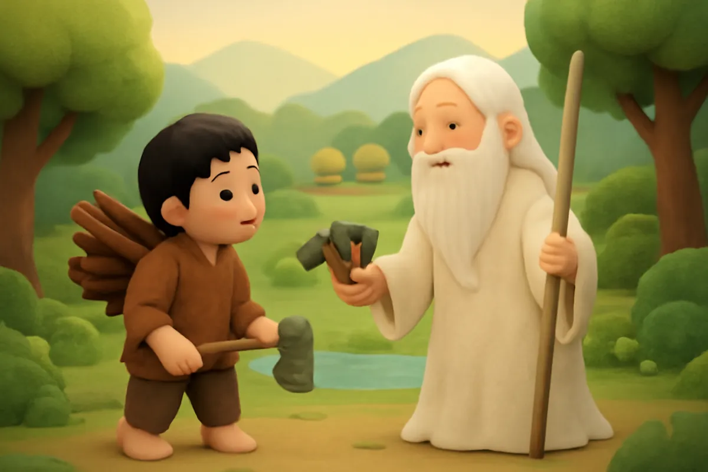
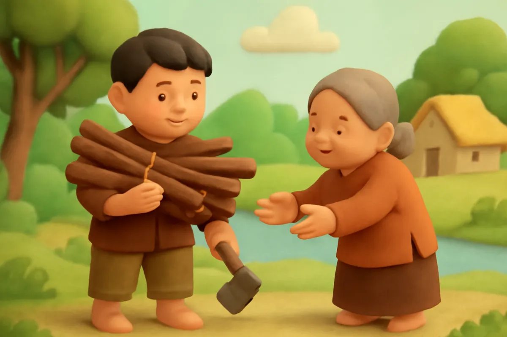

# Ba chiếc rìu

| | |
| --- | --- |
| Mã truyện | `1c22cc06-e0d6-419f-a203-0ceed3cd2597` |
| Nhóm | Truyện thư viện |
| Nguồn | manual |
| Tạo lúc | 2026-10-15T14:34:09.448749+00:00 |
| Cập nhật | 2026-10-16T04:21:50.447346+00:00 |
| Số trang | 8 |
| Ngôn ngữ | vi |
| Tuổi | 3–7 |
| Giọng kể | Viên - Narrative, Warm and Clear (northern) |
| Trạng thái | published |
| Đã xoá | không |

**Giới thiệu:** Anh tiều phu nghèo làm rơi chiếc rìu sắt xuống sông. Ông Bụt mang lên rìu vàng, rìu bạc, nhưng anh chỉ nhận đúng chiếc rìu của mình.

**Bài học:** Thật thà, không tham của người khác.

## Nhân vật

- **Anh Tiều Phu** — Anh tiều phu nghèo, chăm chỉ và thật thà (giọng: Quang — chú trầm ấm)
- **Ông Bụt** — Ông Bụt hiền từ, hay giúp người tốt (giọng: Thanh — ông hiền từ)

## Trang 1

Ngày xưa, có một anh tiều phu nghèo sống ở bìa rừng. Cả gia tài của anh chỉ có một chiếc rìu sắt cũ. Ngày nào anh cũng vào rừng đốn củi, mang ra chợ đổi lấy gạo.

**Anh Tiều Phu:** Rìu ơi, hôm nay mình cùng cố gắng nhé. Đốn thật nhiều củi để mua gạo nào!

Tiếng rìu vang lên cộc cộc giữa rừng xanh.

🔊 [Nghe trang 1](../../../media/tts-cache/a5b43d4a-6660-4184-83e0-f299506414b3-8e0f3d24-75f8-408d-b0d5-562a84384d97.mp3)

## Trang 2

Hôm ấy, anh đốn củi bên một dòng sông. Mồ hôi ướt đẫm, tay anh trơn tuột. Chiếc rìu tuột khỏi tay, rơi tõm xuống nước sâu.

Anh lội xuống tìm mãi mà không thấy. Anh ngồi bên bờ sông, buồn rầu ôm mặt, nước mắt rưng rưng.

**Anh Tiều Phu:** Mất rìu rồi, mình biết lấy gì kiếm sống đây?

🔊 [Nghe trang 2](../../../media/tts-cache/1e85bb23-15a6-454b-b178-f331b600c015-2a4bb066-a361-483b-a948-48df8ce1268d.mp3)

## Trang 3

Bỗng có ánh sáng lấp lánh trên mặt nước. Một ông cụ râu tóc bạc phơ hiện ra, nét mặt hiền từ. Đó là ông Bụt.

**Ông Bụt:** Con ơi, vì sao con buồn thế?

**Anh Tiều Phu:** Thưa ông, con làm rơi chiếc rìu xuống sông. Con chỉ có chiếc rìu ấy để kiếm sống.

**Ông Bụt:** Con đừng buồn. Để ông tìm giúp con.

🔊 [Nghe trang 3](../../../media/tts-cache/5f3d2b63-d432-4c9a-aca0-11c470bec173-d32836fe-0a00-4931-a73f-9c6d2695046b.mp3)

## Trang 4

Ông Bụt lặn xuống sông. Một lúc sau, ông ngoi lên, trên tay cầm một chiếc rìu bằng vàng sáng chói.

**Ông Bụt:** Có phải rìu của con đây không?

Anh tiều phu nhìn chiếc rìu vàng lấp lánh, rồi chậm rãi lắc đầu. Rìu vàng đẹp thật, nhưng đó không phải rìu của anh.

**Anh Tiều Phu:** Thưa ông, không phải ạ. Rìu của con chỉ là rìu sắt thôi.

🔊 [Nghe trang 4](../../../media/tts-cache/4ac7bab9-92d1-4c0a-b6b3-16e7afde2485-eeff9e85-2f2c-45e7-9111-4ee95ce6be6f.mp3)

## Trang 5

Ông Bụt lại lặn xuống lần nữa. Lần này, ông mang lên một chiếc rìu bằng bạc trắng ngời, sáng như ánh trăng.

**Ông Bụt:** Thế chiếc rìu bạc này có phải của con không?

Anh tiều phu vẫn thật thà lắc đầu.

**Anh Tiều Phu:** Cũng không phải đâu ạ. Rìu của con có cán gỗ, lưỡi sắt đã cũ lắm rồi.

🔊 [Nghe trang 5](../../../media/tts-cache/b60794c5-9ff4-4dfa-b5f1-ed63ae1e9cf1-e7e04388-ac58-4133-be93-d0bff722c1ce.mp3)

## Trang 6

Ông Bụt lặn xuống lần thứ ba. Khi ngoi lên, ông cầm một chiếc rìu sắt cũ, cán gỗ đã mòn.

Vừa nhìn thấy, anh tiều phu reo lên vui sướng. Anh đưa hai tay đón lấy chiếc rìu, ôm vào lòng như ôm một người bạn cũ.

**Anh Tiều Phu:** Đúng rồi! Đây mới là rìu của con. Con cảm ơn ông nhiều lắm!

🔊 [Nghe trang 6](../../../media/tts-cache/bbb9781e-526d-4854-a9bb-b65abbe060d4-f0b21ab0-e08a-4d79-95b2-5d9b7d344728.mp3)

## Trang 7

Ông Bụt mỉm cười, vuốt chòm râu bạc, gật gù khen ngợi.

**Ông Bụt:** Con là người thật thà, không tham của người khác. Ông tặng con cả ba chiếc rìu này.

Anh tiều phu cảm ơn ông Bụt rối rít. Chớp mắt một cái, ông Bụt đã biến mất, chỉ còn mặt sông lấp lánh nắng vàng.

🔊 [Nghe trang 7](../../../media/tts-cache/c33f950a-4d42-4a3a-af5e-eee3db683fbe-3c263508-86df-4cad-98c7-13a46d9502c3.mp3)

## Trang 8

Anh tiều phu mang ba chiếc rìu về làng. Anh đổi rìu vàng, rìu bạc lấy tiền, giúp đỡ những nhà nghèo trong làng. Còn chiếc rìu sắt, anh vẫn mang theo vào rừng mỗi ngày.

**Anh Tiều Phu:** Chăm chỉ và thật thà thì lòng mình lúc nào cũng nhẹ nhàng.

Từ đó, ai trong làng cũng quý mến anh.

🔊 [Nghe trang 8](../../../media/tts-cache/9c356b3d-5726-4031-bd62-a3b0f6e210e8-c42514fc-4ae6-49f9-87a9-bdf75381e5df.mp3)

---

Bản đầy đủ (mọi cột trong cơ sở dữ liệu): [story.json](story.json)
