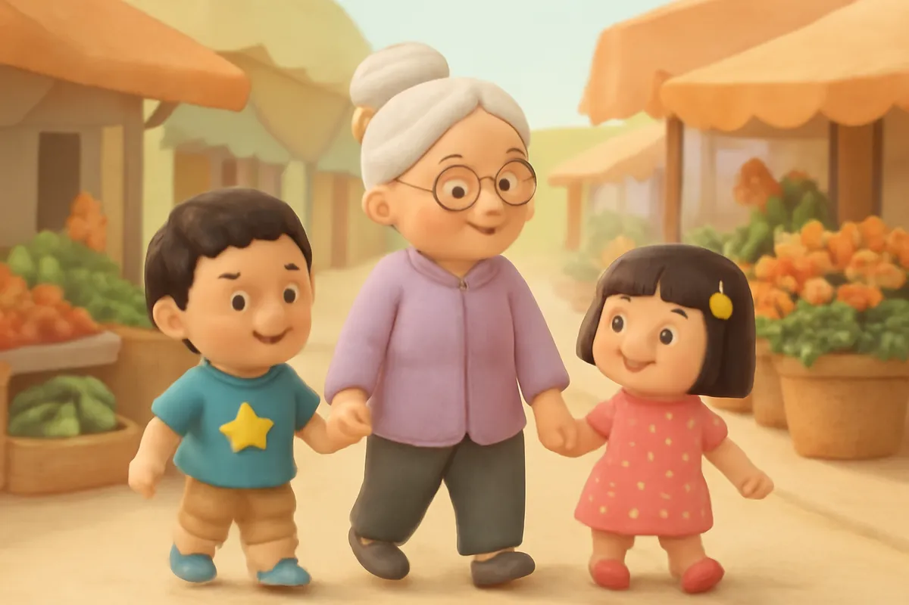
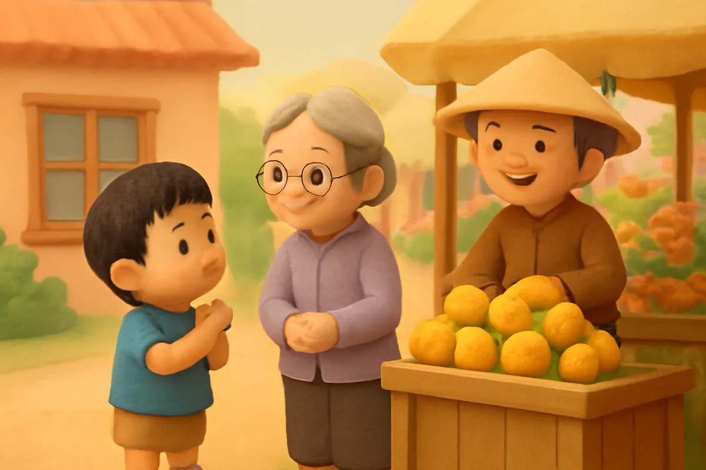
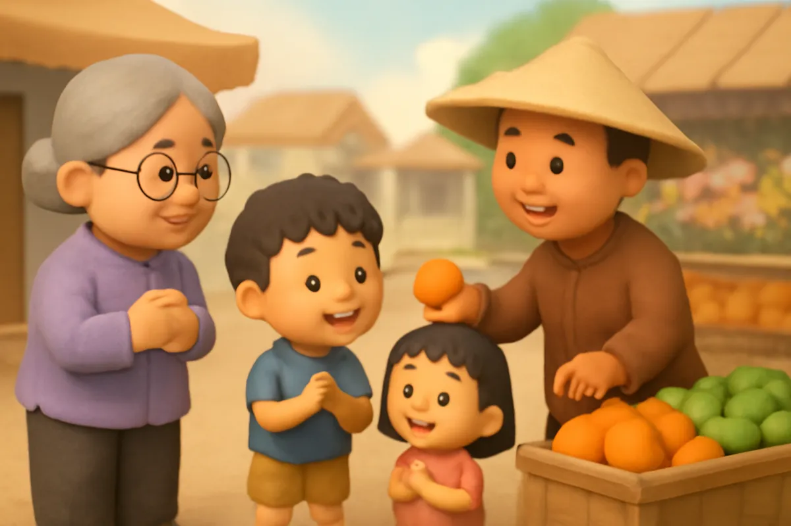
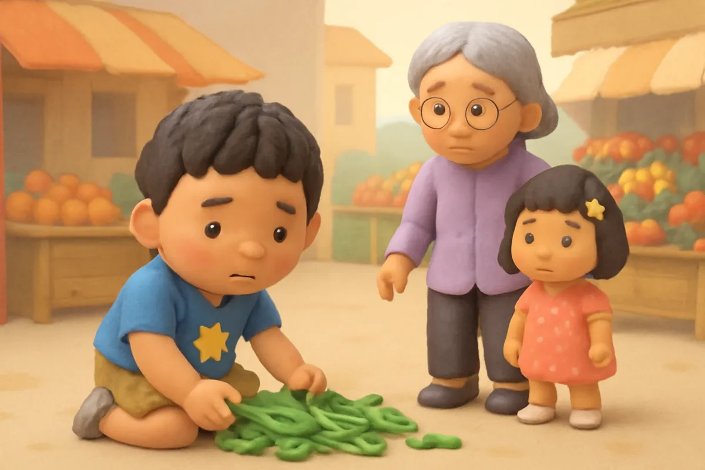
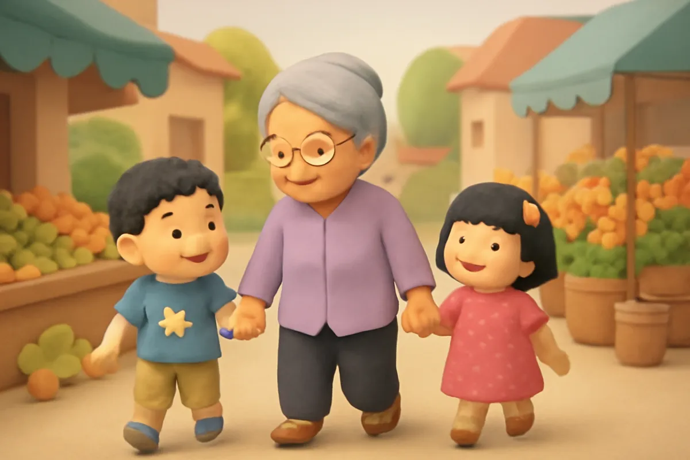
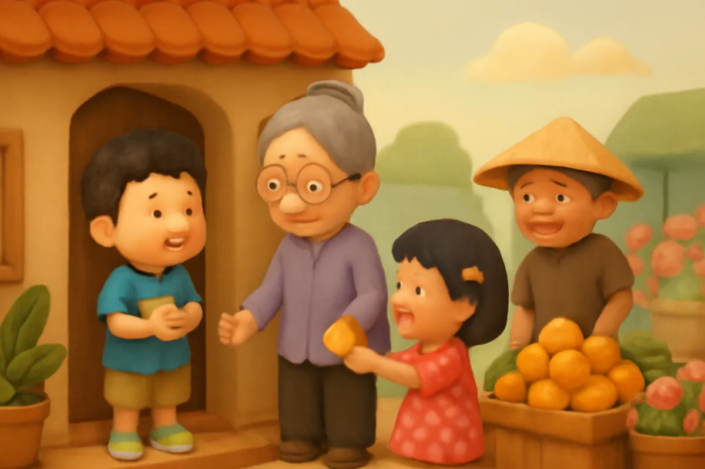
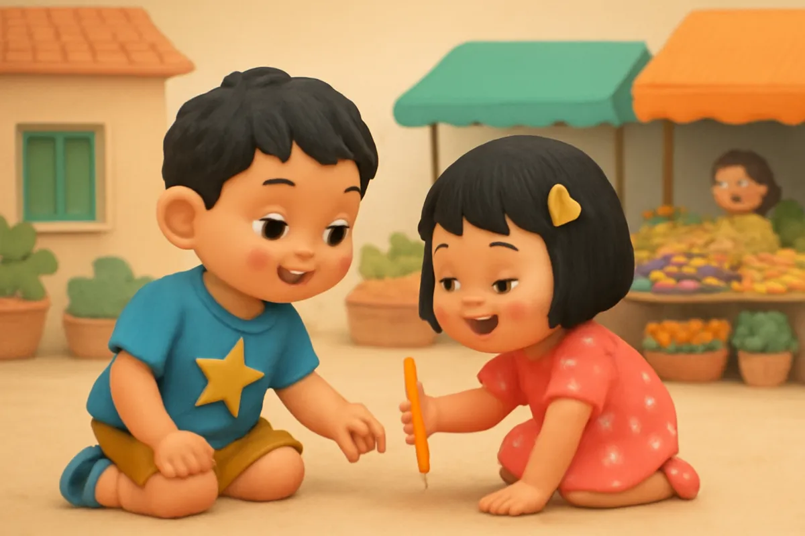
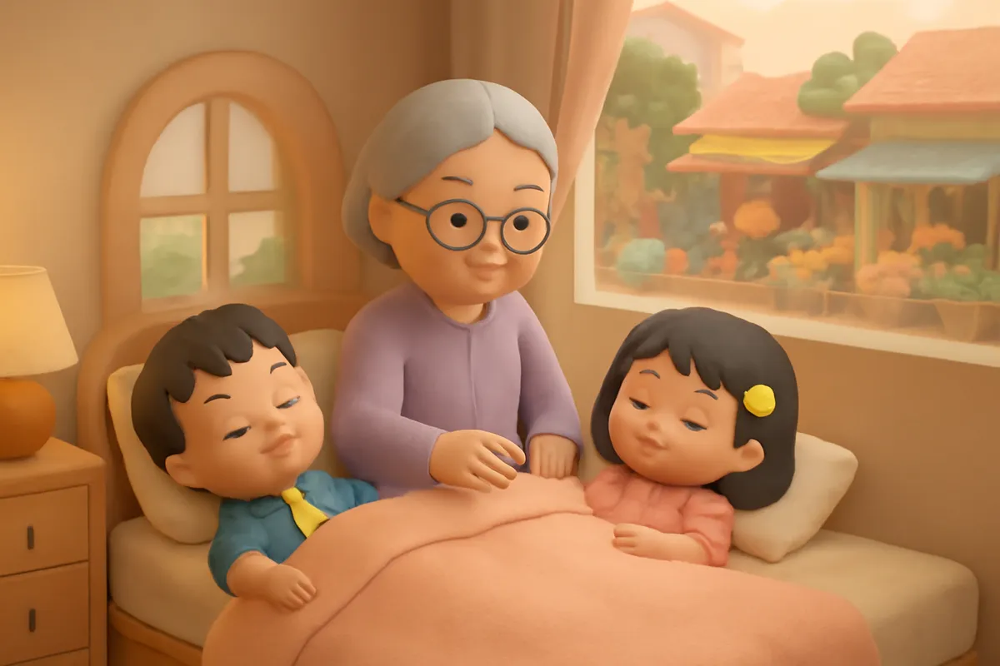

# Ba từ kỳ diệu

| | |
| --- | --- |
| Mã truyện | `07ad2ef3-fcc5-444d-ac6e-49c0f74e1095` |
| Nhóm | Truyện thư viện |
| Nguồn | manual |
| Tạo lúc | 2026-10-15T14:34:10.193821+00:00 |
| Cập nhật | 2026-10-16T04:29:23.40766+00:00 |
| Số trang | 8 |
| Ngôn ngữ | vi |
| Tuổi | 3–6 |
| Giọng kể | Viên - Narrative, Warm and Clear (northern) |
| Trạng thái | published |
| Đã xoá | không |

**Giới thiệu:** Bà dẫn Bo và Su đi chợ và bày cho hai anh em trò chơi ba từ kỳ diệu: chào, cảm ơn và xin lỗi. Mỗi lần nói ra, Bo thấy mọi người mỉm cười như có phép màu.

**Bài học:** Lời chào, lời cảm ơn và lời xin lỗi là ba từ kỳ diệu làm ai cũng vui.

## Nhân vật

- **Bo** — Cậu bé 5 tuổi hiếu động, tốt bụng, đang tập thói quen tốt (giọng: Bin — bé trai lém lỉnh)
- **Bà** — Bà nội hiền hậu, kể chuyện hay (giọng: Hiền — bà hiền hậu)
- **Su** — Em gái 4 tuổi của Bo, hay hỏi, thích vẽ (giọng: Yuna — bé gái tinh nghịch)
- **Bác Tư** — Bác bán hoa quả vui tính ở chợ (giọng: Quang — chú trầm ấm)

## Trang 1

Sáng chủ nhật, bà dẫn Bo và Su đi chợ. Chợ đông vui lắm, có hàng rau xanh, hàng cá tươi, hàng hoa quả thơm phức.

**Bà:** Hôm nay bà bày cho hai cháu một trò chơi. Có ba từ kỳ diệu: chào, cảm ơn và xin lỗi. Mỗi lần nói ra, các cháu nhìn xem có phép màu gì xảy ra nhé.

**Su:** Phép màu ạ? Thích quá!

🔊 [Nghe trang 1](../../../media/tts-cache/9b6dee32-0648-4e4a-9dbc-7ad07d09ec25-b53ee347-ccca-4b44-98e2-bf79ec30bffa.mp3)

## Trang 2

Đến sạp hoa quả, bác Tư đang xếp những quả cam vàng ruộm. Bà khẽ nhắc Bo.

**Bà:** Từ kỳ diệu thứ nhất là gì nào?

**Bo:** Cháu chào bác Tư ạ!

**Bác Tư:** Ôi, chào cháu! Cháu ngoan quá! Hôm nay bác có xoài chín thơm lắm đấy.

Bác Tư cười tươi rói. Bo ngạc nhiên: phép màu thứ nhất là một nụ cười.

🔊 [Nghe trang 2](../../../media/tts-cache/500d7054-a61d-4a93-b453-ed60a02233de-fb8c94f7-b0d9-49ac-bd99-a9d84822687f.mp3)

## Trang 3

Bà mua một túi xoài. Bác Tư còn tặng mỗi bạn nhỏ một quả quýt.

**Bác Tư:** Quýt ngọt lắm, bác cho hai cháu này.

**Su:** Cháu cảm ơn bác ạ!

**Bo:** Cháu cảm ơn bác Tư ạ!

**Bác Tư:** Ngoan quá! Lần sau lại đến chơi với bác nhé.

Su nháy mắt với anh. Từ kỳ diệu thứ hai làm bác Tư vui ơi là vui.

🔊 [Nghe trang 3](../../../media/tts-cache/f8b2e894-2306-416a-9bf7-feebfbfd2e67-bf1a0956-233d-4778-aa52-1d6d93e8ba38.mp3)

## Trang 4

Trên đường đi tiếp, Bo mải nhìn hàng cá, vô ý va vào một cô đang xách giỏ rau. Mấy bó rau rơi xuống đất.

Bo đứng sững lại. Bo nhớ đến từ kỳ diệu thứ ba.

**Bo:** Cháu xin lỗi cô ạ! Để cháu nhặt rau giúp cô.

Bo cúi xuống nhặt từng bó rau, bỏ lại vào giỏ.

🔊 [Nghe trang 4](../../../media/tts-cache/878f15a1-6bd6-4a2d-9539-bdf6a8eb916f-313eead7-cc2f-4068-8a8d-a19ff3c1823b.mp3)

## Trang 5

Cô xách giỏ rau mỉm cười, xoa đầu Bo rồi đi tiếp. Cô còn khen Bo là cậu bé lễ phép.

**Bà:** Cháu thấy không? Lỡ va vào người khác, mình nói xin lỗi và giúp người ta. Thế là ai cũng hết bực.

**Bo:** Từ kỳ diệu thứ ba làm cô ấy mỉm cười bà ạ!

**Su:** Ba từ kỳ diệu có phép màu thật!

🔊 [Nghe trang 5](../../../media/tts-cache/beb7f128-36c6-4e62-b495-d1d3566dc7c7-f23ea2f9-ba37-4284-9742-29132b3a2dba.mp3)

## Trang 6

Về đến nhà, bố đang tưới cây ở hiên. Bo chạy tới khoanh tay.

**Bo:** Con chào bố ạ! Bố ơi, hôm nay con được bác Tư tặng quýt đấy.

Su bóc quả quýt, chia cho bà một nửa.

**Su:** Bà ơi, bà ăn quýt đi ạ. Cháu cảm ơn bà đã dẫn cháu đi chợ!

**Bà:** Bà cảm ơn cháu. Cháu bà biết chia sẻ nữa cơ đấy!

🔊 [Nghe trang 6](../../../media/tts-cache/424aa250-fcc3-46c9-b75c-9ddb4c78641a-36df1055-d255-4af6-bffd-b4abd90f00fb.mp3)

## Trang 7

Buổi trưa, Su lỡ tay làm rơi chiếc bút chì của Bo xuống gầm bàn.

**Su:** Anh Bo ơi, em xin lỗi. Em nhặt lên cho anh ngay đây.

**Bo:** Không sao đâu. Cảm ơn em đã nhặt giúp anh!

Hai anh em nhìn nhau cười. Ở nhà, ba từ kỳ diệu cũng có phép màu. Bo lại tiếp tục vẽ bức tranh khu chợ.

🔊 [Nghe trang 7](../../../media/tts-cache/77614530-e4ca-4211-a7a4-e74cc77db1ba-6b0e77fc-03bb-406c-9639-fdf722df89a4.mp3)

## Trang 8

Tối hôm ấy, bà kể chuyện cho hai anh em trước khi ngủ.

**Bo:** Bà ơi, mai con sẽ chào cô Hoa thật to và cảm ơn các bạn ở lớp ạ.

**Bà:** Giỏi lắm. Ba từ kỳ diệu dùng mãi cũng không bao giờ hết đâu.

Bé ơi, ba từ kỳ diệu là những từ nào nhỉ? Hôm nay bé đã nói từ kỳ diệu nào rồi?

🔊 [Nghe trang 8](../../../media/tts-cache/49a07222-f277-4682-a173-9f110ef5ba88-c88b110f-1a7b-4a47-bf81-5831eee5b4ef.mp3)

---

Bản đầy đủ (mọi cột trong cơ sở dữ liệu): [story.json](story.json)
