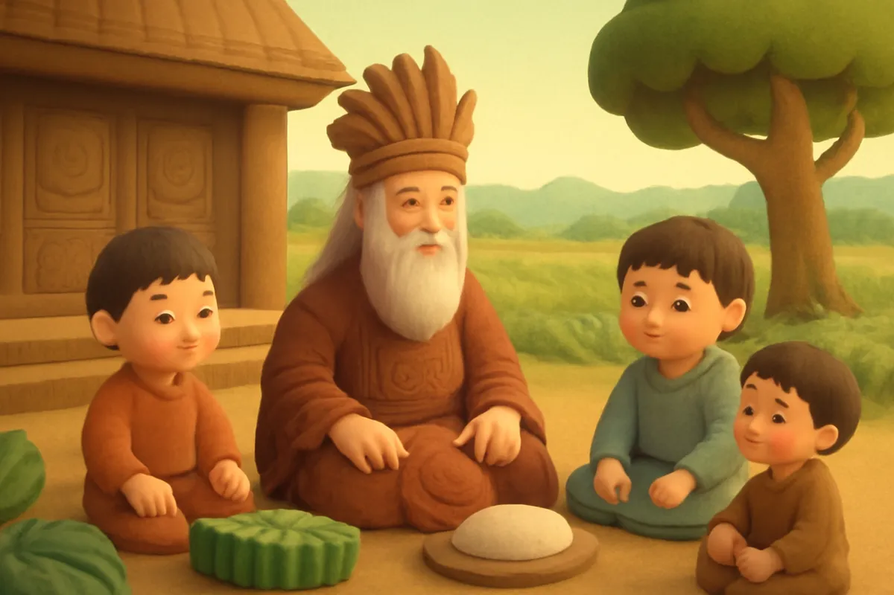
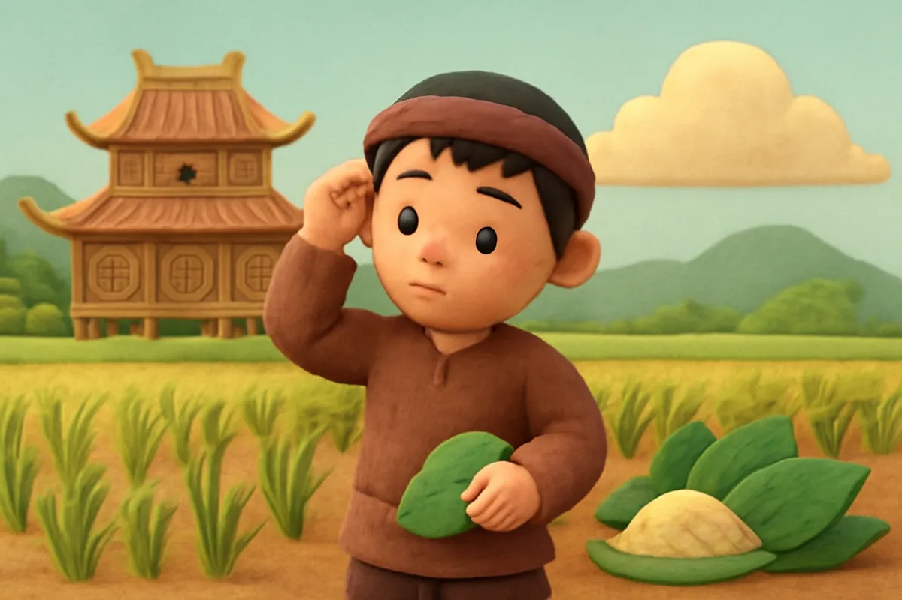
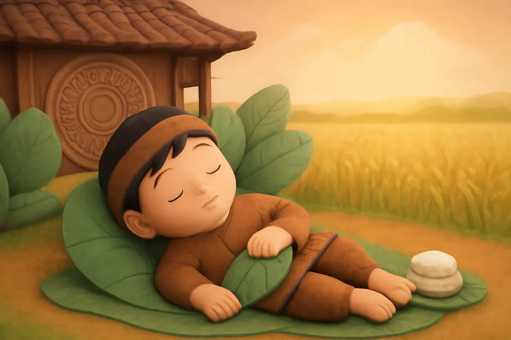
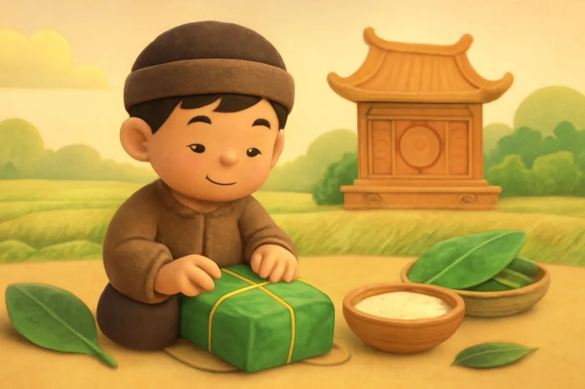
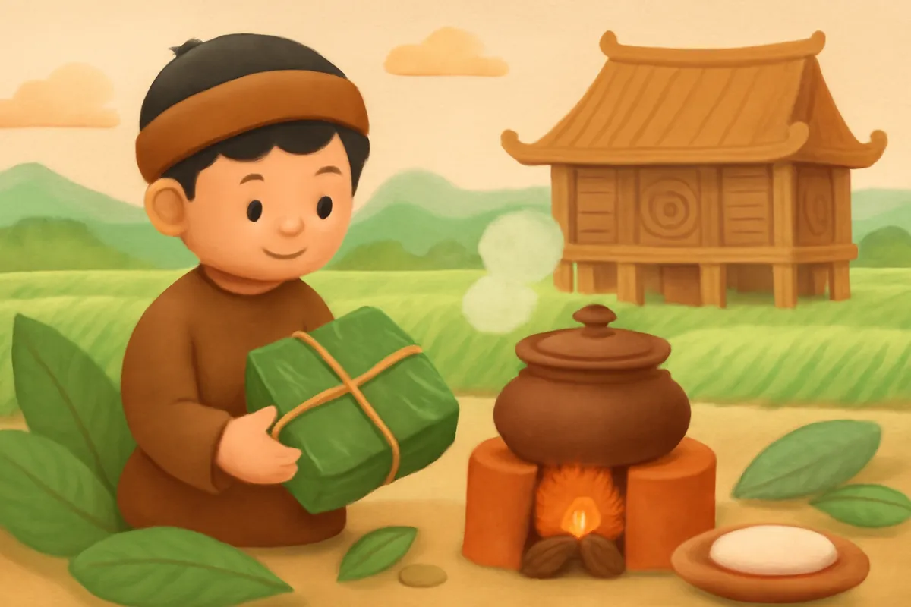
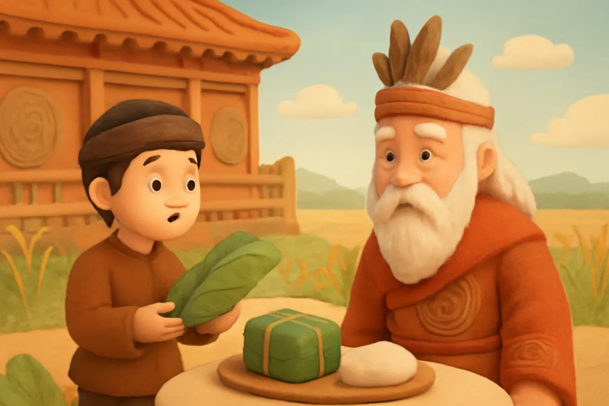
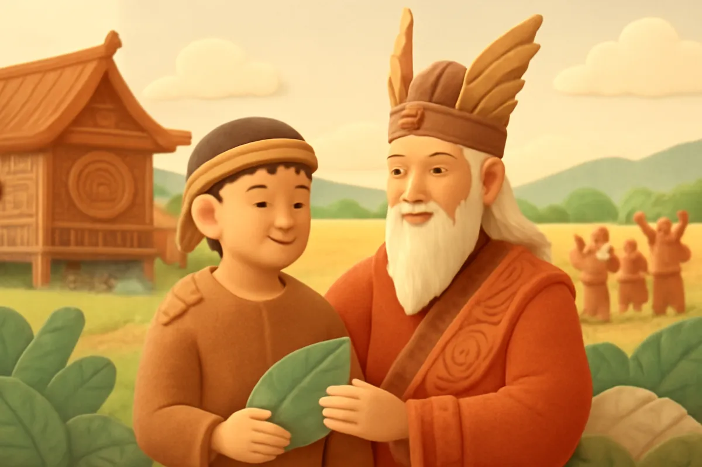
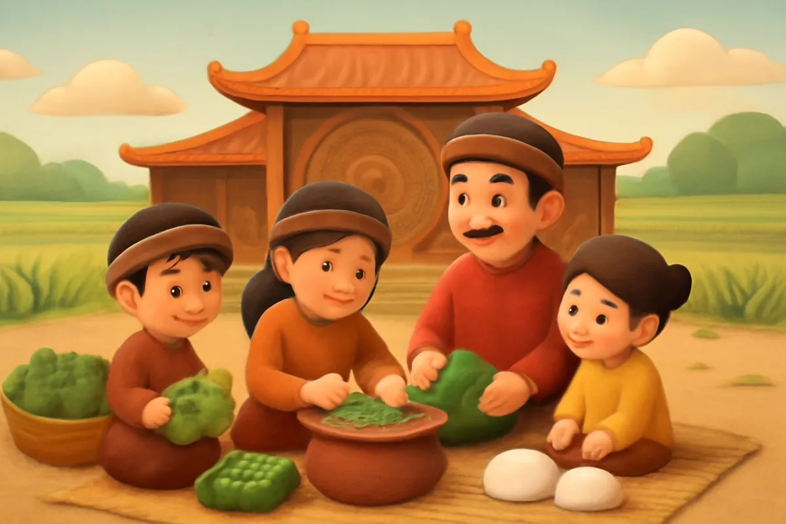

# Bánh chưng bánh giầy

| | |
| --- | --- |
| Mã truyện | `8cebaa50-de92-4b62-a27a-fa5acead9496` |
| Nhóm | Truyện thư viện |
| Nguồn | manual |
| Tạo lúc | 2026-10-15T14:34:09.448749+00:00 |
| Cập nhật | 2026-10-16T04:22:30.291276+00:00 |
| Số trang | 8 |
| Ngôn ngữ | vi |
| Tuổi | 4–8 |
| Giọng kể | Viên - Narrative, Warm and Clear (northern) |
| Trạng thái | published |
| Đã xoá | không |

**Giới thiệu:** Vua Hùng muốn truyền ngôi cho người con dâng lễ vật ý nghĩa nhất. Lang Liêu nghèo nhưng hiểu quý nhất là hạt gạo, làm bánh vuông, bánh tròn tượng trưng cho đất và trời.

**Bài học:** Quý trọng hạt gạo, công sức lao động và nhớ ơn tổ tiên.

## Nhân vật

- **Lang Liêu** — Hoàng tử thứ mười tám, sống giản dị, chăm làm ruộng (giọng: Quang — chú trầm ấm)
- **Vua Hùng** — Vua Hùng thứ sáu, già và hiền minh (giọng: Thanh — ông hiền từ)

## Trang 1

Ngày xưa, vua Hùng thứ sáu trị vì đất nước. Vua có hai mươi người con trai. Khi đã già, vua muốn chọn một người con giỏi nhất để truyền ngôi.

Một năm, nhân dịp đầu xuân, vua gọi các con đến và phán:

**Vua Hùng:** Năm nay, con nào tìm được lễ vật ý nghĩa nhất dâng lên tổ tiên, ta sẽ truyền ngôi cho người đó.

🔊 [Nghe trang 1](../../../media/tts-cache/015cf44d-886b-4ce9-8a2b-755c603e6302-e20ffd15-f359-4e89-9f2a-fb75de999d19.mp3)

## Trang 2

Các hoàng tử, người ta gọi là các lang, đua nhau đi tìm của ngon vật lạ. Người lên rừng tìm nấm quý, người xuống biển tìm tôm cá, ngọc trai.

Riêng Lang Liêu, người con thứ mười tám, sống giản dị nhất. Ngày ngày, chàng chỉ chăm lo việc đồng áng, trồng lúa, trồng khoai.

**Lang Liêu:** Nhà ta chỉ có lúa gạo, khoai sắn. Biết lấy gì làm lễ vật dâng cha đây?

🔊 [Nghe trang 2](../../../media/tts-cache/20216dff-d5cd-4f97-a544-5eabadbec4fe-c50b6e5e-5217-4ec0-9b01-499662d39214.mp3)

## Trang 3

Đêm ấy, Lang Liêu trằn trọc mãi mới ngủ được. Trong giấc mơ, chàng thấy một vị thần hiện ra và bảo: Trong trời đất, không gì quý bằng hạt gạo. Hãy lấy gạo làm bánh mà dâng lễ.

Tỉnh dậy, Lang Liêu ngẫm nghĩ mãi.

**Lang Liêu:** Hạt gạo nuôi sống mọi người. Ta sẽ làm một chiếc bánh vuông như mặt đất, và một chiếc bánh tròn như bầu trời.

🔊 [Nghe trang 3](../../../media/tts-cache/e6c8c7c6-a2a1-4b9b-9030-a7740cf44aba-1ce1d63e-b923-4de0-af3c-da8373c833e6.mp3)

## Trang 4

Lang Liêu chọn gạo nếp trắng tròn, ngâm cho mềm. Chàng ra vườn hái lá dong xanh, rửa thật sạch. Chàng lấy đậu xanh và thịt lợn làm nhân.

Lá dong gói bên ngoài, gạo nếp ở trong, nhân đậu thịt ở giữa. Chàng gói thành những chiếc bánh vuông vức, buộc lạt cẩn thận.

**Lang Liêu:** Bánh vuông này giống mặt đất, có cây cỏ, ruộng đồng. Ta gọi là bánh chưng.

🔊 [Nghe trang 4](../../../media/tts-cache/900c5483-d092-41a2-9c8d-222ce6f9b6ab-1e152d23-8311-4089-b5f4-5c6ede5ba933.mp3)

## Trang 5

Rồi Lang Liêu đồ xôi nếp thật dẻo, cho vào cối giã thật nhuyễn. Chàng nặn thành những chiếc bánh tròn, trắng mịn, xinh xắn như mặt trăng rằm.

**Lang Liêu:** Bánh tròn này giống bầu trời. Ta gọi là bánh giầy.

Đêm ấy, bếp lửa nhà Lang Liêu cháy đỏ. Nồi bánh chưng sôi lục bục suốt đêm, toả mùi thơm khắp xóm.

🔊 [Nghe trang 5](../../../media/tts-cache/df1dda06-b43a-49b4-a43c-dd04667ac93a-0a6129d2-532a-4d42-a751-1b29f9d033b1.mp3)

## Trang 6

Ngày lễ đến, các lang bày lên mâm đủ thứ sơn hào hải vị. Vua đi xem một lượt, chỉ gật đầu. Đến mâm của Lang Liêu, vua dừng lại thật lâu trước hai thứ bánh giản dị.

**Vua Hùng:** Bánh này tên là gì? Vì sao con làm như vậy?

**Lang Liêu:** Thưa cha, bánh vuông là bánh chưng, giống mặt đất. Bánh tròn là bánh giầy, giống bầu trời. Cả hai đều làm từ hạt gạo nuôi sống muôn dân.

🔊 [Nghe trang 6](../../../media/tts-cache/4df5c569-1926-4179-a689-03ed510193e3-add412c5-509c-482d-ab43-ae5db8786574.mp3)

## Trang 7

Vua nếm thử, thấy bánh thơm ngon, lại có ý nghĩa sâu xa. Vua vui lắm.

**Vua Hùng:** Con đã hiểu điều quý nhất là hạt gạo, là mồ hôi của người làm ruộng. Ta truyền ngôi cho con!

Lang Liêu lên làm vua. Chàng luôn chăm lo cho dân, khuyên mọi người chăm chỉ cấy cày, để nhà nhà no ấm.

🔊 [Nghe trang 7](../../../media/tts-cache/b037e0a4-cf84-424c-8e92-fa3e3b4b771f-5966683c-b02b-4e8a-8024-2e28fe62654f.mp3)

## Trang 8

Từ đó, mỗi khi Tết đến xuân về, nhà nhà lại gói bánh chưng, làm bánh giầy để dâng lên tổ tiên, ông bà.

Ngày nay, nhiều bạn nhỏ vẫn cùng ông bà, bố mẹ ngồi bên nồi bánh chưng, kể chuyện Lang Liêu và chờ bánh chín. Bạn có biết vì sao bánh chưng lại có hình vuông không nhỉ?

🔊 [Nghe trang 8](../../../media/tts-cache/a47e1d97-a138-4ef2-902b-e26c199f8350-6ee6dbd6-2e02-4dc2-b32f-1ce9623a7d72.mp3)

---

Bản đầy đủ (mọi cột trong cơ sở dữ liệu): [story.json](story.json)
