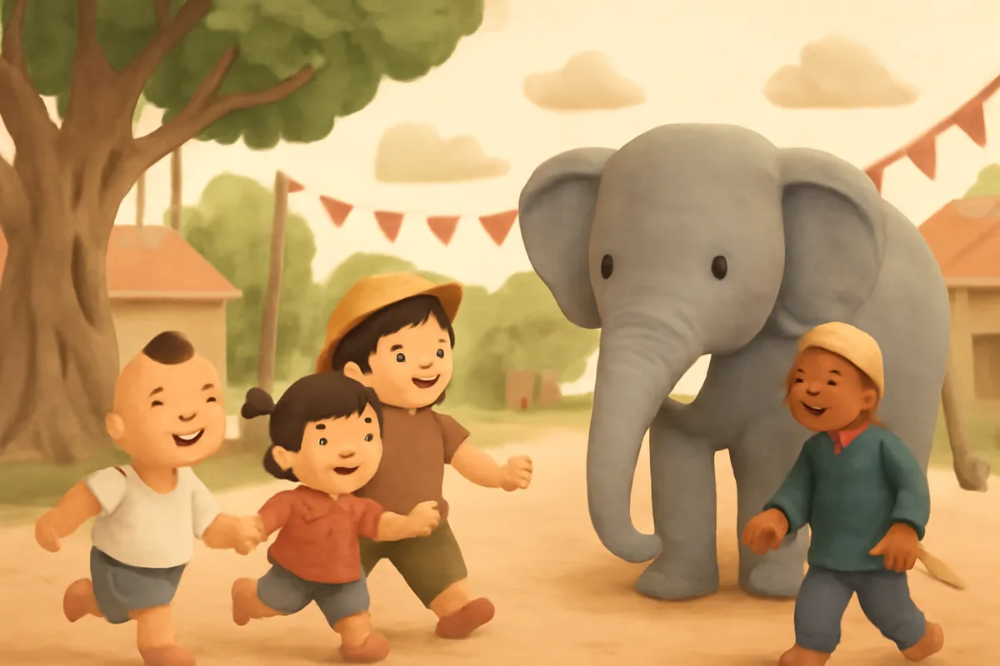
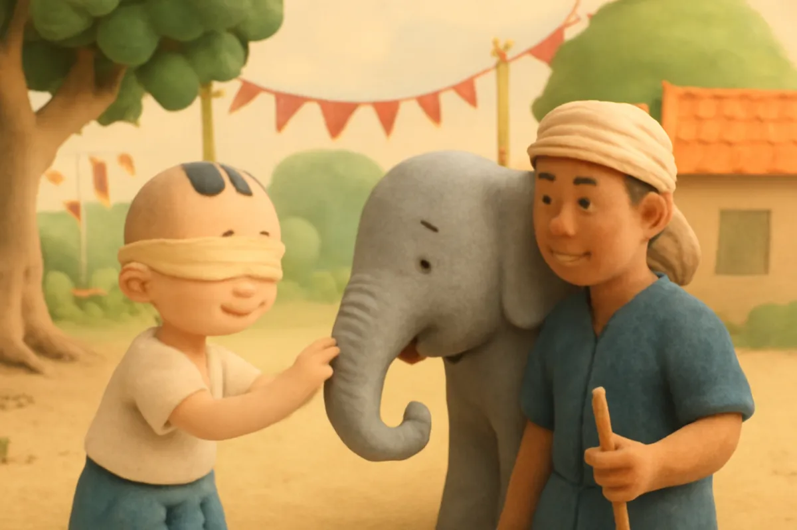
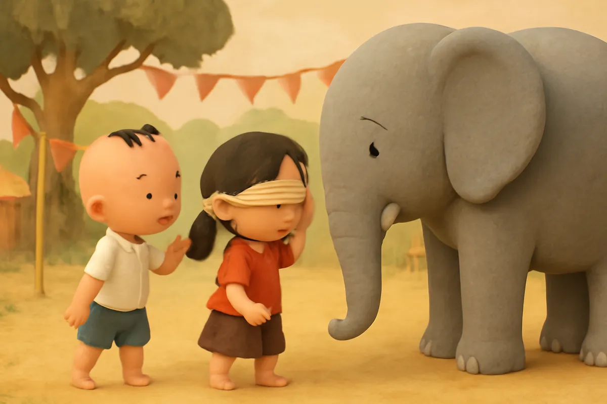
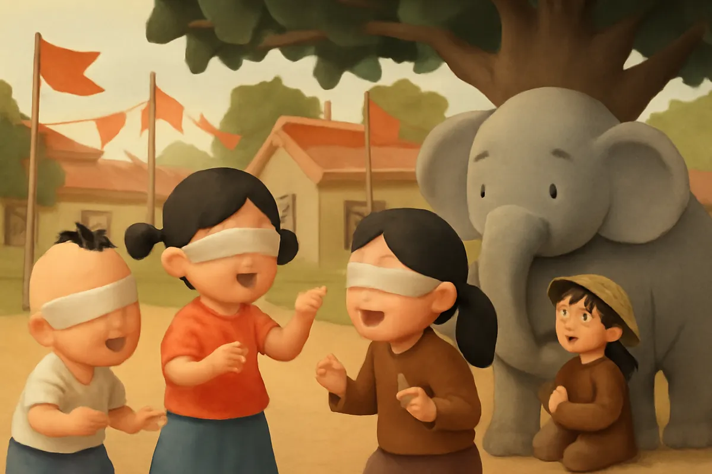
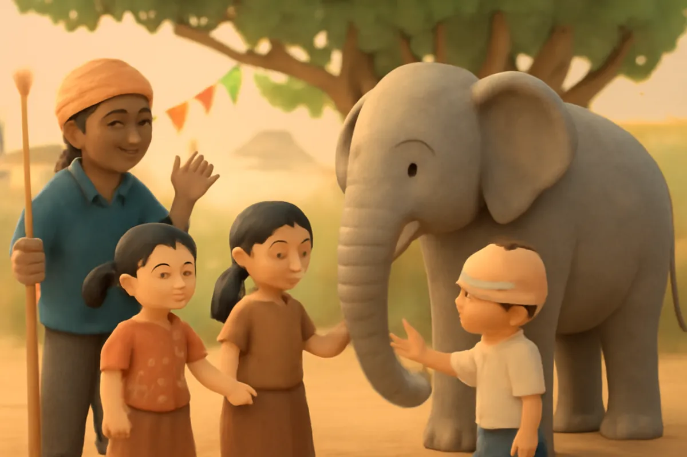
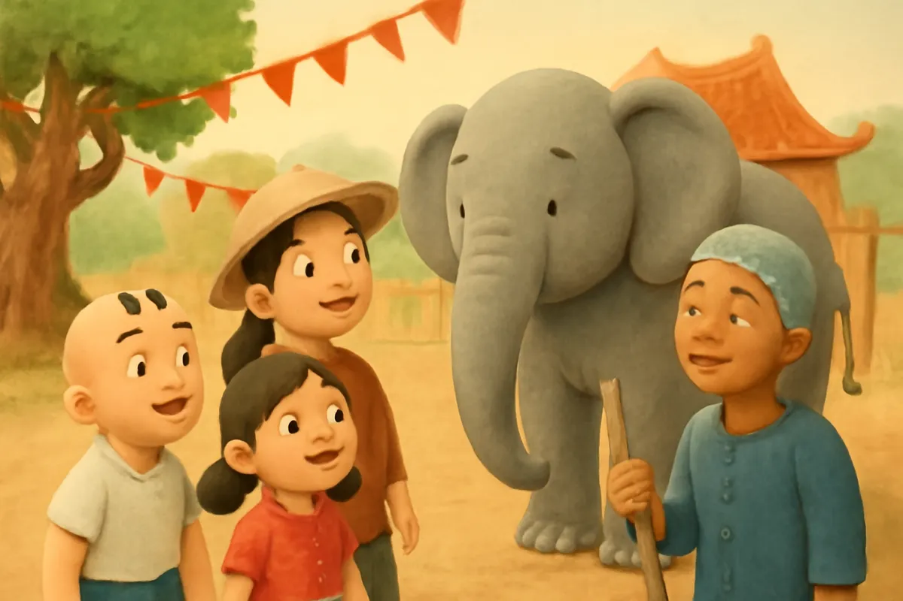
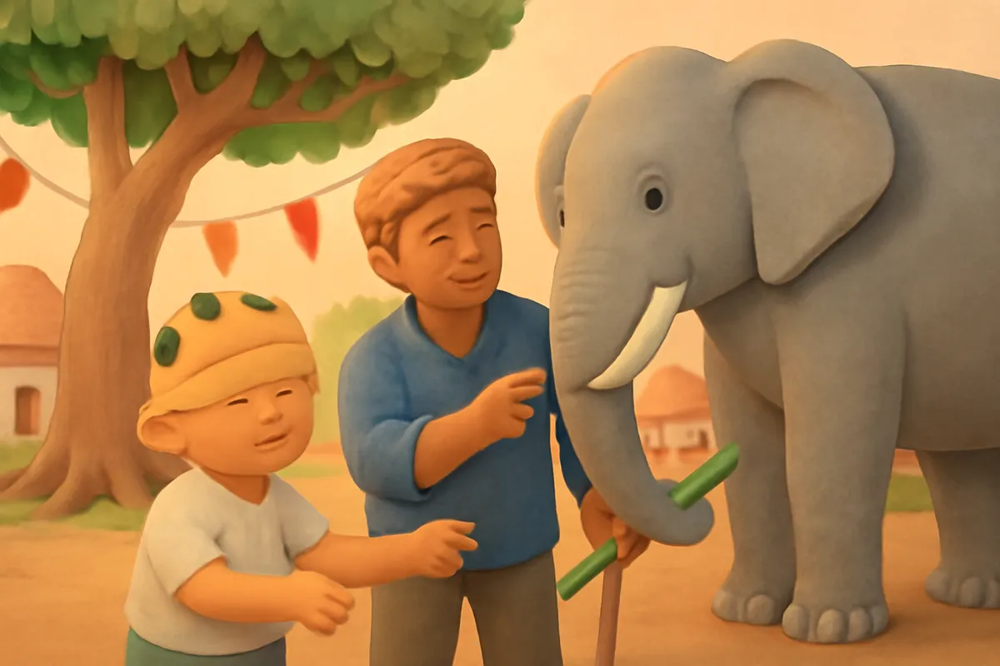
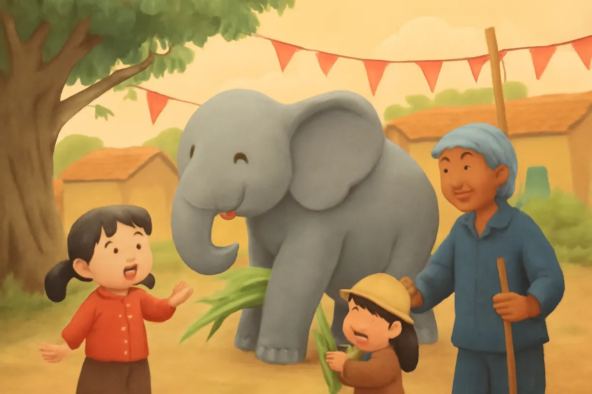

# Bịt mắt xem voi

| | |
| --- | --- |
| Mã truyện | `d40ef100-f118-4310-b96a-697daacdf95f` |
| Nhóm | Truyện thư viện |
| Nguồn | manual |
| Tạo lúc | 2026-10-15T14:34:09.814347+00:00 |
| Cập nhật | 2026-10-16T04:20:55.860668+00:00 |
| Số trang | 8 |
| Ngôn ngữ | vi |
| Tuổi | 3–6 |
| Giọng kể | Viên - Narrative, Warm and Clear (northern) |
| Trạng thái | published |
| Đã xoá | không |

**Giới thiệu:** Ngày hội làng, ba bạn nhỏ chơi trò bịt mắt sờ voi. Mỗi bạn sờ một chỗ rồi cãi nhau voi giống cái gì, đến khi đổi chỗ và mở mắt mới thấy cả con voi.

**Bài học:** Mỗi người chỉ thấy một phần; muốn biết đúng phải nhìn cho hết và lắng nghe nhau.

## Nhân vật

- **Tí** — Cậu bé hiếu động, tò mò (giọng: Bin — bé trai lém lỉnh)
- **Na** — Cô bé nhanh nhảu, thích hỏi (giọng: Yuna — bé gái tinh nghịch)
- **Chị Mơ** — Chị gái lớn của Tí, học lớp năm, thật thà nhưng hay vội kết luận (giọng: Kim — chị gái dịu dàng)
- **Bác Quản Tượng** — Người quản tượng hiền lành, hiểu tính voi (giọng: Quang — chú trầm ấm)

## Trang 1

Hôm ấy làng mở hội. Trống chèo rộn ràng, cờ hoa bay phấp phới. Bác Quản Tượng dắt một chú voi to lớn đi vào sân đình. Chú voi tên là Xám.

Ba chị em Tí, Na và chị Mơ chạy ùa tới, mắt tròn xoe.

**Chị Mơ:** Ôi, to quá! Cháu chưa thấy con voi thật bao giờ!

**Bác Quản Tượng:** Hôm nay bác cho các cháu chơi một trò thật vui nhé!

🔊 [Nghe trang 1](../../../media/tts-cache/5d4b196f-5cc1-4b3a-867e-2452f53ccaac-6bcc20fe-ff14-40e4-adf4-b49e72217053.mp3)

## Trang 2

Bác Quản Tượng lấy ba chiếc khăn, bịt mắt cho từng bạn.

**Bác Quản Tượng:** Mỗi cháu sờ thử một chỗ trên người chú Xám, rồi đoán xem con voi trông giống cái gì.

Tí đưa tay ra trước, chạm phải cái vòi dài đang ngọ nguậy.

**Tí:** Ồ, mềm mềm, cong cong, sun sun như con đỉa! Con voi giống con đỉa khổng lồ!

Chú Xám khẽ cuộn vòi, làm Tí nhột cười khanh khách.

🔊 [Nghe trang 2](../../../media/tts-cache/fd821e70-3d90-4103-9e1d-e4b4a031161e-9d13a8b7-c002-490d-9427-fa0dc037623c.mp3)

## Trang 3

Đến lượt Na. Na kiễng chân, sờ trúng cái tai to của chú Xám. Đúng lúc ấy, chú Xám phe phẩy tai, gió thổi mát rượi.

**Na:** Không phải đâu Tí ơi! Con voi bè bè như cái quạt thóc. Còn quạt cho Na mát nữa này!

**Tí:** Rõ ràng nó giống con đỉa mà!

Hai bạn vẫn bịt mắt, cứ thế cãi nhau chí choé.

🔊 [Nghe trang 3](../../../media/tts-cache/f046f500-4413-46de-8dba-d22d141a5c46-3d61e167-20fb-485a-9a5a-7c37c8467bc0.mp3)

## Trang 4

Chị Mơ đi vòng ra phía dưới, ôm trọn một chân của chú Xám. Chị Mơ vỗ vỗ, thấy vừa to, vừa chắc, vừa nhám.

**Chị Mơ:** Hai em sai hết rồi! Con voi sừng sững như cái cột đình!

**Na:** Quạt thóc chứ!

**Tí:** Con đỉa chứ!

Ba bạn nói to dần, to dần. Ai cũng chắc mình đúng, chẳng ai chịu nghe ai. Chú Xám ngơ ngác nhìn ba bạn nhỏ.

🔊 [Nghe trang 4](../../../media/tts-cache/de0ea292-772c-4df2-8c4b-c4b9d497924e-17c0406a-ca84-423f-a5ed-01cc279c2a55.mp3)

## Trang 5

Bác Quản Tượng mỉm cười, giơ tay ra hiệu cho ba bạn im lặng.

**Bác Quản Tượng:** Các cháu ơi, ai cũng nói thật, nhưng mỗi cháu mới chỉ sờ được một chỗ thôi. Bây giờ, các cháu thử đổi chỗ cho nhau xem nào.

Tí sang sờ tai, Na sờ chân, còn chị Mơ sờ vòi.

**Na:** Ơ, chỗ này đúng là giống cột đình thật!

**Chị Mơ:** Còn chỗ này mềm và dài như Tí nói!

🔊 [Nghe trang 5](../../../media/tts-cache/157350ea-e4ff-49fb-846b-e2a30e9ccea5-9822eb53-f778-4493-8873-af0bc8cd0086.mp3)

## Trang 6

Bác Quản Tượng cởi khăn cho ba bạn. Cả ba mở mắt ra, nhìn thấy chú Xám đứng sừng sững trước mặt, to như một ngọn đồi nhỏ.

**Tí:** À, hoá ra cái vòi, cái tai, cái chân đều là của chú Xám!

**Na:** Thì ra ba đứa mình đều đúng một phần.

**Chị Mơ:** Ghép lại với nhau mới thành con voi thật!

🔊 [Nghe trang 6](../../../media/tts-cache/854c3783-8612-4978-af0f-e2b45d332c67-b258fc34-6e01-4305-8373-b35a129d8fc1.mp3)

## Trang 7

Bác Quản Tượng dẫn ba bạn đi một vòng quanh chú Xám.

**Bác Quản Tượng:** Đây là đôi ngà, cứng và nhẵn, chần chẫn như cái đòn càn. Còn đây là cái đuôi, tun tủn như cái chổi sể.

Chú Xám ve vẩy đuôi, rồi dùng vòi nhặt một khúc mía, đưa lên miệng nhai rau ráu.

**Tí:** Vòi của voi vừa để ngửi, vừa để cầm đồ ăn nữa kìa!

🔊 [Nghe trang 7](../../../media/tts-cache/a0d6ba90-eaae-4d4a-ac3f-2f4eb1f0ef88-2dd12435-f30c-4fce-9fe3-4e9492ffcbc0.mp3)

## Trang 8

Ba bạn thay nhau đưa mía cho chú Xám ăn. Chú Xám vẫy tai cảm ơn.

**Bác Quản Tượng:** Mỗi người chỉ thấy được một phần. Muốn biết cho đúng, phải nhìn cho hết và lắng nghe nhau.

**Na:** Lần sau chúng cháu sẽ không cãi nhau nữa, mà cùng nhau tìm hiểu ạ.

**Chị Mơ:** Ngày mai cháu sẽ kể cho cả lớp nghe về chú Xám!

🔊 [Nghe trang 8](../../../media/tts-cache/cb825232-67a0-4598-9051-0a7e0a5a5d3f-1c4e1f56-67d3-425a-b1d7-94b1a7c07514.mp3)

---

Bản đầy đủ (mọi cột trong cơ sở dữ liệu): [story.json](story.json)
