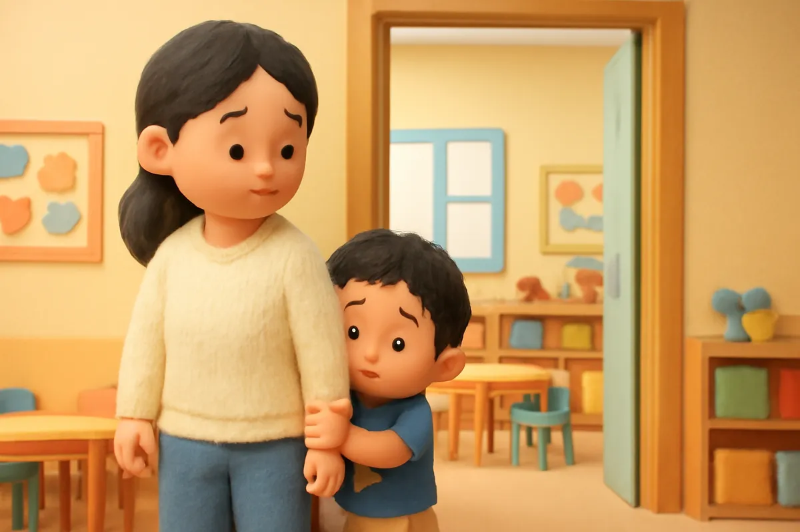
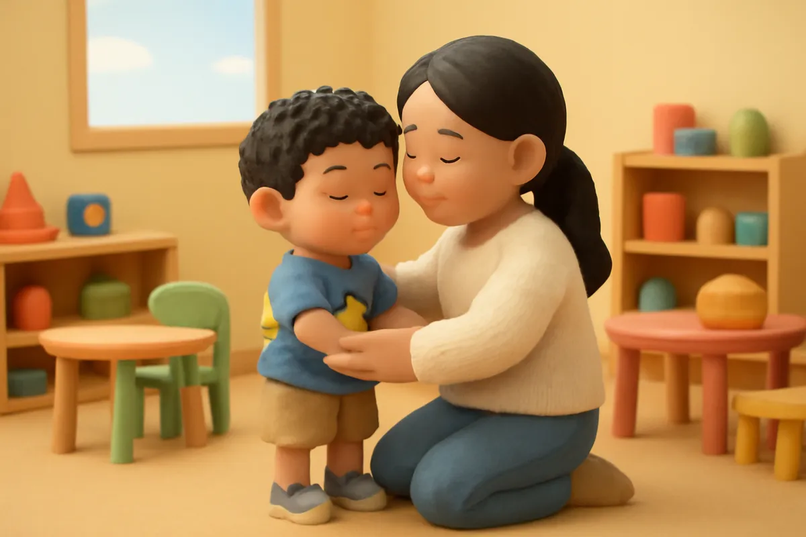
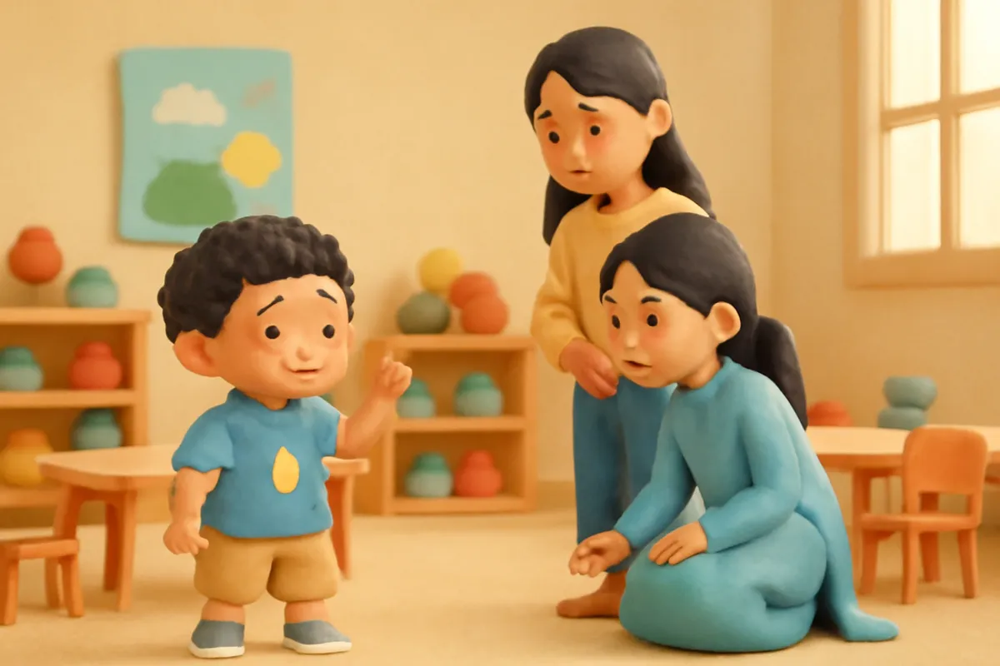
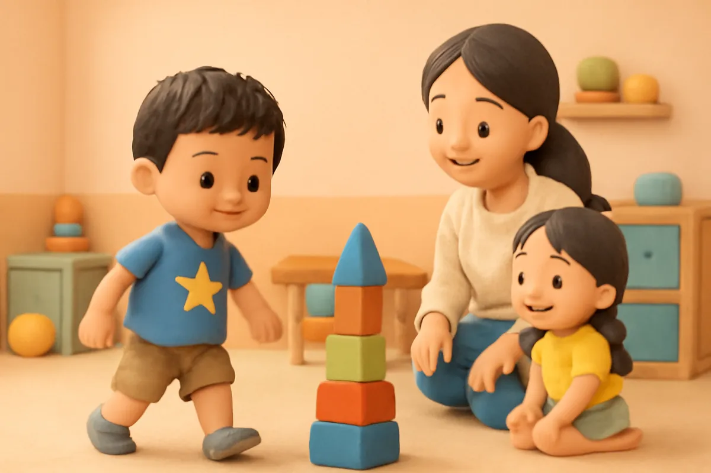
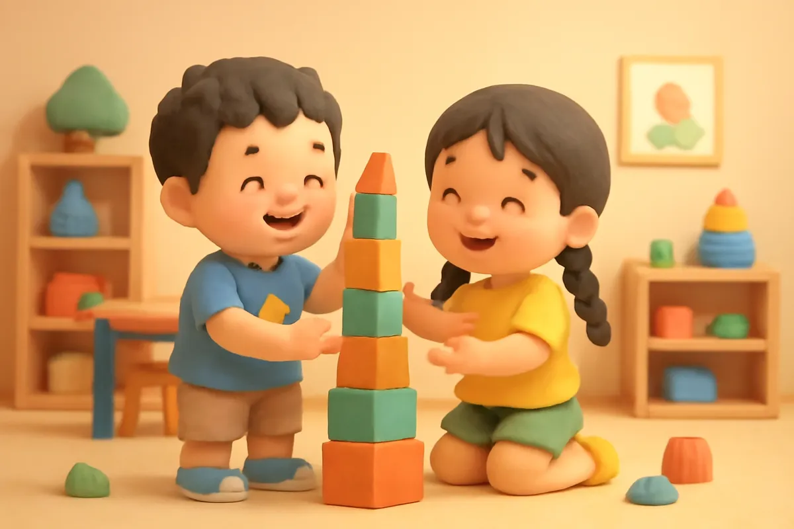
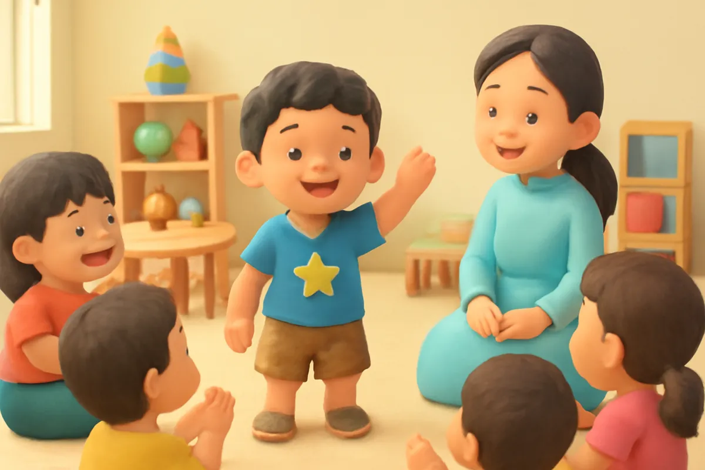
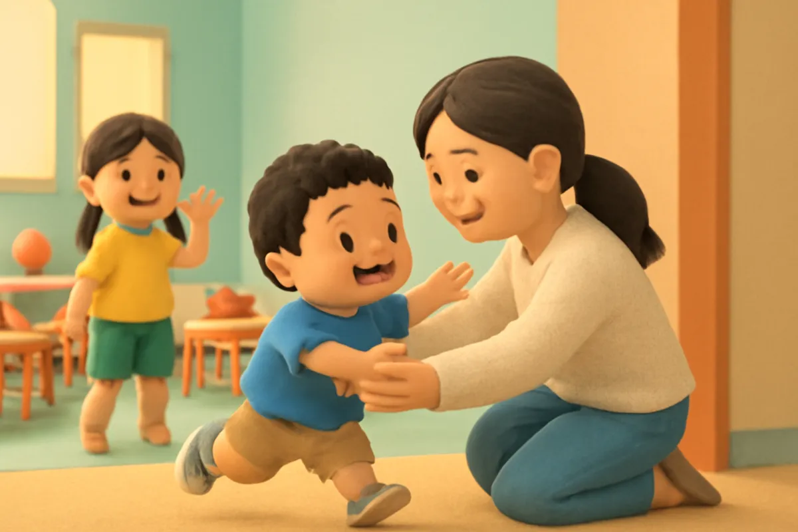
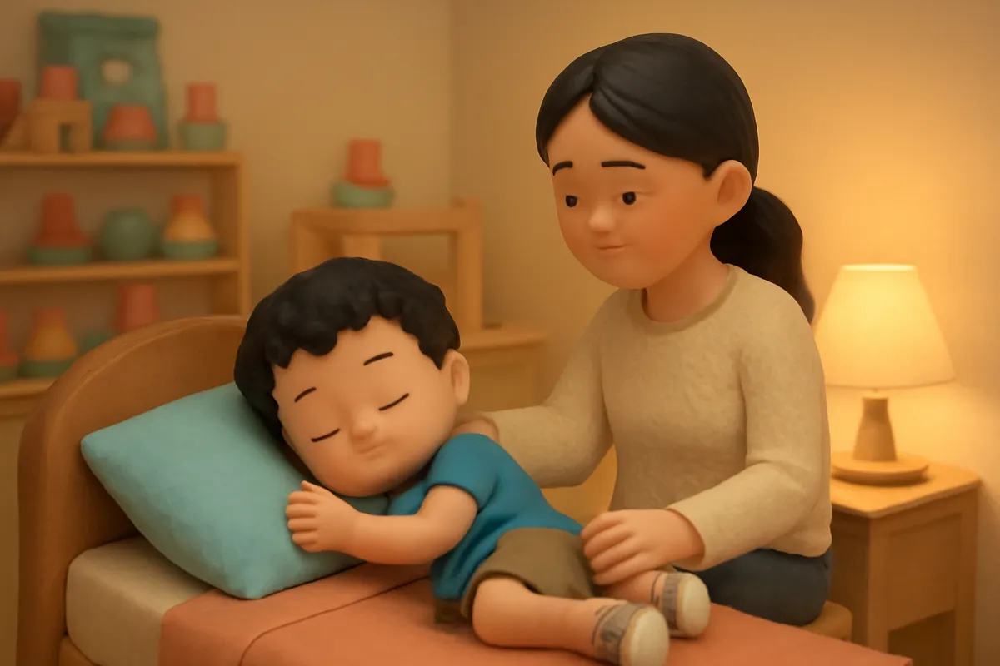

# Bo mạnh dạn từng bước nhỏ

| | |
| --- | --- |
| Mã truyện | `ae97a8bf-f2cd-4812-a2a3-a41a75287121` |
| Nhóm | Truyện thư viện |
| Nguồn | manual |
| Tạo lúc | 2026-10-15T14:34:10.193821+00:00 |
| Cập nhật | 2026-10-16T13:44:05.732716+00:00 |
| Số trang | 8 |
| Ngôn ngữ | vi |
| Tuổi | 3–6 |
| Giọng kể | Viên - Narrative, Warm and Clear (northern) |
| Trạng thái | published |
| Đã xoá | không |

**Giới thiệu:** Ngày đầu đến lớp mới, Bo sợ hãi nấp sau lưng mẹ. Mẹ dạy Bo hít thở và thử từng bước nhỏ: vẫy tay chào cô, rủ bạn chơi, rồi giơ tay kể chuyện trước cả lớp.

**Bài học:** Dũng cảm là vẫn thấy sợ nhưng vẫn thử, từng bước nhỏ một.

## Nhân vật

- **Bo** — Cậu bé 5 tuổi hiếu động, tốt bụng, đang tập thói quen tốt (giọng: Bin — bé trai lém lỉnh)
- **Mẹ** — Mẹ của Bo và Su, dịu dàng, kiên nhẫn (giọng: Tâm — cô kể chuyện cổ tích)
- **Cô Hoa** — Cô giáo mầm non dịu dàng (giọng: Kim — chị gái dịu dàng)
- **Mai** — Bạn cùng lớp của Bo, nhanh nhẹn (giọng: Yuna — bé gái tinh nghịch)

## Trang 1

Hôm nay là ngày đầu tiên Bo đến lớp mới. Lớp học rộng, đồ chơi nhiều, các bạn cười nói rộn ràng. Nhưng Bo chẳng quen ai cả. Bo nấp sau lưng mẹ, tay nắm chặt vạt áo mẹ.

**Bo:** Mẹ ơi, con sợ lắm. Con muốn về nhà.

Tim Bo đập thình thịch, thình thịch.

🔊 [Nghe trang 1](../../../media/tts-cache/6c049246-fc93-47e1-9675-3696f6d6b8aa-bb015f25-b450-4530-a8f3-9723d2059b33.mp3)

## Trang 2

Mẹ ngồi xuống, ôm Bo vào lòng.

**Mẹ:** Sợ cũng không sao đâu con. Ai đến chỗ mới cũng thấy hồi hộp. Mình thử từng bước nhỏ nhé. Trước tiên, con hít vào như ngửi hoa, thở ra như thổi nến.

Bo hít vào thật sâu, thở ra thật chậm. Một lần, hai lần, ba lần.

**Bo:** Con thấy đỡ run hơn rồi ạ.

🔊 [Nghe trang 2](../../../media/tts-cache/8267affa-90be-422b-b879-f05972346acc-99a5ec83-2f1c-4dbf-83d2-70a2eb512f33.mp3)

## Trang 3

**Mẹ:** Bước nhỏ thứ nhất: con vẫy tay chào cô giáo nhé.

Bo ngập ngừng một chút, rồi giơ bàn tay nhỏ lên vẫy vẫy.

**Cô Hoa:** Chào Bo! Cô rất vui được gặp con. Lớp mình có góc xếp hình đấy, con có thích xếp hình không?

Bo gật đầu thật khẽ. Mẹ hôn lên má Bo, hẹn chiều sẽ đến đón.

🔊 [Nghe trang 3](../../../media/tts-cache/1c9e391c-6551-4604-b064-8e2f11515284-c552ae8a-64dc-4fdd-a456-9567a2bd9b81.mp3)

## Trang 4

Ở góc xếp hình, một bạn gái tết tóc hai bím đang xây tháp. Bo muốn chơi cùng lắm, nhưng lại ngại. Bo nhớ lời mẹ dặn: bước nhỏ thứ hai, nói một câu với bạn.

Bo hít vào, thở ra, rồi bước tới.

**Bo:** Chào bạn, tớ là Bo. Tớ chơi cùng được không?

**Mai:** Được chứ! Tớ là Mai. Cậu đưa tớ khối màu đỏ nhé!

🔊 [Nghe trang 4](../../../media/tts-cache/9f69529a-bd4d-4fb8-ae67-481002c31952-54acdbe6-cc73-4c4f-801b-58cc7f13d64d.mp3)

## Trang 5

Hai bạn cùng xây một toà tháp thật cao, có cửa sổ, có cả cột cờ. Tháp cao đến ngang vai Bo.

**Mai:** Tháp của chúng mình cao nhất lớp luôn! Cậu xếp khéo tay thật đấy!

**Bo:** Mình xây thêm một cây cầu nữa đi!

Bo cười tươi, vỗ tay reo lên. Bo quên mất là lúc sáng mình còn sợ đến run cả tay.

🔊 [Nghe trang 5](../../../media/tts-cache/cc8e3760-7297-42b4-a654-83a7b0ab23a9-6c06934e-905d-45cb-97af-666df7ce2347.mp3)

## Trang 6

Đến giờ trò chuyện, cô Hoa hỏi cả lớp.

**Cô Hoa:** Bạn nào kể cho cả lớp nghe về con vật mình thích nào?

Tim Bo lại đập thình thịch. Bước nhỏ thứ ba đây rồi. Bo hít thật sâu, rồi giơ tay lên.

**Bo:** Con thích con rùa, vì rùa đi chậm mà chắc ạ!

Cả lớp vỗ tay rào rào.

🔊 [Nghe trang 6](../../../media/tts-cache/610e9899-30ba-4b31-bd6f-d47f60a0ebe8-fff6db2f-93ba-478d-8499-1ef4354c2e21.mp3)

## Trang 7

Chiều, mẹ đến đón. Vừa thấy mẹ ở cổng, Bo chạy ùa ra, ôm chầm lấy mẹ.

**Bo:** Mẹ ơi, con có bạn mới tên là Mai! Con còn giơ tay kể chuyện con rùa nữa! Cả lớp vỗ tay cho con đấy!

**Mẹ:** Con dũng cảm lắm. Dũng cảm là vẫn thấy sợ, nhưng con vẫn thử.

**Mai:** Ngày mai cậu lại chơi xếp hình với tớ nhé, Bo!

🔊 [Nghe trang 7](../../../media/tts-cache/a5b142b3-296e-4cfe-98d0-caf627e0d81b-bf510aa3-3b4d-4a15-bbdc-55dafa294a2e.mp3)

## Trang 8

Tối đi ngủ, Bo ôm gối, nghĩ về một ngày thật vui.

**Bo:** Mẹ ơi, mai con sẽ thử chơi cầu trượt cao nữa. Từng bước nhỏ một thôi ạ.

**Mẹ:** Ừ, từng bước nhỏ một. Mẹ luôn ở bên con.

Bé ơi, khi thấy sợ, bé sẽ thử bước nhỏ nào trước nhỉ? Mình cùng hít vào như ngửi hoa, thở ra như thổi nến nhé.

🔊 [Nghe trang 8](../../../media/tts-cache/9181ad47-2066-4819-8419-89332a0e8797-bd7b9783-64de-4bb5-b8da-9331bc8637d7.mp3)

---

Bản đầy đủ (mọi cột trong cơ sở dữ liệu): [story.json](story.json)
