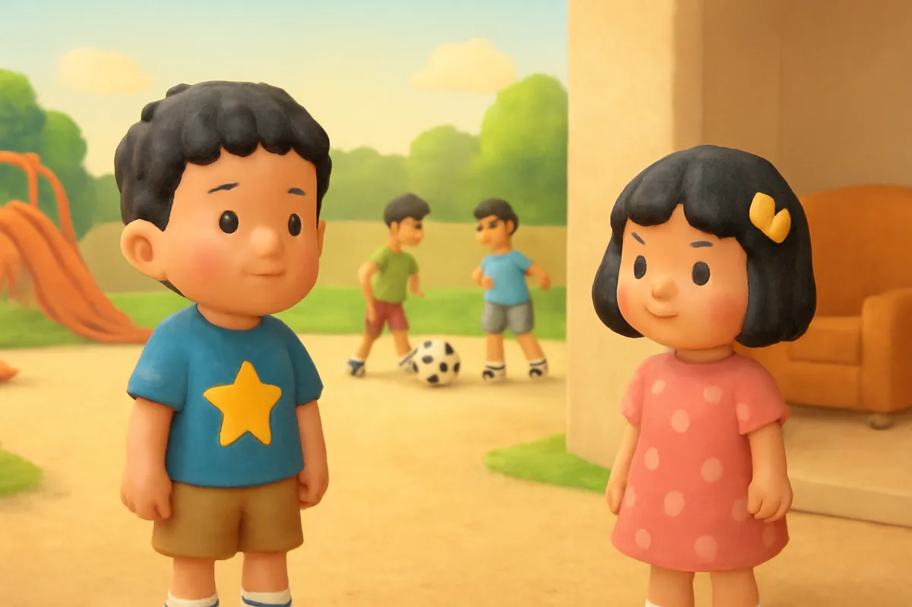
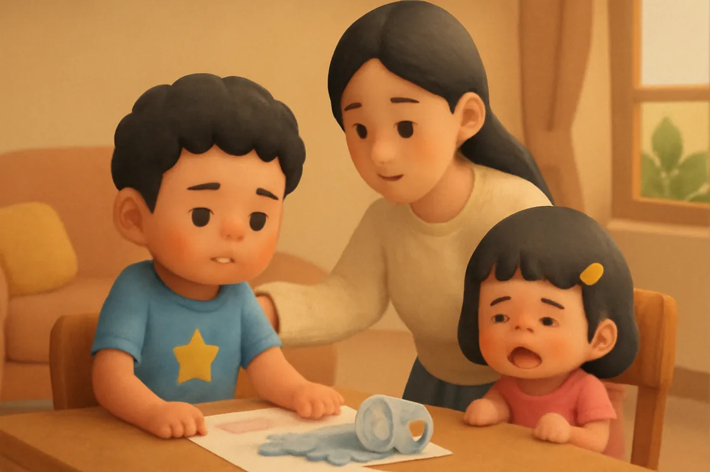
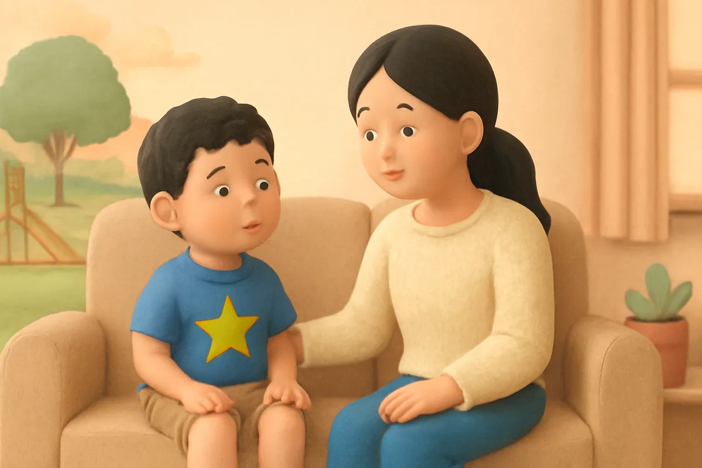
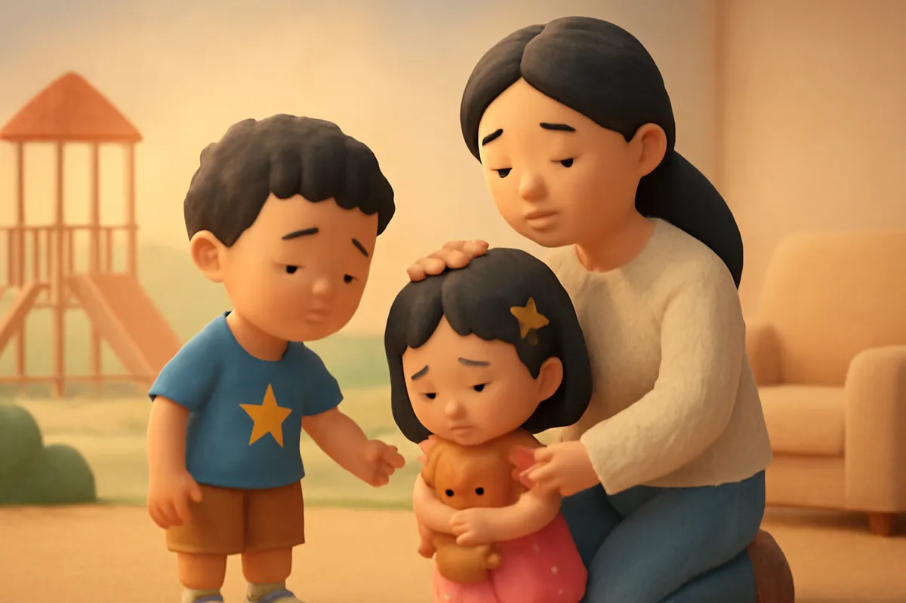
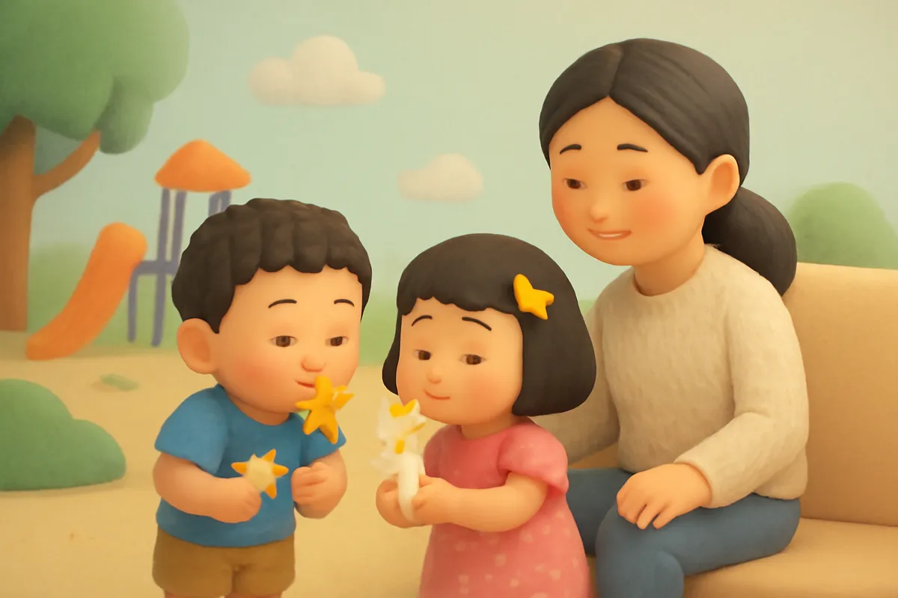
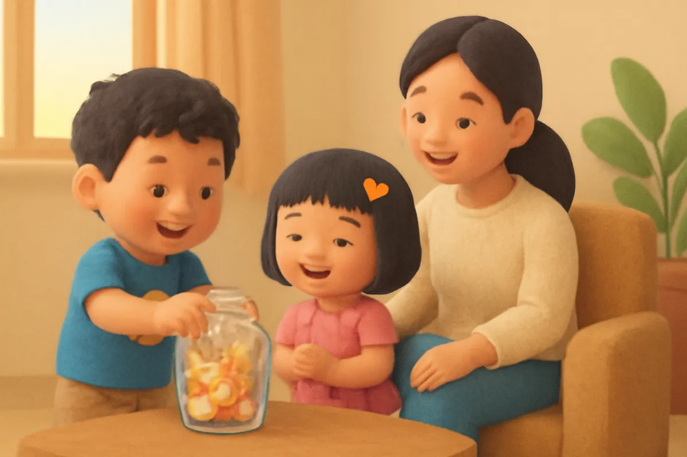
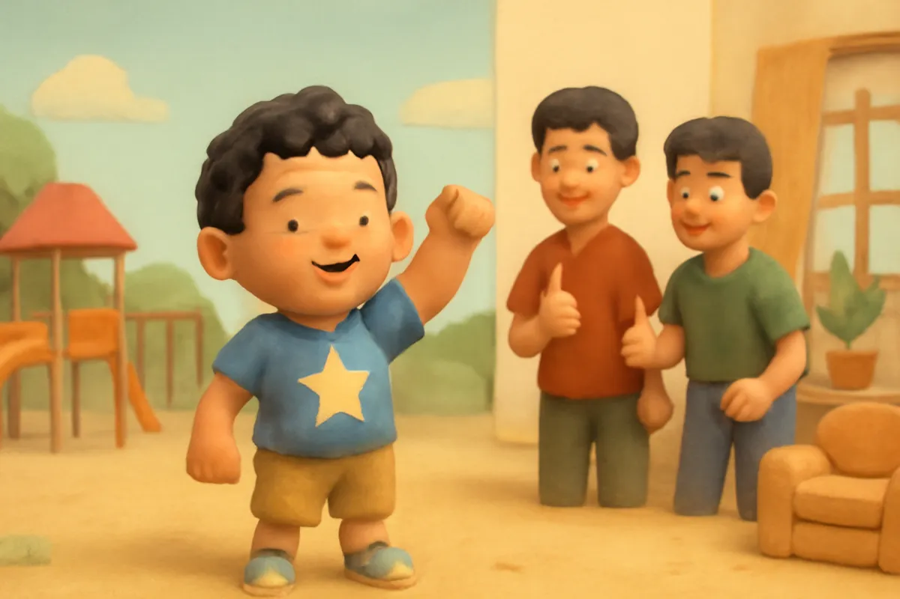
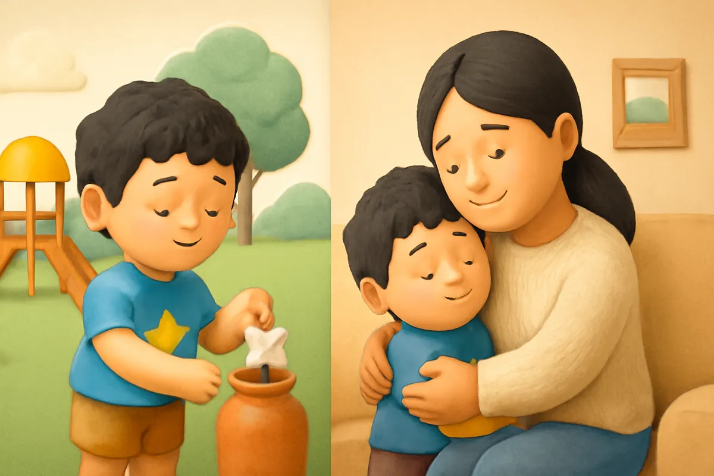

# Bo và những lời nói đẹp

| | |
| --- | --- |
| Mã truyện | `a22402fc-74bc-48ae-aef6-1d64d1270ae9` |
| Nhóm | Truyện thư viện |
| Nguồn | manual |
| Tạo lúc | 2026-10-15T14:34:10.193821+00:00 |
| Cập nhật | 2026-10-16T04:31:19.948544+00:00 |
| Số trang | 8 |
| Ngôn ngữ | vi |
| Tuổi | 3–6 |
| Giọng kể | Viên - Narrative, Warm and Clear (northern) |
| Trạng thái | published |
| Đã xoá | không |

**Giới thiệu:** Bo nghe một từ không đẹp ở sân chơi rồi nói ra lúc bực, làm em Su buồn. Mẹ bình tĩnh giải thích và dạy Bo câu nói thay thế, cả nhà làm lọ sao lời nói đẹp.

**Bài học:** Lời nói đẹp làm mọi người vui; khi bực, hãy nói 'Con đang giận' và hít thở thật sâu.

## Nhân vật

- **Bo** — Cậu bé 5 tuổi hiếu động, tốt bụng, đang tập thói quen tốt (giọng: Bin — bé trai lém lỉnh)
- **Mẹ** — Mẹ của Bo và Su, dịu dàng, kiên nhẫn (giọng: Tâm — cô kể chuyện cổ tích)
- **Su** — Em gái 4 tuổi của Bo, hay hỏi, thích vẽ (giọng: Yuna — bé gái tinh nghịch)

## Trang 1

Chiều thứ bảy, Bo ra sân chơi gần nhà. Mấy anh lớn đang đá bóng ở góc sân. Khi bóng lăn ra ngoài, một anh bực mình hét lên một từ rất lạ.

Bo nghe thấy, khúc khích cười.

**Bo:** Từ gì mà nghe buồn cười thế nhỉ? Mình nhớ để về nói cho Su nghe.

Bo đâu biết, đó là một từ không đẹp chút nào.

🔊 [Nghe trang 1](../../../media/tts-cache/85a629ab-24e2-429b-938b-30b93a79bc87-c08eb246-b7ca-400b-8f06-d29fc7d1d80f.mp3)

## Trang 2

Tối hôm ấy, cả nhà ngồi ăn cơm. Su vô ý làm đổ cốc nước lên bức tranh Bo vừa vẽ. Bo tức quá, buột miệng nói ngay cái từ nghe được ở sân.

Cả nhà bỗng im lặng. Su mếu máo.

**Su:** Anh Bo nói từ gì thế? Nghe sợ lắm.

**Mẹ:** Bo ơi, ăn xong mẹ con mình nói chuyện một chút nhé.

🔊 [Nghe trang 2](../../../media/tts-cache/371b03a5-1eea-4ec3-855b-bdbeee9ed0dc-ffc33064-70fc-4a35-b286-a3a6cbe3544a.mp3)

## Trang 3

Ăn cơm xong, mẹ ngồi xuống cạnh Bo. Mẹ không mắng, mẹ chỉ nhẹ nhàng hỏi.

**Mẹ:** Con nghe từ ấy ở đâu? Con có biết nó nghĩa là gì không?

**Bo:** Con nghe các anh ở sân nói. Con không biết, con thấy buồn cười thôi ạ.

**Mẹ:** Đó là một từ không đẹp. Nói ra, người nghe sẽ buồn, giống như bị gai đâm vào lòng vậy.

🔊 [Nghe trang 3](../../../media/tts-cache/d617f427-a33a-4959-b90d-acbceea8781c-9fb0d4de-1b28-4347-bd40-1e53237b5b62.mp3)

## Trang 4

Bo nhìn sang Su. Em đang ôm gấu bông, mắt vẫn còn đỏ hoe.

**Bo:** Su ơi, anh xin lỗi. Anh không muốn làm em buồn đâu.

**Su:** Em hết buồn rồi. Nhưng anh đừng nói từ ấy nữa nhé.

**Bo:** Anh hứa. Mẹ ơi, nhưng lúc bực quá, con biết nói gì bây giờ?

Mẹ mỉm cười, xoa đầu hai anh em.

🔊 [Nghe trang 4](../../../media/tts-cache/6204758e-7a36-4393-a1b9-df81bbd69d86-b0501db4-8c62-4d25-8048-5ae2f0528fb8.mp3)

## Trang 5

**Mẹ:** Lúc bực, con có thể nói: Ôi, con bực quá! Hoặc: Con đang giận đấy! Rồi con hít một hơi thật sâu, thở ra thật chậm.

Bo thử ngay. Bo hít vào như đang ngửi một bông hoa, rồi thở ra như đang thổi một ngọn nến.

**Bo:** Ôi, con bực quá! Phù... Ơ, con thấy đỡ hơn thật!

**Su:** Em cũng thử! Ngửi hoa... thổi nến... phù!

🔊 [Nghe trang 5](../../../media/tts-cache/181d5ba2-e7fb-4a84-9073-2fb305506a8c-94394004-e4a2-4dd6-b6fb-2a72be5896e7.mp3)

## Trang 6

Mẹ đưa cho hai anh em một chiếc lọ thủy tinh và mấy ngôi sao giấy. Mỗi khi ai nói một lời đẹp, người ấy được bỏ vào lọ một ngôi sao.

**Su:** Cảm ơn anh Bo đã dán lại tranh cho em! Thế là anh được một ngôi sao!

**Bo:** Su vẽ con mèo đẹp quá! Em cũng được một ngôi sao này!

Chẳng mấy chốc, chiếc lọ đã lấp lánh sao.

🔊 [Nghe trang 6](../../../media/tts-cache/168184f7-790b-423e-a8c6-bd9c7f4fab73-873acd37-dc63-44a8-bfa7-a2c77cbcdd33.mp3)

## Trang 7

Hôm sau ra sân, Bo đang chạy thì vấp ngã, đầu gối trầy một chút. Bo nhăn mặt, suýt nữa thì nói ra cái từ không đẹp. Nhưng Bo dừng lại, hít một hơi thật sâu.

**Bo:** Ối, đau quá! Bực quá đi mất!

Rồi Bo phủi tay, đứng dậy chơi tiếp. Mấy anh lớn nhìn thấy, giơ ngón tay cái lên khen Bo.

🔊 [Nghe trang 7](../../../media/tts-cache/38cf21f0-8d5f-4109-ab82-45a6e17c9d5d-62163571-2065-4033-8c21-b2e8fca94e94.mp3)

## Trang 8

Tối về, Bo kể cho mẹ nghe. Mẹ ôm Bo thật chặt.

**Mẹ:** Mẹ tự hào về con. Lời nói đẹp làm mọi người vui, và làm con thêm đáng yêu nữa.

**Bo:** Con được bỏ thêm một ngôi sao vào lọ rồi!

Bé ơi, khi đang bực, bé sẽ nói gì thay cho từ không đẹp nhỉ? Bé thử hít vào như ngửi hoa, thở ra như thổi nến xem nào.

🔊 [Nghe trang 8](../../../media/tts-cache/19c36e61-227c-4f52-9c41-6866441ecfd5-68e42672-c6c3-44ff-b68c-9f7dee21a8c2.mp3)

---

Bản đầy đủ (mọi cột trong cơ sở dữ liệu): [story.json](story.json)
