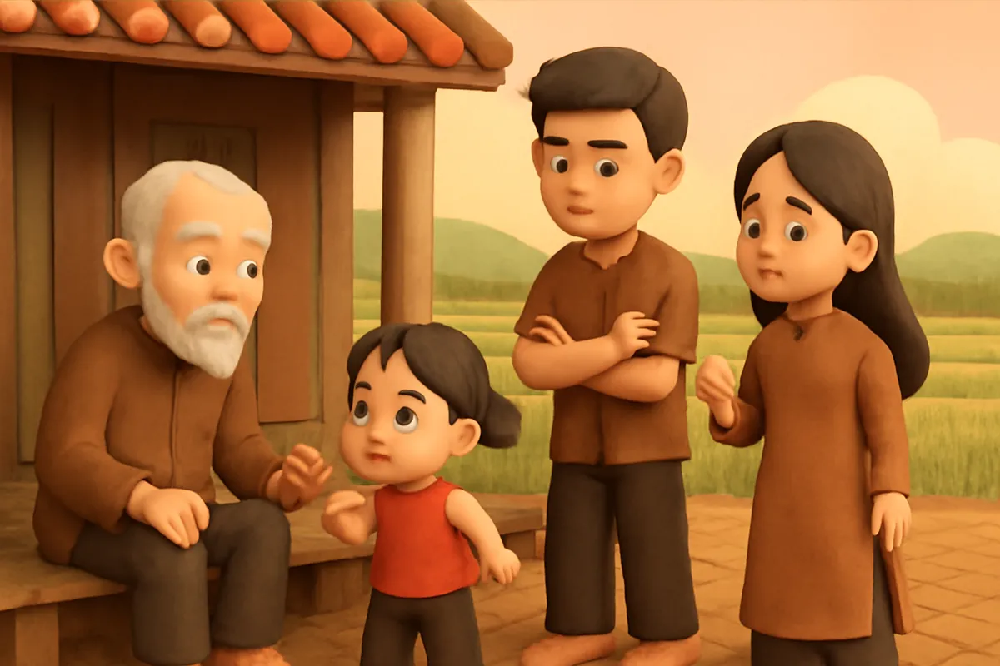
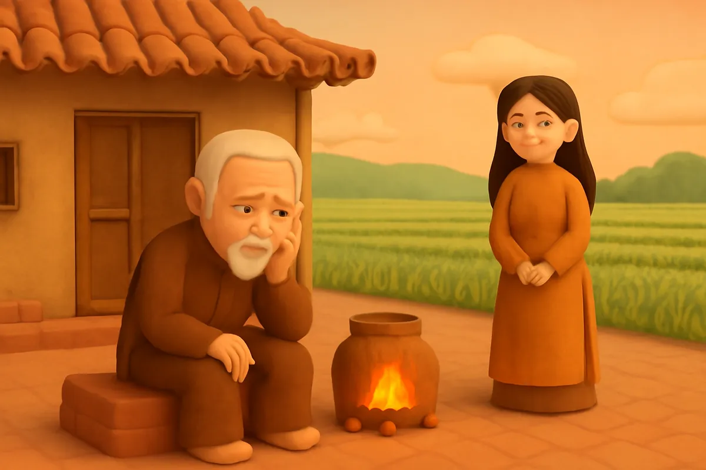
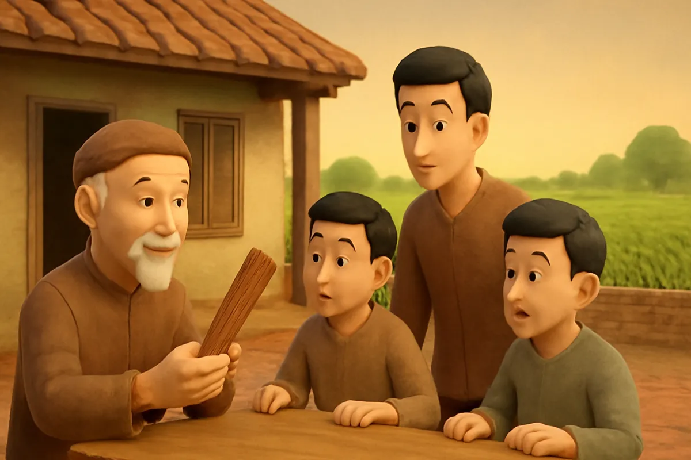
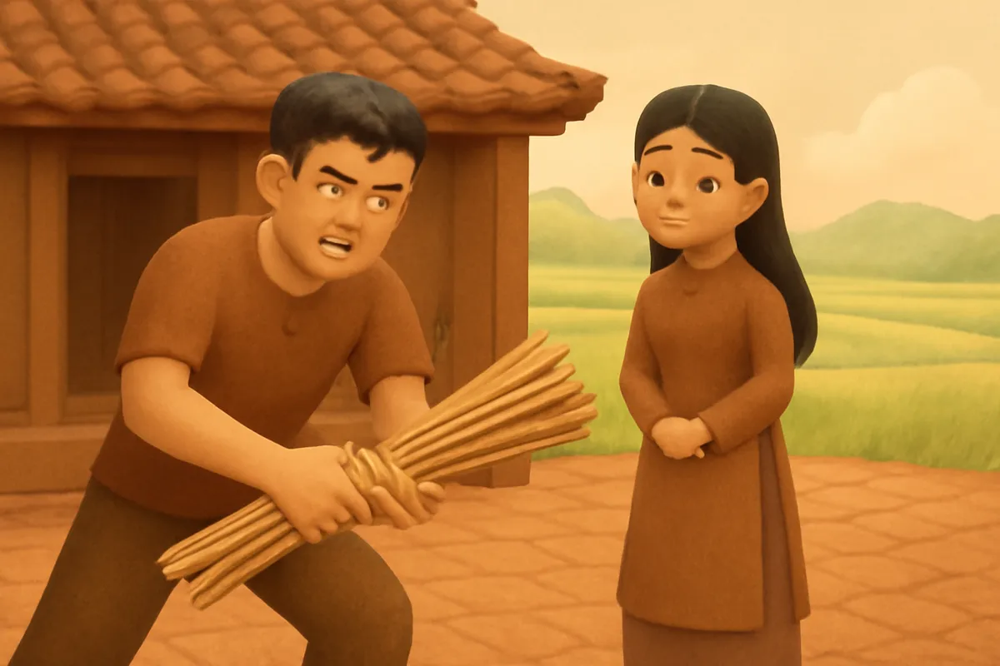
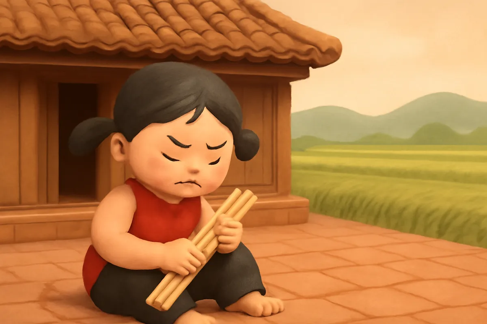
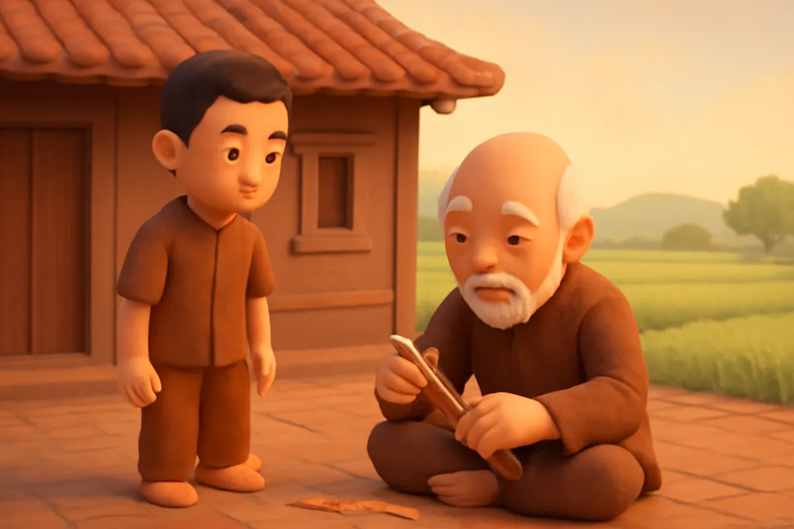
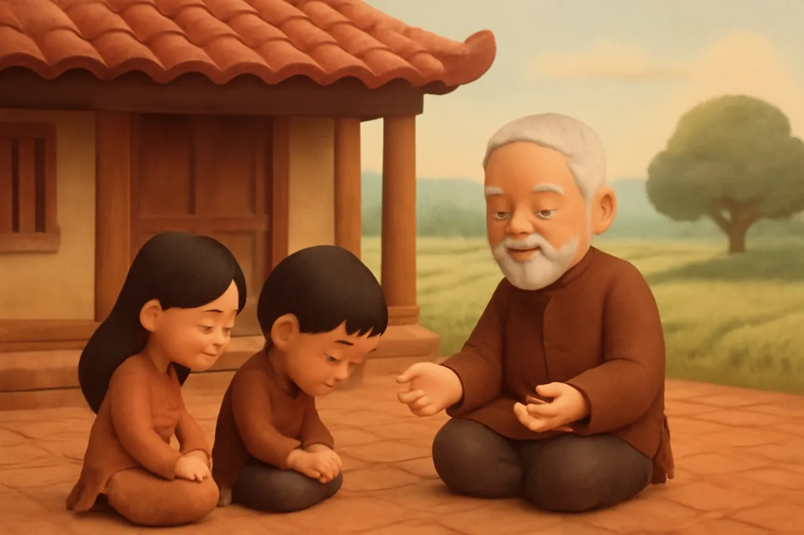
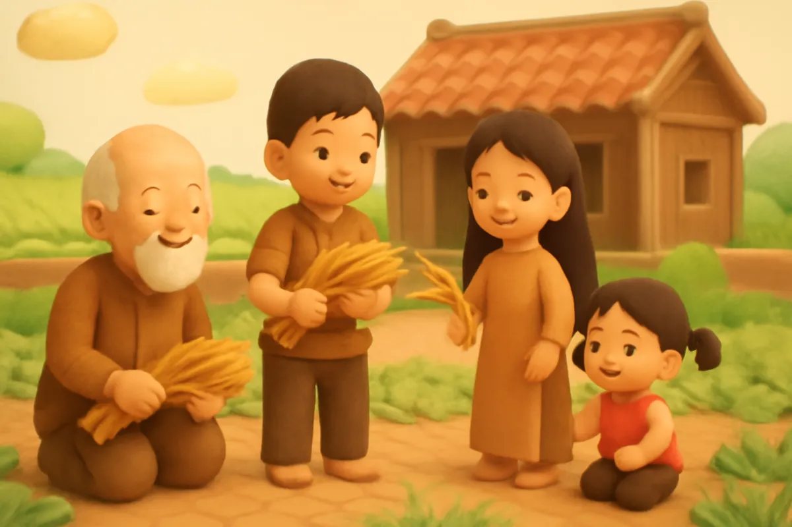

# Câu chuyện bó đũa

| | |
| --- | --- |
| Mã truyện | `c3e3af18-10b0-4f1e-b1d3-632c104a2d13` |
| Nhóm | Truyện thư viện |
| Nguồn | manual |
| Tạo lúc | 2026-10-15T14:34:09.448749+00:00 |
| Cập nhật | 2026-10-16T04:23:11.847527+00:00 |
| Số trang | 8 |
| Ngôn ngữ | vi |
| Tuổi | 4–7 |
| Giọng kể | Viên - Narrative, Warm and Clear (northern) |
| Trạng thái | published |
| Đã xoá | không |

**Giới thiệu:** Ba anh em hay cãi nhau. Người cha đưa ra một bó đũa và một câu đố, giúp các con hiểu vì sao anh em phải thương yêu, đoàn kết.

**Bài học:** Anh chị em đoàn kết, nhường nhịn thì sẽ mạnh mẽ.

## Nhân vật

- **Người Cha** — Người cha già hiền từ, thông thái (giọng: Thanh — ông hiền từ)
- **Anh Cả** — Người anh cả khoẻ mạnh nhưng hay giành phần (giọng: Quang — chú trầm ấm)
- **Chị Hai** — Người chị khéo tay, hay giận dỗi (giọng: Kim — chị gái dịu dàng)
- **Em Út** — Cô em út nhanh nhẹn, hay cãi lại (giọng: Yuna — bé gái tinh nghịch)

## Trang 1

Ở một làng nọ, có một người cha già và ba người con. Anh Cả khoẻ mạnh, chị Hai khéo tay, em Út nhanh nhẹn. Nhưng ba anh em lại hay cãi nhau, chẳng ai chịu nhường ai.

**Anh Cả:** Cái chổi này của anh, em không được lấy!

**Em Út:** Em lấy trước mà! Anh lúc nào cũng giành phần.

🔊 [Nghe trang 1](../../../media/tts-cache/158d3a5e-d910-46d7-8131-e95f5f82f50b-5b242dcc-97da-41d6-b055-e4897c00ef5e.mp3)

## Trang 2

Chị Hai thì giận dỗi, ngồi quay mặt vào góc nhà. Người cha nhìn các con, lòng buồn lắm.

**Người Cha:** Các con cứ cãi nhau mãi thế này, mai sau biết sống sao cho êm ấm?

Tối hôm ấy, ông ngồi bên bếp lửa, suy nghĩ thật lâu. Rồi ông khẽ mỉm cười. Ông đã nghĩ ra một cách.

🔊 [Nghe trang 2](../../../media/tts-cache/d96e6f89-22f0-42d5-8362-beecff6aa712-1b4c3eee-288d-4ab0-85a1-40b56c9a256f.mp3)

## Trang 3

Sáng hôm sau, người cha gọi ba con lại. Ông đặt lên bàn một bó đũa, buộc chặt bằng một sợi lạt.

**Người Cha:** Cha có một câu đố. Đứa nào bẻ gãy được bó đũa này, đứa ấy thắng.

**Anh Cả:** Dễ thôi cha ạ! Để con thử trước!

Hai em đứng bên cạnh, tò mò nhìn anh.

🔊 [Nghe trang 3](../../../media/tts-cache/848154a8-4988-4e03-979f-d36d82b08b49-a5a5c63b-09d7-43f8-a5b4-e9fcc561a147.mp3)

## Trang 4

Anh Cả cầm bó đũa, gồng hết sức bẻ. Mặt anh đỏ bừng, tay run run, mà bó đũa vẫn chẳng hề hấn gì.

**Anh Cả:** Lạ thật, sao bó đũa cứng thế này?

Đến lượt chị Hai. Chị bẻ đi bẻ lại, bẻ xuôi rồi bẻ ngược, bó đũa vẫn nguyên.

**Chị Hai:** Con chịu thôi, cha ạ.

🔊 [Nghe trang 4](../../../media/tts-cache/8dbc7363-9976-45f0-91a2-a101a92f1513-a92a538a-fabc-4e76-9340-0404b4712973.mp3)

## Trang 5

Em Út nghĩ mình nhanh nhẹn, chắc sẽ làm được. Em đặt bó đũa lên đầu gối, ấn mạnh một cái. Bó đũa vẫn cứ thẳng tắp.

**Em Út:** Không ai bẻ được bó đũa này đâu cha ơi!

Ba anh em nhìn nhau ngơ ngác. Không ai nghĩ một bó đũa nhỏ lại cứng đến thế.

🔊 [Nghe trang 5](../../../media/tts-cache/568f0374-768e-4624-a4c7-80121deb44d6-c73cffb1-da74-447e-8712-7afc96c20763.mp3)

## Trang 6

Người cha mỉm cười. Ông cởi sợi lạt, rút từng chiếc đũa ra. Rắc, rắc, rắc! Từng chiếc đũa gãy đôi thật dễ dàng.

**Người Cha:** Các con thấy không? Từng chiếc đũa thì rất dễ gãy.

**Anh Cả:** Nhưng buộc lại thành bó thì không ai bẻ được cha ạ.

Ba anh em nhìn nhau, bỗng hiểu ra lời cha dạy.

🔊 [Nghe trang 6](../../../media/tts-cache/e6f3de07-8a48-46c7-bbbe-557452ceb9f6-137d1eab-4306-4a51-bbb0-9bf17703d847.mp3)

## Trang 7

**Người Cha:** Đúng rồi. Anh em trong nhà cũng như bó đũa này. Nếu chia rẽ, mỗi đứa sẽ yếu đi. Nếu biết thương yêu, đùm bọc nhau, các con sẽ mạnh hơn bất cứ ai.

Ba anh em lặng đi. Các con cúi đầu, thấy mình thật có lỗi.

**Chị Hai:** Con xin lỗi cha. Từ nay chúng con sẽ không cãi nhau nữa.

🔊 [Nghe trang 7](../../../media/tts-cache/0080e8f9-513f-45e6-ae03-d86210bda7ce-7049b50f-f6d4-4151-a225-52b3b06096ae.mp3)

## Trang 8

Từ hôm đó, ba anh em luôn giúp đỡ nhau. Anh Cả gánh nước, chị Hai nấu cơm, em Út quét sân. Có miếng ngon, ba người cùng chia nhau.

**Em Út:** Anh Cả ơi, chị Hai ơi, mình cùng làm cho nhanh nhé!

Người cha ngồi nhìn các con, cười thật hiền. Nhà nhỏ mà lúc nào cũng rộn rã tiếng cười.

🔊 [Nghe trang 8](../../../media/tts-cache/6f920277-b459-45f3-9baf-3a3e7867f1f0-1581de27-74d2-42b2-982a-ecb0908a73df.mp3)

---

Bản đầy đủ (mọi cột trong cơ sở dữ liệu): [story.json](story.json)
