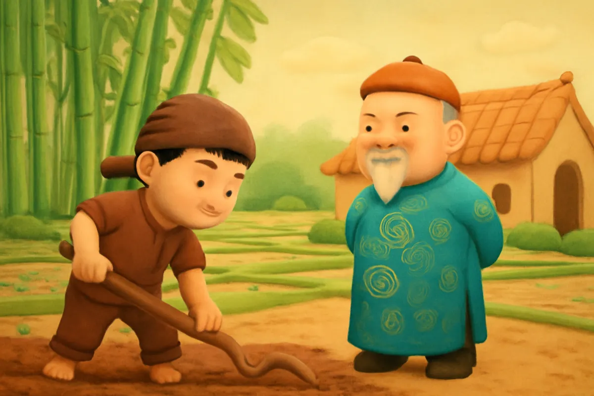
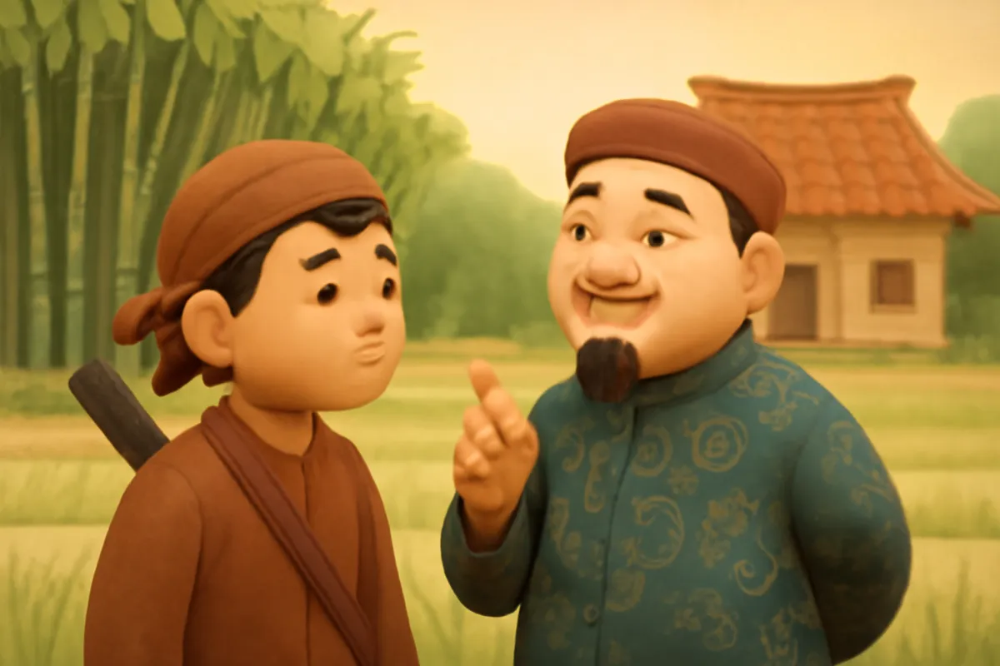
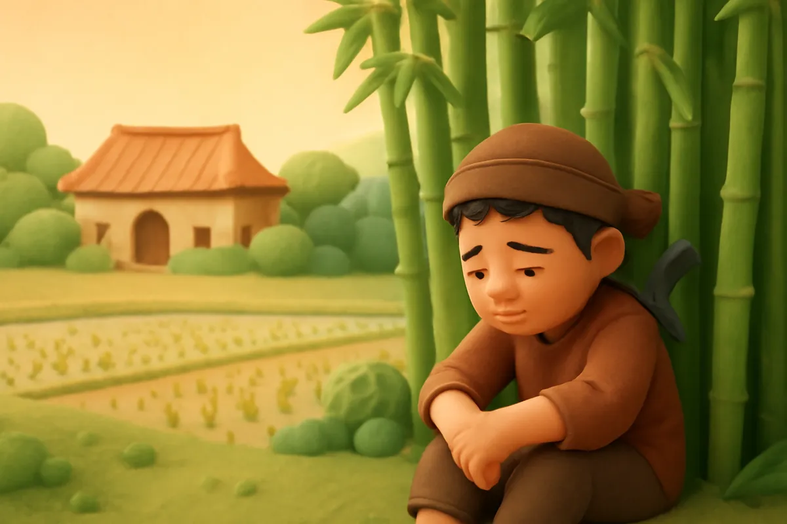
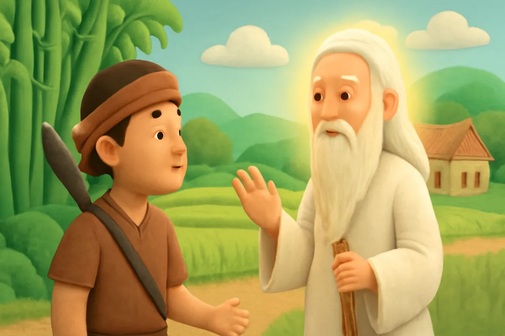
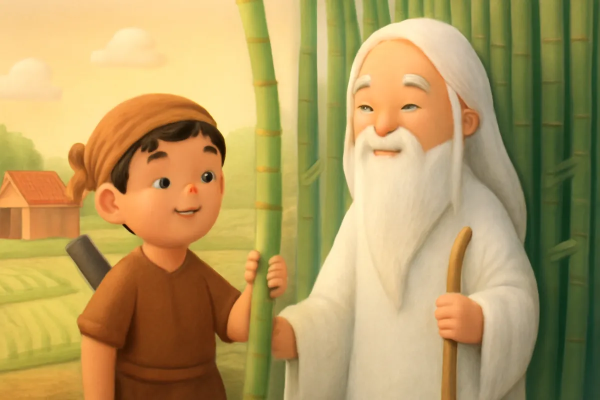
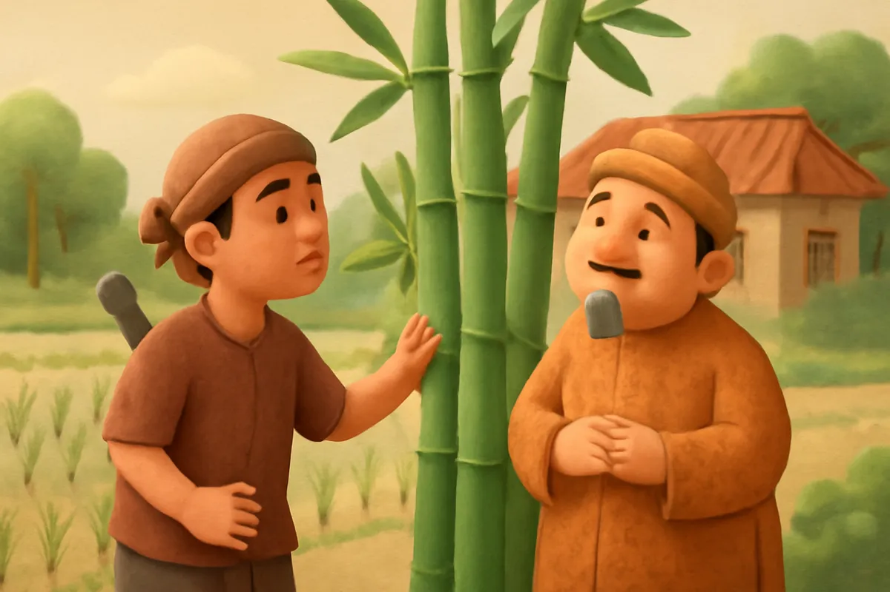
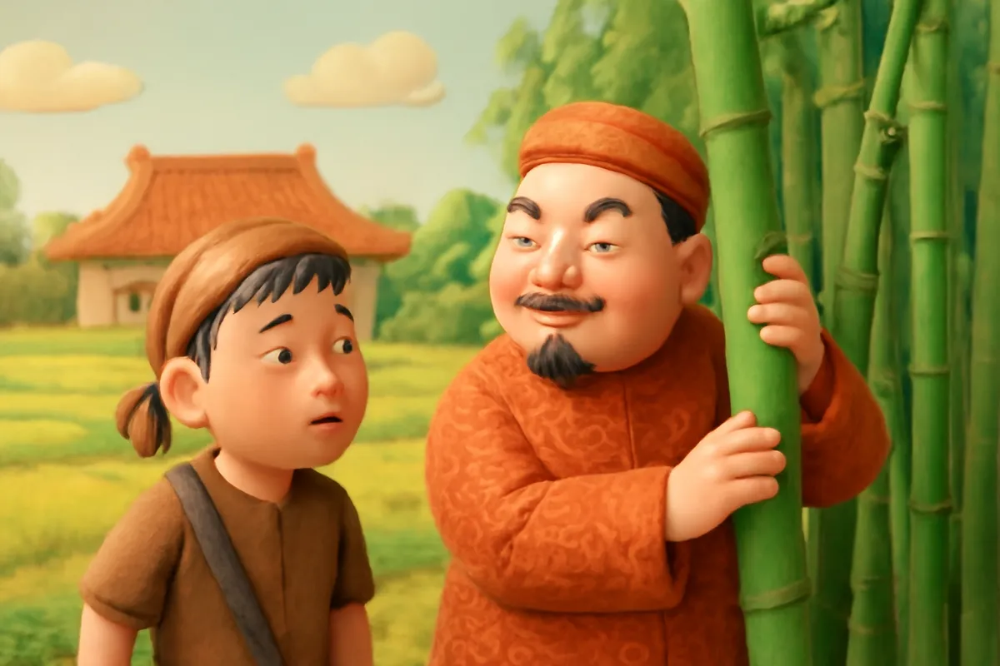

# Cây tre trăm đốt

| | |
| --- | --- |
| Mã truyện | `67b8f76a-0d49-42ce-8e0c-699d4a15e522` |
| Nhóm | Truyện thư viện |
| Nguồn | manual |
| Tạo lúc | 2026-10-15T14:34:09.448749+00:00 |
| Cập nhật | 2026-10-16T05:38:32.049591+00:00 |
| Số trang | 8 |
| Ngôn ngữ | vi |
| Tuổi | 4–8 |
| Giọng kể | Viên - Narrative, Warm and Clear (northern) |
| Trạng thái | published |
| Đã xoá | không |

**Giới thiệu:** Phú ông lừa anh Khoai đi tìm cây tre trăm đốt để khỏi giữ lời hứa. Nhờ ông Bụt và câu thần chú khắc nhập, khắc xuất, anh Khoai được đền đáp.

**Bài học:** Phải giữ lời hứa; người hiền lành, chăm chỉ sẽ được giúp đỡ.

## Nhân vật

- **Anh Khoai** — Anh nông dân hiền lành, chăm chỉ (giọng: Quang — chú trầm ấm)
- **Phú Ông** — Ông nhà giàu keo kiệt, hay nuốt lời (giọng: Thanh — ông hiền từ)
- **Ông Bụt** — Ông Bụt hiền từ, giúp người ngay thẳng (giọng: Thanh — ông hiền từ)

## Trang 1

Ngày xưa, có một anh nông dân hiền lành tên là Khoai. Anh làm thuê cho nhà phú ông giàu nhất làng. Sáng sớm anh đã ra đồng, tối mịt mới về.

**Phú Ông:** Khoai này, con chịu khó làm cho ta ba năm. Ta sẽ gả con gái cho con.

**Anh Khoai:** Dạ, con xin hứa sẽ làm việc thật chăm chỉ.

🔊 [Nghe trang 1](../../../media/tts-cache/90e98362-1507-4e6e-8f7c-757d862049e9-d4307ece-4b97-4192-a952-33d00e251064.mp3)

## Trang 2

Ba năm trôi qua. Nhờ anh Khoai, ruộng nhà phú ông lúa chín vàng, kho thóc đầy ắp. Nhưng phú ông lại không muốn giữ lời hứa. Lão muốn gả con gái cho một nhà giàu khác.

Phú ông nghĩ ra một mẹo.

**Phú Ông:** Khoai à, con vào rừng tìm cho ta một cây tre có đủ một trăm đốt. Có tre ấy, ta mới cho cưới.

🔊 [Nghe trang 2](../../../media/tts-cache/25cc6a8a-abd5-442a-9500-74ceafd0bcbe-8e1081d8-5cf3-4e78-b8b0-02851d5665a2.mp3)

## Trang 3

Anh Khoai vác dao vào rừng. Anh đi hết bụi tre này đến bụi tre khác, đếm mãi mà chẳng cây nào đủ một trăm đốt. Cây dài nhất cũng chỉ hơn hai mươi đốt.

Trời đã về chiều. Anh ngồi xuống gốc tre, buồn bã thở dài.

**Anh Khoai:** Làm sao tìm được cây tre trăm đốt bây giờ?

🔊 [Nghe trang 3](../../../media/tts-cache/4e2e9082-4688-4196-b92b-9303c182dec6-d2739cb3-3ed0-400e-83f3-0882a817fa87.mp3)

## Trang 4

Bỗng ông Bụt hiện ra, râu tóc bạc phơ, tay chống gậy trúc.

**Ông Bụt:** Con ơi, vì sao con buồn thế?

Anh Khoai kể hết mọi chuyện. Ông Bụt mỉm cười hiền hậu.

**Ông Bụt:** Con hãy chặt đủ một trăm đốt tre. Rồi đọc thật to: khắc nhập, khắc nhập! Các đốt tre sẽ liền lại với nhau.

🔊 [Nghe trang 4](../../../media/tts-cache/91073a3f-b31e-4f79-9047-eeea53ffb784-b5addc7a-81b2-4a82-806f-9985f62ded2e.mp3)

## Trang 5

Anh Khoai làm theo lời Bụt. Anh chặt từng đốt tre, xếp thành một hàng dài, đếm đủ một trăm đốt.

**Anh Khoai:** Khắc nhập, khắc nhập!

Kỳ lạ chưa! Một trăm đốt tre liền lại thành một cây tre dài thật dài. Nhưng cây tre dài quá, anh không vác về được.

**Ông Bụt:** Con đọc: khắc xuất, khắc xuất, các đốt tre sẽ rời ra.

🔊 [Nghe trang 5](../../../media/tts-cache/ab0255f1-14b6-4ea0-81df-5cb2bf9ff23f-65dd251a-2b23-43e1-8b75-9aa111b17a6f.mp3)

## Trang 6

Anh Khoai bó các đốt tre lại, vác về làng. Lúc ấy, nhà phú ông đang làm cỗ cưới con gái cho nhà giàu kia. Anh Khoai xếp các đốt tre ra giữa sân.

**Anh Khoai:** Khắc nhập, khắc nhập!

Các đốt tre liền lại thành cây tre trăm đốt. Phú ông tò mò chạy lại, đưa tay sờ thử.

🔊 [Nghe trang 6](../../../media/tts-cache/448e3629-eda4-425c-a3a8-531c35468e4b-128badcd-42f2-42ab-b05e-711273b2580e.mp3)

## Trang 7

**Anh Khoai:** Khắc nhập, khắc nhập!

Thế là phú ông dính chặt vào cây tre, giãy mãi không ra. Ông nhà giàu kia chạy đến kéo, cũng dính luôn. Cả làng đứng xem, cười ồ lên. Mọi người xúm vào gỡ mà không ai gỡ ra được.

**Phú Ông:** Ối, gỡ ta ra! Khoai ơi, ta sai rồi! Ta xin giữ lời hứa!

🔊 [Nghe trang 7](../../../media/tts-cache/c2306ce0-082f-4e81-ac22-72bdd1a68a8d-0aaff2ae-1236-401e-9cd3-64df9e5b917f.mp3)

## Trang 8

Anh Khoai mỉm cười, rồi đọc thật to câu thần chú.

**Anh Khoai:** Khắc xuất, khắc xuất!

Phú ông được gỡ ra, xấu hổ đỏ mặt. Từ đó, phú ông giữ đúng lời hứa. Đám cưới của anh Khoai diễn ra vui vẻ, cả làng đến chúc mừng. Ai cũng nói: người hiền lành, chăm chỉ sẽ được đền đáp.

🔊 [Nghe trang 8](../../../media/tts-cache/d7707dad-47e8-4eeb-a339-e53b3a4de62a-12a9689a-1772-4f6d-b237-77610f7f1dab.mp3)

---

Bản đầy đủ (mọi cột trong cơ sở dữ liệu): [story.json](story.json)
