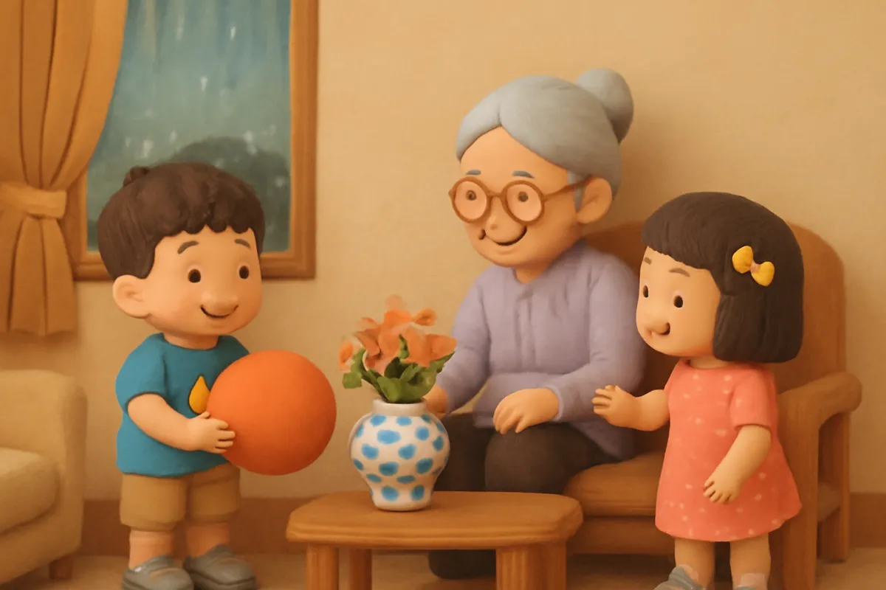
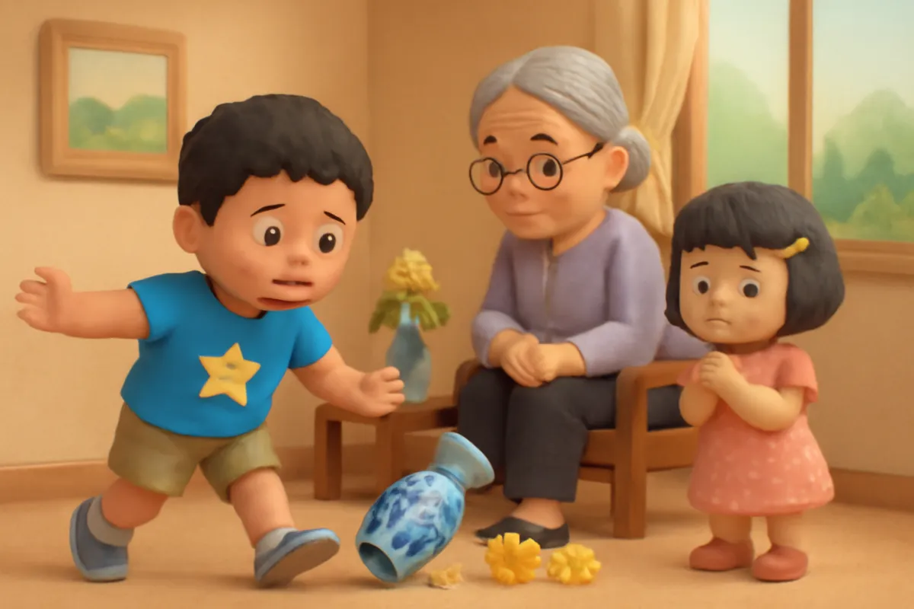
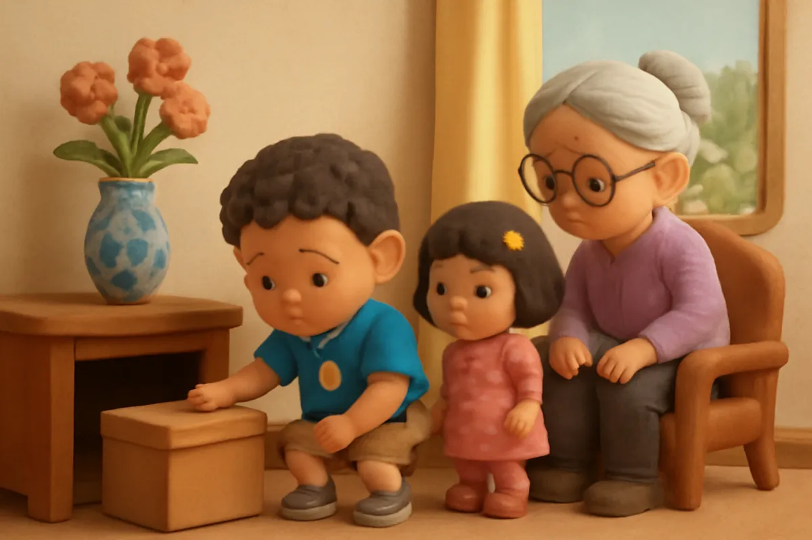
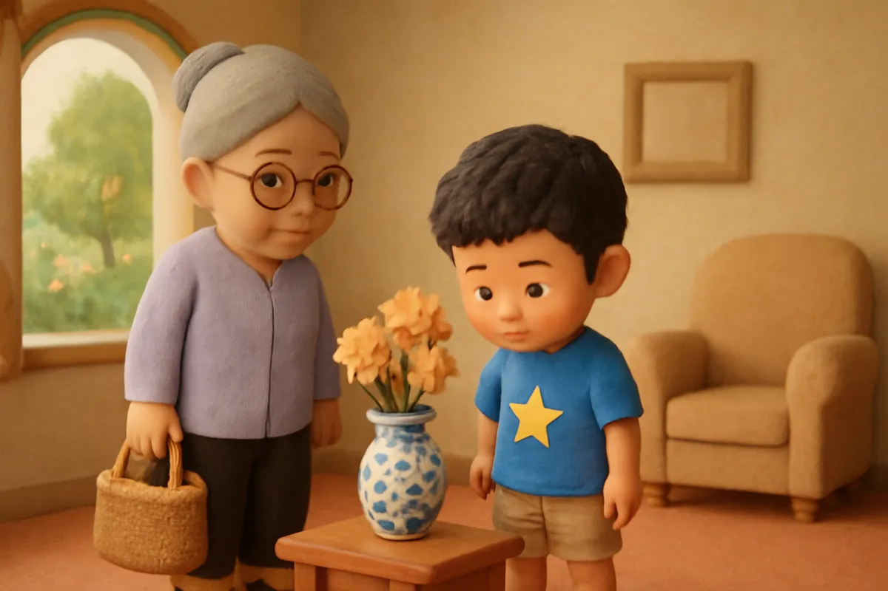
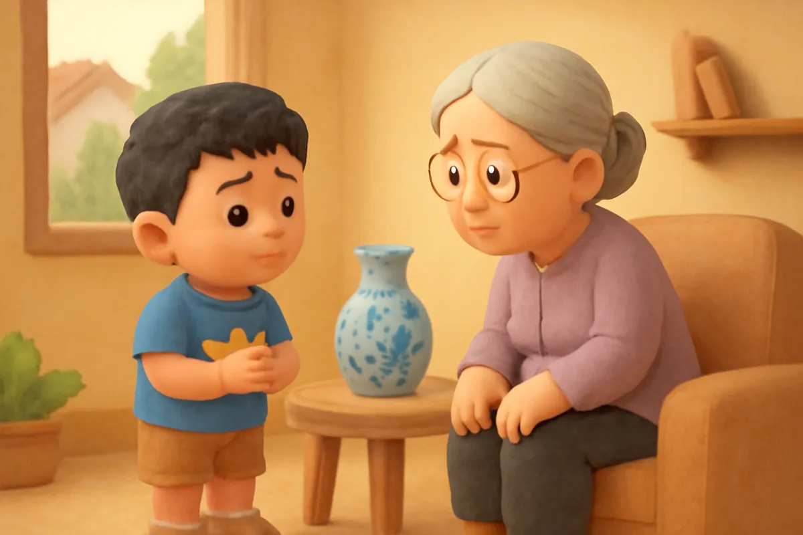
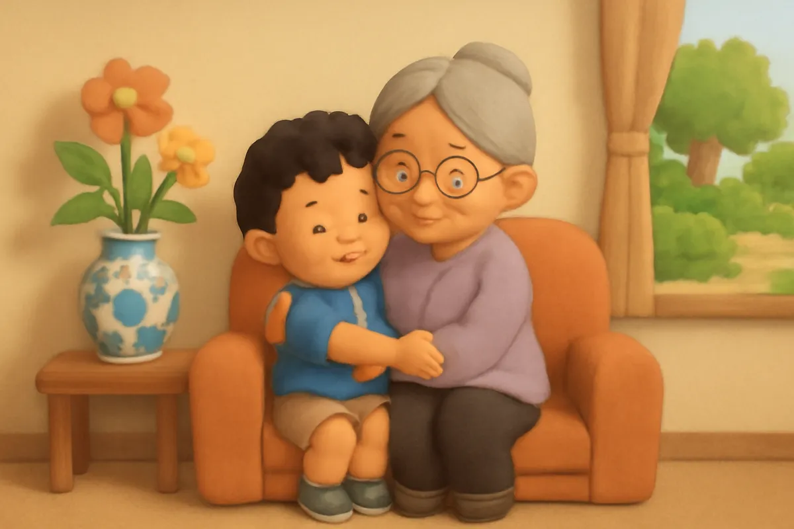
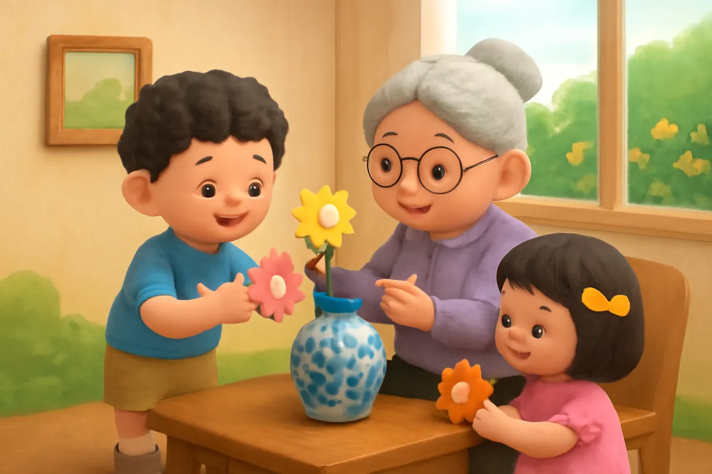
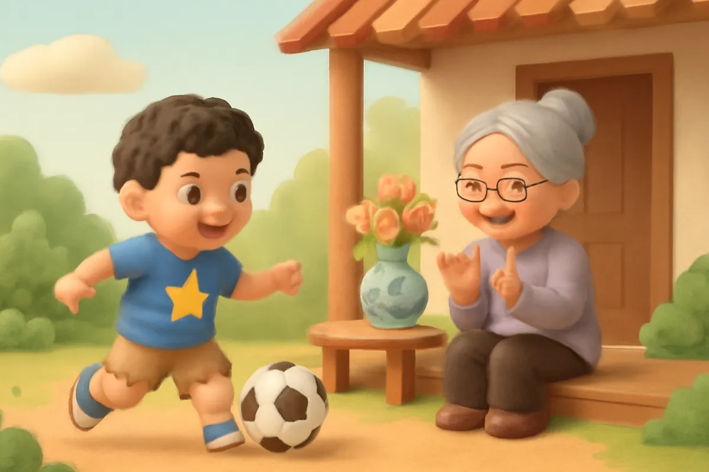

# Chiếc bình hoa của bà

| | |
| --- | --- |
| Mã truyện | `fb77bff5-2fec-47f7-a657-0c55d01c967b` |
| Nhóm | Truyện thư viện |
| Nguồn | manual |
| Tạo lúc | 2026-10-15T14:34:10.193821+00:00 |
| Cập nhật | 2026-10-16T04:32:03.530422+00:00 |
| Số trang | 8 |
| Ngôn ngữ | vi |
| Tuổi | 3–6 |
| Giọng kể | Viên - Narrative, Warm and Clear (northern) |
| Trạng thái | published |
| Đã xoá | không |

**Giới thiệu:** Bo đá bóng trong nhà làm vỡ chiếc bình hoa của bà rồi giấu các mảnh vỡ đi. Bụng Bo cứ thấy khó chịu, cho đến khi Bo dũng cảm nói thật và được bà cảm ơn.

**Bài học:** Nói thật có khi làm mình hồi hộp, nhưng nói thật giúp lòng nhẹ nhõm và được mọi người tin.

## Nhân vật

- **Bo** — Cậu bé 5 tuổi hiếu động, tốt bụng, đang tập thói quen tốt (giọng: Bin — bé trai lém lỉnh)
- **Bà** — Bà nội hiền hậu, kể chuyện hay (giọng: Hiền — bà hiền hậu)
- **Su** — Em gái 4 tuổi của Bo, hay hỏi, thích vẽ (giọng: Yuna — bé gái tinh nghịch)

## Trang 1

Chiều chủ nhật, trời mưa lâm thâm nên Bo không được ra sân. Bo ôm quả bóng, chạy quanh phòng khách. Quả bóng nảy tưng tưng trên sàn gạch.

**Su:** Anh Bo ơi, bà dặn không đá bóng trong nhà mà!

**Bo:** Anh chỉ đá khẽ thôi. Một cái thôi mà!

Nhưng Bo mải chơi quá, quên mất lời bà dặn. Bo lùi lại mấy bước, co chân, đá thật mạnh.

🔊 [Nghe trang 1](../../../media/tts-cache/883d40c5-084b-444a-a812-c1395d28c06d-267294d8-c9d3-4740-af20-b7eef0c234bd.mp3)

## Trang 2

Quả bóng bay vèo, đập vào chiếc bình hoa trên bàn. Choang! Chiếc bình hoa men xanh của bà rơi xuống đất, vỡ thành mấy mảnh. Mấy bông hoa cúc nằm lăn lóc trên sàn.

**Su:** Ôi! Bình hoa của bà vỡ rồi! Bà quý chiếc bình ấy lắm đấy!

**Bo:** Suỵt! Em đừng nói to. Để anh giấu đi.

Tim Bo đập thình thịch, tay chân run run.

🔊 [Nghe trang 2](../../../media/tts-cache/47302f50-dfb5-465f-932d-552880f120dc-a5e13773-5869-4833-afe0-7c880dc09ba0.mp3)

## Trang 3

Bo vội vàng nhặt các mảnh vỡ, giấu vào trong một chiếc hộp giấy, rồi đẩy hộp vào gầm tủ. Bo nhặt hoa cúc, cắm tạm vào cái cốc. Nhưng bụng Bo cứ thấy nặng nặng, khó chịu lạ lùng.

**Bo:** Sao bụng mình cứ thấy khó chịu thế nhỉ?

**Su:** Anh ơi, hay là mình nói với bà đi.

🔊 [Nghe trang 3](../../../media/tts-cache/4ac9f58a-b1fb-4034-8280-bb1e5ca19ff3-ff12647f-6af1-4503-934c-16ec846227f5.mp3)

## Trang 4

Bà đi chợ về, nhìn quanh phòng khách.

**Bà:** Ơ, chiếc bình hoa của bà đâu rồi nhỉ? Sao hoa cúc lại nằm trong cái cốc thế này?

Bo nhìn bà, rồi nhìn xuống chân mình. Bo rất sợ bà buồn. Bo muốn nói là không biết. Nhưng Bo nhớ cảm giác nặng nặng trong bụng.

🔊 [Nghe trang 4](../../../media/tts-cache/cb74a9ac-5e90-43de-9c7f-85bb8e2e7884-25769db3-4df5-416e-b32e-2df21a83e443.mp3)

## Trang 5

Bo hít một hơi thật sâu, rồi bước tới cạnh bà.

**Bo:** Bà ơi, con xin lỗi bà. Con đá bóng trong nhà, làm vỡ bình hoa của bà. Con còn giấu các mảnh vỡ vào gầm tủ nữa ạ.

Nói xong, Bo thấy bụng mình nhẹ hẳn đi, như vừa đặt xuống một hòn đá to.

🔊 [Nghe trang 5](../../../media/tts-cache/f7ff52ab-17e7-452d-ac90-da08ade2ea19-765e35ca-e6a5-4a51-856f-f73a93635b21.mp3)

## Trang 6

Bà ngồi xuống, ôm Bo vào lòng.

**Bà:** Bà cảm ơn con đã nói thật với bà. Nói thật cần rất nhiều dũng cảm đấy. Bình vỡ thì bà tiếc, nhưng bà vui vì cháu bà là người trung thực.

**Bo:** Con hứa từ giờ không đá bóng trong nhà nữa ạ.

**Bà:** Mảnh vỡ sắc lắm, để bà gói lại cẩn thận. Con đừng chạm vào nhé.

🔊 [Nghe trang 6](../../../media/tts-cache/44d979fd-072a-45a7-a060-2b360a55b8e1-fa7ead06-0115-4b80-bc97-9d293047660f.mp3)

## Trang 7

Bà tìm ra một chiếc lọ thủy tinh cũ. Bo và Su rửa lọ thật sạch, rồi dán quanh lọ những bông hoa giấy tự cắt. Bà cắm lại những bông cúc vào lọ mới.

**Su:** Lọ hoa mới đẹp quá bà ơi!

**Bà:** Đẹp hơn cả bình cũ, vì có công của hai cháu bà đấy.

**Bo:** Mai trời tạnh, con ra vườn đá bóng ạ!

🔊 [Nghe trang 7](../../../media/tts-cache/fd156bad-b31d-4ea1-b436-b09026766e36-ac4136ad-4349-42ad-8f04-df6db76a39a3.mp3)

## Trang 8

Hôm sau trời nắng đẹp. Bo ra vườn đá bóng thỏa thích, còn chiếc lọ hoa mới nằm yên trên bàn trong nhà. Bà ngồi ở hiên, vỗ tay mỗi khi Bo sút trúng khung thành bằng hai chiếc dép.

**Bo:** Bà ơi, ngoài vườn đá bóng vui hơn nhiều!

Bé ơi, nếu bé lỡ làm vỡ một món đồ, bé sẽ nói gì với người lớn nhỉ?

🔊 [Nghe trang 8](../../../media/tts-cache/0e5a4328-2058-4aa5-a415-b5491baab954-d8cbae31-7fd2-456f-bd05-b13817d11c16.mp3)

---

Bản đầy đủ (mọi cột trong cơ sở dữ liệu): [story.json](story.json)
