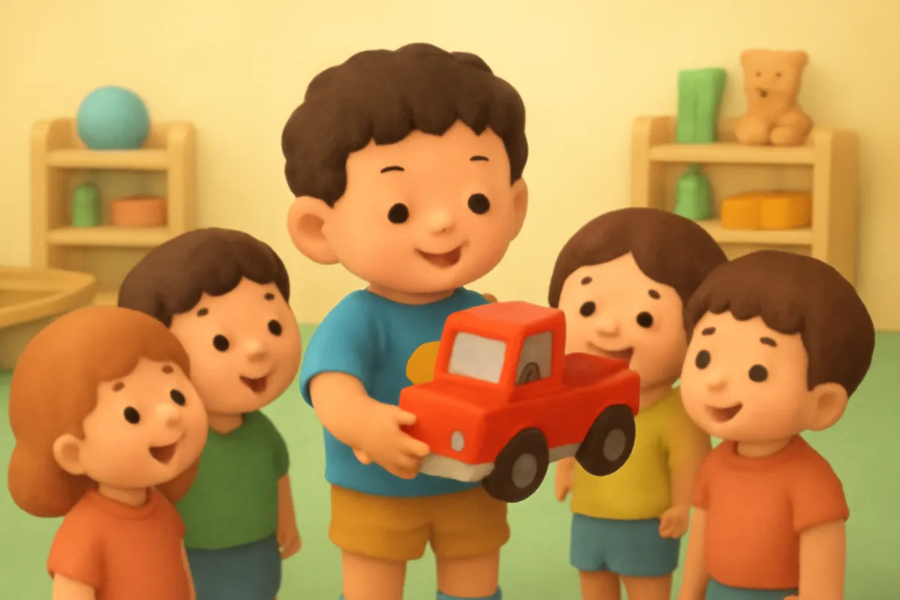
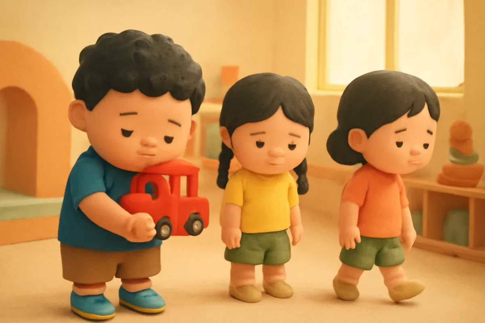
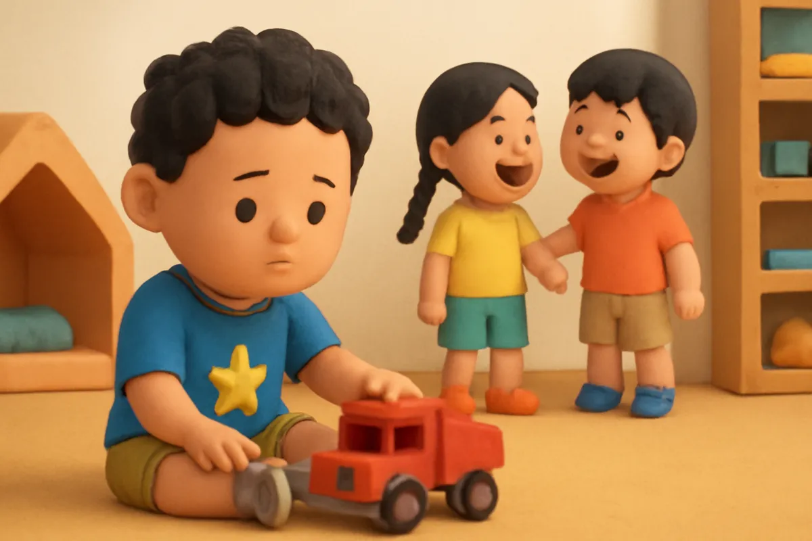
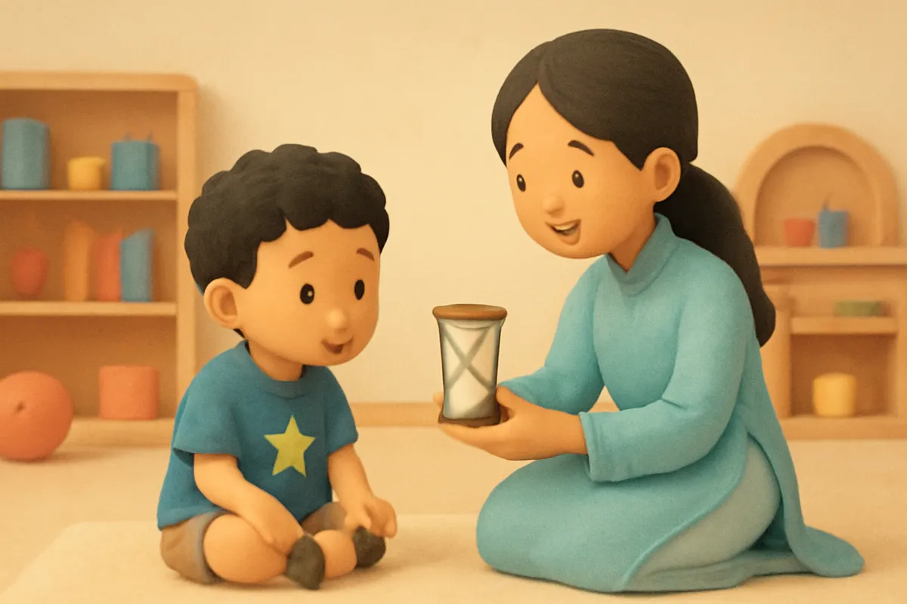
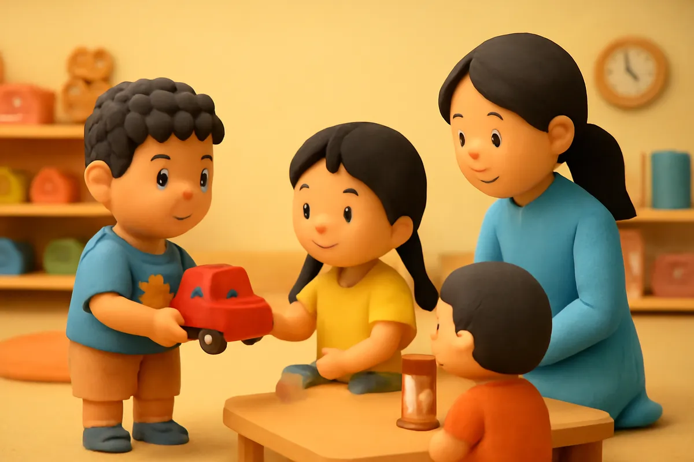
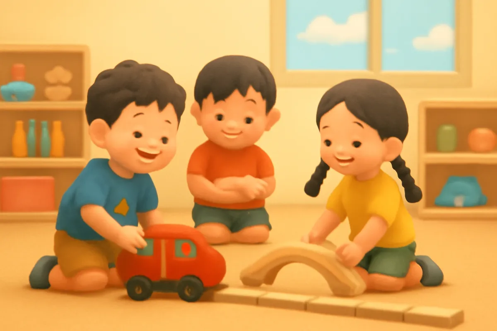
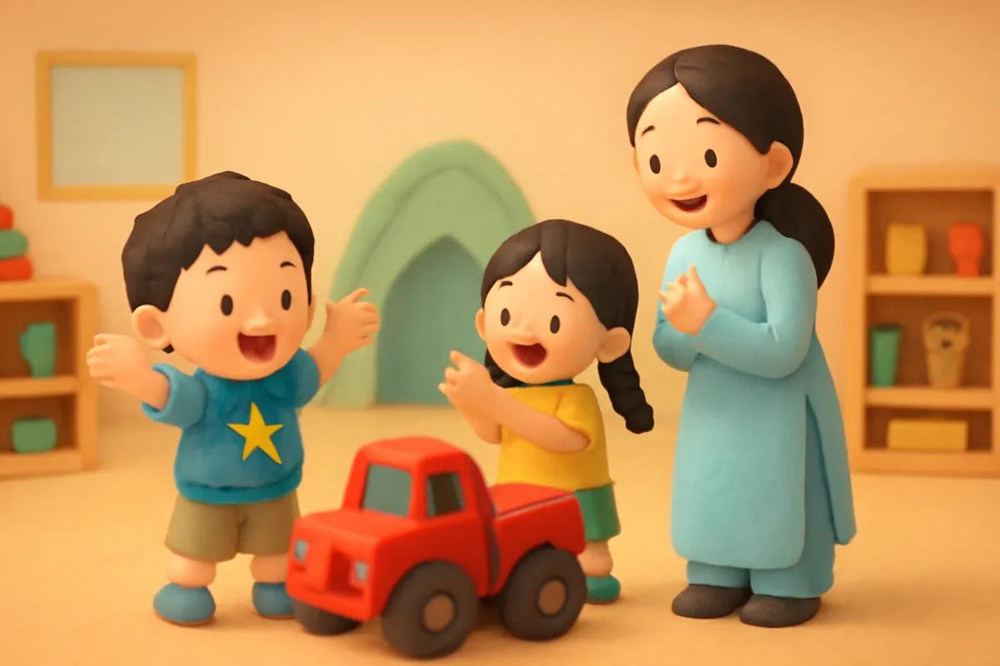
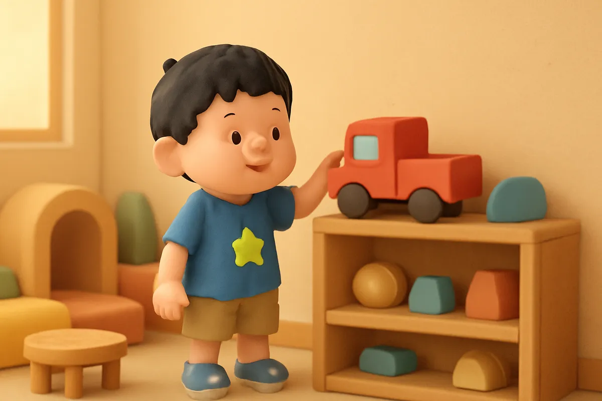

# Chiếc xe tải đỏ

| | |
| --- | --- |
| Mã truyện | `78c260c0-5a15-44f0-8c8d-09032e5bb007` |
| Nhóm | Truyện thư viện |
| Nguồn | manual |
| Tạo lúc | 2026-10-15T14:34:10.193821+00:00 |
| Cập nhật | 2026-10-16T04:32:43.705503+00:00 |
| Số trang | 8 |
| Ngôn ngữ | vi |
| Tuổi | 3–6 |
| Giọng kể | Viên - Narrative, Warm and Clear (northern) |
| Trạng thái | published |
| Đã xoá | không |

**Giới thiệu:** Bo mang chiếc xe tải đỏ mới đến lớp nhưng không cho ai chơi cùng, rồi thấy buồn vì chơi một mình. Cô Hoa dạy các bạn chờ đến lượt bằng đồng hồ cát, và cả nhóm cùng xây một con đường thật dài.

**Bài học:** Chia sẻ và chờ đến lượt giúp mình có thêm bạn, chơi chung vui hơn chơi một mình.

## Nhân vật

- **Bo** — Cậu bé 5 tuổi hiếu động, tốt bụng, đang tập thói quen tốt (giọng: Bin — bé trai lém lỉnh)
- **Mai** — Bạn cùng lớp của Bo, nhanh nhẹn (giọng: Yuna — bé gái tinh nghịch)
- **Cô Hoa** — Cô giáo mầm non dịu dàng (giọng: Tâm — cô kể chuyện cổ tích)

## Trang 1

Sáng thứ hai, Bo mang đến lớp một chiếc xe tải đỏ mới tinh. Xe có thùng nâng lên hạ xuống được, bánh xe quay vù vù, còn bấm còi kêu bim bim nữa.

**Bo:** Xe tải của tớ đấy! Bố mới mua cho tớ hôm qua!

Các bạn xúm lại xem, mắt tròn xoe. Ai cũng muốn được sờ thử chiếc xe một lần.

🔊 [Nghe trang 1](../../../media/tts-cache/a39148bd-7c10-42e4-87ef-a9da6c6e85fe-497bc88a-1cd0-4ac0-b565-e0c47eb933da.mp3)

## Trang 2

Tin rụt rè kéo áo Bo, chỉ vào chiếc xe.

**Mai:** Bo ơi, cho tớ với Tin chơi cùng với! Cho tớ thử bấm còi một lần thôi!

Bo sợ các bạn làm hỏng xe. Bo ôm chặt chiếc xe vào lòng, quay lưng lại.

**Bo:** Không! Xe của tớ, chỉ tớ được chơi thôi!

Tin cúi đầu đi ra góc xếp hình. Mai cũng lặng lẽ đi chỗ khác. Hai bạn trông buồn thiu.

🔊 [Nghe trang 2](../../../media/tts-cache/9445b1d8-3f52-4b26-8c77-51eb2cc8542c-ddc64fde-6ce3-4abd-9ffb-e87f80936346.mp3)

## Trang 3

Bo ngồi một mình trong góc, đẩy xe tới, đẩy xe lui. Bim bim. Vù vù. Lúc đầu thì vui, nhưng một lúc sau Bo thấy chán. Ở góc bên kia, Tin và Mai đang xây đường bằng khối gỗ, cười khúc khích.

**Bo:** Sao chơi một mình chẳng vui gì cả nhỉ?

Bo nhìn chiếc xe tải, rồi lại nhìn sang các bạn.

🔊 [Nghe trang 3](../../../media/tts-cache/164b3b70-34a0-4156-88a5-6fd9784366ac-9b08d358-699d-4782-a9ca-9e97f8f916fb.mp3)

## Trang 4

Cô Hoa đến ngồi cạnh Bo.

**Cô Hoa:** Cô thấy Bo có vẻ buồn. Con sợ bạn làm hỏng xe phải không?

**Bo:** Vâng ạ. Con sợ bạn lấy mất xe của con.

**Cô Hoa:** Mình có thể chơi theo lượt. Mỗi bạn được chơi đến khi cát trong đồng hồ chảy hết, rồi xe lại về với con. Xe vẫn là của con mà.

🔊 [Nghe trang 4](../../../media/tts-cache/95662f36-0b84-480e-89da-8ff64907daea-8744d09c-4a61-449c-9f42-cbc8e781933b.mp3)

## Trang 5

Bo nghĩ một lúc, rồi cầm xe đi về phía góc xếp hình.

**Bo:** Tin ơi, cậu chơi xe trước nhé. Cát chảy hết thì đến lượt Mai, rồi đến tớ.

Tin cười tít mắt, cảm ơn Bo rồi đẩy xe thật nhẹ tay.

Cô Hoa lật đồng hồ cát. Những hạt cát nhỏ bắt đầu chảy xuống. Bo ngồi chờ, đếm cùng các bạn: một, hai, ba...

🔊 [Nghe trang 5](../../../media/tts-cache/0c314db6-5bb2-47da-9e3f-fb9a4b2b2db3-392a79b6-7222-4d75-84b0-70c528433585.mp3)

## Trang 6

Đến lượt Bo, Tin mang hết khối gỗ của mình ra cho Bo chở đi xây đường.

**Mai:** Còn tớ làm cây cầu cho xe tải chạy qua!

Cả ba bạn cùng xây một con đường thật dài, có cầu, có đường hầm, có cả trạm xăng. Chiếc xe tải đỏ chở khối gỗ chạy đi chạy lại, bim bim, vù vù.

**Bo:** Chơi chung vui hơn nhiều!

🔊 [Nghe trang 6](../../../media/tts-cache/0340e772-b230-4655-8139-ee0dae32a07d-495fa452-077b-4b3f-b1b0-82fa697273c6.mp3)

## Trang 7

Đến giờ về, chiếc xe tải vẫn còn nguyên, không trầy một chút nào.

**Cô Hoa:** Hôm nay Bo đã biết chia sẻ, còn Tin và Mai biết chờ đến lượt. Cô khen cả ba con!

**Mai:** Ngày mai tớ mang búp bê đến, tớ cũng cho các cậu chơi cùng!

**Bo:** Thế thì mai mình lại chơi chung nhé!

🔊 [Nghe trang 7](../../../media/tts-cache/cd2e41f3-6d6e-462e-bd58-378fb03f4470-23b6515e-552f-4da7-ba20-d4213bd39096.mp3)

## Trang 8

Tối về nhà, Bo kể cho bố mẹ nghe về con đường dài và hai người bạn. Bo đặt chiếc xe tải đỏ lên kệ.

**Bo:** Xe ơi, hôm nay xe có thêm hai người bạn đấy!

Bé ơi, khi bạn muốn mượn đồ chơi của bé, bé sẽ nói gì nhỉ? Mình thử nói: Cậu chơi trước nhé, rồi đến lượt tớ!

🔊 [Nghe trang 8](../../../media/tts-cache/1421a8ca-3a58-4d50-870a-637f72db1366-4826869b-24b2-418d-8696-d29cd87065a2.mp3)

---

Bản đầy đủ (mọi cột trong cơ sở dữ liệu): [story.json](story.json)
