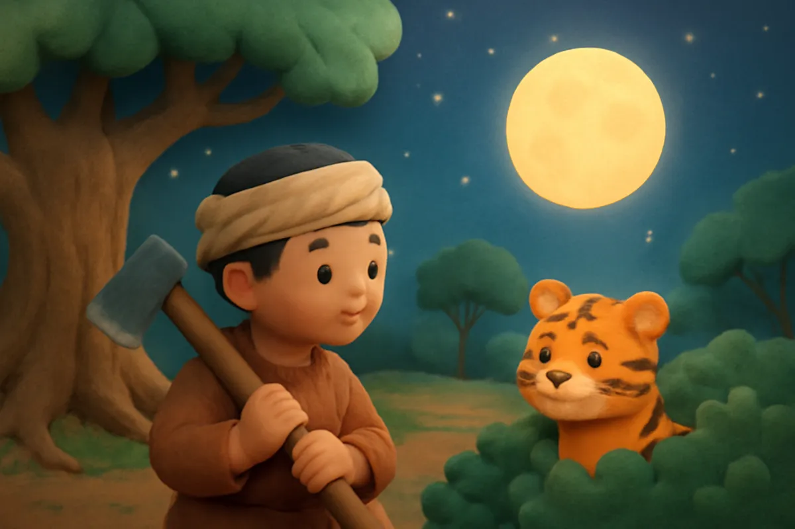
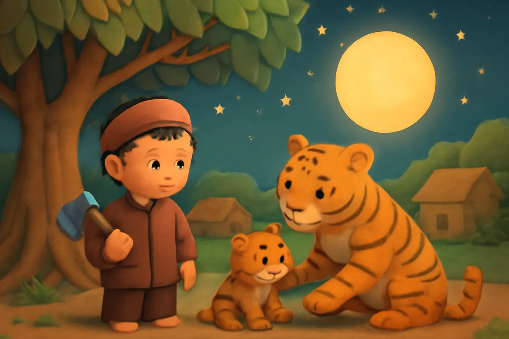
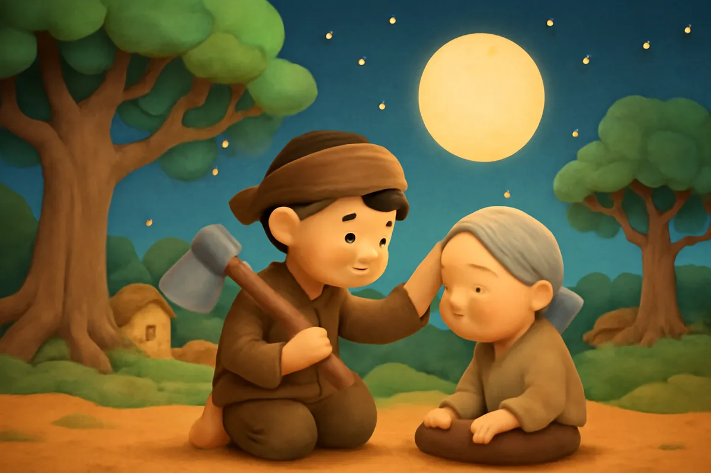
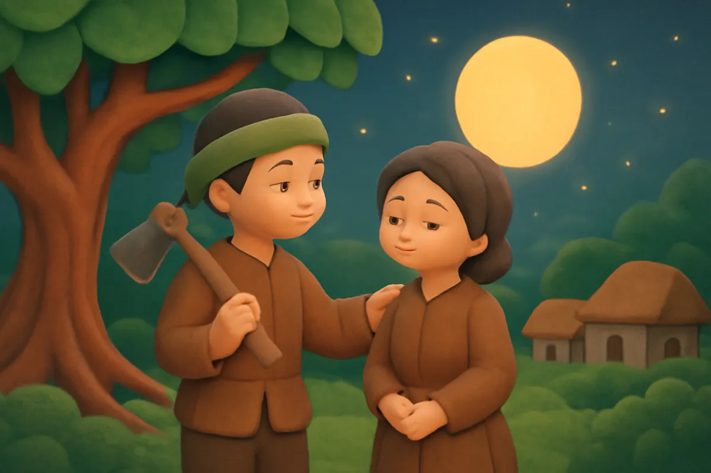
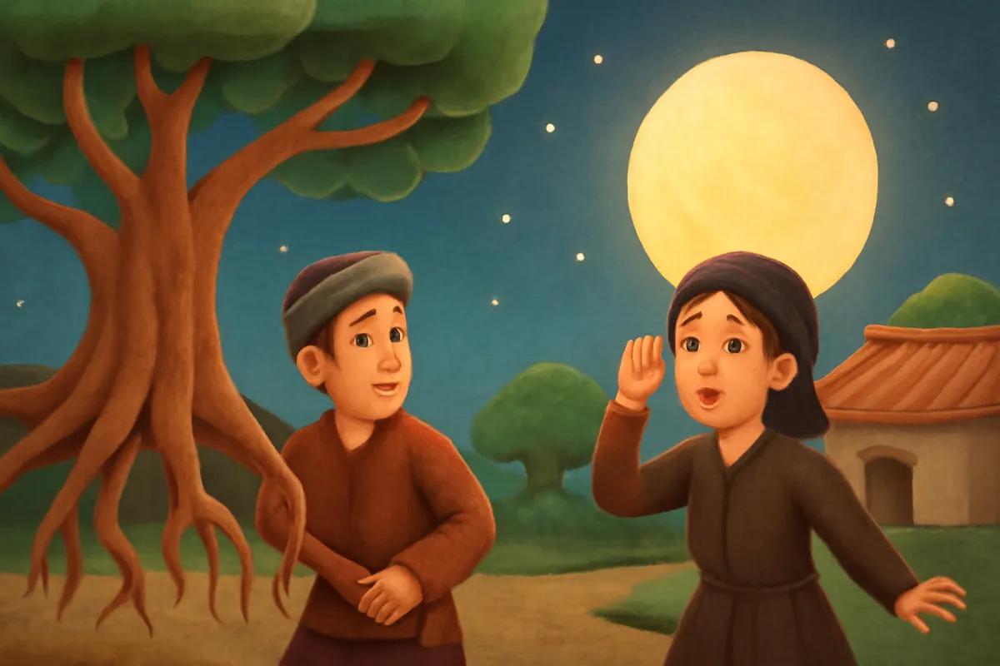
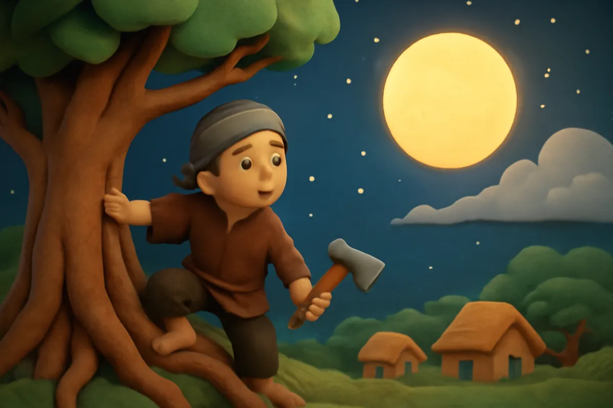
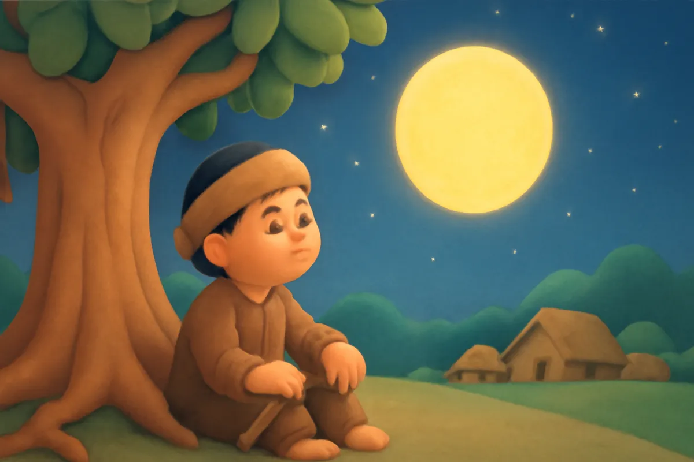
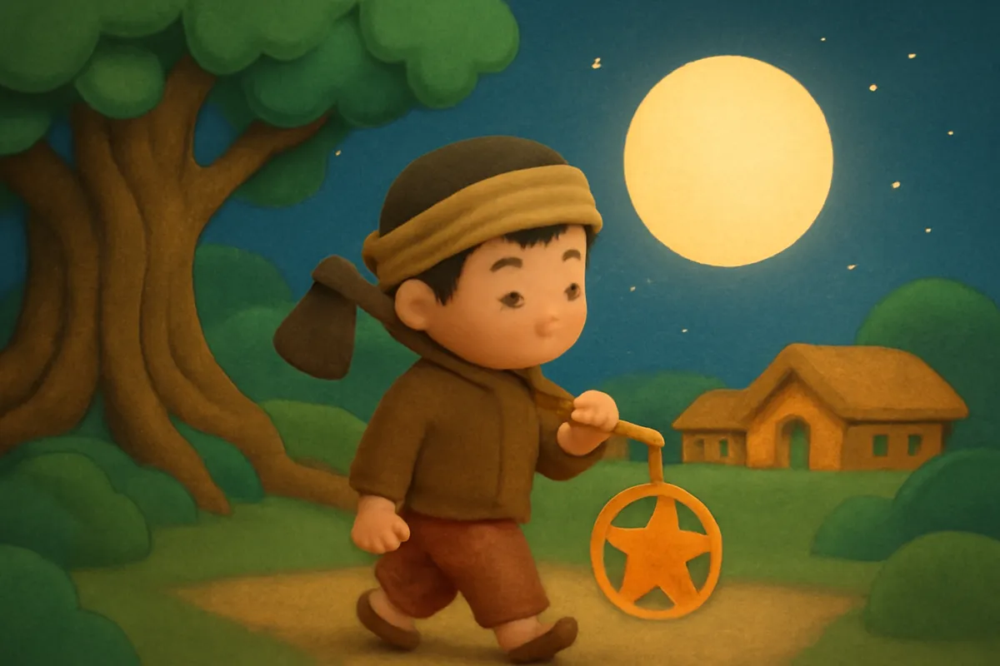

# Chú Cuội cung trăng

| | |
| --- | --- |
| Mã truyện | `ea23165d-1c6f-4490-9777-7d6e9528e178` |
| Nhóm | Truyện thư viện |
| Nguồn | manual |
| Tạo lúc | 2026-10-15T14:34:09.448749+00:00 |
| Cập nhật | 2026-10-16T13:43:08.393721+00:00 |
| Số trang | 8 |
| Ngôn ngữ | vi |
| Tuổi | 3–7 |
| Giọng kể | Viên - Narrative, Warm and Clear (northern) |
| Trạng thái | published |
| Đã xoá | không |

**Giới thiệu:** Chàng tiều phu Cuội tìm được cây đa thần chữa lành vết thương. Một hôm cây đa bay lên trời, mang Cuội lên tận cung trăng.

**Bài học:** Giữ lời dặn và giúp đỡ mọi người bằng điều mình có.

## Nhân vật

- **Cuội** — Chàng tiều phu hiền lành, tốt bụng (giọng: Quang — chú trầm ấm)
- **Vợ Cuội** — Vợ của Cuội, chăm chỉ nhưng hay quên (giọng: Tâm — cô kể chuyện cổ tích)

## Trang 1

Ngày xưa, có một chàng tiều phu tên là Cuội. Ngày ngày, Cuội vác rìu vào rừng đốn củi. Tiếng rìu vang lên cộc cộc, chim chóc hót ríu rít trên cành.

Một hôm, Cuội đang đi thì nghe tiếng kêu khe khẽ sau bụi cây. Anh rón rén lại gần nhìn.

**Cuội:** Ồ, có một chú hổ con bị ngã. Chân chú trầy xước cả rồi.

🔊 [Nghe trang 1](../../../media/tts-cache/6cf941e1-5eca-455f-94b9-2a9535670e72-fb84a84b-dd16-4beb-9a52-3519ca3a45d3.mp3)

## Trang 2

Cuội vội nấp sau gốc cây. Một lát sau, hổ mẹ chạy đến. Hổ mẹ ngửi ngửi hổ con, rồi đến bên một cây đa nhỏ, nhai mấy chiếc lá và đắp lên vết xước.

Thật kỳ lạ! Chỉ một lát sau, hổ con đã đứng dậy, chạy nhảy tung tăng theo mẹ.

**Cuội:** Cây đa này là cây thần rồi! Lá cây chữa lành được vết thương!

🔊 [Nghe trang 2](../../../media/tts-cache/8522a388-1764-4be4-82cf-2bf53d51fa98-b165e6e2-da44-492f-bf99-5e4b0b9443b8.mp3)

## Trang 3

Đợi hổ mẹ đi xa, Cuội cẩn thận đào cây đa, mang về trồng ở góc vườn. Từ đó, ai trong làng bị đau, Cuội đều lấy lá đa chữa cho.

**Cuội:** Bà con đừng lo. Lá đa thần sẽ giúp mọi người khoẻ lại.

Người làng ai cũng quý Cuội. Trẻ con thì thích ra gốc đa ngồi chơi, nghe chim hót líu lo.

🔊 [Nghe trang 3](../../../media/tts-cache/000e312a-ba47-400e-a154-d999266ca5c3-2b96906d-443b-4cd6-b674-8472cb6af026.mp3)

## Trang 4

Cây đa lớn nhanh lắm. Tán lá xanh mướt, toả bóng mát cả khu vườn. Trước khi đi rừng, Cuội dặn vợ thật kỹ.

**Cuội:** Mình nhớ nhé, phải tưới cây bằng nước sạch. Nếu tưới nước bẩn, cây sẽ bay mất lên trời đấy.

**Vợ Cuội:** Ừ, em nhớ rồi. Mình cứ yên tâm đi rừng đi.

🔊 [Nghe trang 4](../../../media/tts-cache/d8038923-d467-46ba-94b3-5c09126ed861-3bccf5c9-2dbc-470f-aaed-85bd46a46dca.mp3)

## Trang 5

Một hôm, vợ Cuội bận rộn quá nên quên mất lời dặn. Chị đổ chậu nước rửa rau vào gốc cây đa.

Bỗng mặt đất rung rinh. Gió thổi ào ào, lá đa xào xạc. Cây đa từ từ bật rễ, bay lên khỏi mặt đất.

**Vợ Cuội:** Ôi thôi! Mình ơi, về mau! Cây đa bay mất rồi!

🔊 [Nghe trang 5](../../../media/tts-cache/8c5955fc-28f1-4c1e-a8a3-24c888491ba1-fc8bbbe0-e61f-445e-8dca-4e261909f4c5.mp3)

## Trang 6

Vừa lúc ấy, Cuội vác củi về đến cổng. Thấy cây đa đang bay lên, anh vội đặt bó củi xuống, chạy đến túm chặt lấy rễ cây.

**Cuội:** Cây ơi, đừng đi! Ở lại với làng mình đi mà!

Nhưng cây đa cứ bay lên, bay lên mãi, mang theo cả Cuội. Cuội bay qua mây trắng, qua những vì sao lấp lánh.

🔊 [Nghe trang 6](../../../media/tts-cache/a6e2b8ff-b617-412c-a510-235e1701c402-25ab7ca4-898e-4c28-ae2e-f8da763bf9e8.mp3)

## Trang 7

Cây đa bay lên tận cung trăng rồi dừng lại. Cuội nhìn quanh. Mặt trăng sáng bạc, yên tĩnh và mát rượi.

**Cuội:** Ở đây đẹp quá. Nhưng mình nhớ làng, nhớ mọi người lắm.

Từ đó, Cuội ngồi dưới gốc cây đa trên cung trăng. Ngày ngày, chú nhìn xuống làng quê, nơi có cánh đồng và những mái nhà quen thuộc.

🔊 [Nghe trang 7](../../../media/tts-cache/a736ebec-252b-480c-9fd6-6849bd41e534-aafae123-a7e9-4618-98f0-0303cd2f0ab3.mp3)

## Trang 8

Mỗi năm, đến rằm tháng Tám, trăng tròn và sáng nhất. Các bạn nhỏ rước đèn ông sao, ngước nhìn lên trời.

Nếu nhìn thật kỹ, bé sẽ thấy hình cây đa và chú Cuội trên cung trăng. Chú Cuội mỉm cười, vẫy tay chúc các bạn nhỏ ngủ ngon.

**Cuội:** Ngủ ngon nhé các bạn nhỏ. Nhớ tưới cây bằng nước sạch nhé!

🔊 [Nghe trang 8](../../../media/tts-cache/65e074d8-fb52-489f-86c0-474c4fc2a71f-ae2523ab-976c-4d97-92cb-cdfd0acea175.mp3)

---

Bản đầy đủ (mọi cột trong cơ sở dữ liệu): [story.json](story.json)
