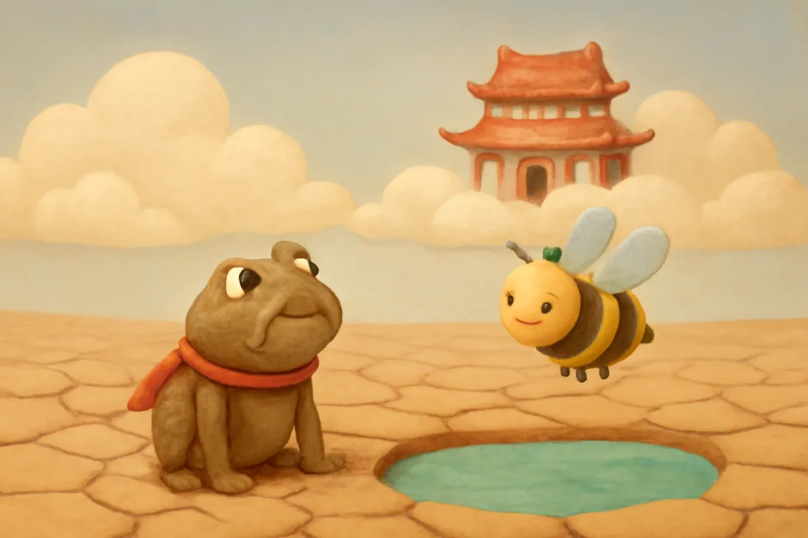
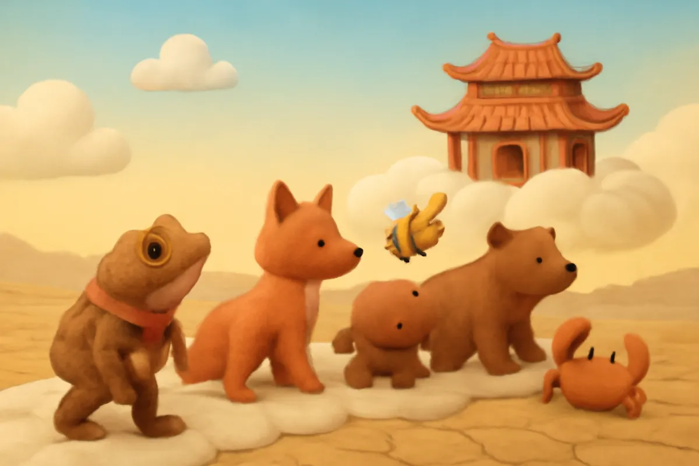
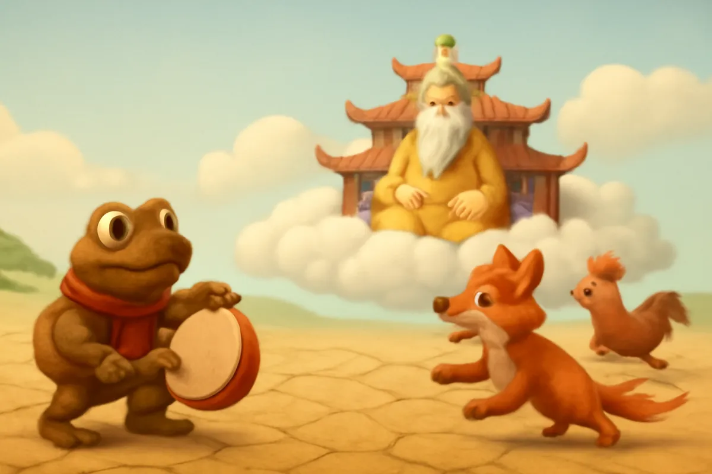
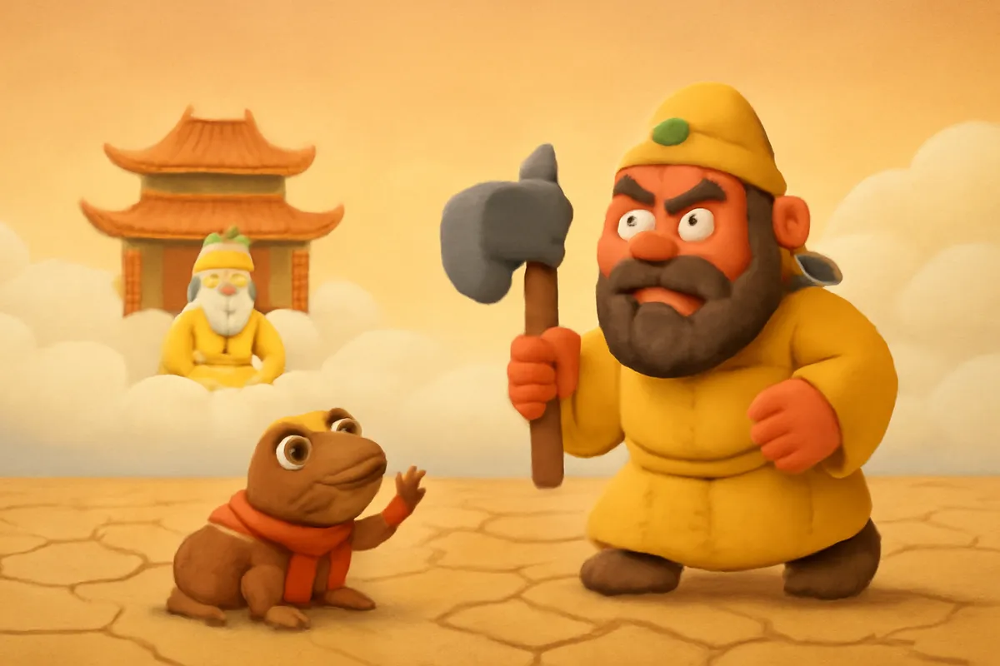
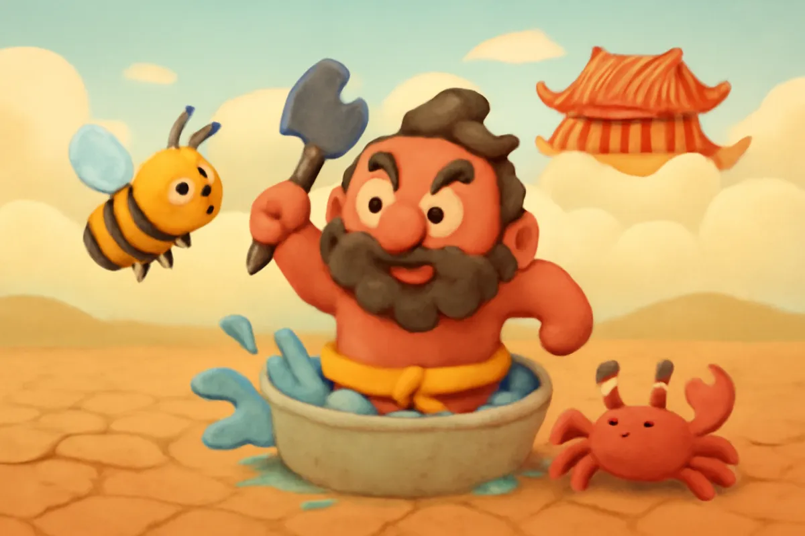
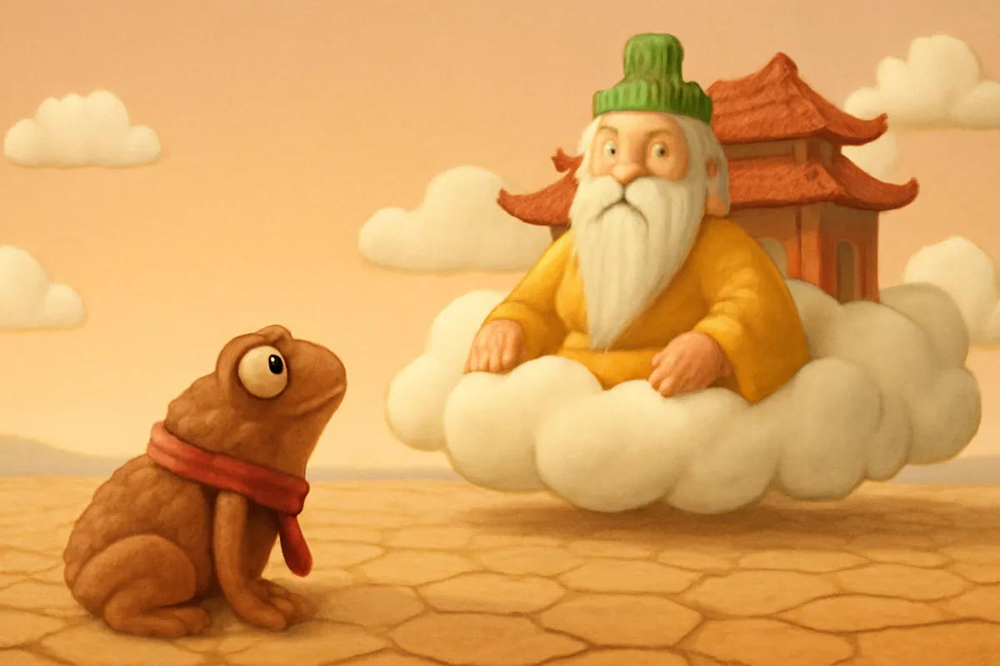
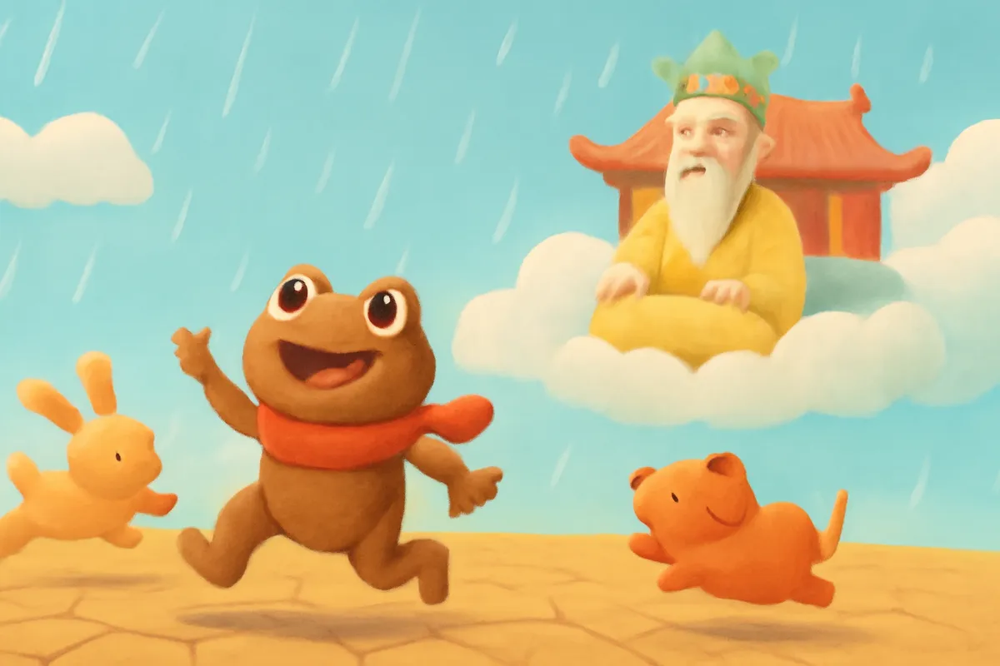
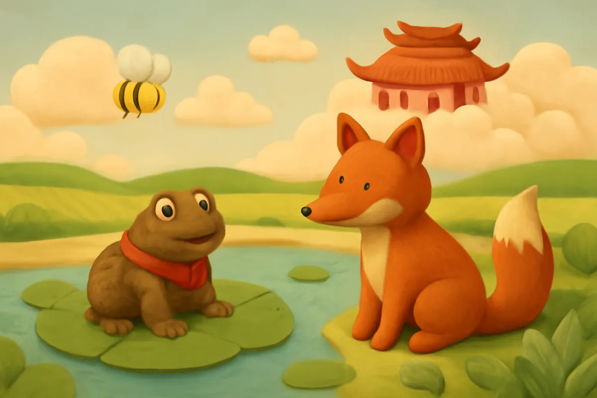

# Cóc kiện Trời

| | |
| --- | --- |
| Mã truyện | `964a9a2b-e268-4bd4-bfde-292d3e61331a` |
| Nhóm | Truyện thư viện |
| Nguồn | manual |
| Tạo lúc | 2026-10-15T14:34:09.814347+00:00 |
| Cập nhật | 2026-10-16T04:21:36.301306+00:00 |
| Số trang | 8 |
| Ngôn ngữ | vi |
| Tuổi | 5–8 |
| Giọng kể | Viên - Narrative, Warm and Clear (northern) |
| Trạng thái | published |
| Đã xoá | không |

**Giới thiệu:** Trời hạn hán lâu ngày, chú Cóc nhỏ cùng Ong, Cáo, Gấu, Cua lên kiện Trời. Gà, Chó rồi Thiên Lôi đều bị các bạn làm cho chạy mất, Ngọc Hoàng đành cho mưa xuống.

**Bài học:** Đoàn kết và dũng cảm thì việc khó mấy cũng làm được.

## Nhân vật

- **Cóc** — Chú cóc nhỏ gan dạ, mưu trí (giọng: Bin — bé trai lém lỉnh)
- **Cáo** — Bác cáo nhanh nhẹn, tinh khôn (giọng: Quang — chú trầm ấm)
- **Ong** — Chị ong vàng dũng cảm (giọng: Yuna — bé gái tinh nghịch)
- **Thiên Lôi** — Thần sét hung hăng nhưng hài hước (giọng: Thanh — ông hiền từ)
- **Ngọc Hoàng** — Vua nhà Trời (giọng: Thanh — ông hiền từ)

## Trang 1

Ngày xưa, có một năm trời làm hạn hán rất lâu. Ruộng đồng nứt nẻ, cây cỏ héo khô, suối cạn trơ đá. Muông thú khát nước, kêu than khắp nơi.

Chú Cóc nhỏ nhìn ao làng khô cạn, nghiến răng tức giận.

**Cóc:** Trời không chịu mưa thì mình lên tận nơi kiện Trời!

**Ong:** Cậu bé tí như thế mà dám lên kiện Trời ư? Thôi được, tớ đi cùng cậu!

🔊 [Nghe trang 1](../../../media/tts-cache/05f53e16-5e09-4ee4-8bfe-e101c3e9505b-f8a23bb3-e599-4d60-88bb-b425620c514d.mp3)

## Trang 2

Cóc và Ong lên đường. Đi một quãng, gặp Cua đang bò trên bãi cát khô. Đi thêm đoạn nữa, gặp Gấu và Cáo đang đi tìm nước. Nghe Cóc định lên kiện Trời, ai cũng xin đi theo.

**Cáo:** Cho tớ đi với! Tớ khát khô cả cổ rồi.

Đến cửa nhà Trời, Cóc bàn kế.

**Cóc:** Cua nấp vào chum nước. Ong nấp sau cánh cửa. Cáo và Gấu nấp hai bên. Cứ nghe tớ ra hiệu nhé!

🔊 [Nghe trang 2](../../../media/tts-cache/e04b0c4f-6798-494b-a524-f905e1182e6d-260f2e58-8bac-4e98-b888-616bdff0fd3c.mp3)

## Trang 3

Cóc nhảy lên, cầm dùi đánh ba hồi trống thật to. Tùng! Tùng! Tùng! Ngọc Hoàng đang ngồi trên ngai mây, giật mình tức giận.

**Ngọc Hoàng:** Đứa nào dám làm ồn trước cửa nhà Trời? Gà đâu, ra đuổi nó đi!

Gà nhà Trời vừa ra tới, Cáo đã nhảy xổ ra. Gà hoảng quá, kêu quang quác, cắm đầu chạy mất.

**Cáo:** Ha ha, Gà chạy nhanh thật đấy!

🔊 [Nghe trang 3](../../../media/tts-cache/e5b5b397-6376-4533-83ee-0c48ecb63862-057bf112-291c-4f8e-a987-c548f2e81cdd.mp3)

## Trang 4

Ngọc Hoàng sai Chó ra. Chó vừa sủa được hai tiếng, Gấu đã đứng chắn trước mặt, gầm lên một tiếng. Chó cụp đuôi, chạy biến vào trong.

**Ngọc Hoàng:** Thiên Lôi đâu! Ra trị tội con cóc kia ngay!

Thiên Lôi vác lưỡi tầm sét, hùng hổ bước ra, mặt đỏ phừng phừng.

**Thiên Lôi:** Kẻ nào to gan dám đến đây gây chuyện?

**Cóc:** Các bạn ơi, đến lượt chúng mình rồi!

🔊 [Nghe trang 4](../../../media/tts-cache/c4a15505-7657-460a-9df1-17ca99fe5153-d79e410f-bf46-4873-8467-be8631a03a18.mp3)

## Trang 5

Ong từ sau cánh cửa bay vù ra, đốt tới tấp vào mặt Thiên Lôi. Thiên Lôi ôm mặt, nhảy ùm vào chum nước cho đỡ rát. Cua trong chum giơ càng kẹp ngay một cái.

**Thiên Lôi:** Ối ối! Rát quá! Kẹp đau quá! Tha cho ta với!

Thiên Lôi nhảy khỏi chum, ướt như chuột lột, chạy một mạch không dám ngoái lại.

**Ong:** Thần sét gì mà chạy nhanh hơn cả Gà!

🔊 [Nghe trang 5](../../../media/tts-cache/6228dbf3-8a90-46b6-9fea-03f3f89af243-ffc39d04-7573-4334-a81b-41056c140a4a.mp3)

## Trang 6

Ngọc Hoàng thấy vậy thì hoảng, vội cho mời Cóc vào, lại còn dịu giọng hỏi han.

**Ngọc Hoàng:** Cậu Cóc có việc gì mà phải lên tận đây?

**Cóc:** Muôn tâu Ngọc Hoàng, hạ giới đã lâu lắm không có một giọt mưa. Ruộng khô, cây héo, muôn loài đều khát. Xin Ngọc Hoàng cho mưa xuống ngay ạ!

**Ngọc Hoàng:** Ồ, ta mải việc mà quên mất. Ta sẽ sai Thần Mưa làm mưa ngay bây giờ.

🔊 [Nghe trang 6](../../../media/tts-cache/29cdfe40-3c43-43f8-854b-ee9a74d9f22d-7e717c41-8d40-4801-9ec8-d86e92c6bd81.mp3)

## Trang 7

Ngọc Hoàng còn dặn thêm.

**Ngọc Hoàng:** Từ nay, hễ hạ giới cần mưa, cậu chỉ cần nghiến răng báo cho ta biết. Ta sẽ cho mưa ngay, không phải đánh trống nữa nhé.

Cóc cảm ơn rồi cùng các bạn trở về. Vừa về tới nơi, mây đen kéo đến. Rồi mưa rơi lộp độp, lộp độp, rồi mưa ào ào như trút nước.

**Cóc:** Mưa rồi! Mưa thật rồi các bạn ơi!

🔊 [Nghe trang 7](../../../media/tts-cache/f3e7747d-ac9f-414b-8ed1-480b9868c36f-8a3b1537-cca0-48df-b804-686b9a4dd700.mp3)

## Trang 8

Ao hồ đầy nước, ruộng đồng xanh tươi trở lại. Cây cối đâm chồi, muông thú vui mừng nhảy múa.

**Cáo:** Cóc bé tí mà giỏi thật, kiện được cả Trời!

**Ong:** Đúng là đoàn kết thì việc khó mấy cũng làm được.

Từ đó, mỗi khi Cóc nghiến răng, trời lại đổ mưa. Người ta vẫn bảo nhau rằng con cóc là cậu ông Trời đấy.

🔊 [Nghe trang 8](../../../media/tts-cache/61d0c0c8-f424-4d1f-b3df-0a71e48abd2e-a70479d5-b3c1-49ff-be20-4c88517f4cf6.mp3)

---

Bản đầy đủ (mọi cột trong cơ sở dữ liệu): [story.json](story.json)
