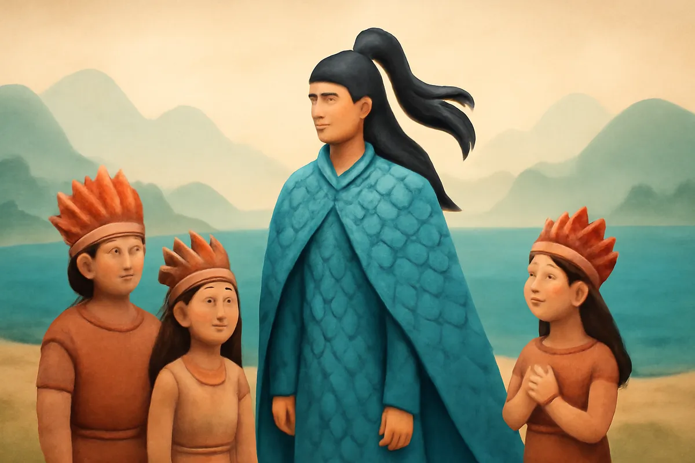
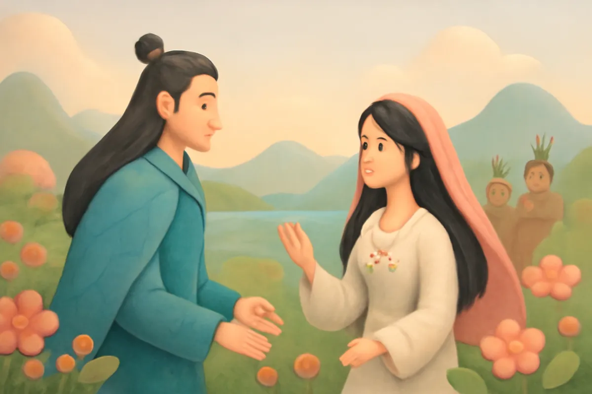
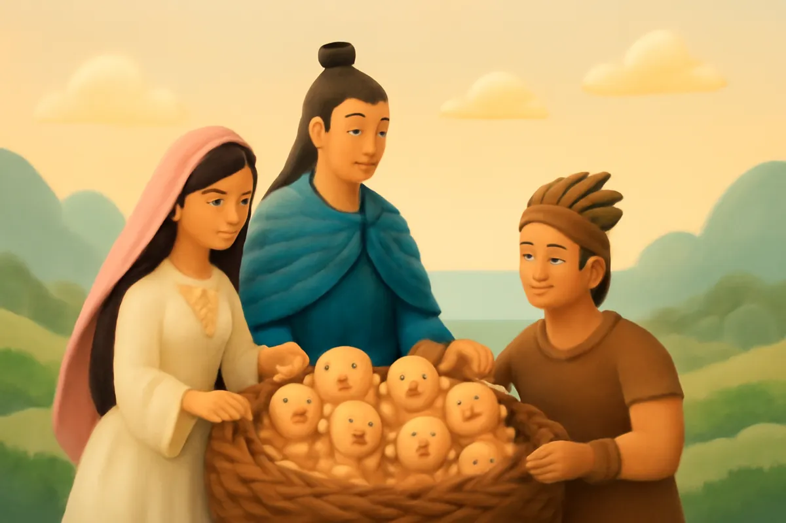
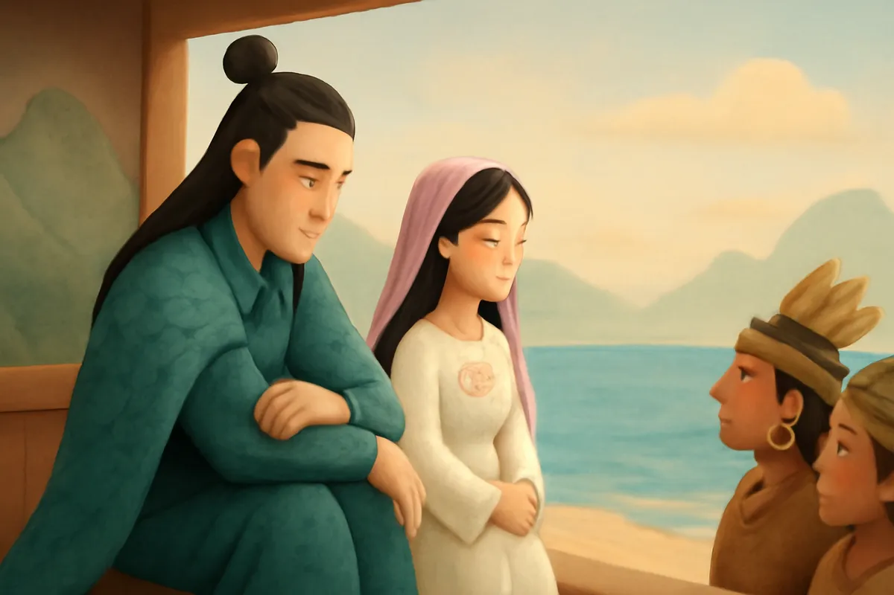
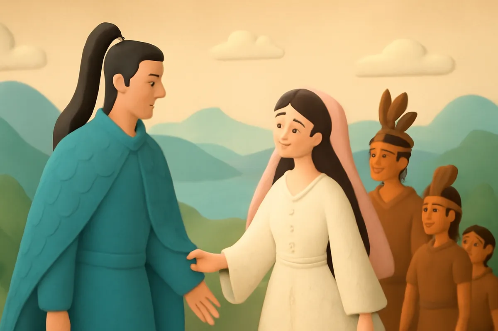
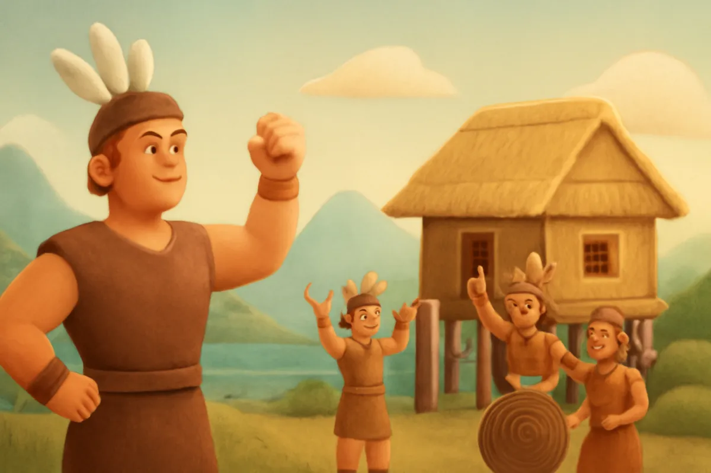
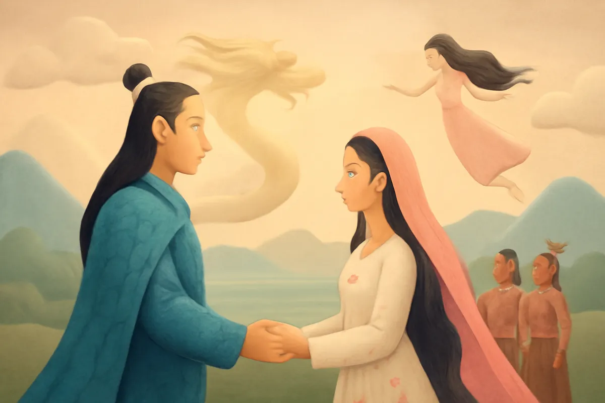

# Con Rồng cháu Tiên

| | |
| --- | --- |
| Mã truyện | `672ac458-22cc-4212-896f-c728f39461a0` |
| Nhóm | Truyện thư viện |
| Nguồn | manual |
| Tạo lúc | 2026-10-15T14:34:09.814347+00:00 |
| Cập nhật | 2026-10-16T04:22:18.002178+00:00 |
| Số trang | 8 |
| Ngôn ngữ | vi |
| Tuổi | 5–8 |
| Giọng kể | Viên - Narrative, Warm and Clear (northern) |
| Trạng thái | published |
| Đã xoá | không |

**Giới thiệu:** Lạc Long Quân nòi rồng gặp nàng tiên Âu Cơ. Âu Cơ sinh bọc trăm trứng nở trăm người con. Năm mươi con theo cha xuống biển, năm mươi con theo mẹ lên núi, con cả làm vua Hùng.

**Bài học:** Người Việt cùng một bọc sinh ra, là đồng bào, phải thương yêu, giúp đỡ nhau.

## Nhân vật

- **Lạc Long Quân** — Thần nòi rồng, sức khoẻ phi thường, thương dân (giọng: Quang — chú trầm ấm)
- **Âu Cơ** — Nàng tiên xinh đẹp ở vùng núi cao, người mẹ hiền (giọng: Kim — chị gái dịu dàng)
- **Con Cả** — Người con trai cả, sau làm vua Hùng (giọng: Thanh — ông hiền từ)

## Trang 1

Ngày xửa ngày xưa, ở vùng đất Lạc Việt có một vị thần nòi rồng tên là Lạc Long Quân. Thần sống dưới thủy cung, mình rồng, sức khoẻ phi thường. Thần thường lên cạn dạy dân cách trồng lúa, chăn nuôi và làm nhà để ở.

**Lạc Long Quân:** Các con hãy cấy lúa ở đồng bằng, trồng dâu bên bờ sông. Có làm thì mới có ăn, có mặc.

Dân làng ai cũng biết ơn thần.

🔊 [Nghe trang 1](../../../media/tts-cache/8e6cbca0-f087-40c5-9f95-bedab7e7b485-1e91a86e-d200-475a-a7d7-6cc5555ad25e.mp3)

## Trang 2

Bấy giờ, ở vùng núi cao phương Bắc có nàng Âu Cơ, thuộc dòng tiên, xinh đẹp tuyệt trần. Nghe nói vùng đất Lạc Việt có nhiều hoa thơm cỏ lạ, nàng tìm đến thăm.

**Âu Cơ:** Ôi, nơi đây núi xanh, sông biếc, hoa nở khắp nơi. Đẹp quá!

Đúng lúc ấy, Lạc Long Quân đi ngang qua và bước tới chào nàng.

**Lạc Long Quân:** Chào nàng tiên. Ta là Lạc Long Quân. Nàng có muốn ở lại đây cùng ta, giúp dân làm ăn không?

🔊 [Nghe trang 2](../../../media/tts-cache/437fbb1e-4e91-4d20-a113-ed8acab3dade-39c866e1-9436-4882-b0f1-d2e27ce6e04f.mp3)

## Trang 3

Âu Cơ gật đầu. Hai người nên vợ nên chồng, sống hạnh phúc trên cạn. Ít lâu sau, Âu Cơ sinh ra một cái bọc lạ, trong bọc có một trăm quả trứng. Trăm trứng nở ra một trăm người con trai hồng hào, khoẻ mạnh.

**Âu Cơ:** Chàng xem này, các con chẳng cần bú mớm mà lớn nhanh như thổi!

**Con Cả:** Thưa cha mẹ, anh em chúng con sẽ chăm ngoan, giúp đỡ cha mẹ.

🔊 [Nghe trang 3](../../../media/tts-cache/9c59d77a-c315-4906-8deb-c4b4645556fd-bab65b1a-507c-4770-ac6c-47395636f9e3.mp3)

## Trang 4

Lạc Long Quân vốn quen sống dưới nước. Ở trên cạn lâu ngày, chàng nhớ biển cả da diết. Một hôm, chàng ngồi buồn bên hiên nhà.

**Lạc Long Quân:** Ta là nòi rồng ở miền nước thẳm, nàng là dòng tiên ở chốn non cao. Ở mãi một nơi, ta khó lòng sống trọn vẹn.

**Âu Cơ:** Vậy chàng tính sao cho các con đây? Thiếp không muốn gia đình mình xa cách.

🔊 [Nghe trang 4](../../../media/tts-cache/078b387c-a792-4c50-a98e-348847706506-c817fe96-3570-48a5-a40d-ce053a87c631.mp3)

## Trang 5

**Lạc Long Quân:** Nay ta đưa năm mươi con xuống biển, nàng đưa năm mươi con lên núi. Chia nhau cai quản các phương. Kẻ miền núi, người miền biển, khi có việc thì giúp đỡ lẫn nhau, đừng quên lời hẹn.

Âu Cơ và các con nghe lời. Trên bờ biển, cả nhà nắm tay nhau thật chặt trước lúc chia tay.

**Con Cả:** Chúng con hứa, núi và biển sẽ luôn là anh em một nhà.

🔊 [Nghe trang 5](../../../media/tts-cache/2f2c741a-9ae3-456a-b75e-4e273ff845f0-694c6292-5580-41a6-b54f-dc8418151765.mp3)

## Trang 6

Lạc Long Quân dẫn năm mươi người con xuống biển. Âu Cơ dẫn năm mươi người con lên núi, đến vùng đất Phong Châu có đồi núi trập trùng, sông suối trong xanh.

**Âu Cơ:** Các con ơi, đây sẽ là quê hương mới của chúng ta. Các con hãy cùng nhau khai hoang, dựng nhà, trồng lúa.

**Con Cả:** Thưa mẹ, chúng con sẽ chăm chỉ làm ăn, giữ gìn nơi này thật tốt.

🔊 [Nghe trang 6](../../../media/tts-cache/21866e05-052c-459c-8892-7ec81ca7a3bd-475c73cd-e0af-4951-9e3e-5947fcc4c935.mp3)

## Trang 7

Người con cả khôn ngoan, khoẻ mạnh được các em tôn lên làm vua, gọi là Hùng Vương. Vua đóng đô ở Phong Châu, đặt tên nước là Văn Lang.

**Con Cả:** Từ nay, nước ta là nước Văn Lang. Ai cũng phải thương yêu, đùm bọc lẫn nhau.

Ngôi vua truyền từ cha sang con, đời đời đều gọi là Hùng Vương. Dân Văn Lang trồng lúa nước, làm nhà sàn, đánh trống đồng mừng mùa vụ.

🔊 [Nghe trang 7](../../../media/tts-cache/449e4f38-22c4-462a-a615-da9cf58a22dd-99825752-032f-42ba-95b5-d5f2d1c98c46.mp3)

## Trang 8

Vì cùng sinh ra từ một bọc trứng của mẹ Âu Cơ, người Việt Nam gọi nhau thân thương là đồng bào. Ai cũng tự hào mình là con Rồng cháu Tiên.

**Âu Cơ:** Dù ở núi hay ở biển, các con vẫn là anh em ruột thịt một nhà.

**Lạc Long Quân:** Hễ có việc, các con gọi cha, cha sẽ về ngay.

Đến nay, mỗi khi gặp khó khăn, người Việt lại nắm tay nhau, giúp đỡ nhau như lời cha mẹ dặn.

🔊 [Nghe trang 8](../../../media/tts-cache/97ce3c62-d600-4c27-a1ba-bf3e0b000a70-1a34053e-927a-49e2-8a47-42591d14ae31.mp3)

---

Bản đầy đủ (mọi cột trong cơ sở dữ liệu): [story.json](story.json)
