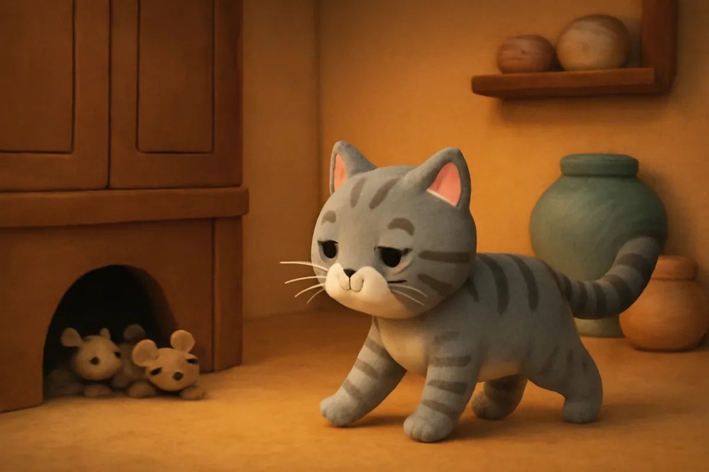
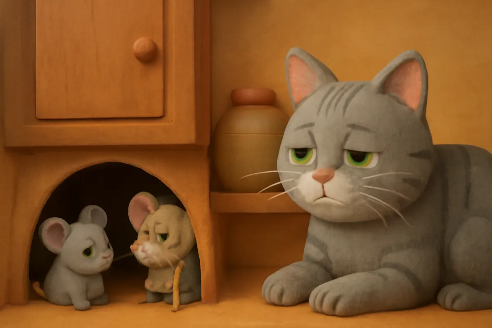
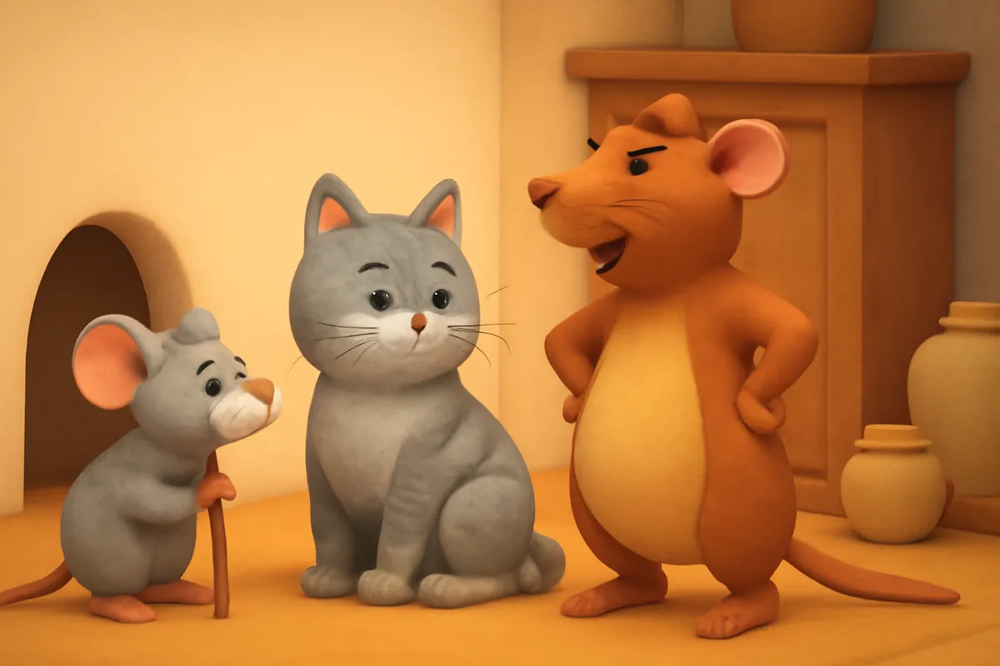
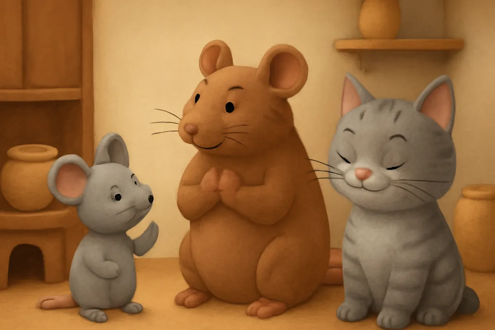
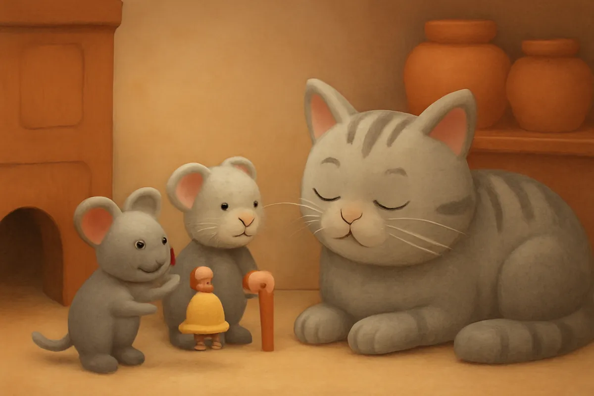
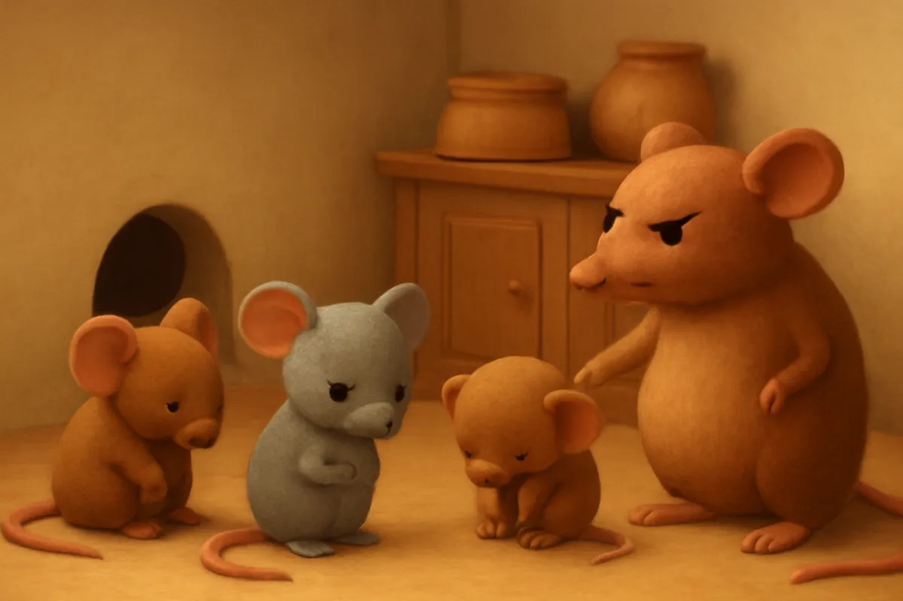
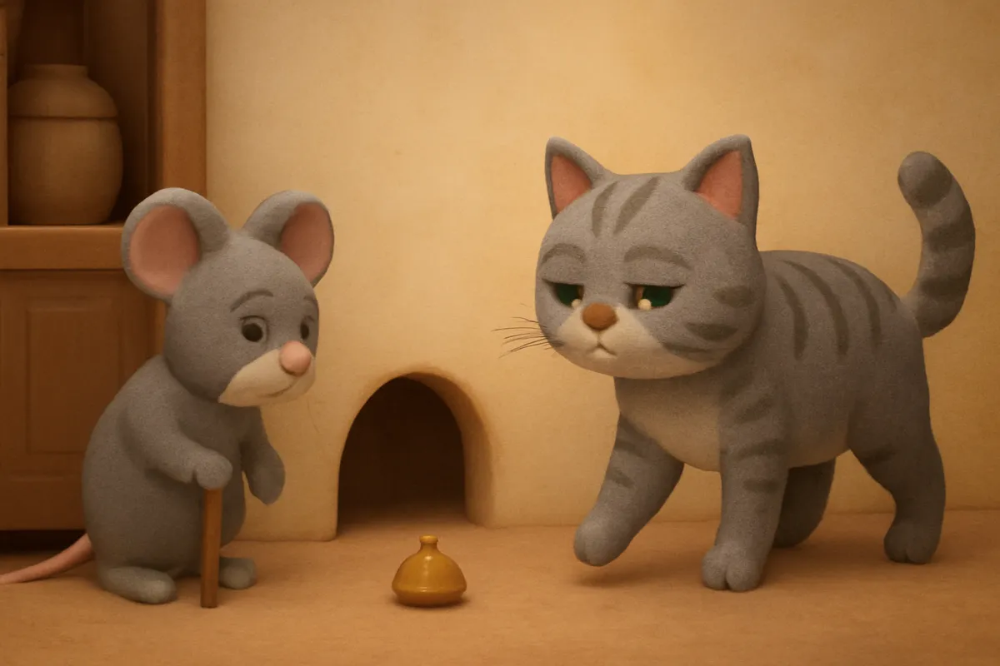
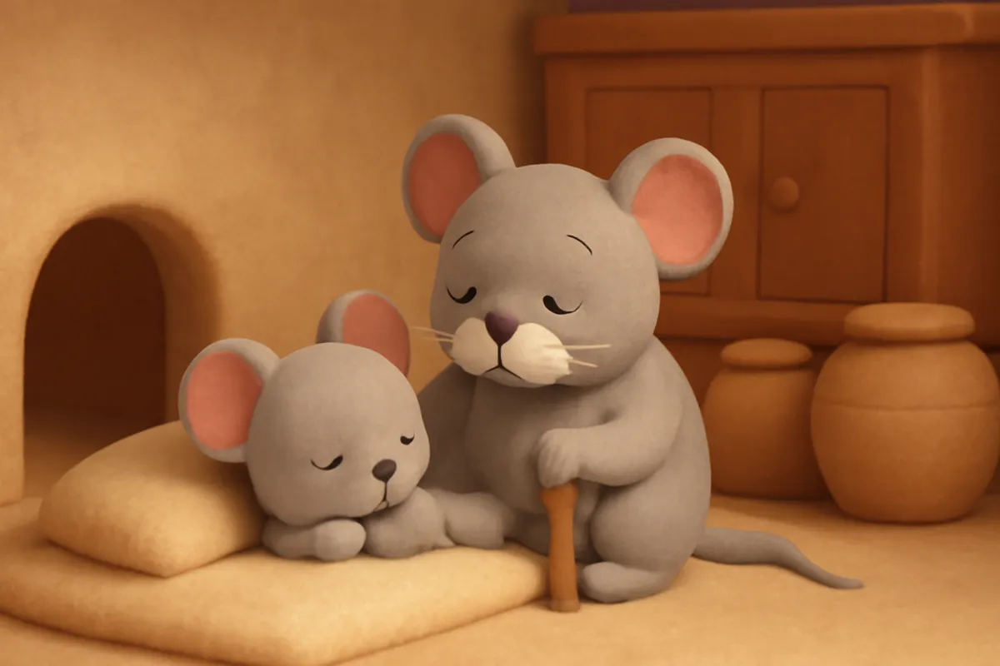

# Đeo nhạc cho mèo

| | |
| --- | --- |
| Mã truyện | `9db07cf1-91c8-46ae-be16-da185011af45` |
| Nhóm | Truyện thư viện |
| Nguồn | manual |
| Tạo lúc | 2026-10-15T14:34:09.814347+00:00 |
| Cập nhật | 2026-10-16T04:22:59.405779+00:00 |
| Số trang | 8 |
| Ngôn ngữ | vi |
| Tuổi | 3–6 |
| Giọng kể | Viên - Narrative, Warm and Clear (northern) |
| Trạng thái | published |
| Đã xoá | không |

**Giới thiệu:** Họ nhà chuột sợ Mèo Mướp nên họp bàn, nghĩ ra cách đeo chuông vào cổ mèo. Ý hay ai cũng khen, nhưng đến lúc phải đi đeo thì chẳng ai dám.

**Bài học:** Nói thì dễ, làm mới khó; ý hay chỉ có ích khi có người làm được.

## Nhân vật

- **Chuột Nhắt** — Chú chuột nhỏ nhanh trí, hay nghĩ ra ý mới (giọng: Bin — bé trai lém lỉnh)
- **Chuột Già** — Cụ chuột già, chủ trì cuộc họp (giọng: Thanh — ông hiền từ)
- **Chuột Cống** — Chú chuột to con, hay khoe khoang (giọng: Quang — chú trầm ấm)
- **Mèo Mướp** — Cô mèo mướp canh gian bếp (giọng: Yuna — bé gái tinh nghịch)

## Trang 1

Trong một ngôi nhà lớn, có một họ chuột đông vui sống dưới gầm bếp. Nhưng nhà ấy lại có cô Mèo Mướp rất tinh mắt.

Đêm nào Mèo Mướp cũng đi tuần quanh gian bếp, bước chân êm ru, chẳng nghe thấy tiếng gì.

**Mèo Mướp:** Meo meo! Đêm nay ta canh bếp. Chú chuột nào dám ra đây lấy trộm đồ ăn nào?

🔊 [Nghe trang 1](../../../media/tts-cache/9ec87ae2-4010-4457-8898-3f5a3cbab34f-4d2a49ac-c0d9-4e06-abd4-2aba7d5ab64b.mp3)

## Trang 2

Họ nhà chuột sợ quá, chẳng dám ra ngoài kiếm ăn. Bụng chú nào cũng đói meo.

Cụ Chuột Già bèn gọi cả họ đến họp trong cái hang ấm dưới gầm tủ.

**Chuột Già:** Các cháu ơi, cứ thế này thì đói mất. Phải nghĩ cách để biết lúc nào Mèo Mướp đi tới.

**Chuột Nhắt:** Thưa cụ, cháu cũng đói lắm rồi ạ.

🔊 [Nghe trang 2](../../../media/tts-cache/20eaef7f-ea74-48fb-9ba2-13bac8f43ab9-69c2f5c6-16d5-4592-b35c-00cc82650515.mp3)

## Trang 3

Cả họ chuột bàn tán xôn xao. Chuột Cống đứng dậy, ưỡn ngực lên.

**Chuột Cống:** Để tôi ra dọa cho mèo một trận! Tôi to khoẻ nhất ở đây mà.

Cả họ nhìn nhau, lắc đầu. Chuột Cống to thật, nhưng vẫn bé hơn Mèo Mướp nhiều lắm.

**Chuột Già:** Không được đâu cháu ạ. Ta cần một cách khôn ngoan hơn.

🔊 [Nghe trang 3](../../../media/tts-cache/2cb2e8bd-d66e-4b59-b129-15d508813bbb-67c93a53-6e62-42e2-8d8e-4b2eac3d168d.mp3)

## Trang 4

Chuột Nhắt suy nghĩ một lúc, rồi giơ tay thật cao.

**Chuột Nhắt:** Cháu có cách rồi! Mình đeo một cái chuông nhỏ vào cổ Mèo Mướp. Mèo đi đến đâu, chuông kêu leng keng đến đó. Nghe tiếng chuông, mình chạy về hang là kịp.

Cả họ chuột reo ầm lên, vỗ tay rào rào.

**Chuột Cống:** Ý hay quá! Sao tôi không nghĩ ra nhỉ?

🔊 [Nghe trang 4](../../../media/tts-cache/e9ee57ba-aa5f-407e-b06a-5b16b0abbc50-11071b50-1b82-477b-bd42-76f2995930ba.mp3)

## Trang 5

Ngay đêm ấy, họ nhà chuột đi tìm được một chiếc chuông nhỏ và một sợi dây đỏ. Chú nào cũng vui, nhảy múa quanh chiếc chuông.

**Chuột Già:** Tốt lắm, ta đã có chuông rồi. Bây giờ chỉ còn một việc nữa thôi.

**Chuột Nhắt:** Việc gì vậy cụ?

**Chuột Già:** Ai sẽ mang chuông đi đeo vào cổ Mèo Mướp?

🔊 [Nghe trang 5](../../../media/tts-cache/e93fa7df-f966-43e6-b26f-0e5d10ec6d5c-9783a178-8fe0-4eab-ae7f-318b1731d91d.mp3)

## Trang 6

Cả hang bỗng im phăng phắc. Chú nào cũng cúi mặt, nhìn xuống chân mình.

**Chuột Cống:** Tôi... tôi đang đau chân lắm. Để lần sau nhé.

**Chuột Nhắt:** Cháu còn bé quá, chắc mèo không cúi xuống cho cháu đeo đâu.

Chú này đẩy cho chú kia, chú kia lại đẩy cho chú khác. Chẳng chú nào chịu nhận việc cả.

🔊 [Nghe trang 6](../../../media/tts-cache/70dff7d5-44fd-4c88-a42d-876df27e6691-8ad726e9-05b9-47bb-9cc5-3401caaa3fca.mp3)

## Trang 7

Chiếc chuông nằm đó, lặng im, không kêu được tiếng nào. Ngoài bếp, Mèo Mướp vẫn đi tuần như mọi đêm.

**Mèo Mướp:** Meo! Hình như trong hang có ai thì thầm thì phải.

Họ nhà chuột lại ôm nhau nấp kỹ.

**Chuột Già:** Các cháu thấy chưa, nói thì dễ, làm mới khó. Ý hay chỉ có ích khi có người làm được.

🔊 [Nghe trang 7](../../../media/tts-cache/1989f82a-dbe5-414d-96f9-a45effda0321-0fb35007-ef1a-4bc0-b3c2-448b3b39d31c.mp3)

## Trang 8

Từ hôm ấy, Chuột Nhắt hiểu ra một điều. Trước khi khoe một ý hay, phải nghĩ xem ai làm và làm thế nào.

**Chuột Nhắt:** Lần sau, cháu sẽ nghĩ cách mà chính cháu cũng làm được.

**Chuột Già:** Giỏi lắm. Biết nghĩ đến việc làm, cháu đã lớn thêm một chút rồi đấy.

Đêm ấy, cả họ chuột nằm sát bên nhau, ngủ thật ngon.

🔊 [Nghe trang 8](../../../media/tts-cache/09d552d3-1980-49a2-a39c-d5cf60e37cd7-0cc987ea-0e0b-495a-8d9b-6875ac228f96.mp3)

---

Bản đầy đủ (mọi cột trong cơ sở dữ liệu): [story.json](story.json)
