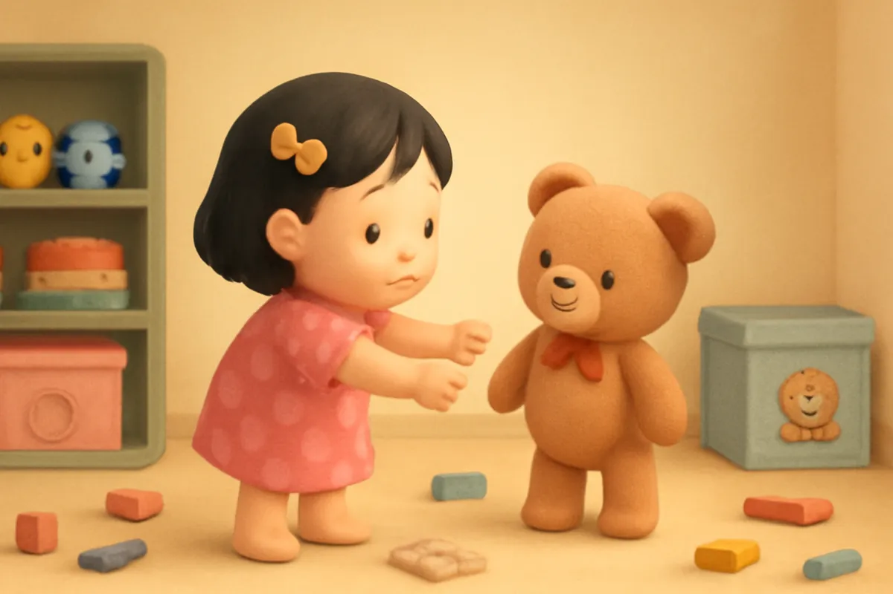
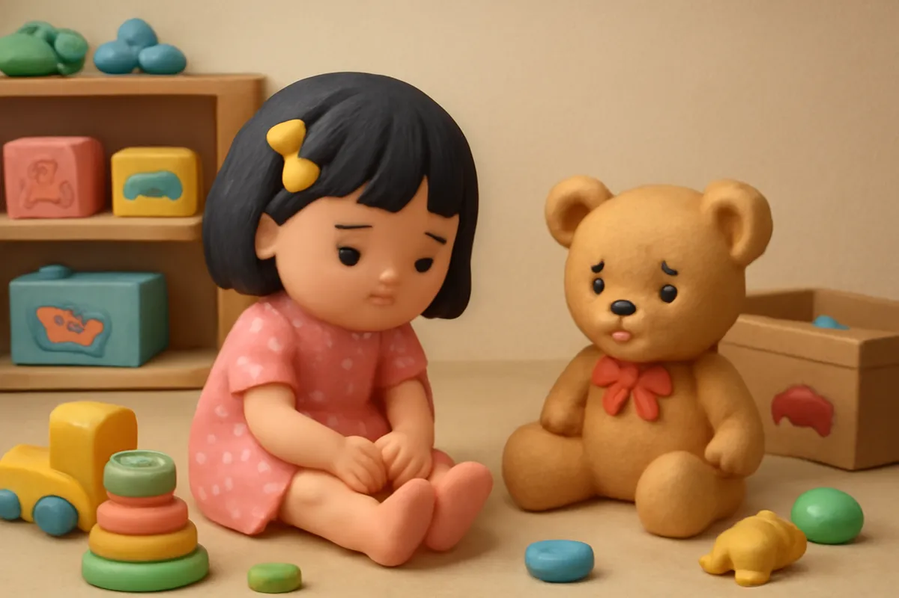
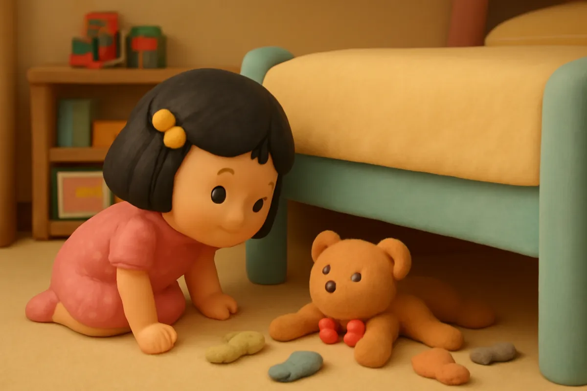
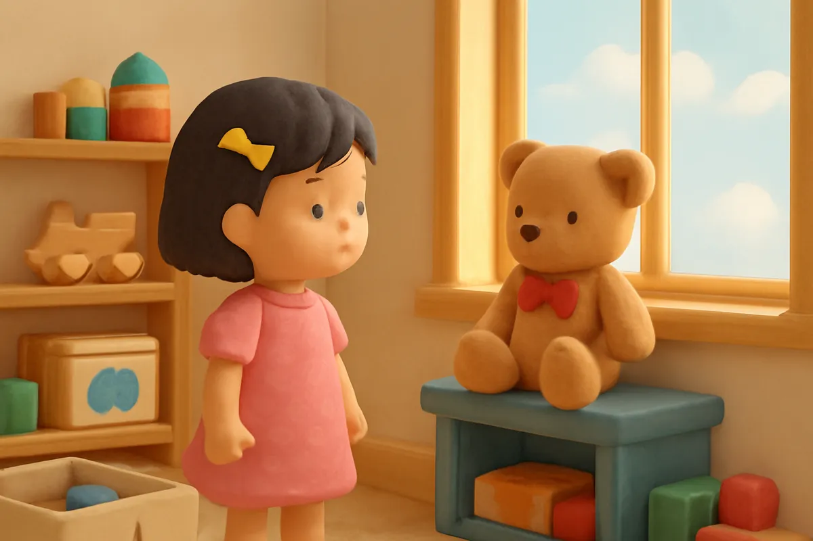
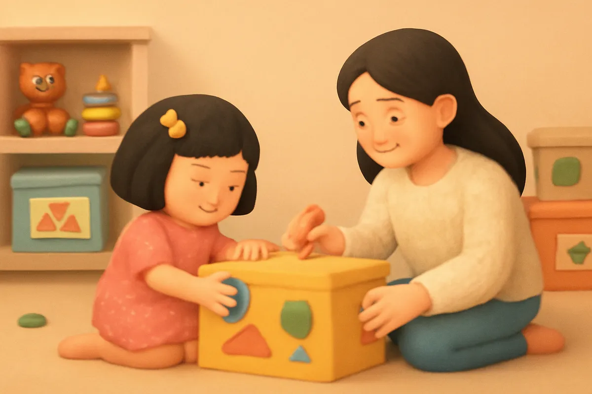
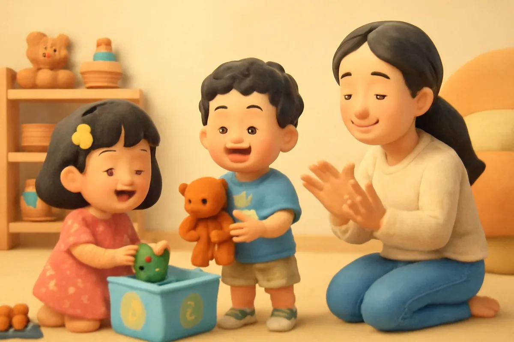
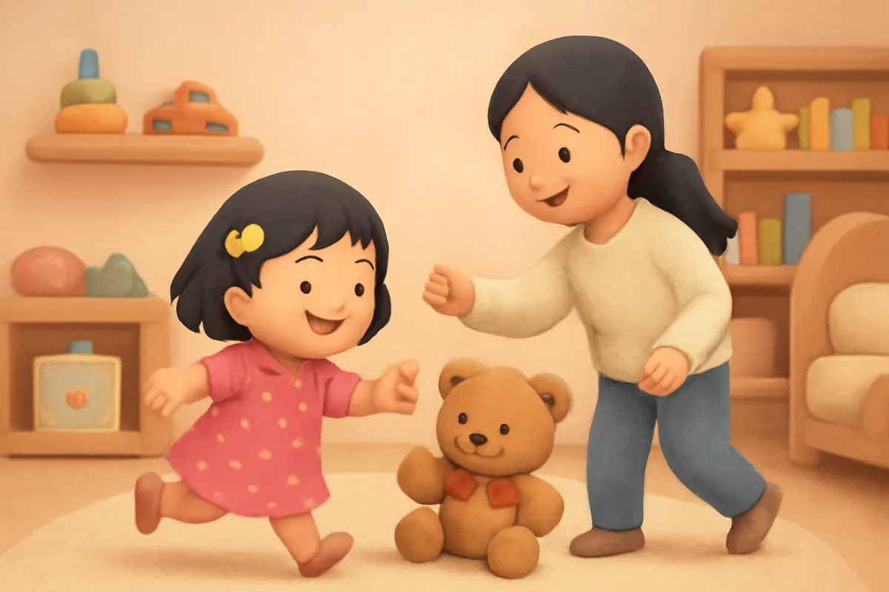
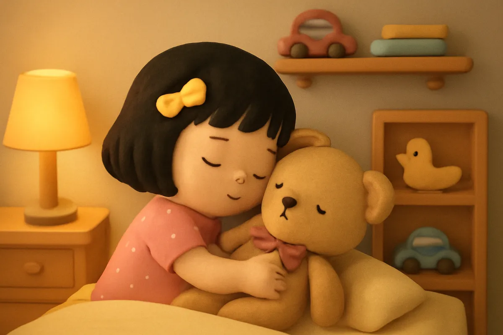

# Đồ chơi muốn về nhà

| | |
| --- | --- |
| Mã truyện | `3cb3ce8f-eac0-4732-bc6e-9e57c499c86b` |
| Nhóm | Truyện thư viện |
| Nguồn | manual |
| Tạo lúc | 2026-10-15T14:34:10.193821+00:00 |
| Cập nhật | 2026-10-16T04:33:23.831013+00:00 |
| Số trang | 8 |
| Ngôn ngữ | vi |
| Tuổi | 3–6 |
| Giọng kể | Viên - Narrative, Warm and Clear (northern) |
| Trạng thái | published |
| Đã xoá | không |

**Giới thiệu:** Phòng của Su bừa bộn đến mức bé không tìm thấy Gấu Bông. Gấu Bông thì thầm rằng đồ chơi nào cũng muốn về nhà, và mẹ dán hình lên từng chiếc hộp để Su tự dọn.

**Bài học:** Đồ chơi nào cũng có nhà; chơi xong mình đưa đồ chơi về nhà nhé.

## Nhân vật

- **Su** — Em gái 4 tuổi của Bo, hay hỏi, thích vẽ (giọng: Yuna — bé gái tinh nghịch)
- **Mẹ** — Mẹ của Bo và Su, dịu dàng, kiên nhẫn (giọng: Tâm — cô kể chuyện cổ tích)
- **Gấu Bông** — Chú gấu bông của Su, chỉ biết nói trong trí tưởng tượng của bé (giọng: Quang — chú trầm ấm)
- **Bo** — Cậu bé 5 tuổi hiếu động, tốt bụng, đang tập thói quen tốt (giọng: Bin — bé trai lém lỉnh)

## Trang 1

Su rất thích chơi. Sáng nay Su chơi xếp hình, trưa chơi búp bê, chiều lại chơi tô màu. Chơi xong món nào, Su để luôn món ấy ở đó. Chẳng mấy chốc, sàn phòng đầy những khối gỗ, bút màu và mảnh ghép.

**Su:** Chơi gì tiếp đây nhỉ? À, mình đi tìm Gấu Bông!

🔊 [Nghe trang 1](../../../media/tts-cache/7c9c4b40-aa35-4acc-a20e-beb22f56036c-43f1867c-e87c-4240-b360-e59cb83e63f5.mp3)

## Trang 2

Su tìm dưới gối, không thấy. Su tìm trong chăn, cũng không thấy. Su bước vội qua đống đồ chơi, giẫm phải một mảnh ghép nhọn.

**Su:** Ui da! Đau chân quá! Gấu Bông ơi, cậu ở đâu rồi?

Su ngồi phịch xuống sàn, mắt rơm rớm. Đồ chơi nhiều thế này mà chẳng tìm thấy bạn thân nhất của mình.

🔊 [Nghe trang 2](../../../media/tts-cache/bbbac5ef-18ff-41a8-b623-2c32f06c2d0a-9ba7c35f-5c53-45aa-a1a9-a6d34f8ca1d7.mp3)

## Trang 3

Bỗng Su nghe một tiếng thì thầm rất khẽ từ dưới gầm giường. Su cúi xuống nhìn. A, Gấu Bông đây rồi, nằm lẫn giữa mấy chiếc tất và một cái hộp bút.

**Gấu Bông:** Su ơi, tớ ở đây! Dưới này tối quá. Tớ muốn về nhà cơ.

**Su:** Nhà của cậu ở đâu hả Gấu Bông?

**Gấu Bông:** Nhà tớ là cái kệ cạnh cửa sổ, chỗ có nắng ấm ấy!

🔊 [Nghe trang 3](../../../media/tts-cache/e5ff4e43-d555-4771-a910-7abbf810cffa-c90a62a1-875d-4d98-9c57-e2559e5985a4.mp3)

## Trang 4

Su ôm Gấu Bông, đặt bạn lên kệ cạnh cửa sổ. Gấu Bông cười tít mắt.

**Gấu Bông:** Cảm ơn Su! Mà này, các bạn đồ chơi khác cũng muốn về nhà đấy. Khối gỗ muốn về hộp gỗ, bút màu muốn về hộp bút, mảnh ghép muốn về túi ghép hình.

**Su:** Ơ, thế đồ chơi nào cũng có nhà à?

**Gấu Bông:** Đúng rồi! Chơi xong, mình đưa các bạn ấy về nhà.

🔊 [Nghe trang 4](../../../media/tts-cache/bbff629d-3a6d-47cb-a919-a7c1554e29b3-df3ff179-cc31-4f05-888a-21d9b58a910c.mp3)

## Trang 5

Mẹ bước vào phòng. Su kể cho mẹ nghe chuyện đồ chơi muốn về nhà. Mẹ mỉm cười, mang đến mấy chiếc hộp và một tờ hình dán.

**Mẹ:** Mình dán hình lên từng hộp nhé. Hộp có hình khối gỗ là nhà của khối gỗ. Hộp có hình cây bút là nhà của bút màu.

**Su:** Con dán! Con dán! Thế này thì con biết ngay đồ chơi nào ở nhà nào.

🔊 [Nghe trang 5](../../../media/tts-cache/a54cae0e-2930-4068-9d7e-a18602db50cf-eceaf0c4-0cba-45a4-8451-5ca55a988d82.mp3)

## Trang 6

Mẹ bày ra một trò chơi: vừa dọn vừa hát.

**Mẹ:** Đồ chơi ơi, về nhà thôi! Đồ chơi ơi, về nhà thôi!

Su nhặt từng khối gỗ bỏ vào hộp gỗ, rồi gom bút màu vào hộp bút. Anh Bo nghe tiếng hát cũng chạy vào.

**Bo:** Anh nhặt mảnh ghép giúp em nhé! Ai nhanh hơn nào?

**Su:** Em thắng rồi! Đồ chơi ơi, về nhà thôi!

🔊 [Nghe trang 6](../../../media/tts-cache/0d66fbcd-88fe-41aa-b046-a38d96326d6e-c75f742c-d457-47d3-9a08-64e4c2f164ce.mp3)

## Trang 7

Chỉ một lát sau, sàn phòng đã sạch bong. Hộp nào cũng đầy đồ chơi, kệ nào cũng gọn gàng. Su chạy tung tăng khắp phòng mà không giẫm phải mảnh ghép nào.

**Gấu Bông:** Cảm ơn Su! Bây giờ ai cũng được về nhà rồi.

**Mẹ:** Con giỏi quá! Phòng gọn gàng thì tìm gì cũng thấy ngay.

🔊 [Nghe trang 7](../../../media/tts-cache/93eecac6-a7ff-4cc9-bb5a-18af251673a7-54b18d18-5d85-4e0a-8a09-55b3aac07b04.mp3)

## Trang 8

Hôm sau, chơi xếp hình xong, Su tự cất khối gỗ vào hộp mà không cần ai nhắc. Tối đến, Su ôm Gấu Bông lên giường.

**Su:** Chúc ngủ ngon, các bạn đồ chơi. Ai cũng ở nhà mình rồi nhé.

Bé ơi, đồ chơi của bé có nhà ở đâu? Chơi xong, bé sẽ đưa món đồ chơi nào về nhà trước nhỉ?

🔊 [Nghe trang 8](../../../media/tts-cache/12a13067-dd00-4949-8573-a5dea55632b9-5de43959-24fa-4bcc-a87c-6e7156e7049c.mp3)

---

Bản đầy đủ (mọi cột trong cơ sở dữ liệu): [story.json](story.json)
