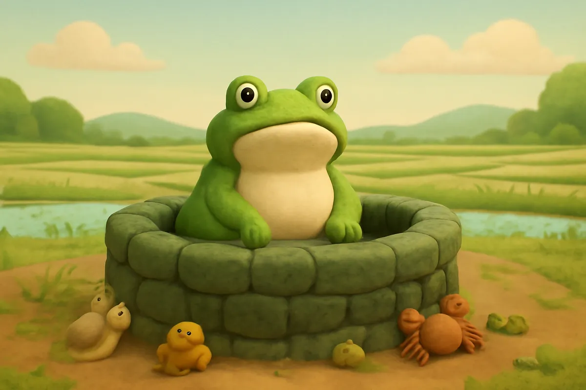
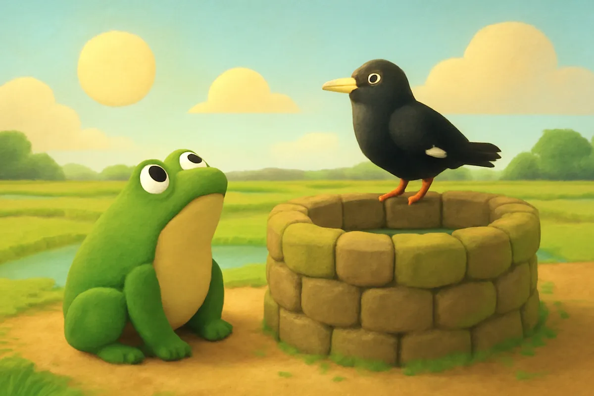
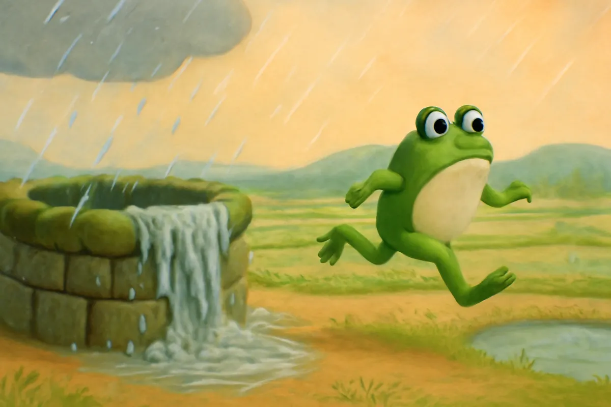
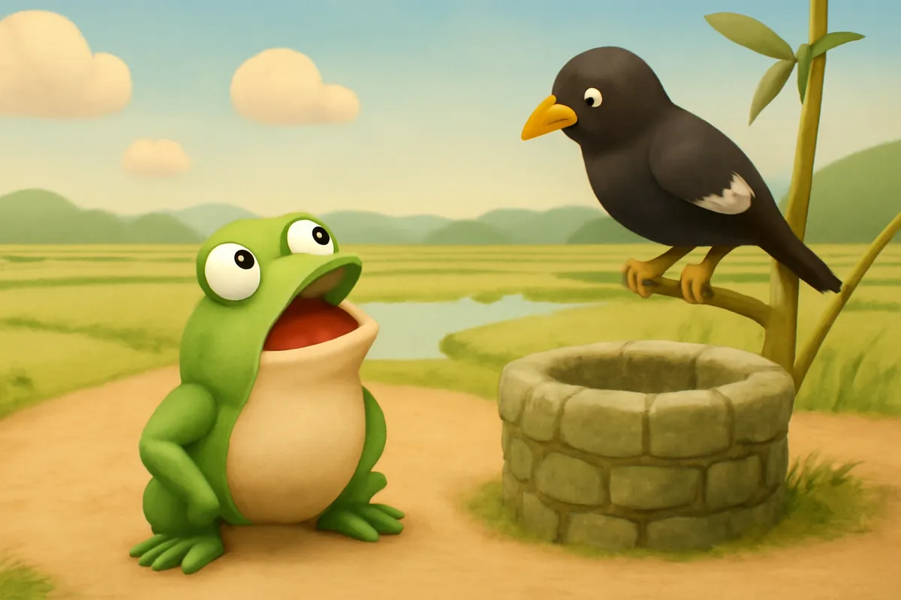
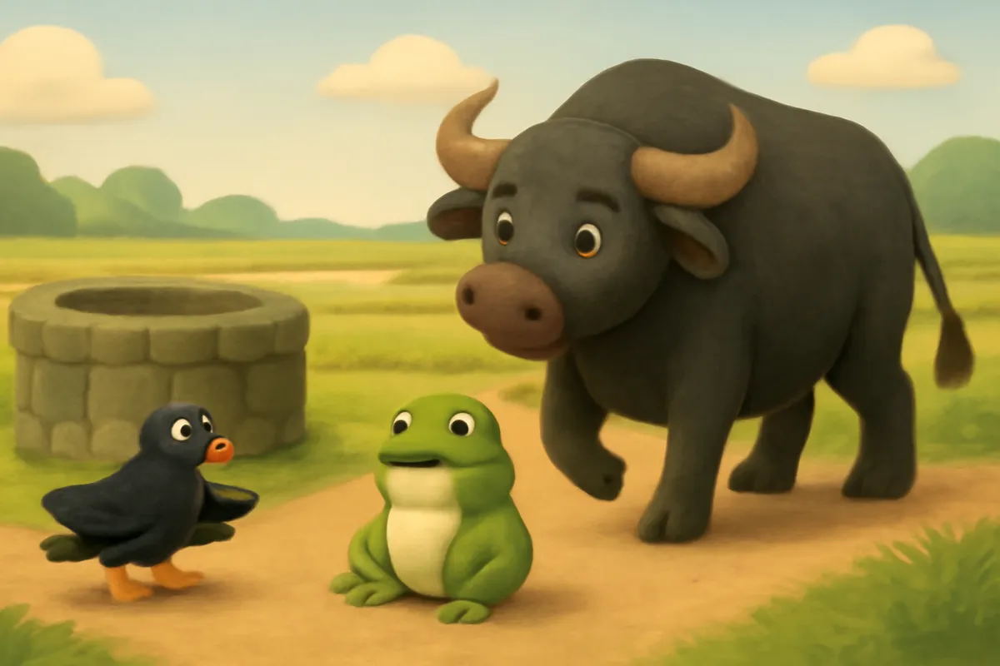
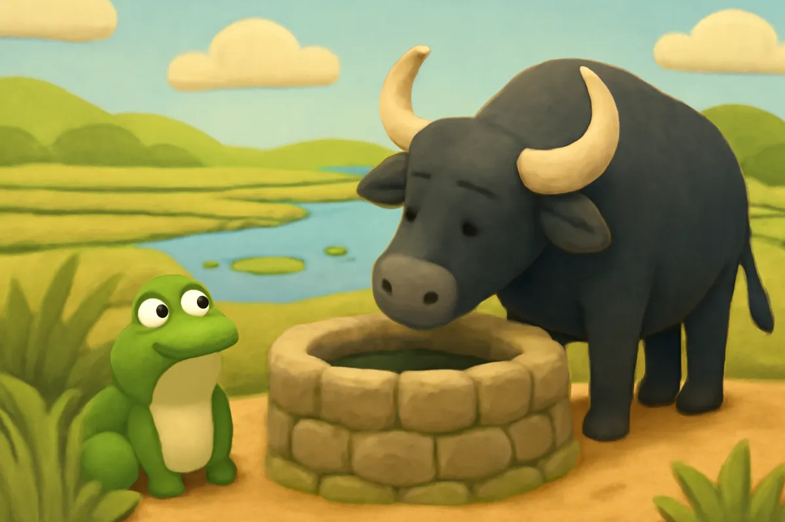
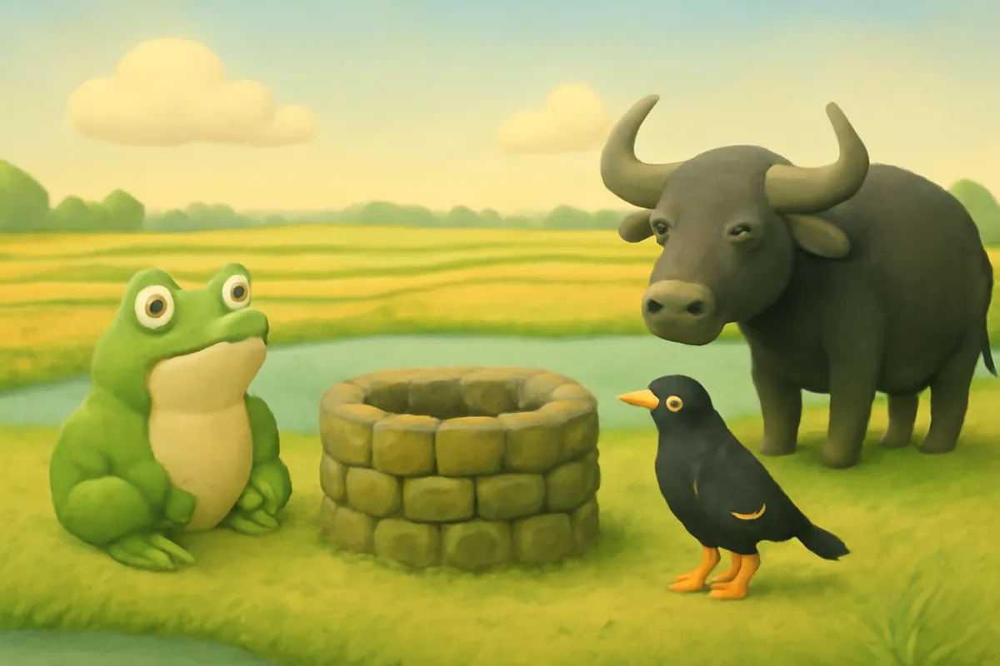
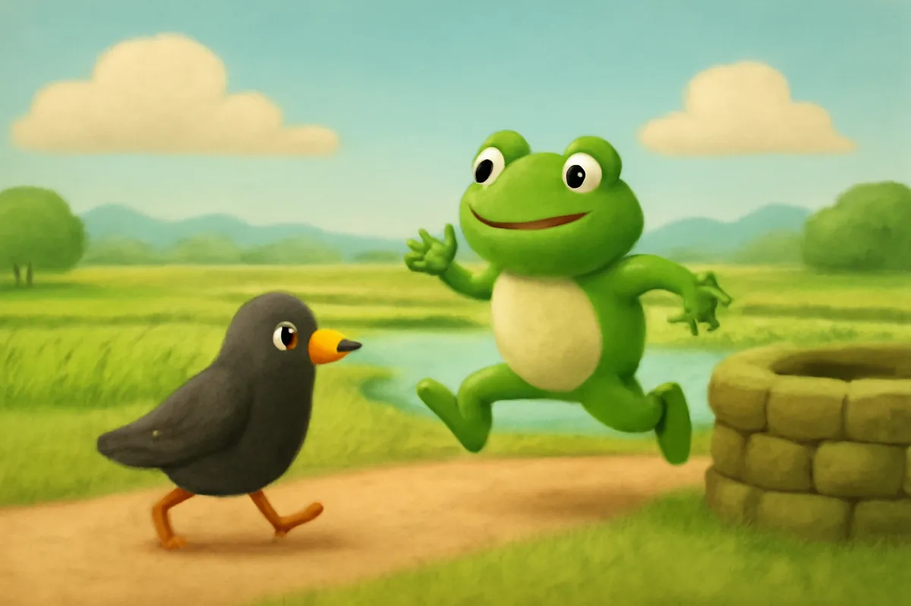

# Ếch ngồi đáy giếng

| | |
| --- | --- |
| Mã truyện | `86a6b2e9-6cfa-4373-9721-41b2ddf9cb58` |
| Nhóm | Truyện thư viện |
| Nguồn | manual |
| Tạo lúc | 2026-10-15T14:34:09.814347+00:00 |
| Cập nhật | 2026-10-16T04:23:37.420756+00:00 |
| Số trang | 8 |
| Ngôn ngữ | vi |
| Tuổi | 3–6 |
| Giọng kể | Viên - Narrative, Warm and Clear (northern) |
| Trạng thái | published |
| Đã xoá | không |

**Giới thiệu:** Chú Ếch sống lâu dưới đáy giếng, tưởng bầu trời chỉ bằng cái vung và mình là to nhất. Ra ngoài, Ếch suýt bị Bác Trâu giẫm phải, may nhờ Chim Sáo nhắc mà biết khiêm tốn.

**Bài học:** Thế giới rất rộng lớn; đừng huênh hoang, hãy khiêm tốn học hỏi.

## Nhân vật

- **Ếch** — Chú ếch nhỏ sống lâu dưới giếng, hay huênh hoang, biết sửa mình (giọng: Bin — bé trai lém lỉnh)
- **Chim Sáo** — Chị chim sáo hiểu biết, hay khuyên bảo (giọng: Tâm — cô kể chuyện cổ tích)
- **Bác Trâu** — Bác trâu già hiền lành, chăm chỉ cày ruộng (giọng: Thanh — ông hiền từ)

## Trang 1

Ngày xưa, có một chú Ếch sống dưới đáy một cái giếng cũ ở góc làng. Xung quanh Ếch chỉ có vài con nhái, con cua và mấy con ốc nhỏ.

Mỗi lần Ếch kêu ộp ộp, tiếng vang lên ầm ĩ khắp giếng. Các con vật nhỏ đều giật mình.

**Ếch:** Ta kêu to thế này, chắc ta là chúa tể muôn loài rồi!

🔊 [Nghe trang 1](../../../media/tts-cache/ef9836e7-28b4-481d-b94f-6f1557e35b2a-849c2cbc-45bc-4321-b09a-90cedc609fe8.mp3)

## Trang 2

Ếch ngước nhìn lên miệng giếng. Bầu trời trên cao chỉ tròn bằng cái vung nồi.

**Ếch:** Trời chỉ bé bằng cái vung thôi. Thế giới này nhỏ xíu, mà ta lại to nhất ở đây!

Một hôm, Chim Sáo bay ngang qua, đậu xuống thành giếng uống nước.

**Chim Sáo:** Chào Ếch! Bầu trời rộng lắm, bay cả ngày cũng chưa hết đâu.

**Ếch:** Chị nói sai rồi! Trời chỉ bằng cái vung thôi!

🔊 [Nghe trang 2](../../../media/tts-cache/8a48ac9f-134f-4a4f-b03e-e5d582ae60b5-6461a05f-f2a5-4e13-bcb6-1784455b4112.mp3)

## Trang 3

Năm ấy, trời mưa to suốt mấy ngày liền. Nước trong giếng dâng lên, dâng lên mãi, tràn cả ra ngoài.

Ếch theo dòng nước, nổi lên miệng giếng rồi nhảy ra bãi cỏ bên ngoài.

**Ếch:** Ôi, trời rộng thế này cơ à? Có mây, có cây, có cánh đồng xa tít!

Nhưng chỉ một lát, Ếch lại ưỡn ngực lên.

**Ếch:** Chẳng sao cả. Ở đâu thì ta cũng là to nhất!

🔊 [Nghe trang 3](../../../media/tts-cache/274d5581-1cc2-415e-92dd-41ce760e25ef-49559884-85d4-4b8b-8f2c-883cb23ead15.mp3)

## Trang 4

Ếch nhảy nghênh ngang khắp nơi, ngửa mặt lên trời, kêu ộp ộp thật to.

**Ếch:** Hỡi muôn loài, hãy cúi chào ta đi!

Nhưng ngoài này rộng quá. Tiếng kêu của Ếch bé tí, lẫn vào tiếng gió, tiếng chim. Chẳng ai để ý đến Ếch cả.

Chim Sáo đậu trên cành tre, lắc đầu.

**Chim Sáo:** Ếch ơi, đi đường phải nhìn trước nhìn sau, đừng nhìn mãi lên trời thế!

🔊 [Nghe trang 4](../../../media/tts-cache/5e91f98a-1349-469c-994a-284b4d10ea3f-56de6245-f653-4254-8e3e-033fb34d7974.mp3)

## Trang 5

Ếch chẳng thèm nghe. Ếch cứ ngẩng cao đầu, nhảy ra giữa con đường làng.

Đúng lúc ấy, Bác Trâu đi cày về, bước những bước chân to và nặng. Bác mệt nên không nhìn thấy Ếch bé xíu dưới đất.

**Chim Sáo:** Ếch ơi, coi chừng! Nhảy sang bên mau lên!

**Bác Trâu:** Ụm bò... Ai đấy? Ai ở dưới chân ta thế?

🔊 [Nghe trang 5](../../../media/tts-cache/829395dc-185f-4d35-b7c2-f3d7ccb84d71-bb81fbef-100d-429c-8508-0bce409163b0.mp3)

## Trang 6

Ếch giật mình, nhảy phắt sang bụi cỏ bên đường. Chiếc chân to của Bác Trâu đặt xuống ngay chỗ Ếch vừa đứng. Bùn bắn tung toé.

Bác Trâu dừng lại, cúi đầu nhìn xuống.

**Bác Trâu:** May quá, cháu không sao chứ? Đi đường phải cẩn thận, cháu ạ.

**Ếch:** Dạ... cháu không sao. Em cảm ơn chị Sáo. Cháu xin lỗi bác Trâu ạ.

🔊 [Nghe trang 6](../../../media/tts-cache/cf499368-43e5-41bd-b55f-dc885c4121dc-8a4264a5-88f3-4c99-ae62-7136d379f45b.mp3)

## Trang 7

Ếch ngồi trong bụi cỏ bên bờ ao, tim vẫn còn đập thình thịch. Ếch nhìn bầu trời rộng, nhìn cánh đồng mênh mông.

**Ếch:** Hoá ra thế giới rộng lớn lắm. Ếch chỉ biết mỗi cái giếng nhỏ mà cứ tưởng mình to nhất.

**Chim Sáo:** Biết mình chưa biết là giỏi rồi đấy. Thế giới còn bao nhiêu điều để học.

**Bác Trâu:** Muốn biết nhiều thì phải đi nhiều, nghe nhiều cháu ạ.

🔊 [Nghe trang 7](../../../media/tts-cache/c0e6a9a4-023b-4264-8f8d-e98985dacbf4-4d38e341-f2dc-428b-ac61-38da82529448.mp3)

## Trang 8

Từ hôm đó, Ếch không còn khoe khoang nữa. Ếch theo Chim Sáo đi thăm ao làng, cánh đồng, rặng tre. Đi đến đâu, Ếch cũng lắng nghe và học hỏi.

**Ếch:** Ộp ộp! Hôm nay em lại biết thêm một điều mới!

**Chim Sáo:** Giỏi lắm! Ngày mai chị dẫn em đi xem dòng sông lớn nhé.

Bầu trời trên đầu Ếch giờ đây thật rộng, thật xanh.

🔊 [Nghe trang 8](../../../media/tts-cache/f3789116-40c1-49ed-b718-a18a1967ce25-bedff7f3-7c20-418c-8ffe-00c613517a98.mp3)

---

Bản đầy đủ (mọi cột trong cơ sở dữ liệu): [story.json](story.json)
