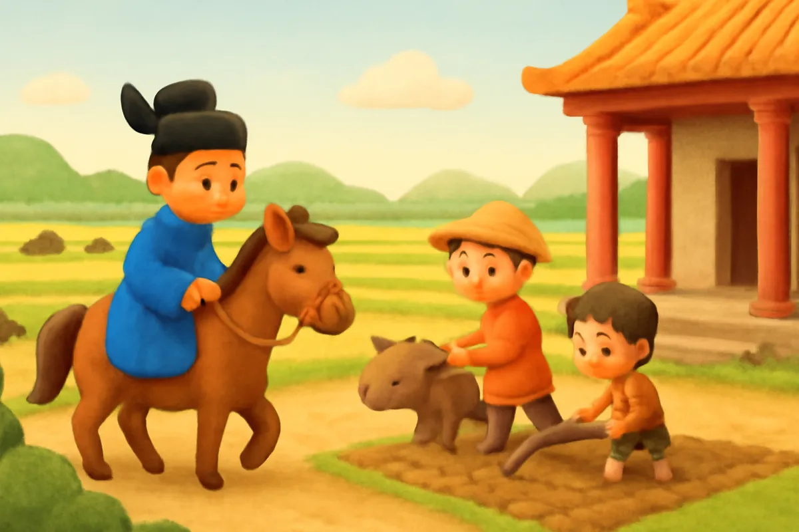
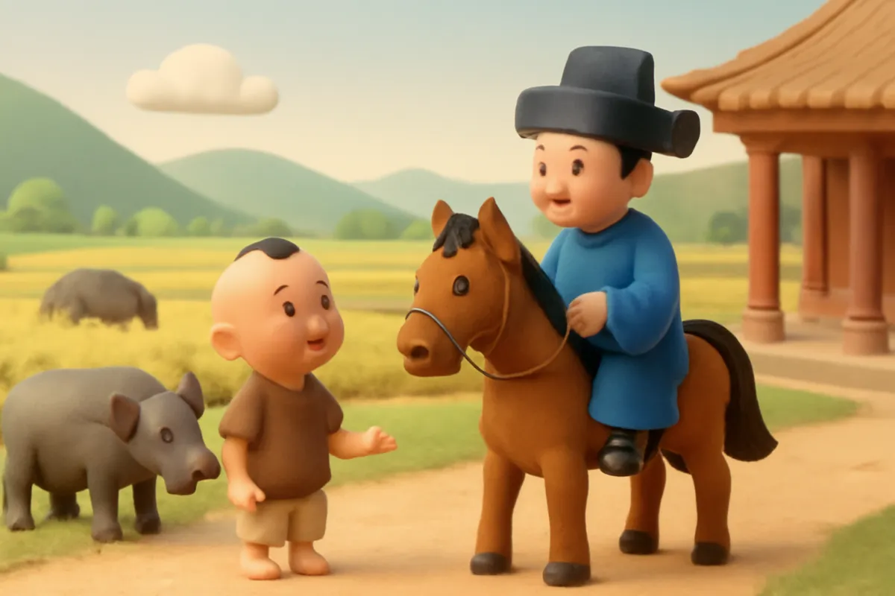
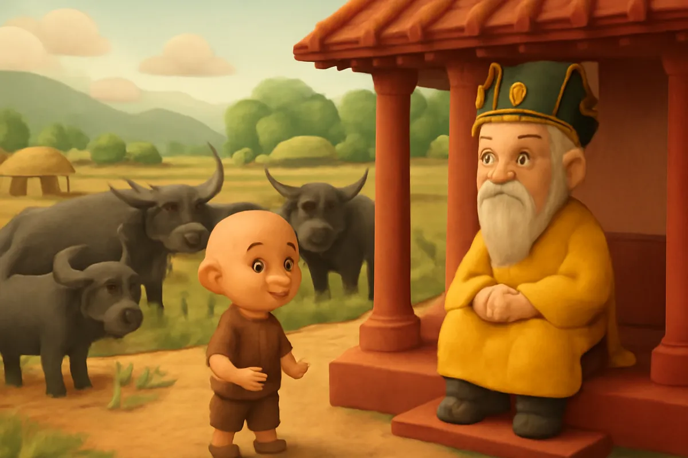
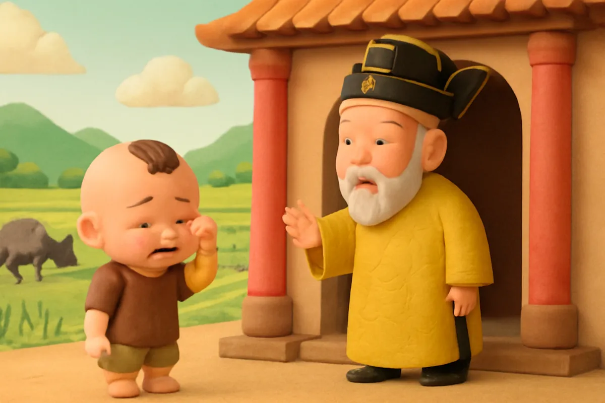
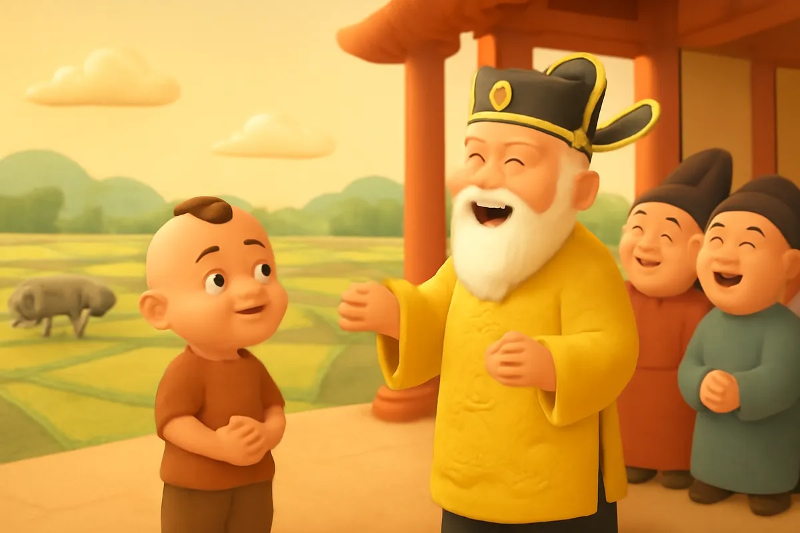
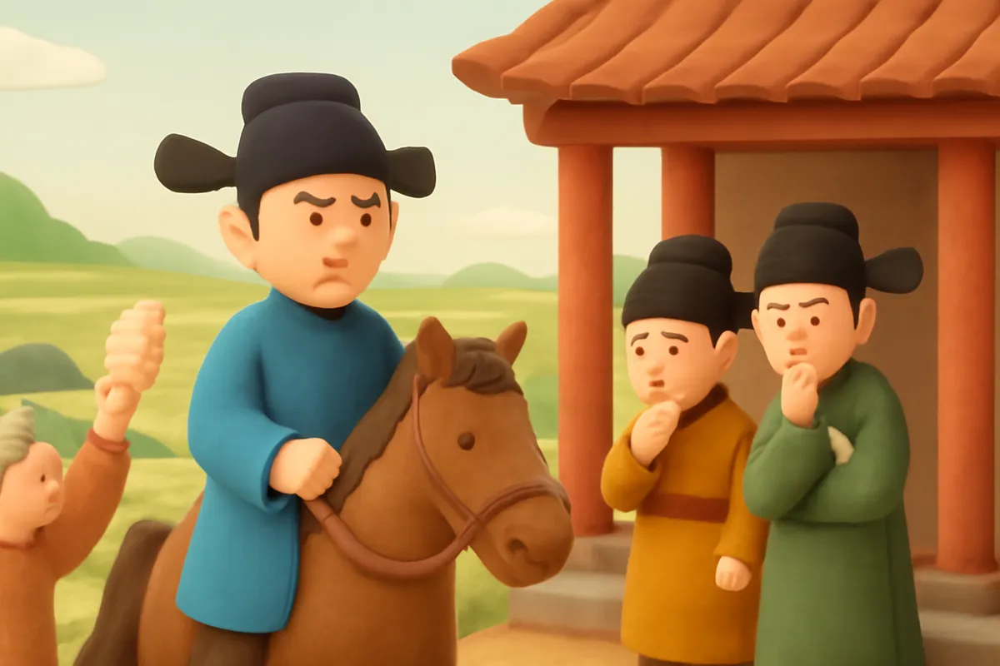
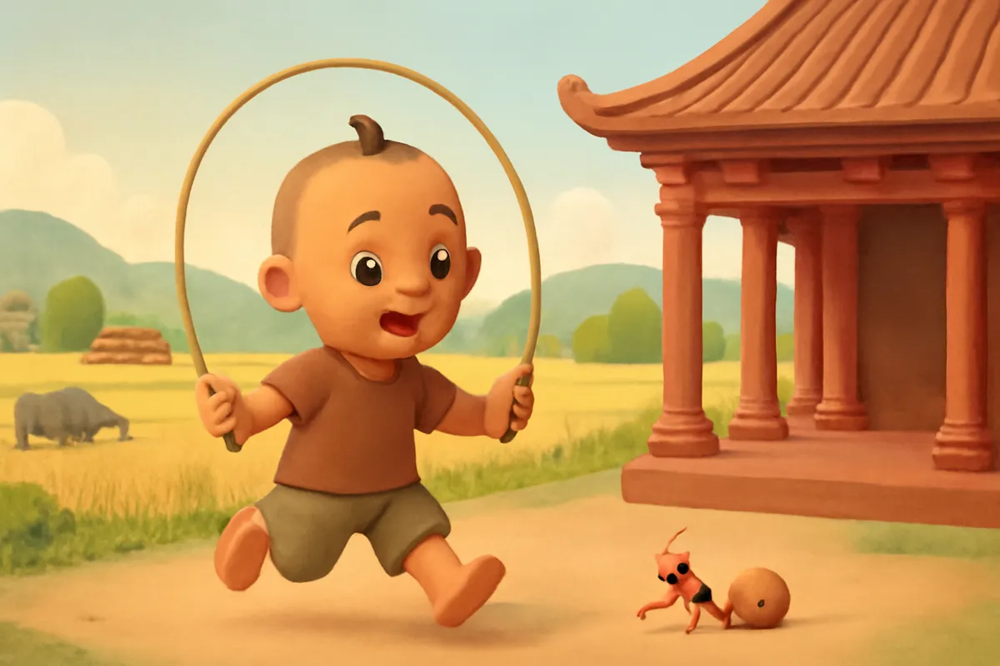
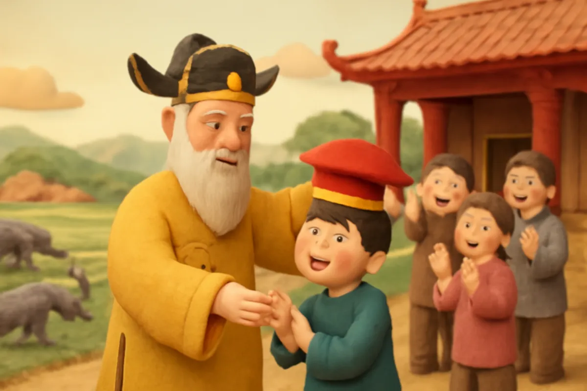

# Em bé thông minh

| | |
| --- | --- |
| Mã truyện | `9aeb993e-f909-40c4-87d8-5524ee0b7907` |
| Nhóm | Truyện thư viện |
| Nguồn | manual |
| Tạo lúc | 2026-10-15T14:34:09.448749+00:00 |
| Cập nhật | 2026-10-16T04:25:10.938932+00:00 |
| Số trang | 8 |
| Ngôn ngữ | vi |
| Tuổi | 5–9 |
| Giọng kể | Viên - Narrative, Warm and Clear (northern) |
| Trạng thái | published |
| Đã xoá | không |

**Giới thiệu:** Viên quan đi tìm người tài gặp một cậu bé đáp lại câu đố rất nhanh trí. Cậu bé giải được câu đố trâu đực đẻ con của vua và câu đố xâu chỉ qua vỏ ốc của sứ giả nước láng giềng.

**Bài học:** Nhanh trí, bình tĩnh và dùng sự thông minh để giúp mọi người.

## Nhân vật

- **Em Bé** — Cậu bé bảy, tám tuổi, nhanh trí, lễ phép (giọng: Bin — bé trai lém lỉnh)
- **Viên Quan** — Viên quan được vua sai đi tìm người tài (giọng: Quang — chú trầm ấm)
- **Nhà Vua** — Nhà vua thích người tài, vui tính (giọng: Thanh — ông hiền từ)

## Trang 1

Ngày xưa, có một ông vua muốn tìm người tài giúp nước. Vua sai một viên quan đi khắp nơi, ra những câu đố thật khó để thử tài mọi người.

Một hôm, viên quan đi qua cánh đồng, thấy hai cha con đang cày ruộng. Ông liền hỏi người cha:

**Viên Quan:** Này ông kia! Trâu của ông cày một ngày được mấy đường?

Người cha ngẩn người, chưa biết trả lời ra sao.

🔊 [Nghe trang 1](../../../media/tts-cache/1df71943-e356-41ed-ae8b-47d615b00b4e-86d1ba95-a7b0-4bc8-8391-b58514285f6c.mp3)

## Trang 2

Cậu con trai mới bảy, tám tuổi, nhanh nhảu đáp lại:

**Em Bé:** Thưa ông, thế ngựa của ông đi một ngày được mấy bước ạ?

Viên quan sững sờ, không trả lời được. Ông thầm nghĩ, cậu bé này thật thông minh, chắc là người tài mình đang tìm. Ông vội về kinh tâu với vua.

**Viên Quan:** Tâu bệ hạ, thần đã tìm được một cậu bé rất lanh lợi.

🔊 [Nghe trang 2](../../../media/tts-cache/8c2d1ef5-9f1c-4bc8-90d3-2e84eca81989-0baafdeb-bce6-4111-ab28-79d8a1410db0.mp3)

## Trang 3

Vua muốn thử thêm. Vua ban cho làng cậu bé ba thúng gạo nếp và ba con trâu đực, rồi ra lệnh:

**Nhà Vua:** Nuôi ba con trâu đực này cho đẻ thành chín con. Sang năm phải nộp đủ!

Cả làng lo sợ, vì trâu đực làm sao mà đẻ được? Cậu bé thì chỉ mỉm cười.

**Em Bé:** Cha ơi, cha đừng lo. Con có cách rồi!

🔊 [Nghe trang 3](../../../media/tts-cache/94932900-b3f0-412a-8d96-68e5fde97a49-cfcf50d7-88a7-488e-90a4-fdbb4d3a5f2a.mp3)

## Trang 4

Cậu bé bảo dân làng lấy gạo nếp đồ xôi chia nhau ăn cho vui, còn trâu thì cứ đem đi cày ruộng. Rồi cậu theo cha lên kinh thành. Đến trước cổng cung vua, cậu khóc ầm lên.

**Nhà Vua:** Cậu bé kia, sao lại khóc ở đây?

**Em Bé:** Tâu đức vua, con muốn có em bé để chơi cùng, mà cha con nhất định không chịu đẻ em bé cho con!

🔊 [Nghe trang 4](../../../media/tts-cache/4a68ab16-11f9-4ab9-b878-6ee704a82041-9b6d85c8-6248-4d6b-abbf-37c2c75d9f11.mp3)

## Trang 5

Vua cùng các quan bật cười.

**Nhà Vua:** Cha con là đàn ông, làm sao mà đẻ được em bé!

**Em Bé:** Thưa đức vua, đàn ông không đẻ được, thì trâu đực làm sao đẻ được ạ?

Vua cười vang, biết cậu bé thông minh thật. Vua ban thưởng cho làng cậu, không bắt nộp trâu nữa. Nhưng vua vẫn muốn xem cậu còn giỏi đến đâu.

🔊 [Nghe trang 5](../../../media/tts-cache/0bd48447-9d1e-4869-b2de-3947caf82262-35dad791-22ce-4c43-b211-8df17d6af80b.mp3)

## Trang 6

Một hôm, sứ giả nước láng giềng đến, mang theo một chiếc vỏ ốc vặn rất dài, rỗng hai đầu. Họ đố: làm sao xâu được sợi chỉ mảnh xuyên qua ruột ốc quanh co?

**Viên Quan:** Đường ruột ốc quanh co thế này, xâu sao nổi?

Các quan đều lắc đầu, chẳng ai nghĩ ra cách. Vua liền cho người đi mời cậu bé.

🔊 [Nghe trang 6](../../../media/tts-cache/dd16d3ea-f351-49da-9b08-491aa3b39097-b3804992-998c-4e08-b161-2a478f28dcea.mp3)

## Trang 7

Cậu bé đang chơi nhảy dây, nghe chuyện, liền vừa nhảy vừa hát:

**Em Bé:** Tang tình tang, tính tang tình. Bắt con kiến càng, buộc chỉ ngang lưng. Bên thì lấy giấy mà bưng, bên thì bôi mỡ, kiến mừng kiến sang!

Người ta làm theo. Con kiến ngửi thấy mùi mỡ, bò quanh co trong ruột ốc, kéo sợi chỉ sang bên kia.

🔊 [Nghe trang 7](../../../media/tts-cache/b01c0e68-9750-417b-b11e-0ec12123d21c-ef7503f1-4104-4693-aed8-30181df8b418.mp3)

## Trang 8

Sứ giả nước láng giềng phục lắm, khen nước ta có người tài.

**Nhà Vua:** Cậu bé tuy nhỏ tuổi mà thông minh hơn người. Ta phong cho cậu làm trạng nguyên!

Vua cho xây nhà cho cậu ở gần cung để tiện hỏi han. Cậu bé vẫn chăm học, chăm hỏi, và dùng sự thông minh của mình để giúp đỡ mọi người.

🔊 [Nghe trang 8](../../../media/tts-cache/81db29bc-566b-43df-9256-a6117a9c98f8-6f90ae50-7055-419b-9ee4-c8510008013a.mp3)

---

Bản đầy đủ (mọi cột trong cơ sở dữ liệu): [story.json](story.json)
