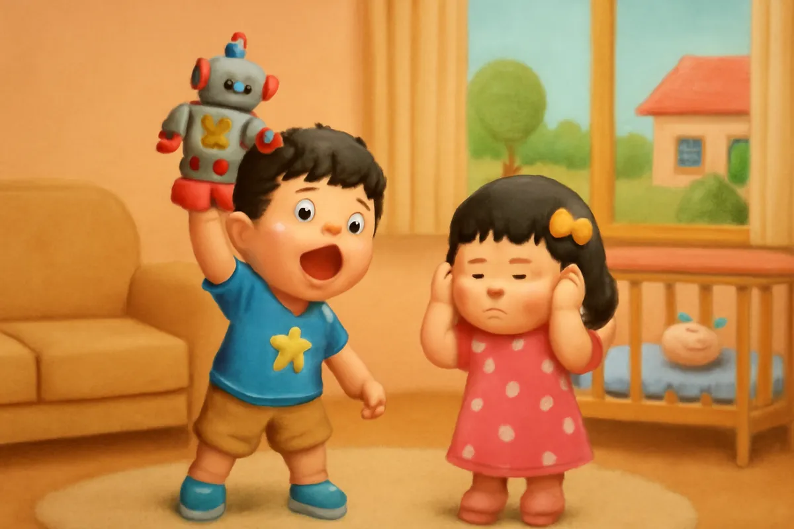
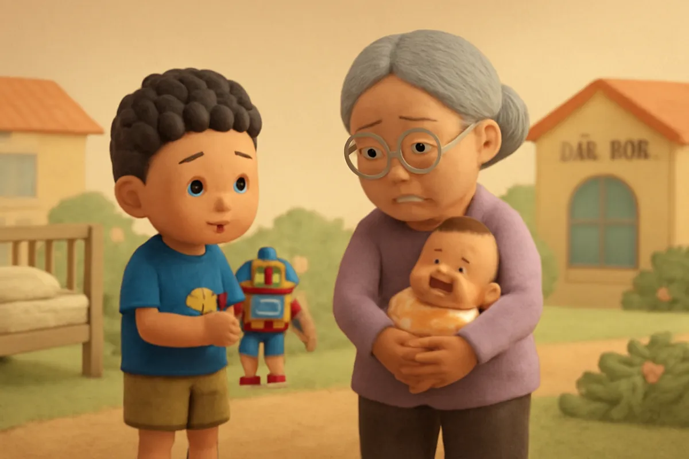
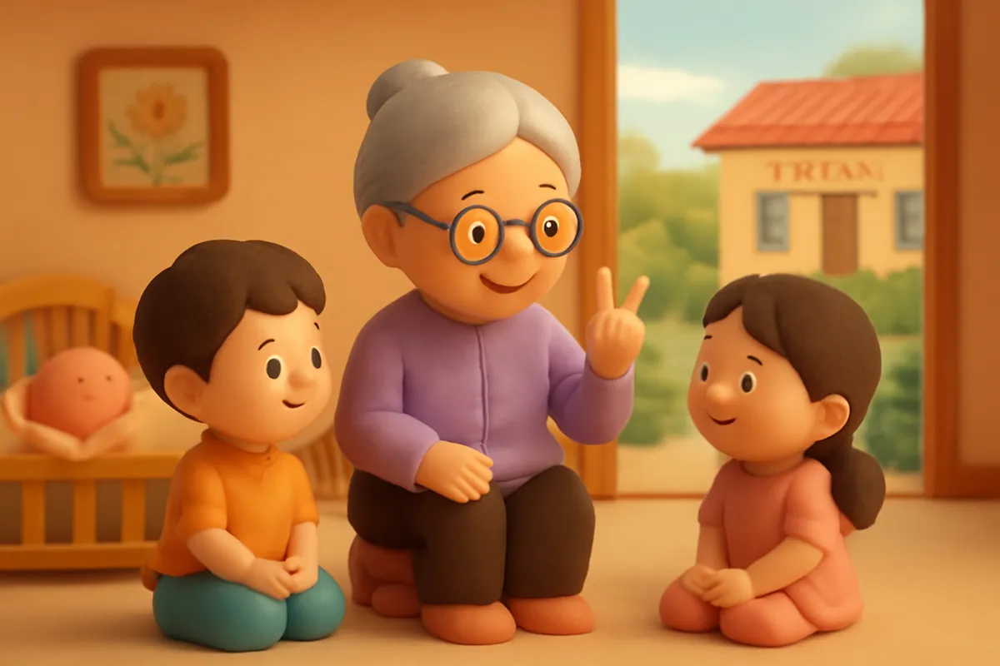
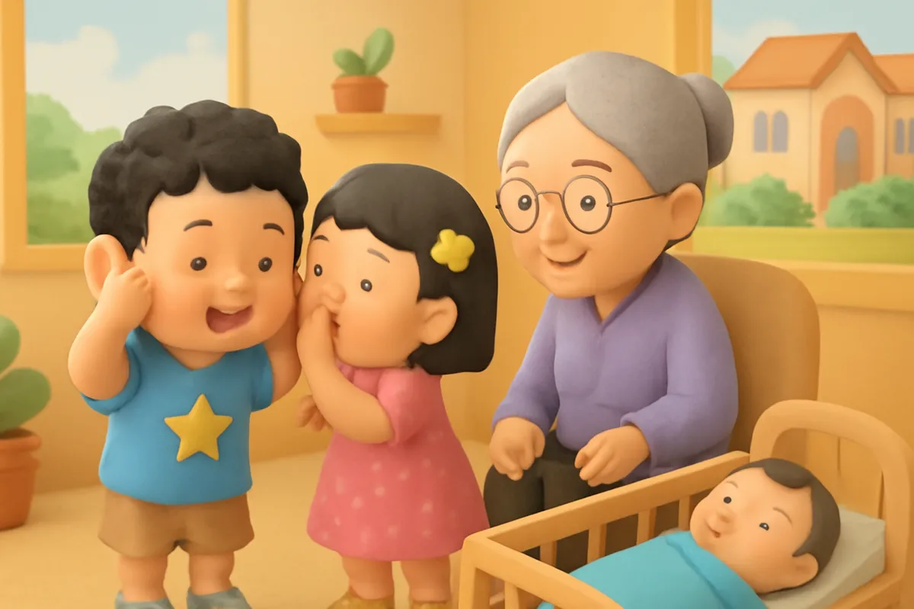
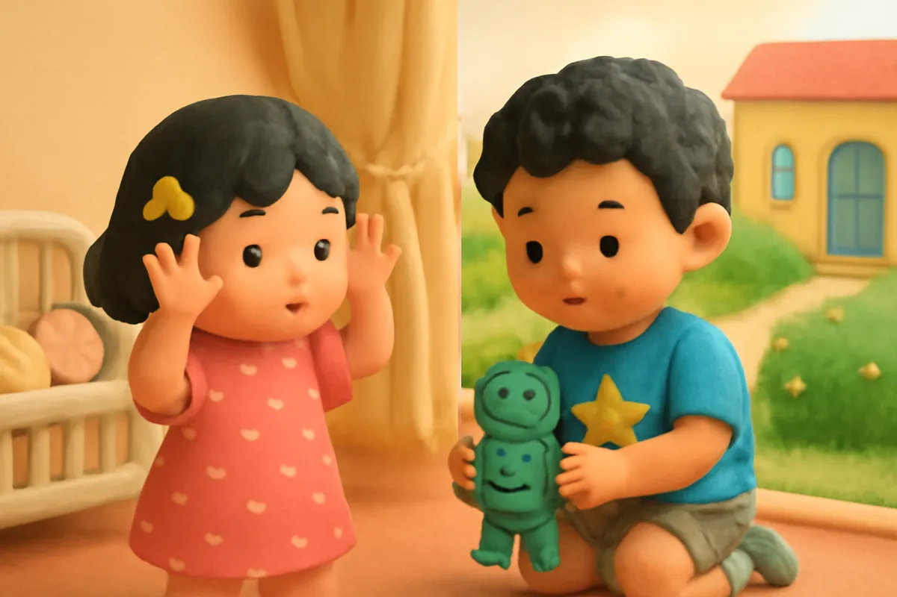
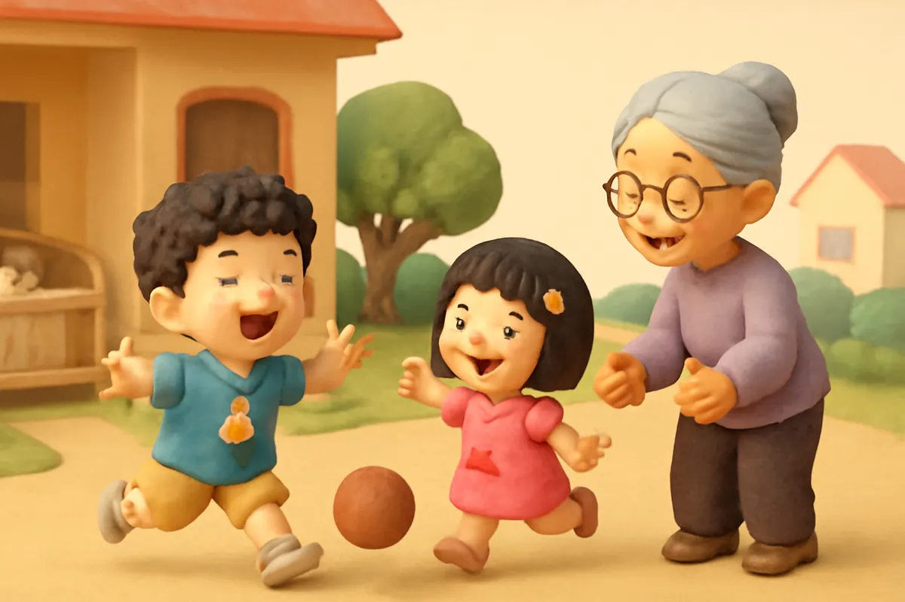
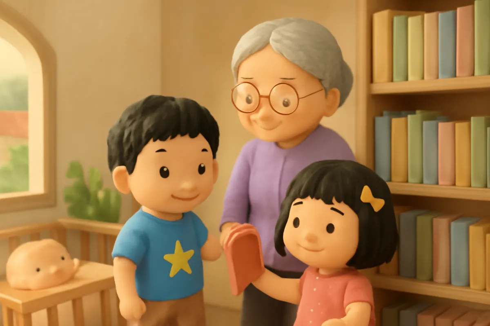
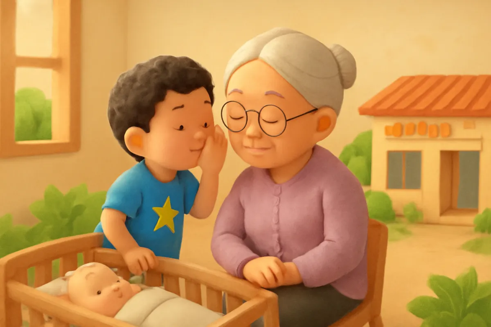

# Giọng nói ba cỡ

| | |
| --- | --- |
| Mã truyện | `08c16b52-a5a3-4856-873f-37a31cca38a5` |
| Nhóm | Truyện thư viện |
| Nguồn | manual |
| Tạo lúc | 2026-10-15T14:34:10.193821+00:00 |
| Cập nhật | 2026-10-16T04:34:04.942962+00:00 |
| Số trang | 8 |
| Ngôn ngữ | vi |
| Tuổi | 3–6 |
| Giọng kể | Viên - Narrative, Warm and Clear (northern) |
| Trạng thái | published |
| Đã xoá | không |

**Giới thiệu:** Bo chơi rô bốt và hét thật to làm em bé Tôm thức giấc. Bà dạy hai anh em trò chơi giọng nói ba cỡ: giọng con kiến, giọng con mèo và giọng con hổ, mỗi giọng dùng một nơi.

**Bài học:** Ở trong nhà nói vừa đủ nghe; giọng to để dành cho sân chơi hoặc khi cần gọi giúp đỡ.

## Nhân vật

- **Bo** — Cậu bé 5 tuổi hiếu động, tốt bụng, đang tập thói quen tốt (giọng: Bin — bé trai lém lỉnh)
- **Bà** — Bà nội hiền hậu, kể chuyện hay (giọng: Hiền — bà hiền hậu)
- **Su** — Em gái 4 tuổi của Bo, hay hỏi, thích vẽ (giọng: Yuna — bé gái tinh nghịch)

## Trang 1

Bo đang chơi rô bốt giữa phòng khách. Bo giơ rô bốt lên cao, hét thật to.

**Bo:** Xông lên! Rô bốt siêu nhân đến đây! Bùm! Bùm!

**Su:** Anh Bo ơi, to quá, em đau tai!

Nhưng Bo mải chơi quá, cứ hét to mãi, to mãi. Tiếng hét vang khắp cả nhà. Chú mèo Mướp đang nằm ngủ trên ghế cũng giật mình chạy biến.

🔊 [Nghe trang 1](../../../media/tts-cache/e6cf547c-503e-4877-a2ef-ffd5ba8d557c-15e46a6e-a7ab-4b64-bf58-436a9aa24e3d.mp3)

## Trang 2

Trong phòng bên, bà vừa ru em bé Tôm ngủ. Tiếng hét của Bo làm Tôm giật mình, oà khóc thật to.

Bà bế Tôm ra, vừa vỗ về em vừa nhìn Bo.

**Bà:** Bo ơi, em Tôm vừa mới ngủ đấy cháu ạ.

**Bo:** Cháu xin lỗi bà. Cháu chơi vui quá nên quên mất.

Bo cúi đầu, hai tay vân vê con rô bốt.

🔊 [Nghe trang 2](../../../media/tts-cache/051312cc-af90-48be-bbc1-21ee5a4d0350-64550a86-589f-43e2-b572-8e98a5c472c5.mp3)

## Trang 3

Ru Tôm ngủ lại xong, bà ngồi xuống cạnh hai anh em.

**Bà:** Bà dạy hai cháu một trò chơi nhé. Giọng nói của mình có ba cỡ. Cỡ nhỏ nhất là giọng con kiến, thì thầm thôi. Cỡ vừa là giọng con mèo, vừa đủ nghe trong nhà. Cỡ to nhất là giọng con hổ, chỉ dùng ngoài sân hoặc khi cần gọi giúp đỡ.

🔊 [Nghe trang 3](../../../media/tts-cache/430b27f8-060f-47cb-a36d-26bb7c83aee9-3061dd40-bac5-4428-9c8a-5af0bc466739.mp3)

## Trang 4

Hai anh em chơi thử ngay.

**Su:** Chào bà ạ... Đây là giọng con kiến.

**Bo:** Bà ơi, cháu khát nước. Đây là giọng con mèo, meo meo.

**Bà:** Giỏi lắm! Thế còn giọng con hổ thì sao?

**Bo:** Giọng con hổ phải để dành ra sân mới dùng ạ!

Cả ba bà cháu cùng cười khúc khích. Em Tôm trong nôi vẫn ngủ ngon lành.

🔊 [Nghe trang 4](../../../media/tts-cache/c33fd267-3fee-44d8-aca8-966e19b7cb05-3ab90a67-695a-4ed4-b718-5e957ae2c68c.mp3)

## Trang 5

Bo lại chơi rô bốt. Chơi một lúc, giọng Bo cứ to dần lên. Su liền giơ hai tay lên đầu, làm đôi tai mèo nhắc anh.

Bo nhìn thấy, bật cười, rồi hạ giọng xuống ngay.

**Bo:** À, giọng con mèo! Rô bốt bay lên nào... vù vù... nhẹ nhàng thôi kẻo em Tôm thức.

**Su:** Anh Bo giỏi quá!

🔊 [Nghe trang 5](../../../media/tts-cache/1cc84704-54e3-4eaa-9389-ddca60ebd154-e24edba0-d8f3-4598-8efe-a189853e9e33.mp3)

## Trang 6

Buổi chiều, bà dẫn hai anh em ra sân chơi. Sân rộng, gió mát, các bạn nhỏ chạy nhảy khắp nơi.

**Bà:** Ở ngoài sân, các cháu dùng giọng con hổ thoải mái nhé!

**Bo:** Hổ đây! Grừ! Su ơi, chuyền bóng cho anh đi!

**Su:** Anh bắt lấy này! Grừ!

Hai anh em chạy khắp sân như hai chú hổ con, chẳng ai phải bịt tai cả.

🔊 [Nghe trang 6](../../../media/tts-cache/c01ac425-74bc-4240-b3c7-1be10ec845c4-499de66d-5691-4868-8c02-bdca2cc04b64.mp3)

## Trang 7

Trên đường về, ba bà cháu ghé vào thư viện nhỏ đầu phố. Trong thư viện, mọi người đang lặng lẽ đọc sách.

**Bo:** Bà ơi, ở đây phải dùng giọng con kiến, đúng không ạ?

**Bà:** Đúng rồi. Cháu nhớ giỏi quá.

Hai anh em rón rén chọn sách, thì thầm với nhau thật khẽ. Bo tìm được một cuốn sách về những chú hổ.

🔊 [Nghe trang 7](../../../media/tts-cache/569ad2e6-5da9-4734-ba23-c5879794a696-5a73b0d0-6b23-4230-93e8-f17771e23733.mp3)

## Trang 8

Tối hôm ấy, em Tôm ngủ một giấc thật ngon. Bà khen Bo đã nhớ dùng giọng con mèo suốt buổi tối.

**Bo:** Ở trong nhà, cháu dùng giọng con mèo. Ra ngoài sân, cháu mới dùng giọng con hổ.

**Bà:** Thế là cháu biết giữ yên tĩnh cho cả nhà rồi đấy.

Bé ơi, bé thử nói giọng con kiến, giọng con mèo, rồi giọng con hổ xem nào!

🔊 [Nghe trang 8](../../../media/tts-cache/d36f7fe3-dc22-45e6-b994-5dad7548f0cc-83fb8c23-f9b4-46b9-b091-f84153bbe1a0.mp3)

---

Bản đầy đủ (mọi cột trong cơ sở dữ liệu): [story.json](story.json)
