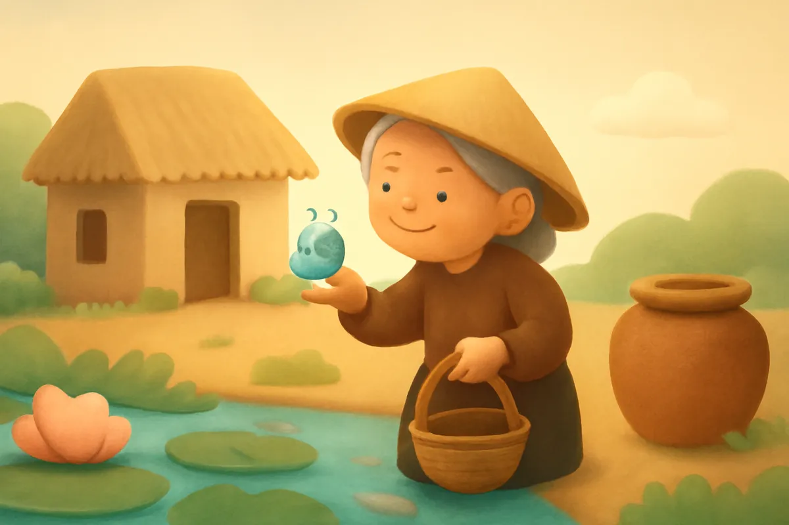
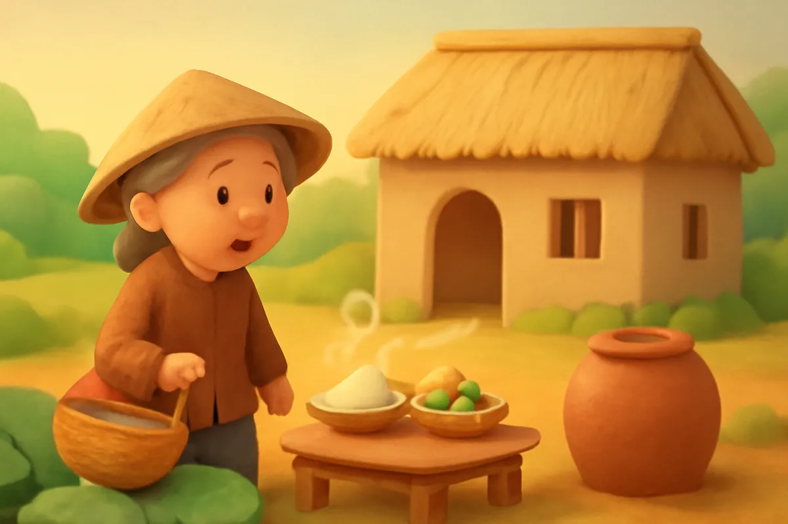
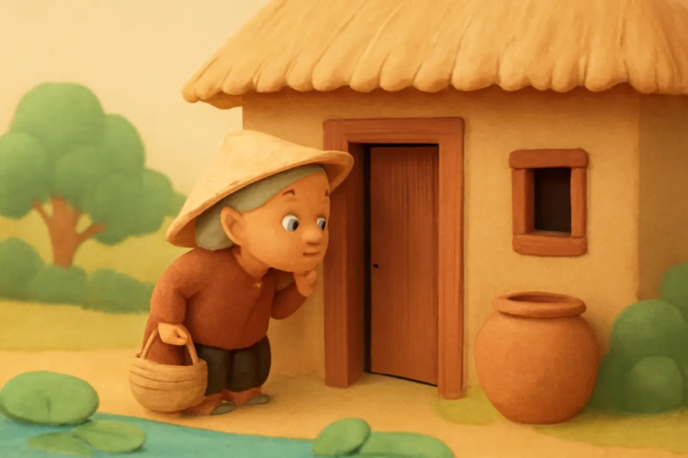
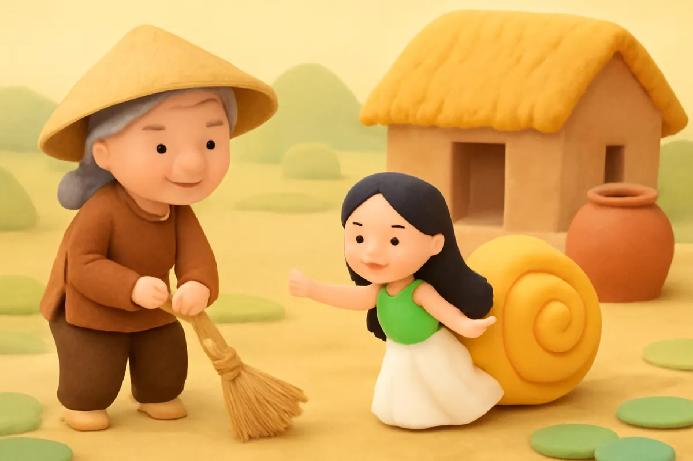
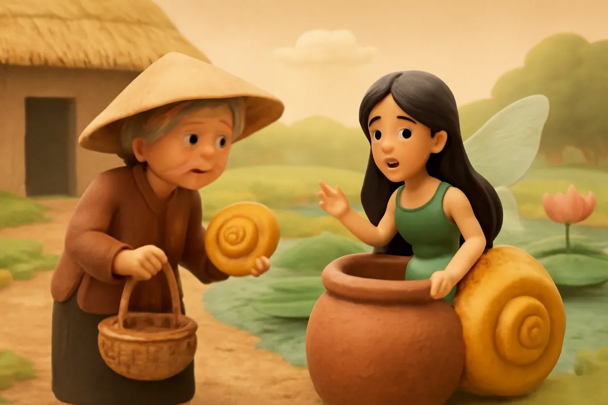
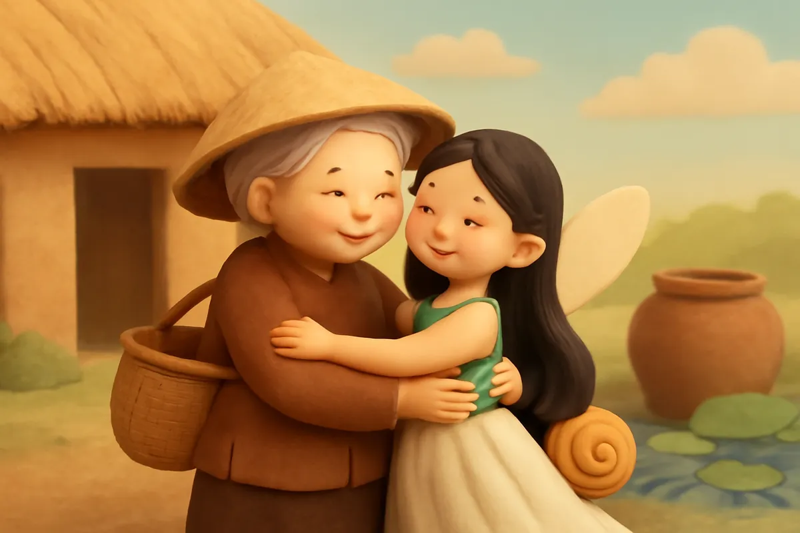
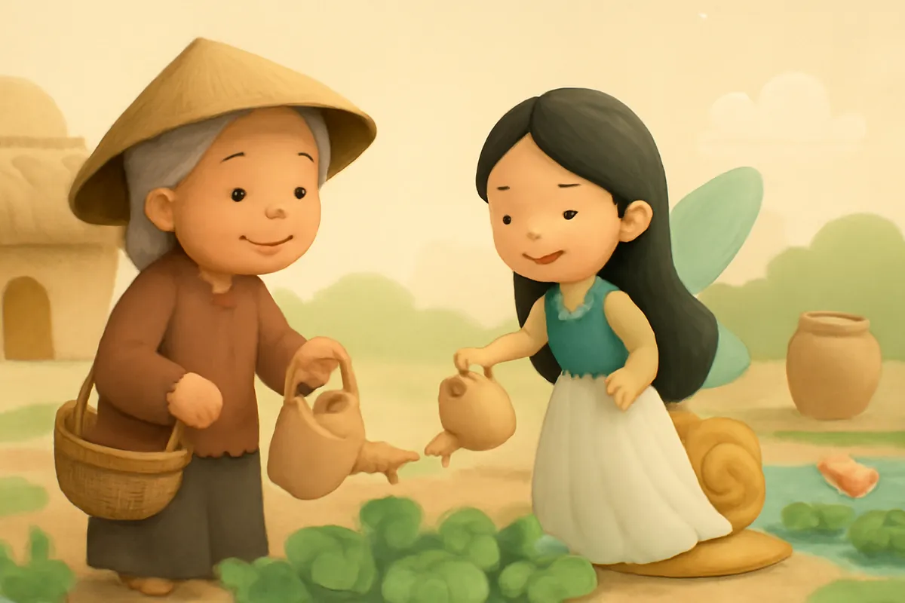
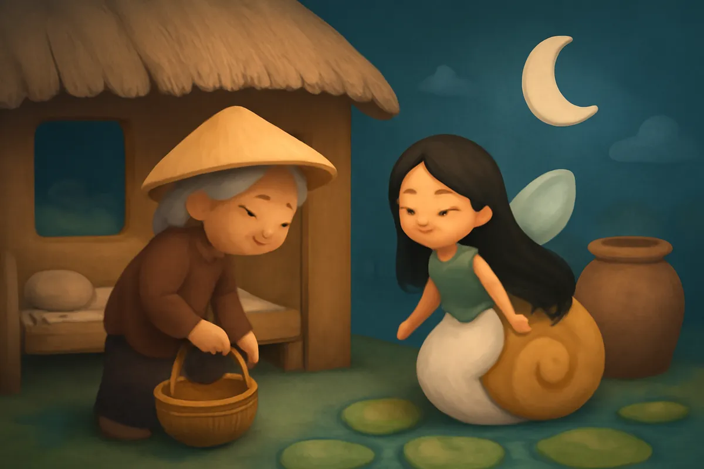

# Nàng tiên Ốc

| | |
| --- | --- |
| Mã truyện | `d91c95f2-9203-4b0e-958b-dc8b75ae76c8` |
| Nhóm | Truyện thư viện |
| Nguồn | manual |
| Tạo lúc | 2026-10-15T14:34:09.814347+00:00 |
| Cập nhật | 2026-10-16T04:24:15.092764+00:00 |
| Số trang | 8 |
| Ngôn ngữ | vi |
| Tuổi | 3–6 |
| Giọng kể | Viên - Narrative, Warm and Clear (northern) |
| Trạng thái | published |
| Đã xoá | không |

**Giới thiệu:** Bà lão nghèo nhặt được con ốc xinh nhưng không nỡ bán. Từ vỏ ốc, một nàng tiên bước ra giúp bà việc nhà, rồi ở lại làm con gái của bà.

**Bài học:** Sống hiền lành, thương yêu muôn loài thì sẽ gặp điều tốt đẹp.

## Nhân vật

- **Bà Lão** — Bà lão nghèo, hiền lành, sống một mình (giọng: Hiền — bà hiền hậu)
- **Nàng Tiên** — Nàng tiên hiền dịu sống trong vỏ ốc (giọng: Kim — chị gái dịu dàng)

## Trang 1

Ngày xưa, có một bà lão nghèo sống một mình trong túp lều nhỏ. Hằng ngày, bà lội ruộng mò cua, bắt ốc để đổi lấy gạo.

Một hôm, bà bắt được một con ốc rất lạ. Vỏ ốc xanh biêng biếc, lấp lánh như ngọc.

**Bà Lão:** Ốc xinh quá! Bà không nỡ bán đâu. Bà mang về nuôi làm bạn nhé.

Về nhà, bà thả ốc vào chiếc chum nước đầy.

🔊 [Nghe trang 1](../../../media/tts-cache/53400908-fc65-4711-af43-41425c4c8ef7-b46c023c-e3e8-431c-9df8-3f4b92407ce0.mp3)

## Trang 2

Sáng hôm sau, bà ra đồng làm việc như mọi ngày. Đến trưa trở về, bà sững sờ đứng ở cửa.

Nhà cửa sạch sẽ gọn gàng. Đàn gà đã được cho ăn. Vườn rau tươi tốt vừa được tưới. Trên bàn còn có mâm cơm nóng hổi, thơm phức.

**Bà Lão:** Ơ kìa, ai đã giúp bà thế này nhỉ? Người tốt bụng ở đâu ra vậy?

🔊 [Nghe trang 2](../../../media/tts-cache/8bc00252-26d5-4a2a-9657-c627ea8d2824-5e7ffc8e-7a0f-4a10-be07-59a55703933c.mp3)

## Trang 3

Mấy ngày liền, chuyện lạ cứ xảy ra như thế. Bà hỏi hàng xóm, nhưng chẳng ai biết gì cả.

Bà bèn nghĩ ra một cách. Sáng sớm, bà vác cuốc đi như thường lệ, đi được một đoạn thì lặng lẽ quay về. Bà nấp sau cánh cửa, nhìn qua khe nhỏ.

**Bà Lão:** Hôm nay bà phải xem cho rõ, ai là người đã giúp bà.

🔊 [Nghe trang 3](../../../media/tts-cache/e3a9de3a-4cd1-48e8-9632-b98be0452672-a9b93b55-46d8-47bb-9905-ea86752c5b14.mp3)

## Trang 4

Một lúc sau, nắp chum khẽ động. Từ trong vỏ ốc, một nàng tiên xinh đẹp bước ra. Nàng quét nhà, cho gà ăn, rồi nhóm bếp nấu cơm. Vừa làm, nàng vừa hát khe khẽ.

**Nàng Tiên:** Bà hiền lành, lại chăm chỉ quá. Mình giúp bà một tay cho bà đỡ vất vả.

Bà lão đứng sau cửa, thương nàng tiên vô cùng.

🔊 [Nghe trang 4](../../../media/tts-cache/0f4c4ad2-3412-4744-b7b1-11fd422cf078-ce4e9c97-3e8d-44e8-ac8b-0cd18d86aac0.mp3)

## Trang 5

Bà rón rén đi tới bên chum, nhẹ nhàng nhặt chiếc vỏ ốc lên và giấu đi. Nàng tiên quay lại, không thấy vỏ ốc đâu, bối rối nhìn quanh.

**Nàng Tiên:** Vỏ ốc của con đâu rồi? Không có vỏ, con biết ở đâu bây giờ?

**Bà Lão:** Con ơi, đừng sợ. Bà cất vỏ ốc đi rồi. Con ở lại đây với bà nhé, bà thương con lắm.

🔊 [Nghe trang 5](../../../media/tts-cache/92b38631-64ff-4b02-8947-5ad2bef678ca-535e2646-3153-44a8-af6f-4da0789f6a04.mp3)

## Trang 6

Nàng tiên nhìn bà lão thật lâu. Đôi mắt bà hiền từ, giọng bà ấm áp như giọng mẹ.

**Nàng Tiên:** Bà thương con thật lòng. Con xin ở lại làm con gái của bà.

Bà lão mừng quá, ôm nàng vào lòng. Từ hôm ấy, túp lều nhỏ lúc nào cũng rộn tiếng cười. Bà không còn phải sống một mình nữa.

🔊 [Nghe trang 6](../../../media/tts-cache/38f7e0d1-4fcd-4aad-aa11-6a96fe6a0883-454c6b34-a832-431a-84d3-8bf1aefcb433.mp3)

## Trang 7

Hai mẹ con cùng nhau trồng rau, nuôi gà, tưới cây. Có miếng ngon, hai mẹ con chia nhau. Tối đến, cả hai ngồi ngoài hiên ngắm trăng, kể chuyện.

**Bà Lão:** Có con, bà thấy mình như trẻ lại.

**Nàng Tiên:** Có bà, con có một mái nhà và một người mẹ.

Hàng xóm ai cũng quý hai mẹ con.

🔊 [Nghe trang 7](../../../media/tts-cache/e68ceaaa-7c30-4210-ba1a-ff098bc16d97-992220ae-6b06-4221-a908-587495b2d973.mp3)

## Trang 8

Bà lão cất chiếc vỏ ốc xanh vào một chiếc hộp gỗ nhỏ, đặt trên đầu giường. Đó là món quà kỷ niệm ngày hai mẹ con gặp nhau.

**Nàng Tiên:** Mẹ ngủ ngon nhé. Sáng mai con dậy sớm nấu cơm cho mẹ.

**Bà Lão:** Ngủ ngon con nhé. Người hiền lành thì luôn có người thương.

Ngoài kia, ánh trăng dịu dàng chiếu vào túp lều nhỏ.

🔊 [Nghe trang 8](../../../media/tts-cache/271a1c0c-6f0c-49be-b224-18bf974c6d71-5a3cc7d4-1e97-4ab2-9931-b15606ebcccc.mp3)

---

Bản đầy đủ (mọi cột trong cơ sở dữ liệu): [story.json](story.json)
