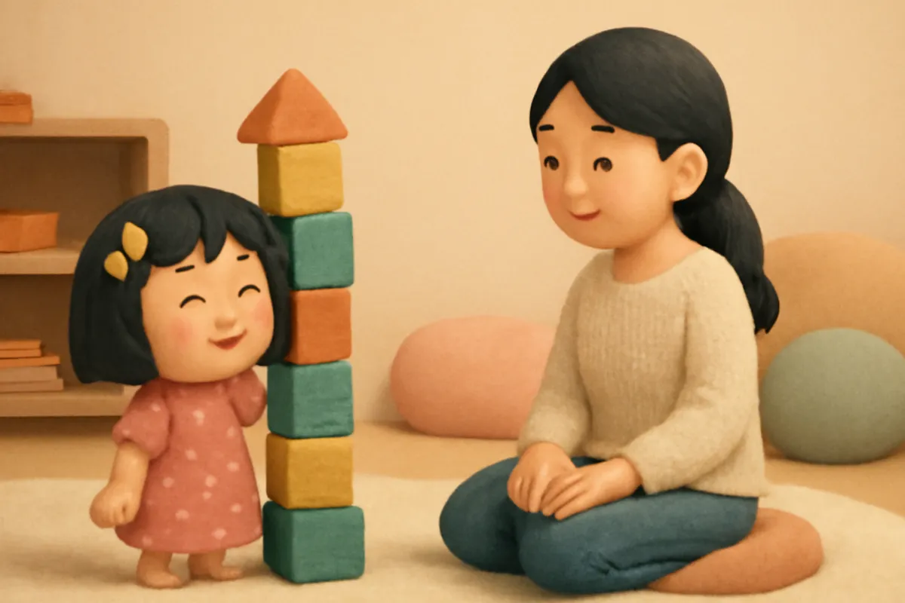
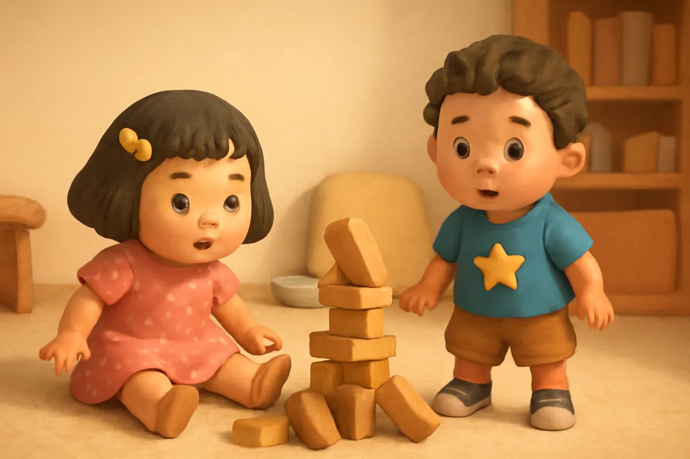
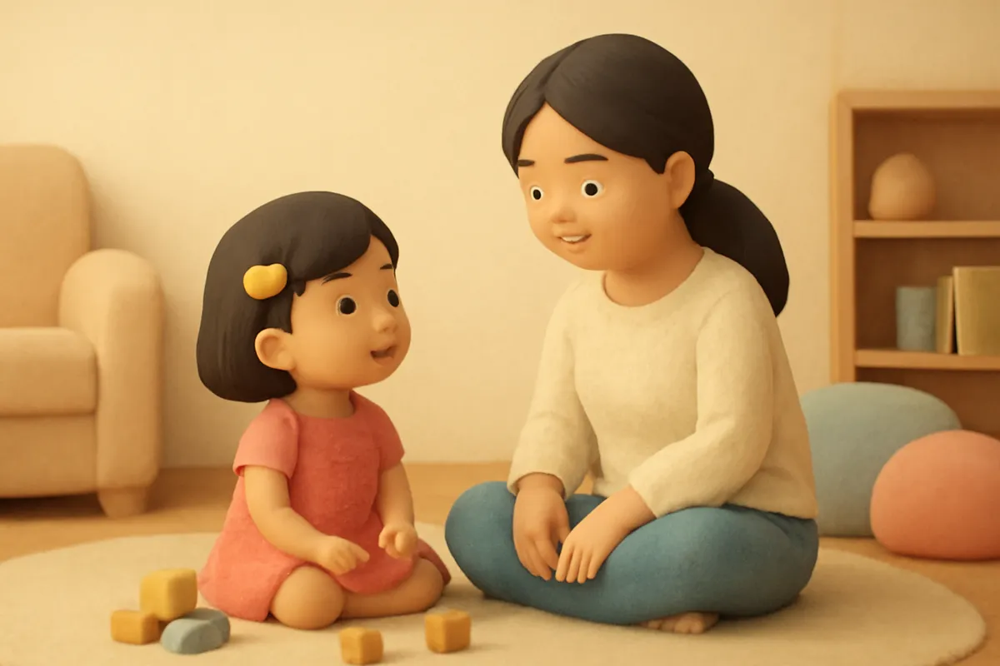
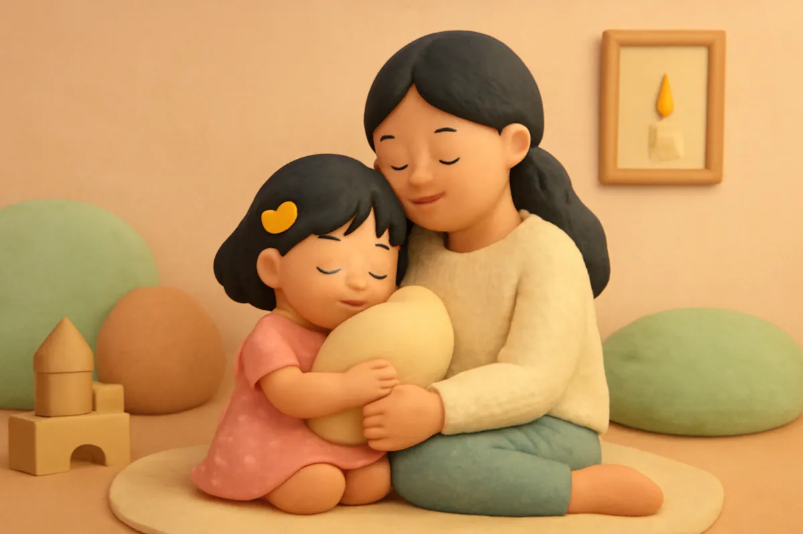
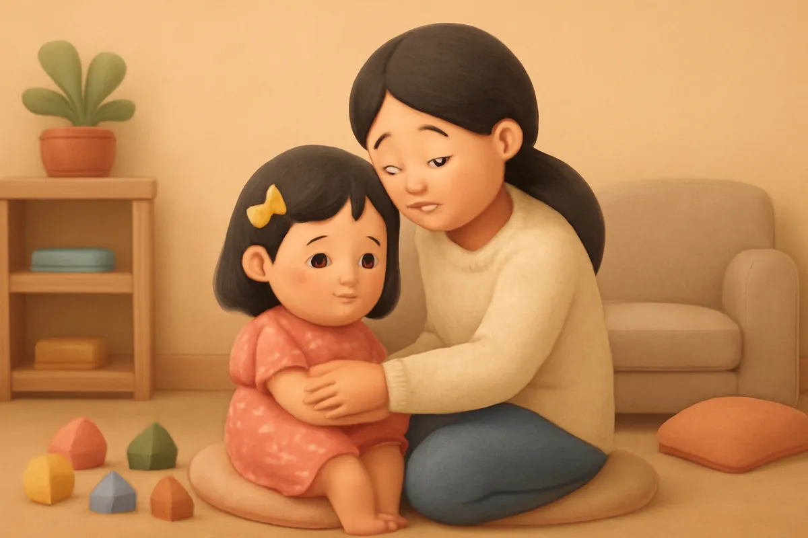
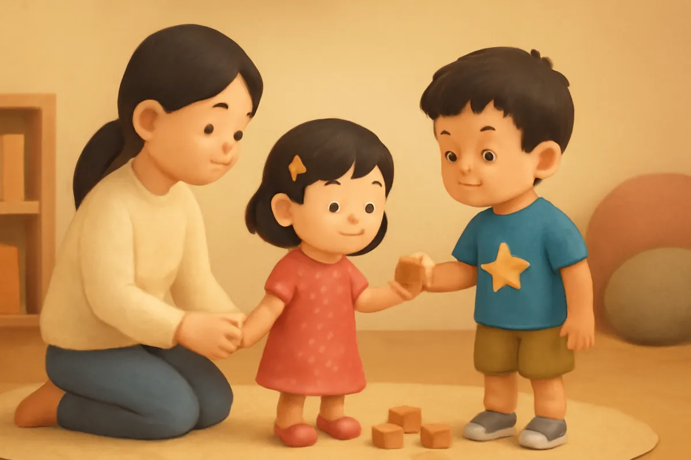
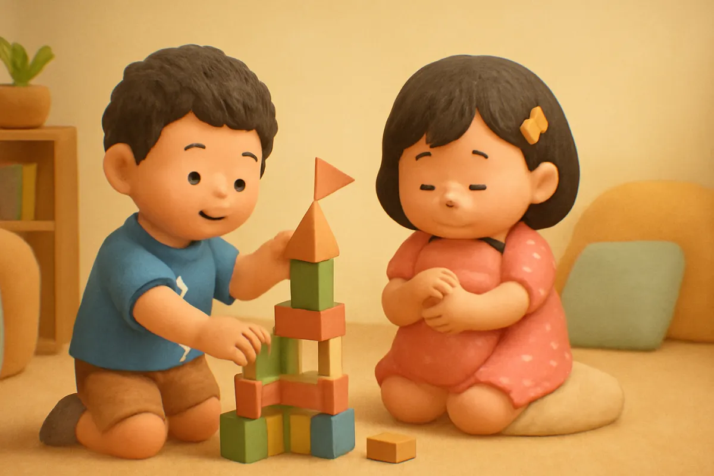
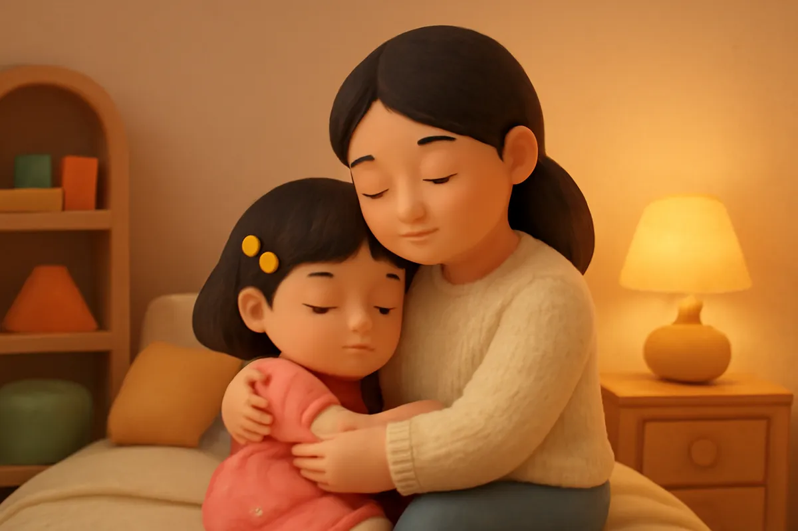

# Ngọn núi lửa nhỏ

| | |
| --- | --- |
| Mã truyện | `52a087d6-9a1b-4c8e-8c32-edf452e04aa8` |
| Nhóm | Truyện thư viện |
| Nguồn | manual |
| Tạo lúc | 2026-10-15T14:34:10.193821+00:00 |
| Cập nhật | 2026-10-16T04:34:46.283893+00:00 |
| Số trang | 8 |
| Ngôn ngữ | vi |
| Tuổi | 3–6 |
| Giọng kể | Viên - Narrative, Warm and Clear (northern) |
| Trạng thái | published |
| Đã xoá | không |

**Giới thiệu:** Tháp gỗ của Su bị anh Bo vô tình làm đổ, Su giận đến mức hét to, ném đồ và lăn ra sàn. Mẹ giúp Su gọi tên cơn giận như một ngọn núi lửa nhỏ và chỉ cho Su góc bình tĩnh.

**Bài học:** Ai cũng có lúc giận; mình thở thật chậm, đếm đến năm rồi nói ra điều mình cảm thấy.

## Nhân vật

- **Su** — Em gái 4 tuổi của Bo, hay hỏi, thích vẽ (giọng: Yuna — bé gái tinh nghịch)
- **Mẹ** — Mẹ của Bo và Su, dịu dàng, kiên nhẫn (giọng: Tâm — cô kể chuyện cổ tích)
- **Bo** — Cậu bé 5 tuổi hiếu động, tốt bụng, đang tập thói quen tốt (giọng: Bin — bé trai lém lỉnh)

## Trang 1

Su xây một toà tháp bằng khối gỗ thật cao. Khối đỏ, khối vàng, khối xanh, chồng lên nhau cao gần bằng Su. Su xếp khối cuối cùng lên đỉnh tháp.

**Su:** Xong rồi! Tháp của em cao nhất nhà luôn!

Su đứng ngắm toà tháp, cười tít mắt. Su định gọi mẹ ra xem, rồi chụp ảnh gửi cho bà nữa.

🔊 [Nghe trang 1](../../../media/tts-cache/f2ba570f-8dc5-4a53-a64c-f76b8116693d-30c7a3c0-9f35-484c-bf2d-f20822caeef7.mp3)

## Trang 2

Đúng lúc ấy, anh Bo chạy vào phòng, vấp phải chân bàn. Rầm! Toà tháp đổ sập, khối gỗ lăn khắp sàn.

**Bo:** Ối! Anh không cố ý đâu!

Su thấy trong người nóng bừng lên, như có một ngọn núi lửa nhỏ sắp phun trào. Su hét thật to, ném khối gỗ đi, rồi lăn ra sàn đạp chân.

**Su:** Anh làm đổ tháp của em! Em ghét anh!

🔊 [Nghe trang 2](../../../media/tts-cache/0d0ac421-2c12-4903-9050-4b100f80b470-5494af18-0106-41a2-91ed-d60f30a8e114.mp3)

## Trang 3

Mẹ đi vào, nhẹ nhàng nhặt mấy khối gỗ để không ai bị trúng. Mẹ không mắng, mẹ ngồi xuống bên cạnh Su.

**Mẹ:** Mẹ thấy con đang rất giận. Con giống như một ngọn núi lửa nhỏ đang sôi sùng sục phải không?

**Su:** Vâng! Núi lửa to lắm! Em giận lắm!

**Mẹ:** Mẹ ở đây với con. Mình cùng làm cho núi lửa nguội đi nhé.

🔊 [Nghe trang 3](../../../media/tts-cache/98dc01ab-5a2c-4ea9-a0b1-41e05600e6be-871dec63-4c88-4c18-93df-86b5792a4a7d.mp3)

## Trang 4

Mẹ đưa Su đến góc bình tĩnh. Ở đó có một chiếc gối mềm, một chú gấu bông và một bức tranh ngọn nến.

**Mẹ:** Con ôm gối nhé. Hít vào như ngửi hoa, thở ra như thổi nến. Rồi mình đếm cùng nhau: một, hai, ba, bốn, năm.

Su ôm gối, hít vào, thở ra. Một, hai, ba, bốn, năm. Ngọn núi lửa nhỏ trong người Su nguội dần, nguội dần.

🔊 [Nghe trang 4](../../../media/tts-cache/e31f2d9b-75b5-4ce6-95ca-94321ffb0171-8f1bc403-0689-4e36-8b50-651e5e7ac9d3.mp3)

## Trang 5

Khi Su đã bình tĩnh lại, mẹ hỏi khẽ.

**Mẹ:** Bây giờ con nói cho mẹ nghe, con thấy thế nào?

**Su:** Con buồn vì tháp đổ. Con xây lâu lắm. Nhưng con không nên ném khối gỗ đâu ạ.

**Mẹ:** Con nói ra được như thế là giỏi lắm. Giận thì không sao, nhưng mình không ném đồ và không làm đau ai, con nhé.

🔊 [Nghe trang 5](../../../media/tts-cache/bf311b9a-cccd-4410-bb8c-62d28c087f3d-92eab5dd-f09b-4a01-a126-33ffc8c14d0a.mp3)

## Trang 6

Bo rón rén đi tới, tay cầm mấy khối gỗ.

**Bo:** Su ơi, anh xin lỗi. Anh chạy nhanh quá nên vấp. Anh giúp em xây lại tháp nhé?

**Su:** Em cũng xin lỗi anh, vì em đã hét và nói ghét anh. Mình xây tháp cao hơn nữa đi!

Hai anh em ngoắc tay làm lành. Mẹ đứng ở cửa, mỉm cười nhìn hai anh em.

🔊 [Nghe trang 6](../../../media/tts-cache/b2daf8ef-759b-4b02-b55d-516aec35f3f1-6b8b0217-5054-4c27-8973-fda4cbc13b05.mp3)

## Trang 7

Hai anh em cùng xây lại toà tháp. Lần này tháp còn có cửa sổ và một lá cờ nhỏ trên đỉnh. Lúc gần xong, một khối gỗ bị lệch, tháp lung lay rồi đổ mất một góc. Su thấy núi lửa nhỏ lại hơi nóng lên. Su ôm gối, hít vào, thở ra, đếm đến năm.

**Su:** Không sao! Mình xây lại góc này thôi anh!

🔊 [Nghe trang 7](../../../media/tts-cache/21bde8b7-da9f-4c65-bf92-75096266da2e-981a83f9-0a6c-4169-9ee2-d66cd4fade04.mp3)

## Trang 8

Tối hôm ấy, mẹ ôm Su lên giường.

**Mẹ:** Hôm nay con đã tự làm nguội ngọn núi lửa nhỏ của mình. Mẹ tự hào về con lắm.

**Su:** Lần sau giận, con sẽ ra góc bình tĩnh và đếm đến năm ạ.

Bé ơi, khi bé thấy giận như núi lửa, bé sẽ làm gì cho núi lửa nguội đi nhỉ? Mình cùng đếm nào: một, hai, ba, bốn, năm.

🔊 [Nghe trang 8](../../../media/tts-cache/6e934e2c-0fb3-4358-badb-2054a210c1ba-8a7e6dae-d69c-4b22-8568-d2a4667bf0a6.mp3)

---

Bản đầy đủ (mọi cột trong cơ sở dữ liệu): [story.json](story.json)
