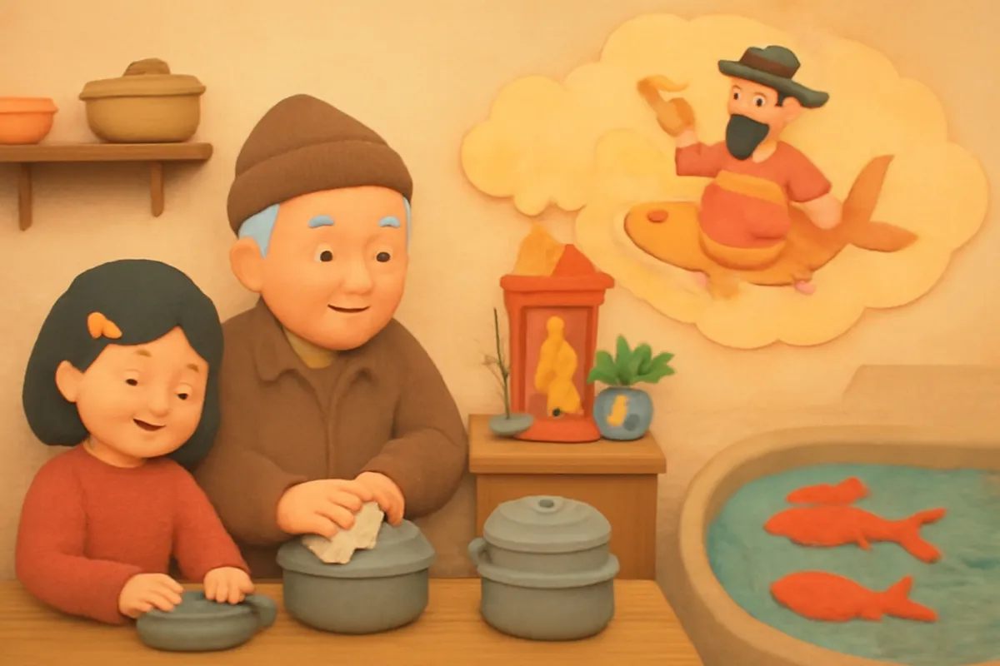
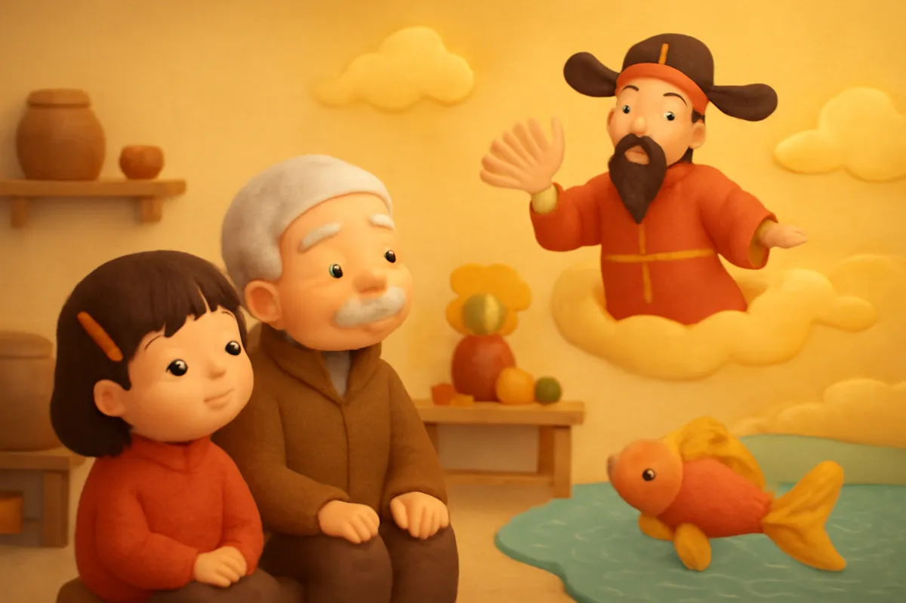
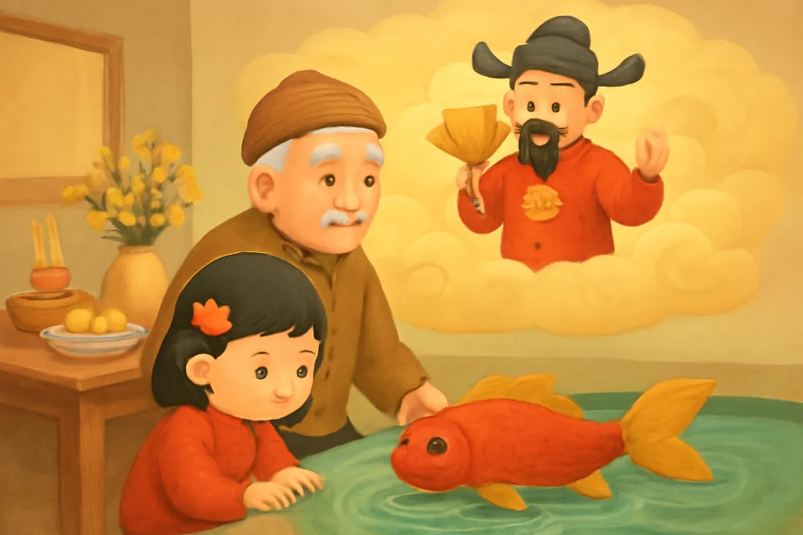
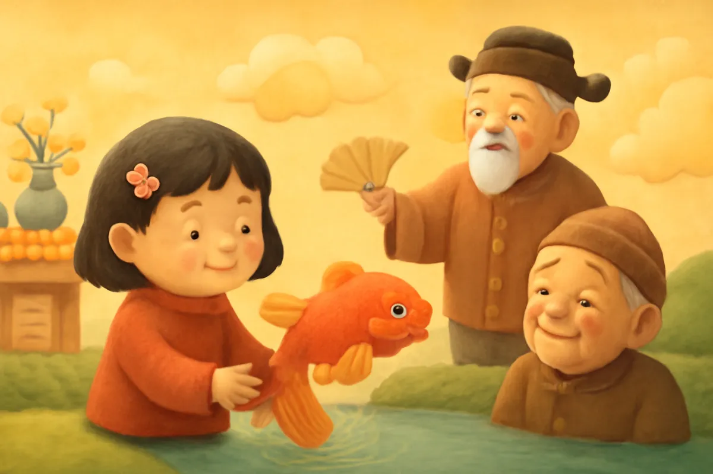
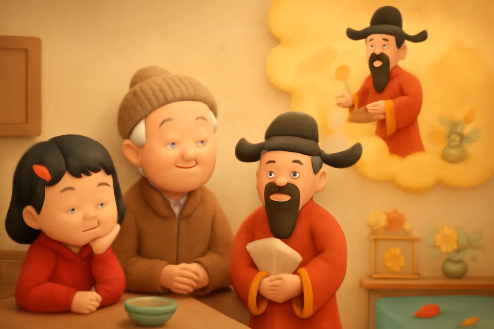
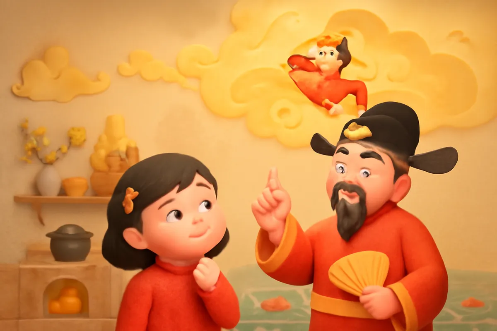
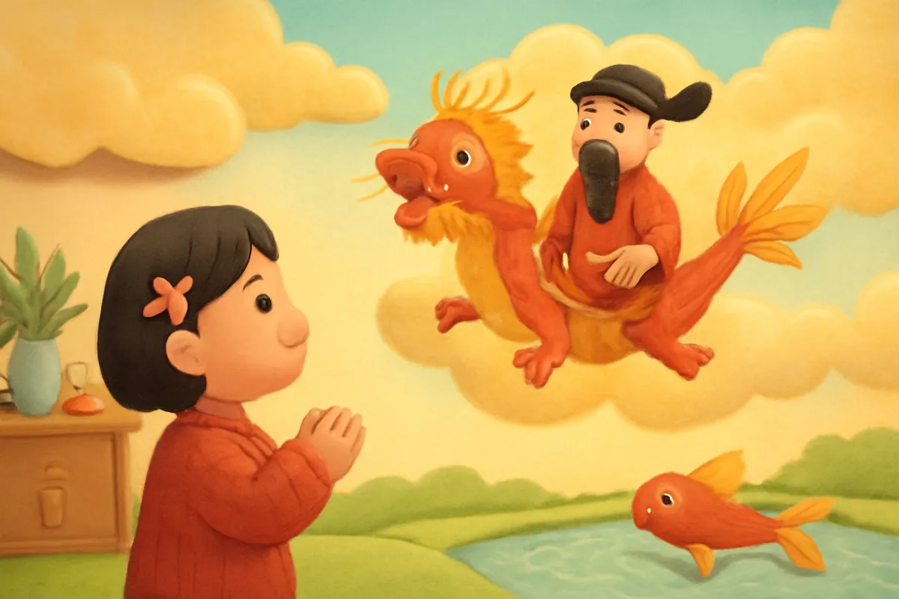
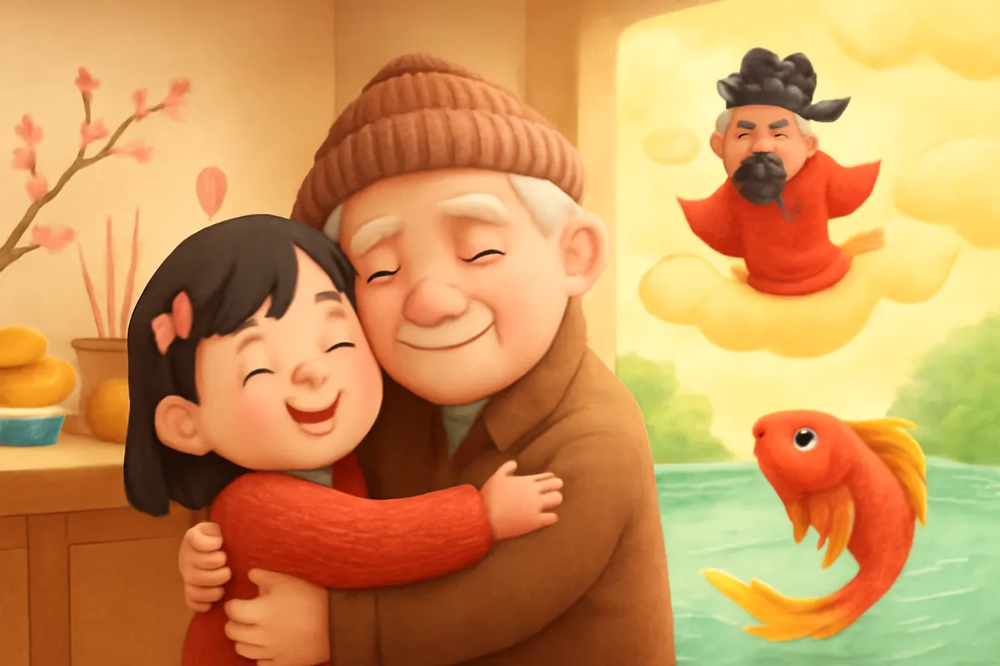

# Ông Táo về trời

| | |
| --- | --- |
| Mã truyện | `4b7a1ac2-281b-41bc-b4d6-72a34e1b43e9` |
| Nhóm | Truyện thư viện |
| Nguồn | manual |
| Tạo lúc | 2026-10-15T14:34:09.814347+00:00 |
| Cập nhật | 2026-10-16T04:24:57.718235+00:00 |
| Số trang | 8 |
| Ngôn ngữ | vi |
| Tuổi | 5–8 |
| Giọng kể | Viên - Narrative, Warm and Clear (northern) |
| Trạng thái | published |
| Đã xoá | không |

**Giới thiệu:** Ngày 23 tháng Chạp, Bé Na cùng ông nội dọn bếp, bày lễ và thả cá chép tiễn ông Táo. Đêm ấy, Na mơ gặp ông Táo, được dặn cách giữ an toàn với bếp lửa và thấy cá chép hoá rồng.

**Bài học:** Biết phong tục ngày Tết, giữ nhà cửa sạch sẽ và không bao giờ nghịch lửa.

## Nhân vật

- **Bé Na** — Cô bé tò mò, ngoan ngoãn (giọng: Yuna — bé gái tinh nghịch)
- **Ông Nội** — Ông nội hiền từ, hiểu nhiều phong tục (giọng: Thanh — ông hiền từ)
- **Ông Táo** — Vị thần bếp hiền hậu (giọng: Quang — chú trầm ấm)
- **Cá Chép** — Chú cá chép đỏ đưa ông Táo về trời (giọng: Tâm — cô kể chuyện cổ tích)

## Trang 1

Hôm ấy là ngày hai mươi ba tháng Chạp. Từ sáng sớm, Ông Nội đã cùng Bé Na lau dọn gian bếp. Ông lau sạch kiềng, quét tro, còn Na xếp nồi niêu gọn gàng lên giá.

**Bé Na:** Ông ơi, sao hôm nay mình dọn bếp kỹ thế ạ?

**Ông Nội:** Vì hôm nay ông Táo về trời đấy cháu ạ. Nhà mình phải sạch sẽ để tiễn ông Táo.

🔊 [Nghe trang 1](../../../media/tts-cache/a809254f-d529-465c-8531-6f3a4d980707-3eb44526-6a9a-48a8-bd5e-fa4de6f7e3d8.mp3)

## Trang 2

Bé Na ngồi xuống bên ông, mắt tròn xoe.

**Bé Na:** Ông Táo là ai hả ông?

**Ông Nội:** Ông Táo là vị thần coi sóc bếp lửa của mỗi nhà. Cả năm ông Táo ở trong bếp, giữ cho lửa ấm, cơm thơm. Cuối năm, ông cưỡi cá chép lên trời, kể với Ngọc Hoàng mọi việc trong nhà.

**Bé Na:** Ông Táo cưỡi cá chép thật hả ông? Thích quá!

🔊 [Nghe trang 2](../../../media/tts-cache/cbca3dca-3e83-439e-a616-f1564d040898-89efda4f-939e-4294-911a-698b9f77b633.mp3)

## Trang 3

Buổi chiều, mẹ bày mâm lễ lên bàn: có hương, có hoa, có đĩa hoa quả và bộ mũ áo giấy cho ông Táo. Bên cạnh là một chậu nước, ba chú cá chép đỏ bơi tung tăng.

**Bé Na:** Cá chép ơi, chào các bạn! Các bạn đẹp quá!

**Ông Nội:** Thắp hương xong, ông cháu mình mang cá ra ao thả, để cá đưa ông Táo về trời.

🔊 [Nghe trang 3](../../../media/tts-cache/1c6d662a-be1f-4819-84bc-469ab411c5f2-772b98ef-9cc8-4cad-9501-b76182dcbbc3.mp3)

## Trang 4

Ông nội bưng chậu cá, Bé Na lon ton chạy theo ra ao làng. Na nhẹ nhàng thả từng chú cá xuống nước. Cá chép quẫy đuôi, bơi một vòng rồi lặn xuống.

**Bé Na:** Cá chép ơi, nhớ đưa ông Táo về trời bình an nhé!

**Cá Chép:** Bé Na yên tâm! Chúng tớ sẽ bơi thật nhanh, đưa ông Táo đến tận cửa trời.

Na tròn mắt nhìn ông. Ông nội chỉ mỉm cười.

🔊 [Nghe trang 4](../../../media/tts-cache/73e6bd74-32a6-4a85-8f4d-594b658f0ec8-0cf8841d-454f-484e-bd50-ca45fe021915.mp3)

## Trang 5

Tối hôm ấy, Bé Na ngủ thiếp đi. Trong giấc mơ, Na thấy gian bếp sáng ấm. Một vị thần mặc áo đỏ, đội mũ cánh chuồn, đứng bên bếp lửa, cười hiền hậu.

**Ông Táo:** Chào cháu Na. Ông là ông Táo đây. Cảm ơn cháu đã giúp ông nội dọn bếp sạch sẽ.

**Bé Na:** Ông Táo ơi, lên trời ông sẽ kể gì với Ngọc Hoàng ạ?

🔊 [Nghe trang 5](../../../media/tts-cache/06f86995-ddeb-4d4c-aa4a-3e2e2b4150dc-94dac959-0ae9-4afd-bae6-47d43187b4db.mp3)

## Trang 6

**Ông Táo:** Ông sẽ kể nhà cháu chăm chỉ, hoà thuận, còn cháu thì ngoan. Nhưng ông dặn cháu điều này nhé. Lửa nấu cơm cho cả nhà, nhưng lửa cũng rất nguy hiểm.

**Bé Na:** Vậy cháu phải làm gì ạ?

**Ông Táo:** Cháu không nghịch lửa, không nghịch bật lửa hay que diêm, không đến gần bếp khi đang đun nấu. Thấy khói hay lửa lạ, cháu gọi người lớn ngay.

**Bé Na:** Cháu nhớ rồi ạ!

🔊 [Nghe trang 6](../../../media/tts-cache/56a3ff1b-661e-418c-bf9d-6701837cab7c-c7b9c6e3-bb45-4919-b459-7b17760cba09.mp3)

## Trang 7

Ông Táo vẫy tay chào rồi bước ra sân. Một chú cá chép đỏ đã chờ sẵn trên làn mây. Ông Táo ngồi lên lưng cá.

**Cá Chép:** Ông Táo ngồi vững nhé! Cháu sẽ vượt qua cửa trời đây!

Cá chép vẫy đuôi, vút lên cao, vượt qua cánh cổng mây. Bỗng vảy cá sáng lấp lánh, cá chép hoá thành một con rồng vàng, chở ông Táo bay về trời.

**Bé Na:** Ôi, cá chép hoá rồng rồi!

🔊 [Nghe trang 7](../../../media/tts-cache/7d455f5a-8673-45a4-be9c-6b17ce576c71-8bb959ad-84e0-4804-a54a-acbb585e6a50.mp3)

## Trang 8

Sáng hôm sau, Na chạy ùa xuống bếp, kể cho ông nội nghe giấc mơ.

**Ông Nội:** Ông Táo về trời rồi, đến đêm giao thừa ông lại về với nhà mình. Cá chép vượt cửa trời hoá rồng, nên người ta bảo ai chăm chỉ, kiên trì cũng sẽ thành công.

**Bé Na:** Cháu sẽ ngoan, không nghịch lửa, để năm sau ông Táo lại kể tốt về nhà mình!

Ngoài ngõ, hoa đào đã chúm chím nở. Tết sắp về rồi.

🔊 [Nghe trang 8](../../../media/tts-cache/28990010-b8ee-476d-a6d7-1cb9f40536af-de04e0dc-bb71-419c-8fea-6035b71fa8bb.mp3)

---

Bản đầy đủ (mọi cột trong cơ sở dữ liệu): [story.json](story.json)
