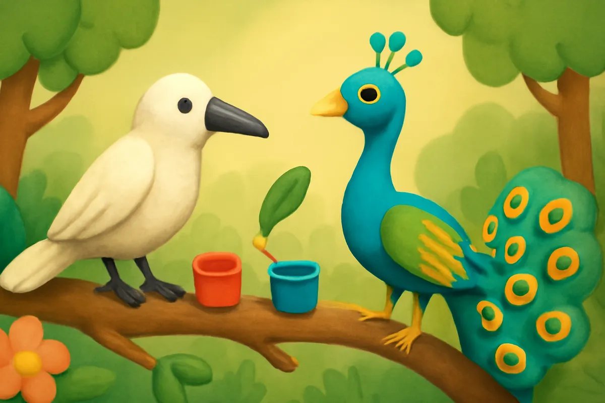
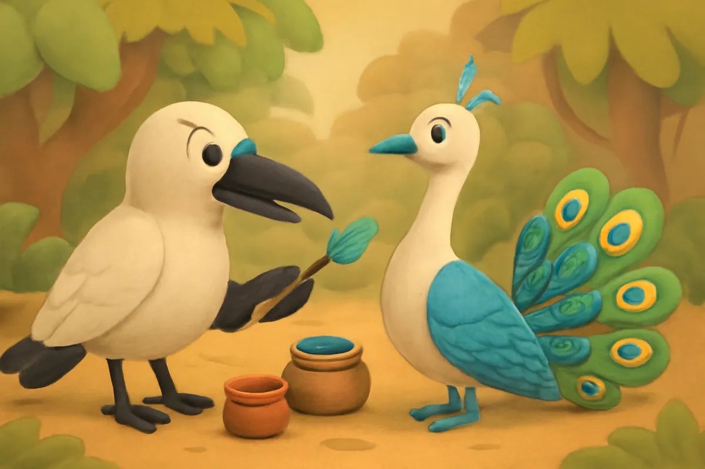
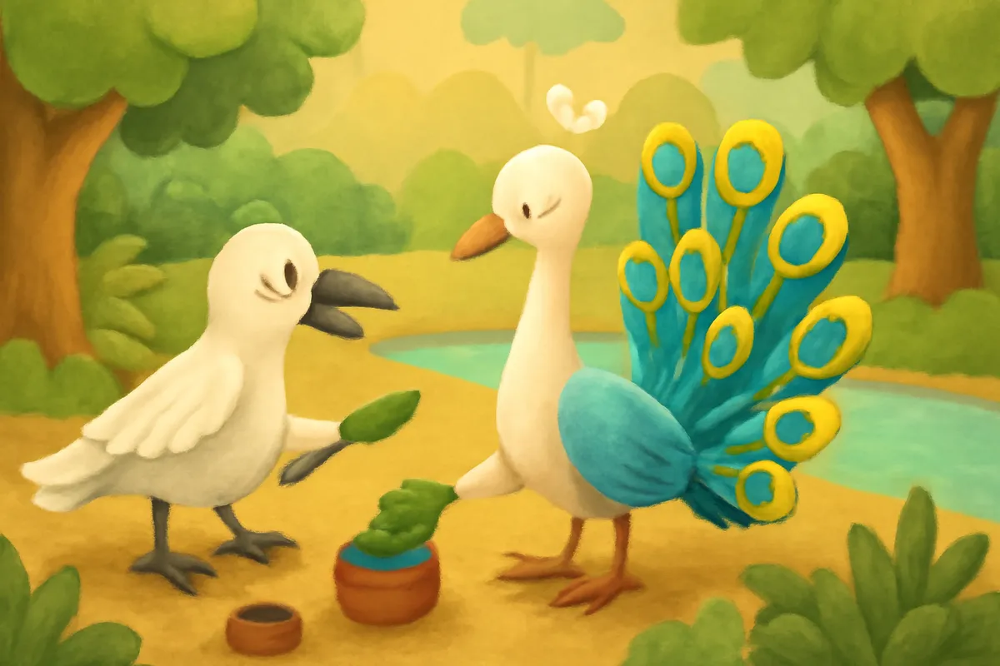
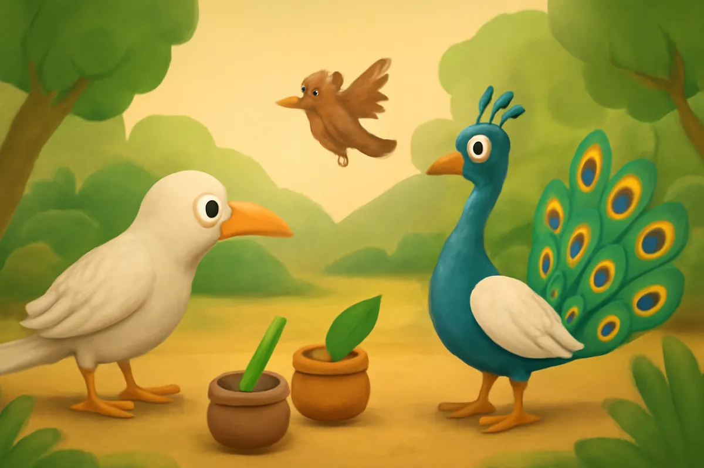
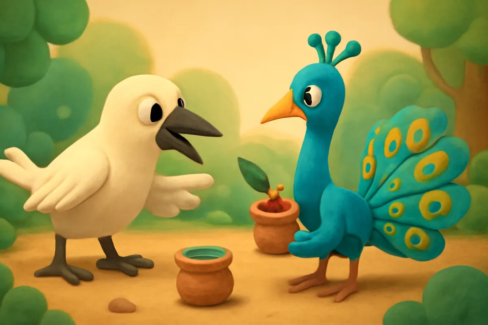
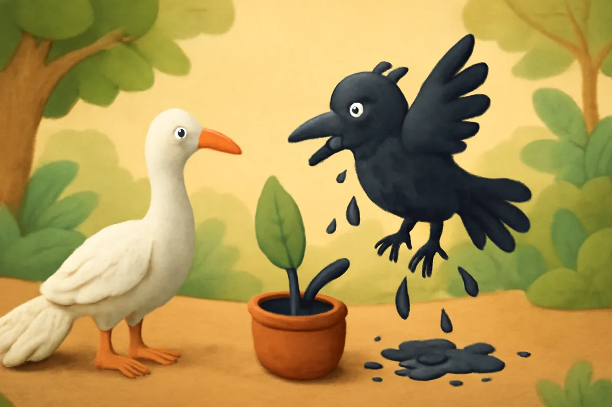
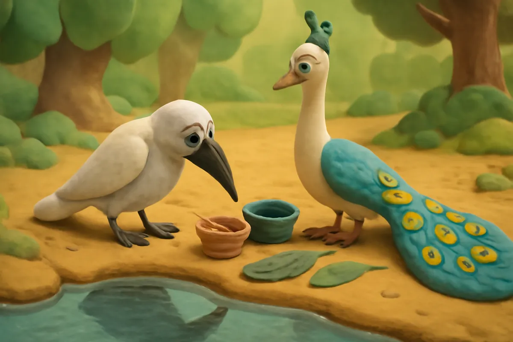
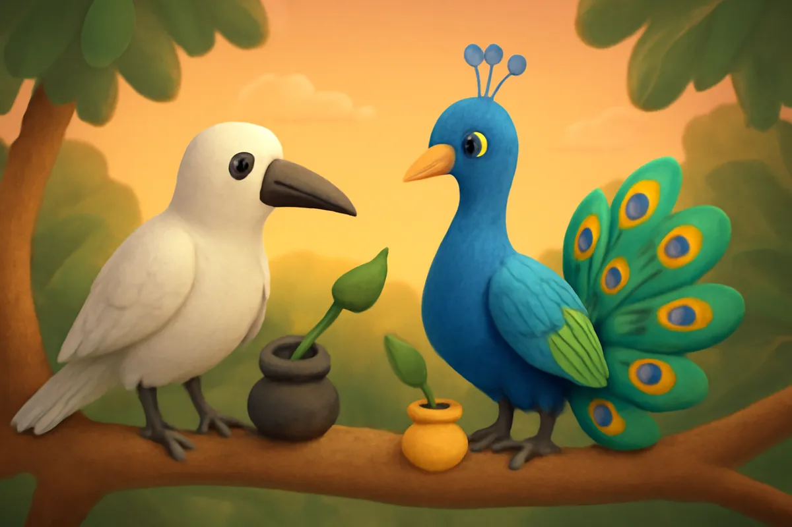

# Quạ và Công

| | |
| --- | --- |
| Mã truyện | `abd3fda8-681e-4eee-9d41-2affbf0dac57` |
| Nhóm | Truyện thư viện |
| Nguồn | manual |
| Tạo lúc | 2026-10-15T14:34:09.814347+00:00 |
| Cập nhật | 2026-10-16T04:25:37.708727+00:00 |
| Số trang | 8 |
| Ngôn ngữ | vi |
| Tuổi | 3–6 |
| Giọng kể | Viên - Narrative, Warm and Clear (northern) |
| Trạng thái | published |
| Đã xoá | không |

**Giới thiệu:** Ngày xưa Quạ và Công đều có bộ lông trắng. Hai bạn rủ nhau tô màu cho nhau. Quạ tô cho Công thật đẹp, còn Quạ vì nóng vội nên bị đen thui.

**Bài học:** Làm việc gì cũng cần kiên nhẫn, đừng nóng vội mà hỏng việc.

## Nhân vật

- **Quạ** — Chú quạ hiếu động, hay nóng vội (giọng: Bin — bé trai lém lỉnh)
- **Công** — Cô công điềm đạm, khéo tay (giọng: Tâm — cô kể chuyện cổ tích)
- **Chim Sẻ** — Cô sẻ nhỏ hay chuyền tin (giọng: Yuna — bé gái tinh nghịch)

## Trang 1

Ngày xửa ngày xưa, các loài chim trong rừng đều có bộ lông trắng muốt như nhau. Quạ và Công là đôi bạn thân.

Một hôm, hai bạn ngồi trên cành cây, nhìn những bông hoa rực rỡ dưới gốc.

**Công:** Hoa nào cũng có màu đẹp. Giá mà lông chúng mình cũng có màu nhỉ?

**Quạ:** Hay là chúng mình tô màu cho nhau đi!

🔊 [Nghe trang 1](../../../media/tts-cache/26730dd9-301f-4bad-ad68-7d0792775adb-acc8e84f-b09a-48d7-a08b-476048bbcdc4.mp3)

## Trang 2

Hai bạn hái lá, vắt hoa, pha thành những bát màu xanh, đỏ, vàng, tím. Quạ nhận tô cho Công trước.

**Quạ:** Công đứng yên nhé, tớ sẽ tô thật cẩn thận.

Quạ ngậm cành lông nhỏ, chấm từng chút màu. Cổ Công màu xanh biếc, cánh Công màu nâu óng, mỗi chiếc lông đuôi có một con mắt tròn lấp lánh.

🔊 [Nghe trang 2](../../../media/tts-cache/69972e27-502d-4766-ac32-7444c2ca1395-a3476294-fee1-40b0-871f-ef0e0c449c5e.mp3)

## Trang 3

Quạ tô suốt từ sáng đến chiều. Xong rồi, Công soi mình xuống mặt suối, xoè chiếc đuôi rộng như một cái quạt lớn.

**Công:** Ôi, đẹp quá! Cảm ơn Quạ, cậu khéo tay thật đấy!

**Quạ:** Đến lượt cậu tô cho tớ nhé. Tớ cũng muốn đẹp như cậu.

Công vui vẻ nhận lời, chuẩn bị bát màu thật cẩn thận.

🔊 [Nghe trang 3](../../../media/tts-cache/2d4cbd14-a5e2-465c-9837-9533416318bc-548bc1eb-e2be-4099-8733-101c4433bc0d.mp3)

## Trang 4

Công vừa chấm màu đầu tiên thì Chim Sẻ bay vụt tới, ríu rít báo tin.

**Chim Sẻ:** Các bạn ơi, bên kia đồi có cây sung chín đỏ cả cành! Chim muông kéo nhau đến ăn đông lắm!

Quạ nghe vậy thì sốt ruột, đứng không yên, cứ ngó mãi về phía đồi xa.

**Quạ:** Thôi rồi, đến muộn là hết sung mất!

🔊 [Nghe trang 4](../../../media/tts-cache/64e7fdbf-fba3-48f3-bfd3-a0579ee18d71-725f0d8d-fb36-4b2c-aa40-dcb4b45a36a4.mp3)

## Trang 5

Quạ giục Công liên hồi.

**Quạ:** Công ơi, tô từng chút lâu lắm. Cậu đổ cả bát màu lên người tớ cho nhanh đi!

**Công:** Không được đâu Quạ ạ. Tô vội thì sẽ không đẹp đâu.

**Công:** Cậu chờ tớ thêm một lát thôi, tớ sẽ tô cho cậu thật đẹp mà.

**Quạ:** Không sao, nhanh lên là được rồi!

Công khuyên mãi, nhưng Quạ vẫn nằng nặc không nghe.

🔊 [Nghe trang 5](../../../media/tts-cache/ba020adf-9c40-4d63-bd3b-4cb77104c0b9-b2402a4a-84e3-4293-905a-79f28a367582.mp3)

## Trang 6

Chiều bạn, Công đành trộn hết các bát màu lại với nhau. Màu xanh, màu đỏ, màu vàng, màu tím hoà vào nhau thành một màu đen sẫm.

Công dội cả bát màu lên người Quạ. Ào một cái, từ đầu đến chân Quạ đen thui. Quạ chẳng kịp soi gương, vỗ cánh bay vù về phía đồi sung.

**Quạ:** Cảm ơn nhé, tớ đi đây!

🔊 [Nghe trang 6](../../../media/tts-cache/c8846c5e-c5ce-4d4b-a10f-24bdc9bc8d25-ea5d94e2-c1b7-4427-a0a8-d38347a0246c.mp3)

## Trang 7

Đến nơi thì sung đã hết. Quạ đậu xuống bờ suối, nhìn bóng mình dưới nước.

**Quạ:** Ôi, sao tớ lại đen thui thế này!

Quạ ngồi buồn thiu, kêu lên những tiếng quạ quạ. Công bay tới, đậu bên cạnh bạn.

**Công:** Quạ đừng buồn. Màu đen cũng óng ánh lắm, nhìn kỹ còn thấy lấp lánh nữa đấy.

🔊 [Nghe trang 7](../../../media/tts-cache/29f83184-cdf1-492d-9b8d-72b805ab1f17-38c6b9ed-edae-4622-a84d-c8e00cbc1bc2.mp3)

## Trang 8

Quạ nghĩ một lúc rồi gật đầu.

**Quạ:** Tại tớ nóng vội quá. Lần sau tớ sẽ kiên nhẫn hơn.

**Công:** Cậu vẫn là bạn thân của tớ mà.

Từ đó, Quạ mang bộ lông đen, còn Công có bộ lông rực rỡ. Mỗi lần nhìn bộ lông của mình, Quạ lại nhớ rằng làm việc gì cũng không nên vội vàng.

🔊 [Nghe trang 8](../../../media/tts-cache/f519919c-2b53-492d-828a-b247ee7362db-93d8c593-83f8-4cb1-9a15-f2a5972be3d1.mp3)

---

Bản đầy đủ (mọi cột trong cơ sở dữ liệu): [story.json](story.json)
