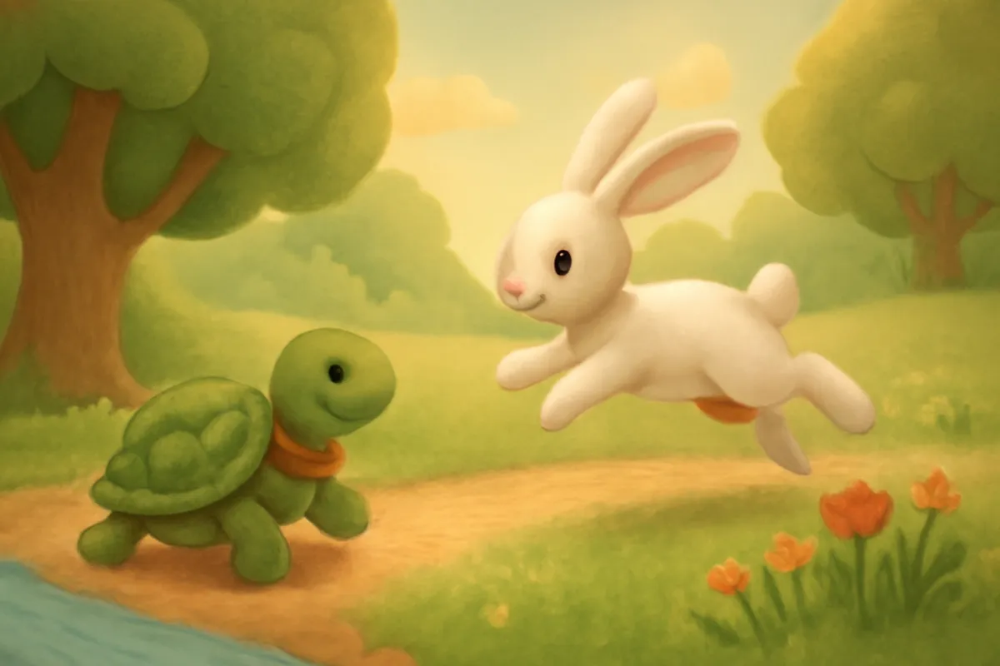
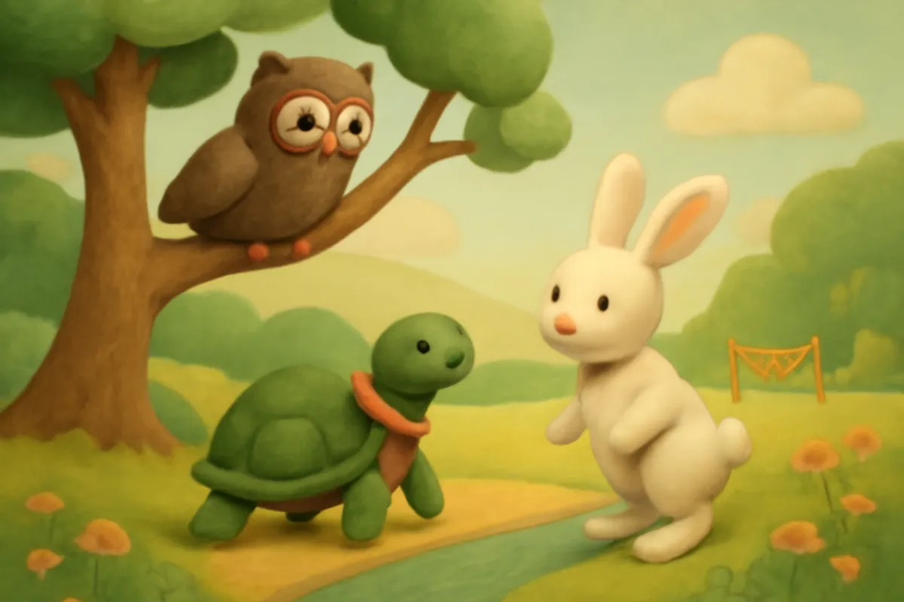
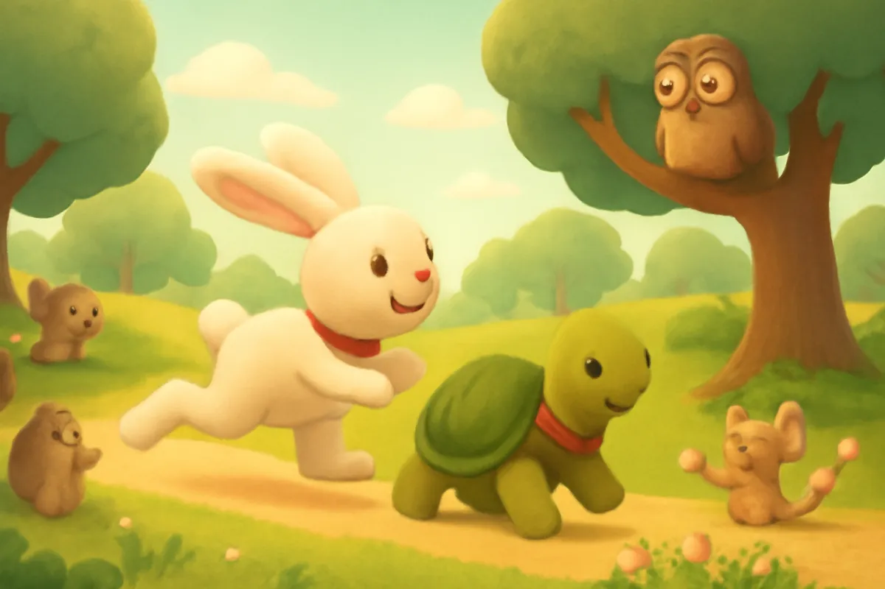
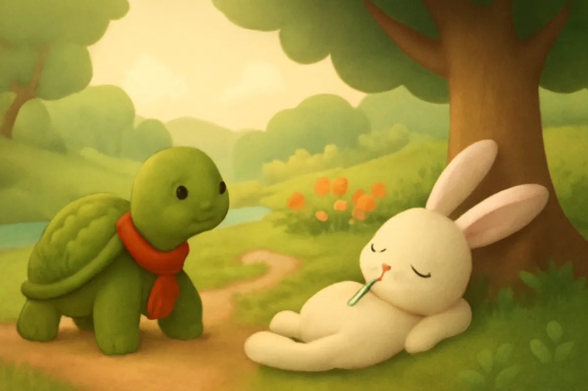
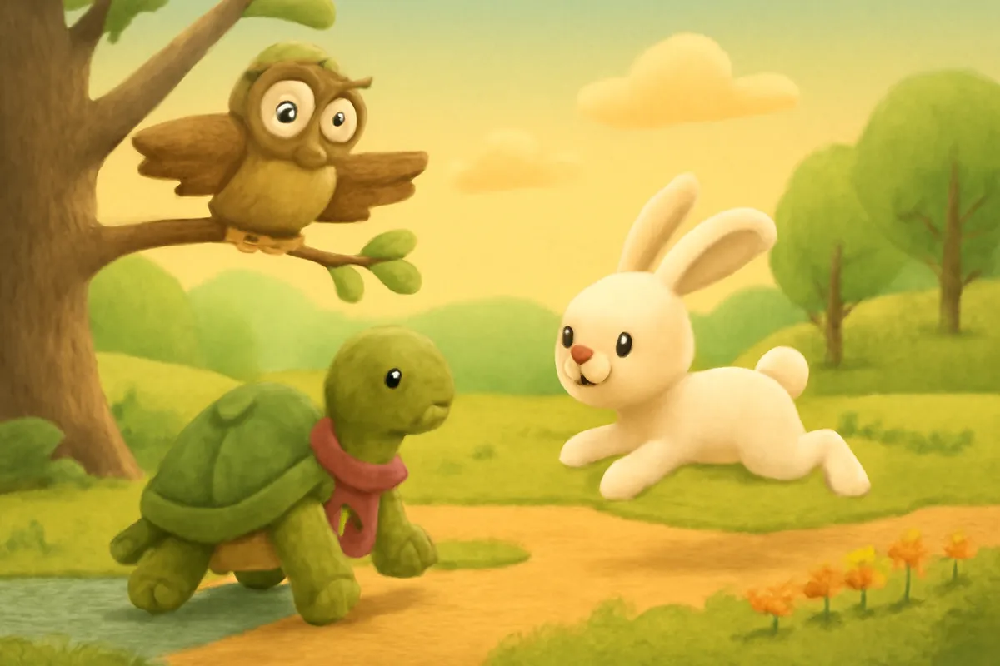
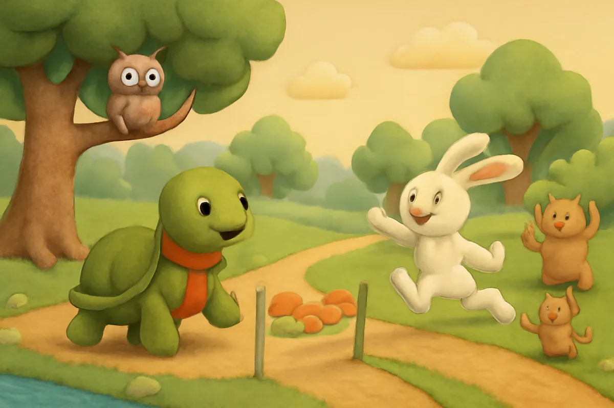
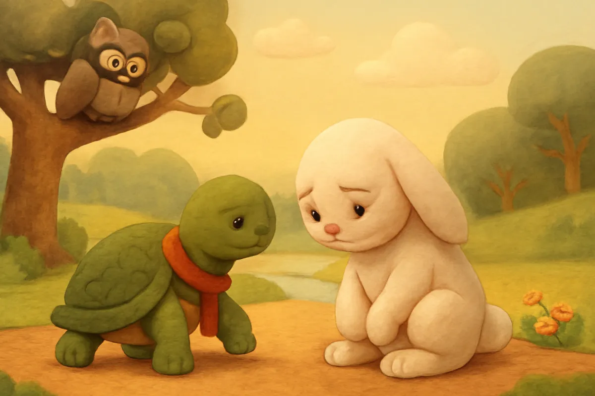
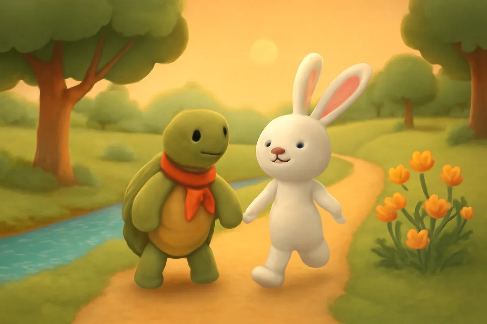

# Rùa và Thỏ

| | |
| --- | --- |
| Mã truyện | `07715708-a609-4ed1-8bc4-4d110b15ff45` |
| Nhóm | Truyện thư viện |
| Nguồn | manual |
| Tạo lúc | 2026-10-15T14:34:09.814347+00:00 |
| Cập nhật | 2026-10-16T04:26:17.566996+00:00 |
| Số trang | 8 |
| Ngôn ngữ | vi |
| Tuổi | 3–6 |
| Giọng kể | Viên - Narrative, Warm and Clear (northern) |
| Trạng thái | published |
| Đã xoá | không |

**Giới thiệu:** Thỏ chạy nhanh nhất rừng, chê bác Rùa chậm chạp rồi rủ thi chạy. Thỏ chủ quan nằm ngủ giữa đường, còn Rùa cứ đi đều từng bước và về đích trước.

**Bài học:** Chậm mà chắc: kiên trì đến cùng thì sẽ thành công, đừng chủ quan coi thường người khác.

## Nhân vật

- **Rùa** — Bác rùa chậm rãi, kiên trì, tốt bụng (giọng: Quang — chú trầm ấm)
- **Thỏ** — Chú thỏ chạy nhanh, hay khoe khoang, biết sửa lỗi (giọng: Bin — bé trai lém lỉnh)
- **Bác Cú** — Bác cú già thông thái, làm trọng tài (giọng: Thanh — ông hiền từ)

## Trang 1

Ở bìa rừng nọ, có chú Thỏ chạy nhanh nhất vùng. Thỏ hay khoe đôi chân dài của mình với mọi người.

Một buổi sáng, Thỏ gặp bác Rùa đang chậm rãi bò ra bờ suối uống nước.

**Thỏ:** Bác Rùa ơi, bác đi chậm thế thì bao giờ mới tới nơi? Cháu chạy một vòng quanh rừng rồi mà bác vẫn còn ở đây!

**Rùa:** Chậm một chút cũng không sao cháu ạ. Bác cứ đi đều, rồi sẽ tới.

🔊 [Nghe trang 1](../../../media/tts-cache/ce3d248e-344e-4878-b7bb-b0ca04011861-4f03b222-b1eb-47b2-a3c5-e4cbdac7317c.mp3)

## Trang 2

Thỏ cười khúc khích, vểnh đôi tai dài lên.

**Thỏ:** Hay là bác thi chạy với cháu đi! Ai tới gốc đa đầu làng trước thì thắng.

Rùa suy nghĩ một lát rồi gật đầu.

**Rùa:** Được, bác thi với cháu. Nhờ bác Cú làm trọng tài nhé.

Bác Cú đậu trên cành cao, nheo mắt nhìn xuống, vỗ cánh đồng ý.

**Bác Cú:** Sáng mai, khi mặt trời lên, hai cháu xuất phát ở đây nhé.

🔊 [Nghe trang 2](../../../media/tts-cache/64d654ab-a5a4-4cba-a640-fa183efc8ae2-fd17baaf-9924-425c-82fe-c15649d18b03.mp3)

## Trang 3

Sáng hôm sau, các con vật trong rừng kéo đến xem rất đông. Sóc, Nhím, Chim Sâu đứng hai bên đường cổ vũ.

**Bác Cú:** Chuẩn bị nhé! Một, hai, ba... chạy!

Thỏ vọt đi như một cơn gió, chẳng mấy chốc đã mất hút sau bụi cây. Rùa bắt đầu bò, từng bước, từng bước một.

**Rùa:** Chậm mà chắc. Mình cứ đi đều là được.

🔊 [Nghe trang 3](../../../media/tts-cache/e4113c6f-7aea-45ed-9486-7b186b179dc2-cc10aed5-928e-4244-8c21-d01e80a4543a.mp3)

## Trang 4

Chạy được nửa đường, Thỏ ngoảnh lại. Chẳng thấy bóng dáng bác Rùa đâu cả.

**Thỏ:** Bác Rùa còn lâu mới tới. Mình nằm nghỉ một lát, ăn mấy ngọn cỏ non đã.

Thỏ nằm dưới gốc cây mát rượi, gặm cỏ, ngắm mây. Gió hiu hiu thổi, Thỏ ngáp một cái thật dài rồi ngủ thiếp đi lúc nào không hay.

**Thỏ:** Ngủ một chút thôi... một chút thôi...

🔊 [Nghe trang 4](../../../media/tts-cache/63bd1b1f-ba7b-4f92-a184-175bf0d88f5e-df21544e-937f-4dd3-9c52-9c66942cc5ea.mp3)

## Trang 5

Trong khi đó, Rùa vẫn bò đều đều. Nắng lên cao, đường xa, chân Rùa mỏi nhừ, nhưng Rùa không dừng lại.

Rùa bò qua bờ suối, qua bãi cỏ, rồi đi ngang qua gốc cây nơi Thỏ đang ngủ say.

**Rùa:** Thỏ ngủ say quá. Bác cứ lặng lẽ đi tiếp, từng bước một.

**Bác Cú:** Cố lên Rùa ơi, sắp tới gốc đa rồi!

🔊 [Nghe trang 5](../../../media/tts-cache/96eb1cbf-d114-41ae-a98d-a5fe3e4ec3cb-6399477d-2fec-4e7b-a007-50d4faf8e414.mp3)

## Trang 6

Mãi đến chiều, Thỏ mới giật mình tỉnh dậy. Mặt trời đã ngả về tây.

**Thỏ:** Ôi, mình ngủ quên mất rồi!

Thỏ co cẳng chạy thục mạng về phía gốc đa. Nhưng từ xa, Thỏ đã nghe tiếng reo hò vang dậy. Bác Rùa đã tới đích trước rồi! Các bạn trong rừng vỗ tay rộn ràng.

**Bác Cú:** Rùa thắng cuộc! Rùa thắng cuộc!

🔊 [Nghe trang 6](../../../media/tts-cache/d93573d5-5333-4334-92e3-152786d655d2-de99462a-6571-460e-b90b-88f46e8c7d7f.mp3)

## Trang 7

Thỏ đứng thở hổn hển, cúi gằm mặt xuống, đôi tai cụp lại.

**Thỏ:** Cháu chạy nhanh hơn bác nhiều, vậy mà cháu lại thua. Cháu xấu hổ quá.

Rùa bò lại gần, nhẹ nhàng an ủi Thỏ.

**Rùa:** Cháu chạy rất giỏi. Chỉ tại cháu chủ quan, coi thường bạn, lại bỏ dở giữa chừng thôi.

**Bác Cú:** Đúng đấy. Nhanh mà không chăm thì cũng chẳng bằng chậm mà bền bỉ.

🔊 [Nghe trang 7](../../../media/tts-cache/3f8e45d1-fd07-4c48-82b2-fac0393bd2dc-b5df80e0-1e36-4600-aefd-d1b0a707c708.mp3)

## Trang 8

Từ hôm đó, Thỏ không còn khoe khoang nữa. Thỏ hay rủ Rùa cùng đi dạo bên bờ suối. Thỏ đi chậm lại để chờ bác, còn bác Rùa kể cho Thỏ nghe bao nhiêu chuyện hay.

**Thỏ:** Lần sau thi, cháu sẽ cố đến cùng, không ngủ quên nữa đâu.

**Rùa:** Thế mới giỏi! Làm việc gì cũng phải kiên trì đến cùng cháu nhé.

🔊 [Nghe trang 8](../../../media/tts-cache/efe6a0d3-b61c-44b7-bd6d-e2e20bd4b615-0541444e-627b-4798-b4be-fda2e1b0ae46.mp3)

---

Bản đầy đủ (mọi cột trong cơ sở dữ liệu): [story.json](story.json)
