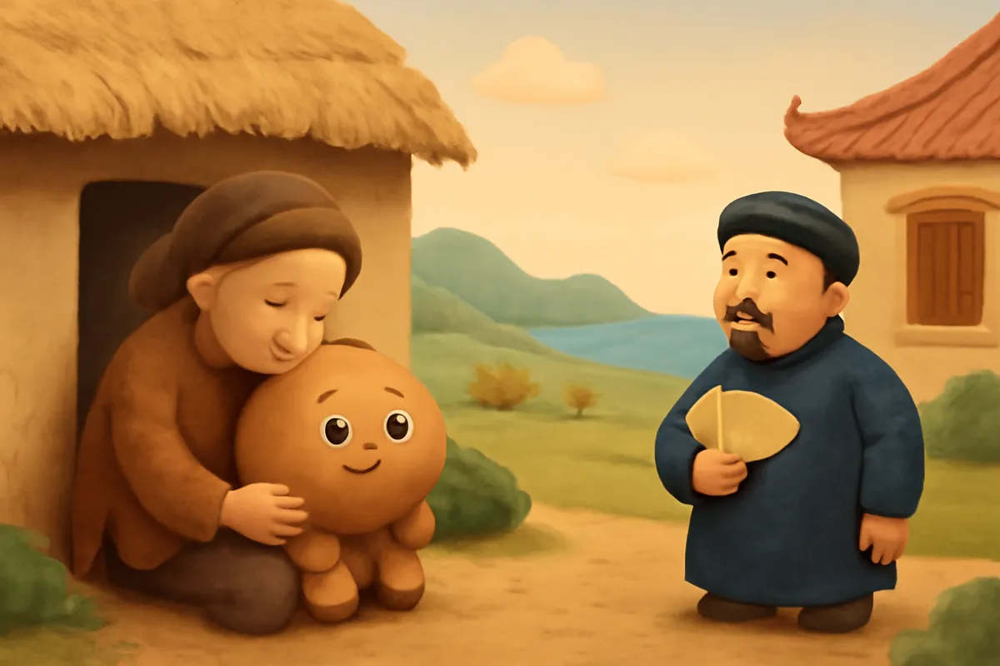
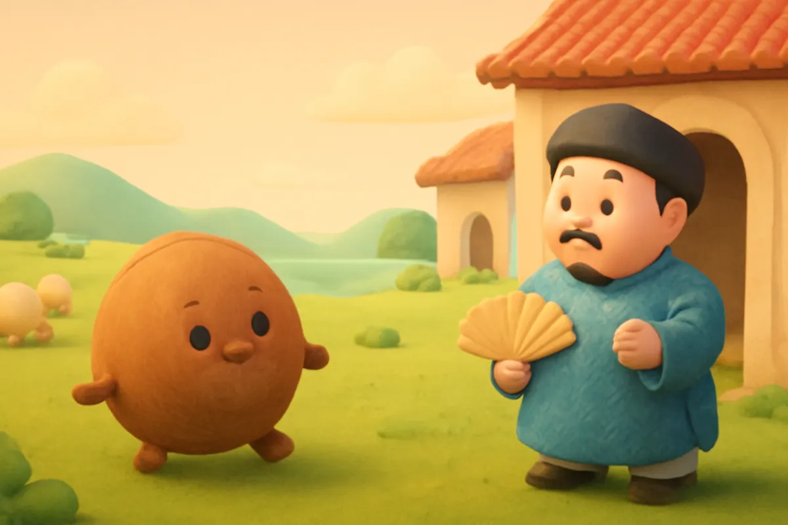
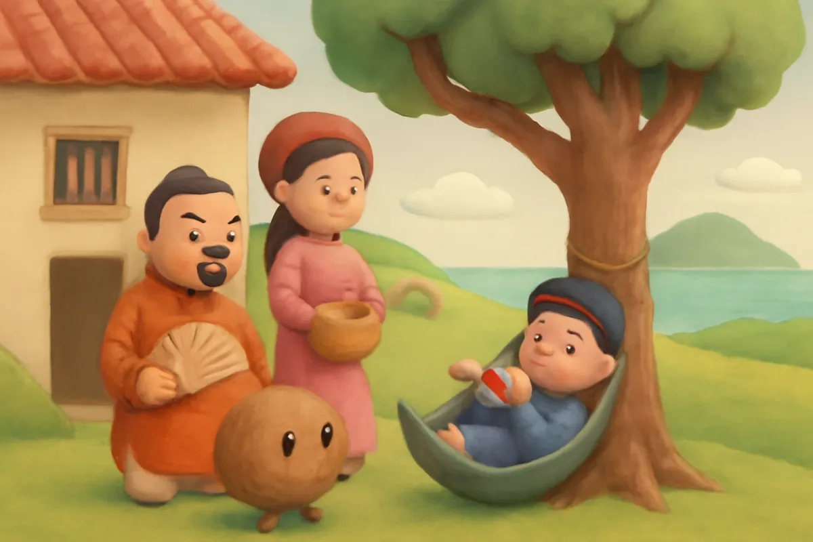
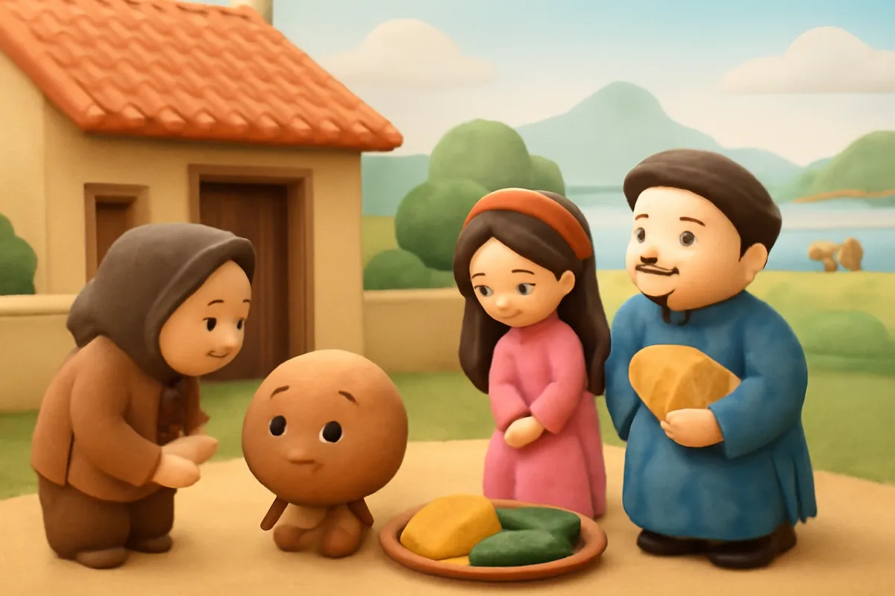
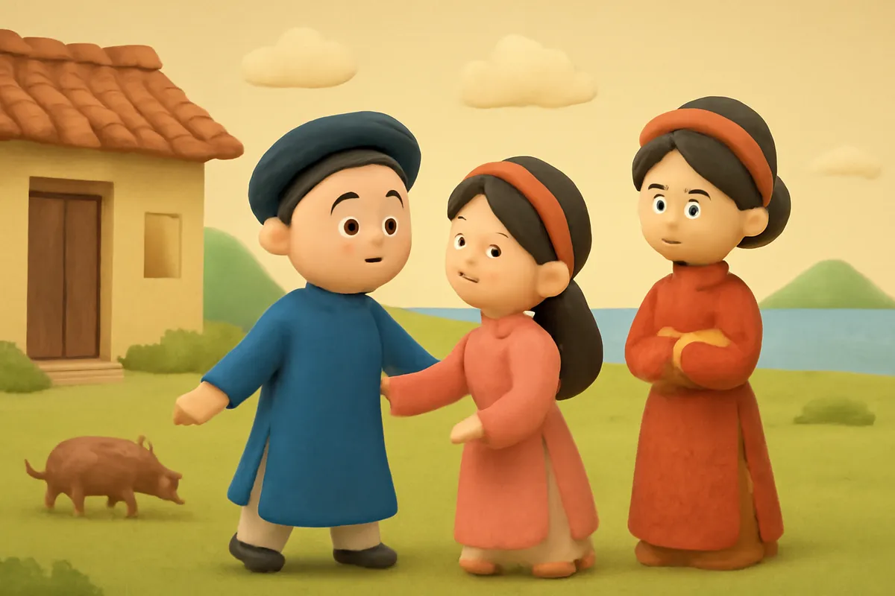
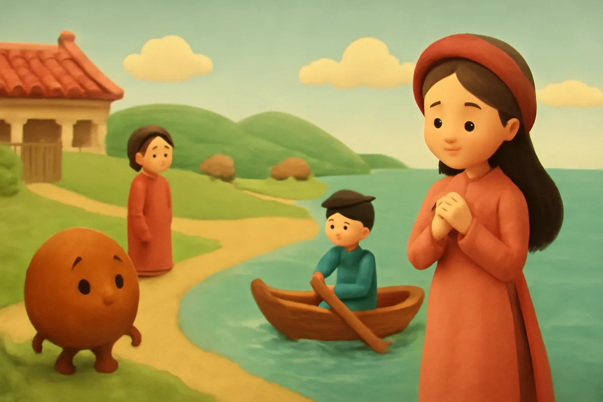
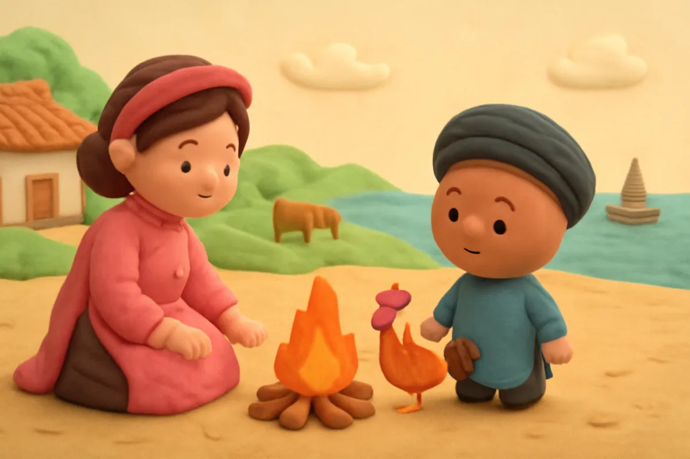
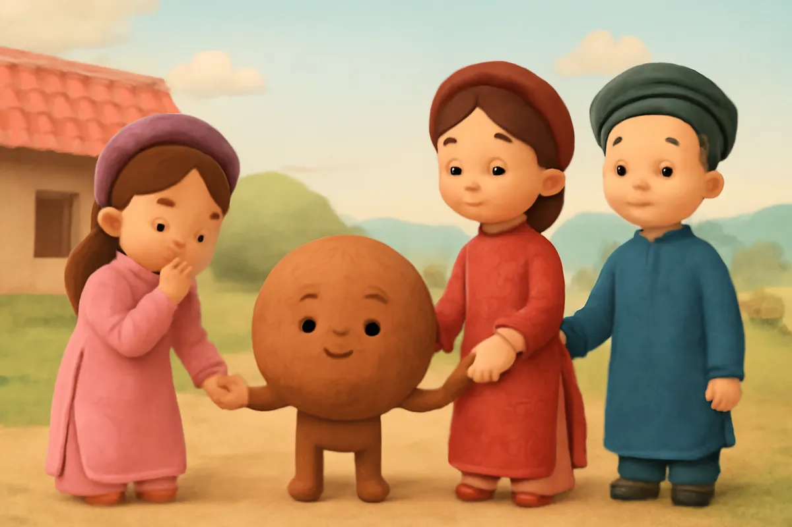

# Sọ Dừa

| | |
| --- | --- |
| Mã truyện | `a4a07111-6c74-42a3-910f-ae72dd29e325` |
| Nhóm | Truyện thư viện |
| Nguồn | manual |
| Tạo lúc | 2026-10-15T14:34:09.814347+00:00 |
| Cập nhật | 2026-10-16T04:26:57.498041+00:00 |
| Số trang | 8 |
| Ngôn ngữ | vi |
| Tuổi | 5–8 |
| Giọng kể | Viên - Narrative, Warm and Clear (northern) |
| Trạng thái | published |
| Đã xoá | không |

**Giới thiệu:** Bà mẹ nghèo sinh ra cậu bé tròn như quả dừa. Sọ Dừa chăn bò giỏi, cưới được cô Út hiền lành rồi hiện thành chàng trai khôi ngô, đỗ trạng nguyên và cứu vợ khỏi đảo hoang.

**Bài học:** Đừng đánh giá người khác qua vẻ bề ngoài; hiền lành, tốt bụng sẽ gặp điều lành.

## Nhân vật

- **Sọ Dừa** — Chàng trai mang lốt sọ dừa, tài giỏi, tốt bụng (giọng: Quang — chú trầm ấm)
- **Bà Mẹ** — Người mẹ nghèo hiền hậu, thương con (giọng: An — bà mẹ trầm ấm)
- **Phú Ông** — Phú ông giàu có, ham của (giọng: Thanh — ông hiền từ)
- **Cô Út** — Cô con gái út hiền lành, tốt bụng (giọng: Kim — chị gái dịu dàng)
- **Cô Cả** — Cô chị cả kiêu kỳ, ghen tị, cuối truyện biết lỗi (giọng: Tâm — cô kể chuyện cổ tích)

## Trang 1

Ngày xưa, có một bà mẹ nghèo đi ở cho nhà phú ông. Một hôm vào rừng hái củi, khát quá, bà uống nước đọng trong một cái sọ dừa. Rồi bà sinh ra một đứa bé tròn lông lốc như quả dừa, không có chân tay.

**Bà Mẹ:** Con ơi, con thế này thì mẹ biết nuôi con ra sao?

**Sọ Dừa:** Mẹ ơi, con cũng là người đấy. Mẹ cứ nuôi con, lớn lên con sẽ đỡ đần mẹ!

Bà thương con, đặt tên là Sọ Dừa.

🔊 [Nghe trang 1](../../../media/tts-cache/11f0b012-f9a1-482b-a8fc-49139520a873-75f3ea59-ee90-4974-8731-045a09edc0a3.mp3)

## Trang 2

Lớn lên, Sọ Dừa vẫn lăn lông lốc khắp nhà. Một hôm, cậu xin mẹ cho đi chăn bò thuê cho phú ông.

**Phú Ông:** Mày không chân không tay, lăn lóc thế kia thì chăn bò làm sao?

**Sọ Dừa:** Ông cứ cho con chăn thử. Con sẽ chăn bò thật giỏi.

Phú ông đành nhận. Lạ thay, ngày nào Sọ Dừa cũng lùa bò ra đồng, tối lại lùa về chuồng. Đàn bò con nào con nấy no căng bụng, béo tròn.

🔊 [Nghe trang 2](../../../media/tts-cache/ab639663-7eb4-4b76-bdb7-77e3c99b2835-8e7f6ec3-c3ea-4bbe-9381-2b34b781ca62.mp3)

## Trang 3

Ngày mùa, phú ông sai ba cô con gái thay nhau mang cơm cho Sọ Dừa. Hai cô chị kiêu kỳ, hắt hủi Sọ Dừa. Chỉ có cô Út hiền lành, đối đãi tử tế.

**Cô Cả:** Ai lại đi mang cơm cho cái sọ dừa lăn lóc chứ!

Một trưa, cô Út mang cơm ra sớm, thấy một chàng trai khôi ngô ngồi thổi sáo trên võng. Nghe tiếng động, chàng biến mất, chỉ còn Sọ Dừa nằm lăn lóc.

**Cô Út:** Sọ Dừa không phải người thường đâu!

🔊 [Nghe trang 3](../../../media/tts-cache/cda93102-d528-4839-b461-4e36de2b3bb0-d81c167c-a3fe-41e4-b586-73681d992e38.mp3)

## Trang 4

Cuối mùa, Sọ Dừa về nhà, giục mẹ đến hỏi con gái phú ông làm vợ.

**Bà Mẹ:** Nhà mình nghèo thế này, phú ông nào chịu gả con cho con?

Bà đành đến hỏi. Phú ông cười, bèn thách cưới thật nặng.

**Phú Ông:** Muốn cưới thì mang đủ một chĩnh vàng cốm, mười tấm lụa đào, mười con lợn béo đến đây!

Đúng ngày hẹn, nhà Sọ Dừa mang đến đủ sính lễ. Phú ông hỏi ba cô con gái, chỉ cô Út cúi đầu e thẹn nhận lời.

🔊 [Nghe trang 4](../../../media/tts-cache/17e295ac-abcd-4490-9d4a-294b46dfa6e2-28d1e300-46ad-4233-9d4e-03953201efb8.mp3)

## Trang 5

Ngày cưới, cỗ bàn linh đình. Đến giờ rước dâu, chẳng ai thấy Sọ Dừa đâu. Bỗng một chàng trai khôi ngô tuấn tú bước ra, cưỡi ngựa đến đón cô Út. Hoá ra Sọ Dừa đã cởi bỏ lốt dừa.

**Sọ Dừa:** Nàng đã thương ta từ khi ta còn là Sọ Dừa. Ta sẽ thương nàng suốt đời.

**Cô Út:** Thiếp cũng nguyện cùng chàng sống hiền lành, chăm chỉ.

Hai cô chị đứng nhìn, vừa tiếc vừa ghen tị.

**Cô Cả:** Biết thế này, ta đã nhận lời rồi!

🔊 [Nghe trang 5](../../../media/tts-cache/35a32900-ffab-47e1-8ee9-6594e35ef474-fe836df4-1d03-4ffe-bacd-dd2938bd17c3.mp3)

## Trang 6

Sọ Dừa chăm học, đỗ trạng nguyên, rồi được vua cử đi sứ. Trước khi đi, chàng đưa vợ một con dao, hòn đá lửa và hai quả trứng gà.

**Sọ Dừa:** Nàng nhớ luôn giữ những thứ này bên mình, có ngày sẽ cần đến.

Ở nhà, hai cô chị ghen tị, rủ em đi chơi thuyền. Hai chị lên bờ trước rồi đẩy chiếc thuyền nhỏ ra xa, bỏ cô Út một mình. Thuyền trôi mãi, trôi ra biển lớn.

**Cô Út:** Chị ơi! Chị ơi! Đợi em với!

🔊 [Nghe trang 6](../../../media/tts-cache/beb2f0d2-a37f-4fcb-a4dc-61861170f30a-f16da621-08a1-4568-a357-46df169d0d31.mp3)

## Trang 7

Thuyền dạt vào một hòn đảo hoang. Cô Út nhớ lời chồng dặn: cô dùng dao hái quả rừng, lấy đá lửa nhóm bếp sưởi ấm, ấp hai quả trứng nở thành một đôi gà con.

**Cô Út:** Gà ơi, lớn nhanh lên làm bạn với chị nhé.

Một hôm, có chiếc thuyền lớn đi ngang qua. Chú gà trống vỗ cánh gáy vang: Ò ó o, phải thuyền quan trạng rước cô tôi về!

**Sọ Dừa:** Gà nhà ai mà gáy lạ thế? Mau ghé thuyền vào xem!

🔊 [Nghe trang 7](../../../media/tts-cache/ce173319-dcf7-46d8-9788-52b3365852c2-55f1f90f-ad63-4b3b-9212-623d44291bc4.mp3)

## Trang 8

Quan trạng nhận ra vợ, mừng rỡ đón nàng về. Chàng mở tiệc mừng, nhưng giấu vợ trong buồng. Hai cô chị đến, tranh nhau kể chuyện.

**Cô Cả:** Em Út chẳng may lạc mất rồi, thương em quá!

Cô Út bước ra. Hai chị đỏ mặt, cúi đầu xấu hổ.

**Cô Cả:** Chị em ta sai rồi. Em tha lỗi cho các chị nhé.

**Cô Út:** Các chị biết lỗi là em vui rồi. Chị em mình thương nhau như xưa nhé.

🔊 [Nghe trang 8](../../../media/tts-cache/a917fcff-15ca-411a-b95d-783dbf6ebc67-eef17a8b-09bd-484d-93ab-2208c73831e5.mp3)

---

Bản đầy đủ (mọi cột trong cơ sở dữ liệu): [story.json](story.json)
