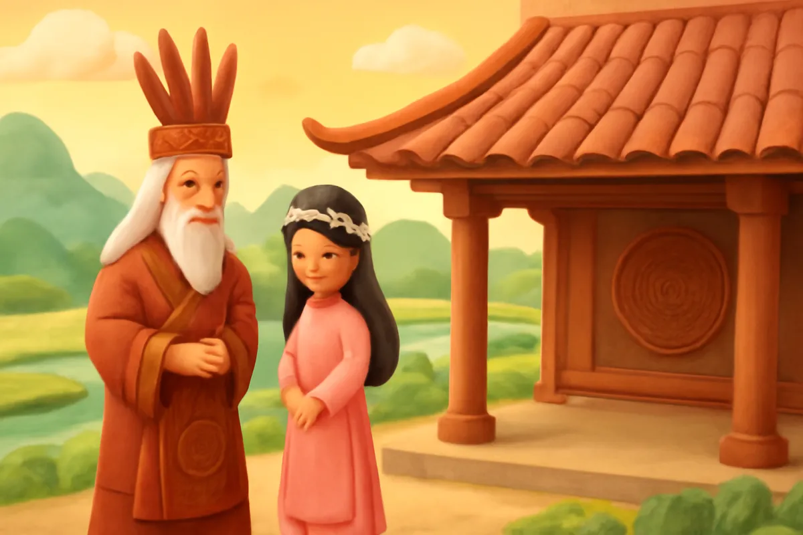
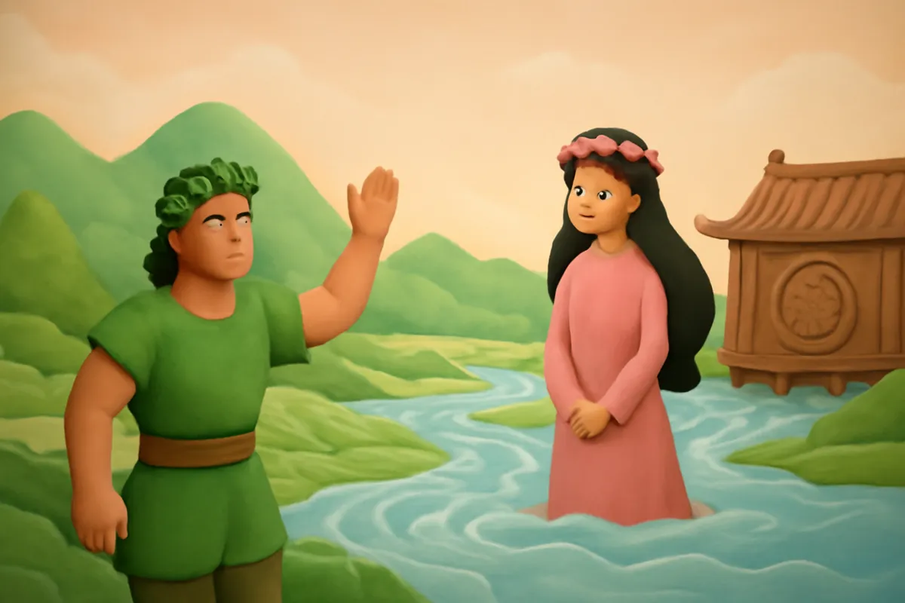
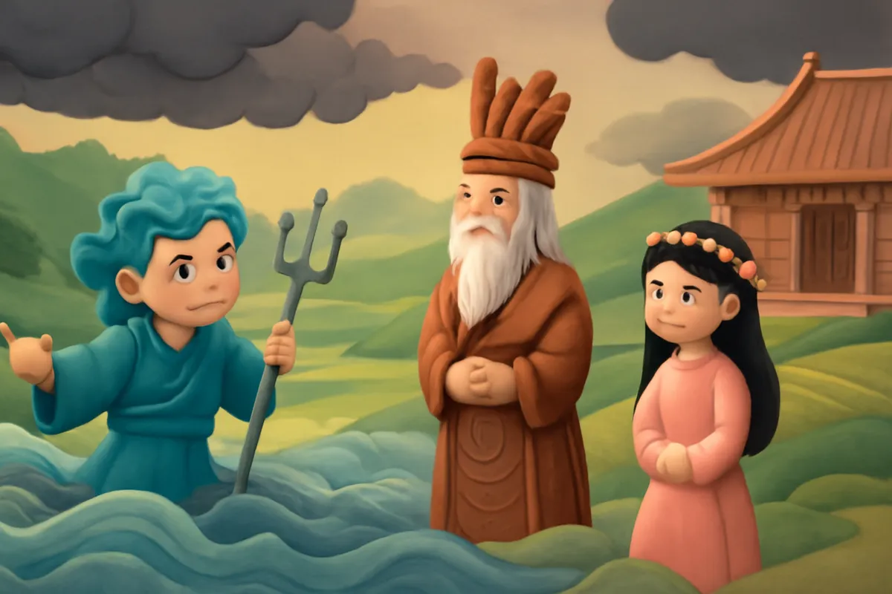
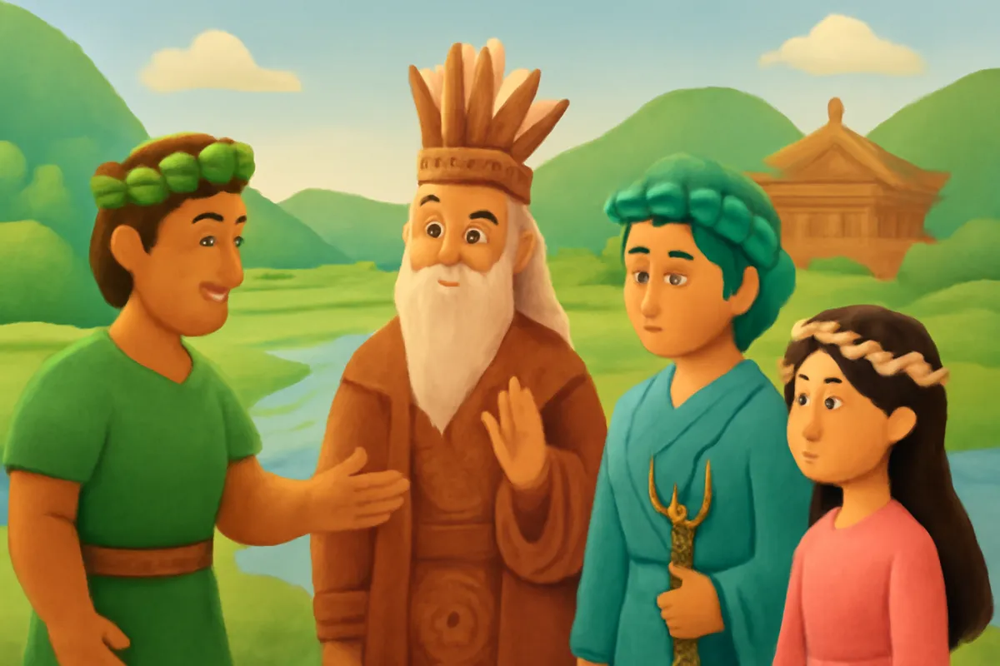
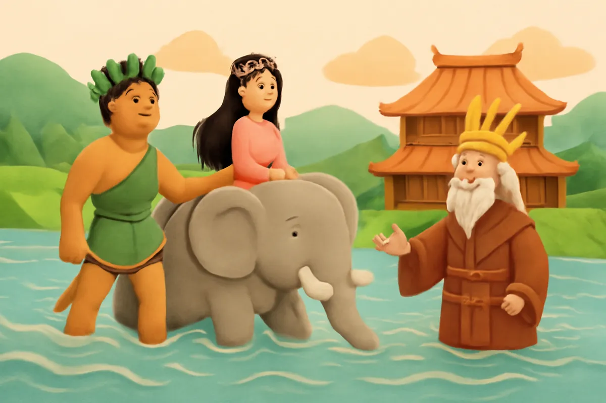
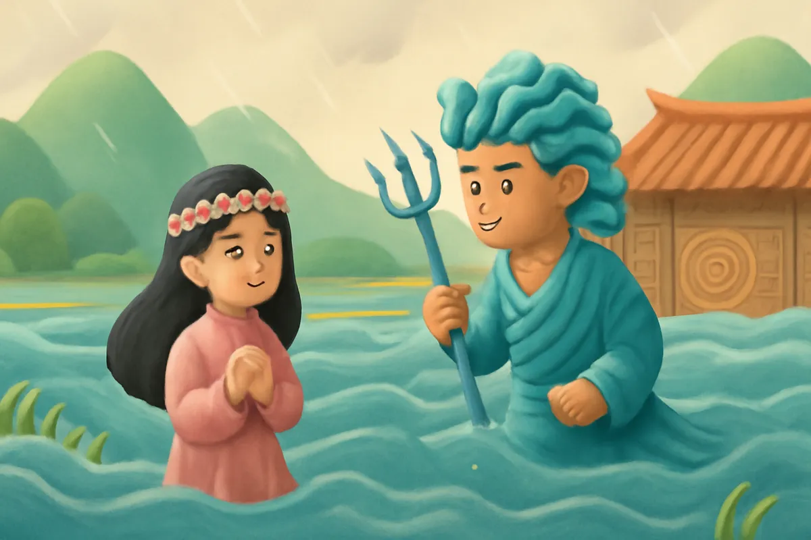
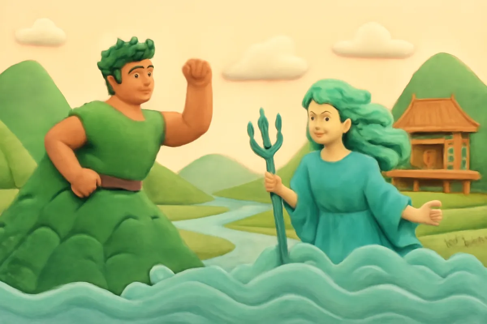
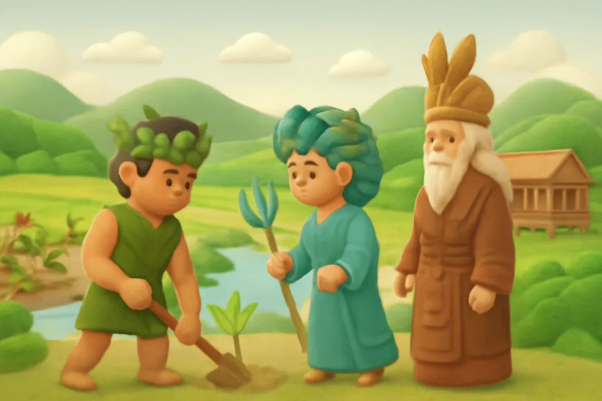

# Sơn Tinh, Thủy Tinh

| | |
| --- | --- |
| Mã truyện | `ef221fa0-d168-4c0f-be1a-4642cae874a3` |
| Nhóm | Truyện thư viện |
| Nguồn | manual |
| Tạo lúc | 2026-10-15T14:34:09.448749+00:00 |
| Cập nhật | 2026-10-16T04:25:50.480025+00:00 |
| Số trang | 8 |
| Ngôn ngữ | vi |
| Tuổi | 5–9 |
| Giọng kể | Viên - Narrative, Warm and Clear (northern) |
| Trạng thái | published |
| Đã xoá | không |

**Giới thiệu:** Sơn Tinh và Thủy Tinh cùng đến cầu hôn Mị Nương. Sơn Tinh mang sính lễ đến trước nên cưới được nàng. Thủy Tinh tức giận dâng nước, Sơn Tinh dựng núi chặn lũ.

**Bài học:** Kiên trì, đoàn kết thì vượt qua được thiên tai.

## Nhân vật

- **Sơn Tinh** — Chúa vùng non cao núi Tản Viên (giọng: Quang — chú trầm ấm)
- **Thủy Tinh** — Chúa vùng biển cả, nóng nảy (giọng: Thanh — ông hiền từ)
- **Vua Hùng** — Vua Hùng thứ mười tám, cha của Mị Nương (giọng: Thanh — ông hiền từ)
- **Mị Nương** — Công chúa xinh đẹp, hiền dịu (giọng: Kim — chị gái dịu dàng)

## Trang 1

Ngày xưa, vua Hùng thứ mười tám có một người con gái tên là Mị Nương, xinh đẹp và hiền dịu. Vua muốn tìm cho nàng một người chồng thật xứng đáng.

**Vua Hùng:** Ta sẽ chọn người tài giỏi nhất cho con gái ta.

**Mị Nương:** Thưa cha, con xin nghe theo lời cha.

Tin ấy bay đi khắp nơi. Một ngày, có hai chàng trai cùng đến cầu hôn.

🔊 [Nghe trang 1](../../../media/tts-cache/eebd474a-34da-497b-a292-632456a5696c-4b7a1b98-da82-4531-bc22-46a6809f7cec.mp3)

## Trang 2

Người thứ nhất là Sơn Tinh, chúa vùng non cao. Sơn Tinh chỉ cần giơ tay lên, mặt đất liền nhô thành gò, thành đồi, rồi núi non mọc lên trùng điệp.

**Sơn Tinh:** Tôi là Sơn Tinh, ở vùng núi Tản Viên. Xin nhà vua cho tôi được cưới Mị Nương.

Mọi người trầm trồ, ai cũng khen Sơn Tinh tài giỏi.

🔊 [Nghe trang 2](../../../media/tts-cache/45e416a5-c88a-4418-8450-f81b82a2ec26-83fb3089-e82d-410a-afa2-4b3f613377c3.mp3)

## Trang 3

Người thứ hai là Thủy Tinh, chúa vùng biển cả. Thủy Tinh khẽ vung tay, gió liền nổi lên ầm ầm. Chàng hô lên một tiếng, mây đen kéo đến, mưa trút xuống như thác.

**Thủy Tinh:** Tôi là Thủy Tinh, ở dưới biển sâu. Tôi cũng xin được cưới Mị Nương!

Vua Hùng nhìn hai chàng trai. Người nào cũng tài giỏi, vua chẳng biết chọn ai.

🔊 [Nghe trang 3](../../../media/tts-cache/36ca5242-4cd9-4746-a671-565cd1ec9699-46e4c775-61e4-49ed-bf8e-5bf7a7aeb2cd.mp3)

## Trang 4

**Vua Hùng:** Hai chàng đều xứng đáng. Ngày mai, ai mang sính lễ đến trước, người đó sẽ được cưới Mị Nương.

Sính lễ gồm một trăm ván cơm nếp, một trăm nệp bánh chưng, voi chín ngà, gà chín cựa, ngựa chín hồng mao.

**Sơn Tinh:** Núi rừng của tôi có đủ những thứ ấy!

Thủy Tinh thì lo lắng, vì những lễ vật ấy đều ở trên rừng, trên núi.

🔊 [Nghe trang 4](../../../media/tts-cache/c31cf949-d832-40d4-843a-991003486efb-926dbe0d-e39d-4cd2-9b27-99fff8637216.mp3)

## Trang 5

Sáng sớm hôm sau, trời còn chưa sáng hẳn, Sơn Tinh đã mang đủ lễ vật đến trước. Đoàn voi, gà, ngựa nối nhau đi theo. Vua Hùng giữ lời hứa, cho Sơn Tinh cưới Mị Nương.

**Mị Nương:** Thưa cha, con xin chào cha để theo chồng về núi.

Sơn Tinh đưa Mị Nương về núi Tản Viên. Hai người sống hạnh phúc giữa núi rừng xanh mát.

🔊 [Nghe trang 5](../../../media/tts-cache/979841a0-90ff-42ee-bbe7-77e5e076a19d-0667e632-566d-4d06-b2cd-5c2910c96ac6.mp3)

## Trang 6

Thủy Tinh đến sau, không cưới được Mị Nương, tức giận vô cùng. Trời bỗng tối sầm lại.

**Thủy Tinh:** Ta sẽ dâng nước lên, đuổi theo đón Mị Nương về!

Thủy Tinh hô mưa, gọi gió, làm thành giông bão rung chuyển cả đất trời. Nước sông dâng cao, cuồn cuộn tràn vào ruộng đồng, nhà cửa, rồi dâng lên cả lưng đồi, sườn núi.

🔊 [Nghe trang 6](../../../media/tts-cache/27410207-53bc-4f5f-9f98-3765317bc93f-797a8372-8d18-4abc-a50b-2539fbea2e4f.mp3)

## Trang 7

Sơn Tinh không hề nao núng. Chàng bốc từng quả đồi, dời từng dãy núi, dựng thành bức tường chắn nước. Nước dâng đến đâu, núi lại vươn cao đến đó.

**Sơn Tinh:** Thủy Tinh, hãy về đi! Núi của ta sẽ che chở cho mọi người!

Ròng rã mấy tháng trời, cuối cùng Thủy Tinh mỏi mệt, đành rút nước về biển.

🔊 [Nghe trang 7](../../../media/tts-cache/99cc951c-4c16-4c7e-b69a-c7590d2afc23-f2329dfa-bdbf-40bd-b6f2-a21c5d686058.mp3)

## Trang 8

Từ đó, năm nào Thủy Tinh cũng nhớ chuyện cũ, lại dâng nước đánh Sơn Tinh. Đó chính là những mùa mưa lũ hằng năm. Nhưng lần nào Thủy Tinh cũng phải rút lui.

Học theo Sơn Tinh, ông cha ta đã cùng nhau đắp đê thật cao, trồng cây giữ đất, để làng xóm bình yên mỗi mùa nước lớn.

**Vua Hùng:** Mọi người đồng lòng, thì không con lũ nào làm khó được chúng ta!

🔊 [Nghe trang 8](../../../media/tts-cache/7e15edd5-b92c-452a-8254-5fa0bd6e4ecf-e167d023-cdd2-44fc-8243-214e89193d95.mp3)

---

Bản đầy đủ (mọi cột trong cơ sở dữ liệu): [story.json](story.json)
