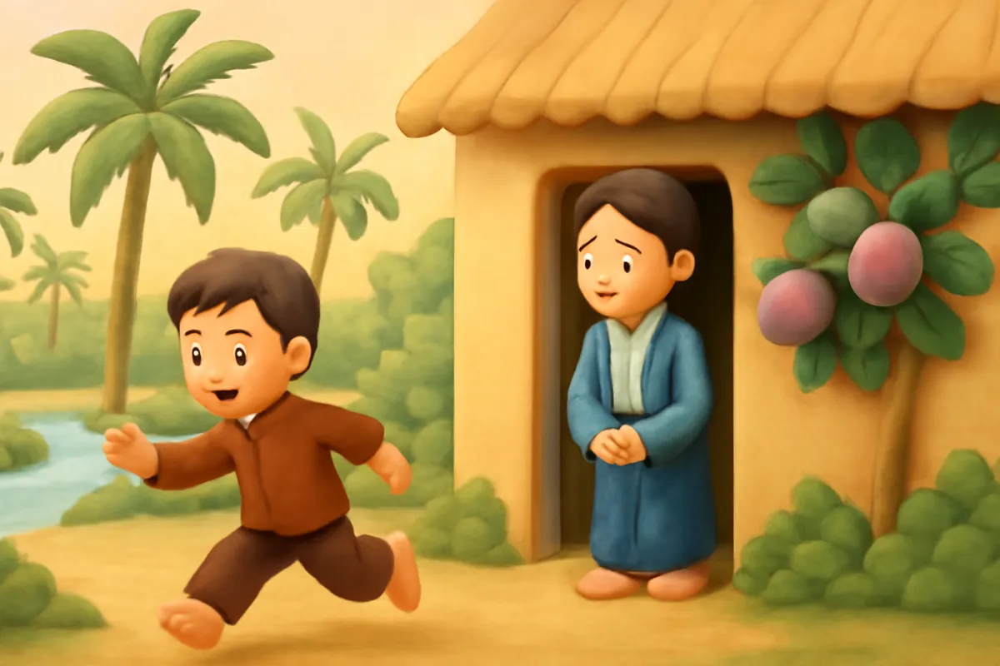
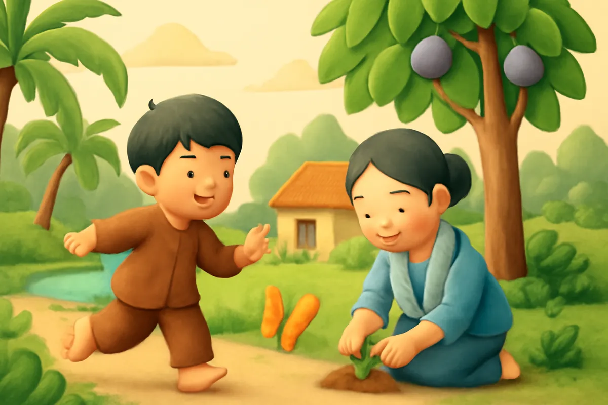
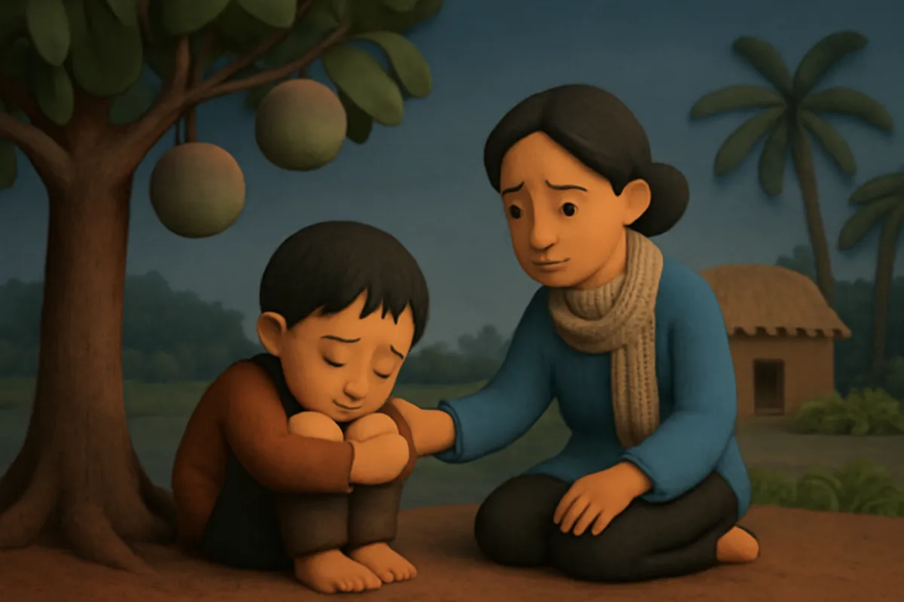
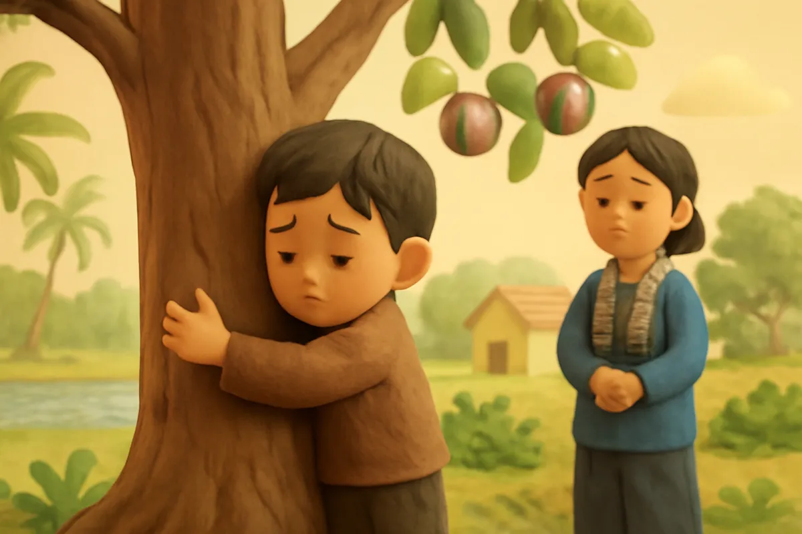
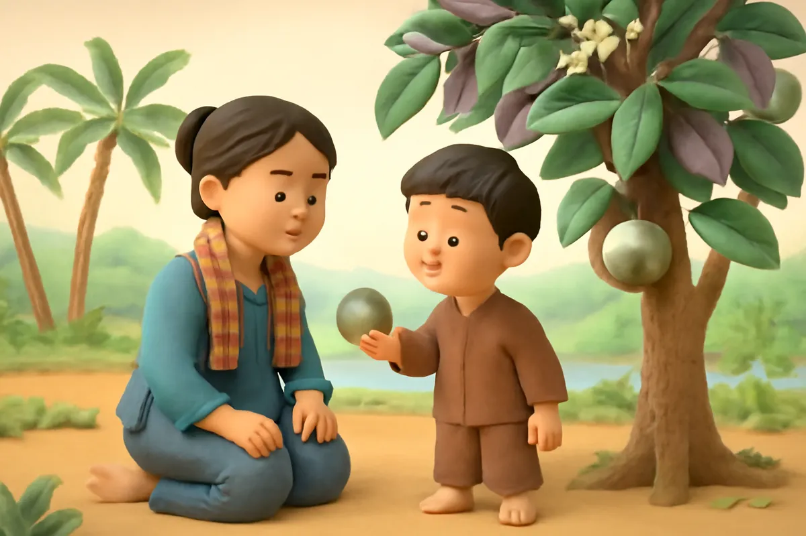
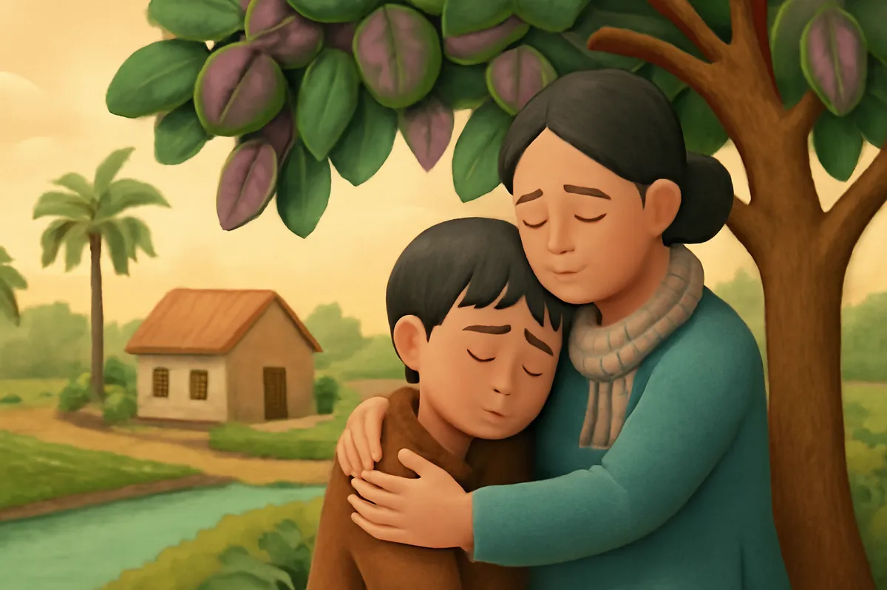
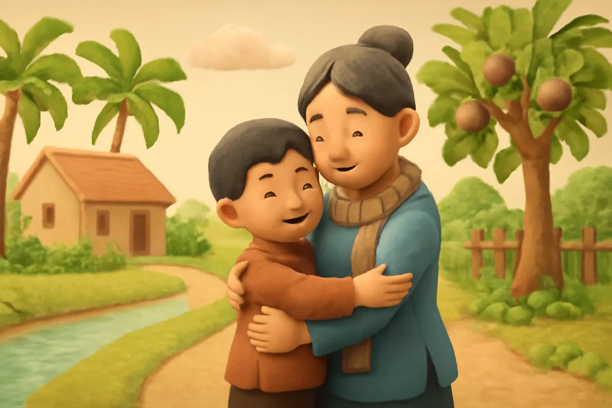
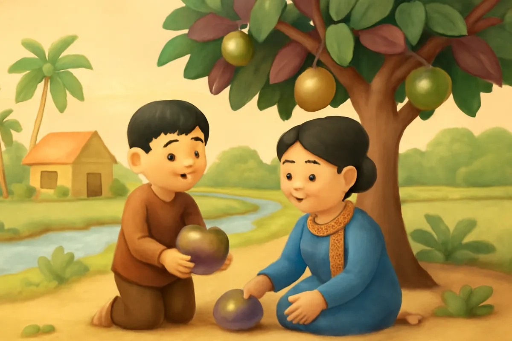

# Sự tích cây vú sữa

| | |
| --- | --- |
| Mã truyện | `5a14fd6c-e922-446a-8920-f972e59b4be4` |
| Nhóm | Truyện thư viện |
| Nguồn | manual |
| Tạo lúc | 2026-10-15T14:34:09.814347+00:00 |
| Cập nhật | 2026-10-16T08:23:06.844328+00:00 |
| Số trang | 8 |
| Ngôn ngữ | vi |
| Tuổi | 3–6 |
| Giọng kể | Viên - Narrative, Warm and Clear (northern) |
| Trạng thái | published |
| Đã xoá | không |

**Giới thiệu:** Cậu bé ham chơi giận mẹ bỏ đi. Khi đói rét trở về, mẹ đã đi tìm con, chỉ còn cây mẹ trồng nở hoa, kết quả ngọt như sữa mẹ. Cậu biết lỗi và mẹ trở về.

**Bài học:** Hãy yêu thương, vâng lời cha mẹ; tình mẹ luôn chờ con trở về.

## Nhân vật

- **Cậu Bé** — Cậu bé ham chơi, sau biết lỗi và thương mẹ (giọng: Bin — bé trai lém lỉnh)
- **Mẹ** — Người mẹ hiền, luôn chờ con về (giọng: Tâm — cô kể chuyện cổ tích)
- **Cây Vú Sữa** — Cây thần do mẹ trồng, biết nói (giọng: An — bà mẹ trầm ấm)

## Trang 1

Ngày xưa, có một cậu bé sống cùng mẹ trong ngôi nhà nhỏ có mảnh vườn xanh. Cậu bé rất ham chơi. Một hôm, mải chơi quên về, cậu bị mẹ nhắc nhở.

**Mẹ:** Con ơi, đi chơi phải nhớ giờ về, kẻo mẹ lo lắm.

**Cậu Bé:** Mẹ toàn nhắc con thôi! Con đi chơi thật xa, không về nữa!

Nói rồi, cậu vùng vằng chạy ra khỏi nhà.

🔊 [Nghe trang 1](../../../media/tts-cache/1675ec91-ee6d-4c66-9b1c-426427055425-f74e34f8-4c0d-405d-a402-384ce08eba56.mp3)

## Trang 2

Cậu bé đi mãi, đi mãi. Cậu đuổi bướm ngoài đồng, hái hoa trong rừng, lội suối bắt cá con.

**Cậu Bé:** Vui quá! Ở đây chẳng ai nhắc mình phải về nhà cả!

Ở nhà, ngày nào mẹ cũng ra cổng ngóng con. Mẹ trồng một cây non ở góc vườn, ngày ngày tưới nước.

**Mẹ:** Cây ơi, lớn nhanh lên. Con mẹ về, cây cho con mẹ quả ngọt nhé.

🔊 [Nghe trang 2](../../../media/tts-cache/f92ba364-73ac-44db-bff7-913a8ad19da3-34491e9b-31da-401c-85ab-7708ea15b03e.mp3)

## Trang 3

Rồi một tối, trời trở lạnh. Cậu bé vừa đói vừa rét, ngồi co ro dưới gốc cây. Chẳng có ai nấu cơm, chẳng có ai đắp chăn cho cậu.

**Cậu Bé:** Mẹ ơi... con nhớ mẹ quá. Con muốn về nhà.

Cậu nhớ bát cơm nóng mẹ nấu, nhớ bàn tay mẹ xoa lưng mỗi tối. Cậu đứng dậy, lần theo đường cũ trở về.

🔊 [Nghe trang 3](../../../media/tts-cache/7eb9c9b4-6534-4006-9214-0d9c06b145fa-6a30f5e0-43e8-4eef-b3c0-abde6f924fa2.mp3)

## Trang 4

Về đến nhà, cánh cổng khép hờ, căn nhà vắng tanh. Cậu bé chạy khắp nơi tìm mẹ.

**Cậu Bé:** Mẹ ơi! Mẹ ở đâu? Con về rồi đây!

Chỉ có tiếng gió thổi xào xạc. Mẹ đã đi tìm cậu ở những làng xa. Ở góc vườn, cây non ngày trước nay đã cao lớn, tán lá xanh rì. Cậu ôm lấy thân cây, oà khóc.

🔊 [Nghe trang 4](../../../media/tts-cache/36095af3-54da-4d14-b2f3-0a6b6b20b7c7-a62fdd49-0f36-4d69-9fe3-8aa956d20aed.mp3)

## Trang 5

Bỗng cây khẽ rung. Từ các cành lá, những bông hoa trắng nở ra, rồi kết thành quả tròn, căng mọng. Một quả rơi vào tay cậu bé.

**Cây Vú Sữa:** Cháu ơi, đừng khóc. Mẹ cháu đã trồng ta và tưới ta mỗi ngày, mong cháu về.

Cậu bé khẽ cắn quả. Một dòng nước trắng ngọt ngào trào ra, thơm như sữa mẹ.

🔊 [Nghe trang 5](../../../media/tts-cache/2ed46af8-7e8c-455e-8b04-9399988eef24-3a672bac-c15d-4cac-91d7-afbfe76a2093.mp3)

## Trang 6

Cậu bé nhìn lên. Lá cây mặt trên xanh bóng, mặt dưới đỏ hoe như mắt mẹ khóc chờ con.

**Cây Vú Sữa:** Mẹ cháu đã đi tìm cháu khắp nơi. Mẹ thương cháu lắm.

**Cậu Bé:** Con biết lỗi rồi. Con không bao giờ bỏ đi như thế nữa. Mẹ ơi, mẹ về với con đi!

Tán cây xoà xuống, ôm lấy cậu như vòng tay mẹ.

🔊 [Nghe trang 6](../../../media/tts-cache/98e73ad4-d317-4b5f-a06f-7f53ca39c4af-b0dabeaf-6db0-49fe-be23-abee8cf8d6f7.mp3)

## Trang 7

Sáng hôm sau, cậu bé ra cổng ngóng, đúng như mẹ vẫn làm ngày trước. Từ cuối con đường làng, một bóng người quen thuộc đang bước về.

**Mẹ:** Con ơi! Con về rồi! Mẹ tìm con mãi!

**Cậu Bé:** Mẹ ơi! Con xin lỗi mẹ. Con thương mẹ nhất trên đời!

Hai mẹ con ôm nhau thật chặt, nước mắt mừng rơi lã chã.

🔊 [Nghe trang 7](../../../media/tts-cache/b0fc45e8-4e1a-459a-9045-e2d25c196455-3d9da1a9-16fd-4586-b1fd-97df1000b613.mp3)

## Trang 8

Từ đó, cậu bé chăm ngoan, ngày ngày giúp mẹ tưới cây, quét vườn. Mùa quả chín, hai mẹ con hái những quả tròn căng, chia cho cả xóm.

**Cây Vú Sữa:** Mỗi quả ngọt của ta là tình thương của mẹ dành cho con đấy.

**Mẹ:** Người ta gọi đây là cây vú sữa, con ạ.

**Cậu Bé:** Con sẽ luôn nhớ về nhà với mẹ!

🔊 [Nghe trang 8](../../../media/tts-cache/e073d250-c811-4496-81a7-277ff6b87eaf-c73eebbc-e754-4f82-9be5-9bb58eccfffc.mp3)

---

Bản đầy đủ (mọi cột trong cơ sở dữ liệu): [story.json](story.json)
