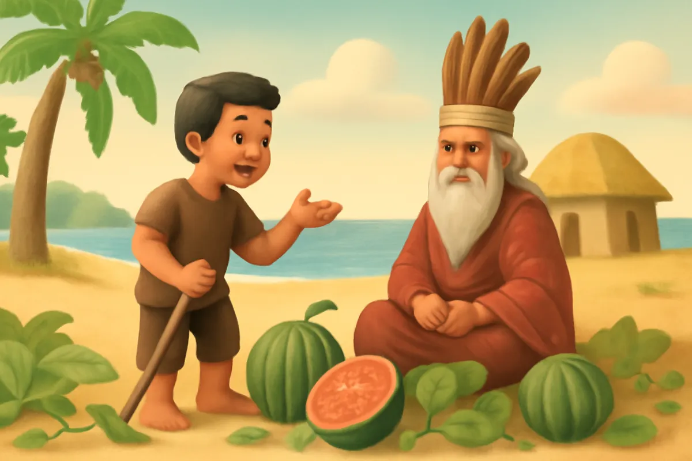
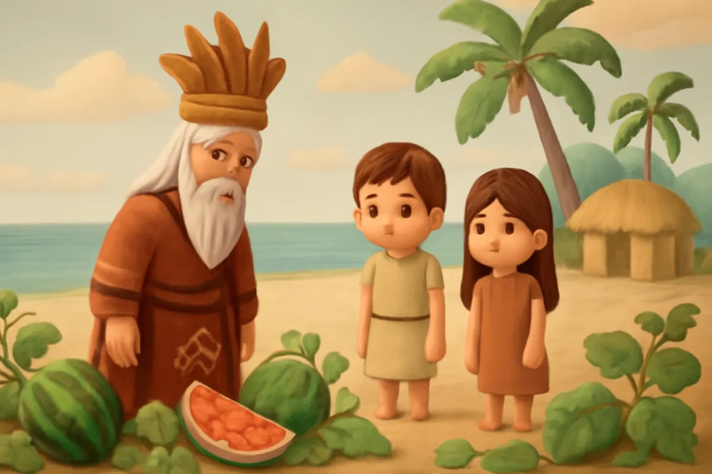
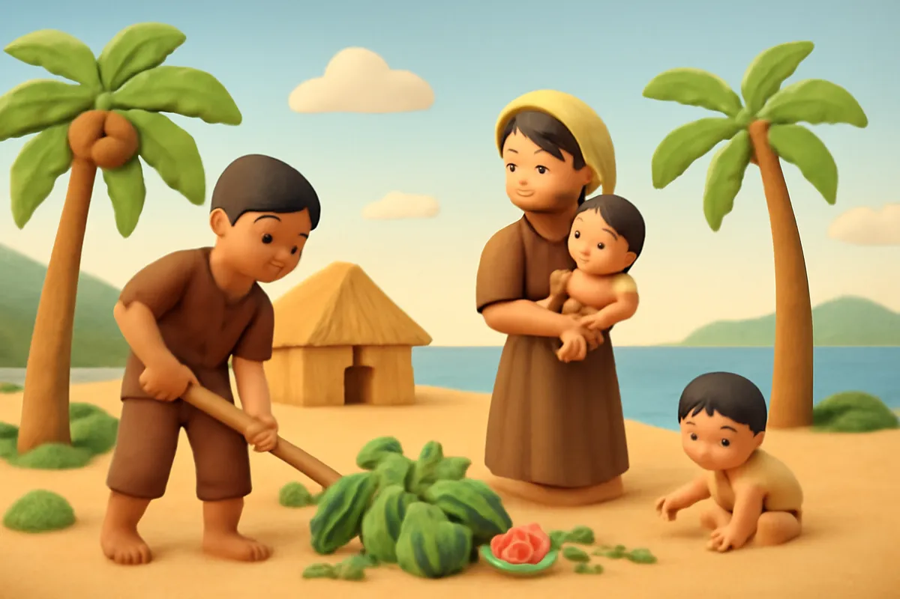
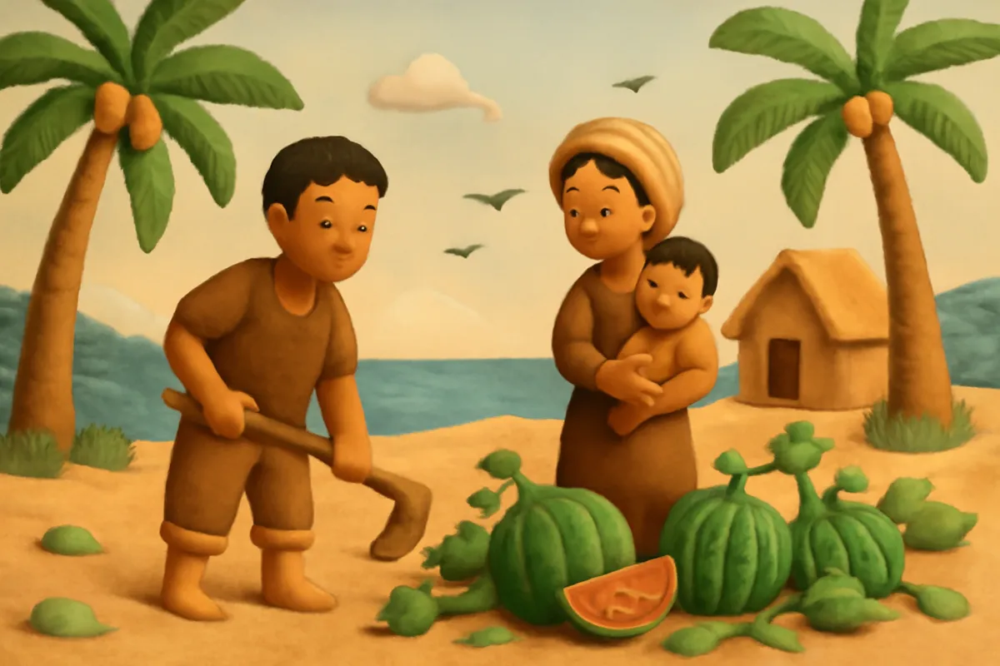
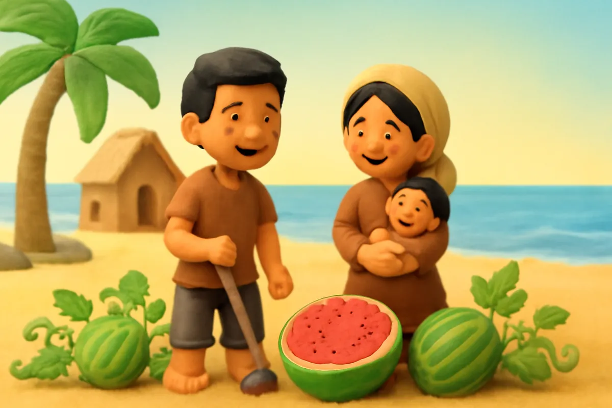
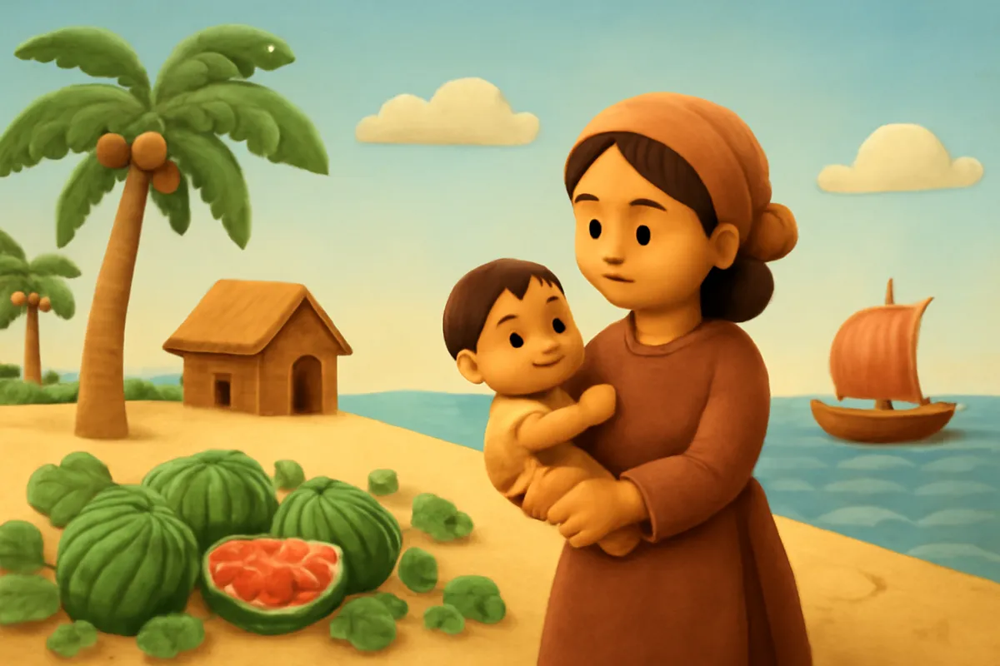
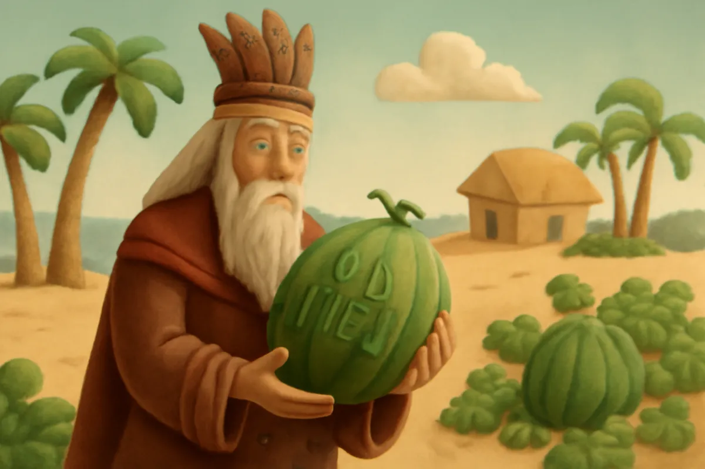
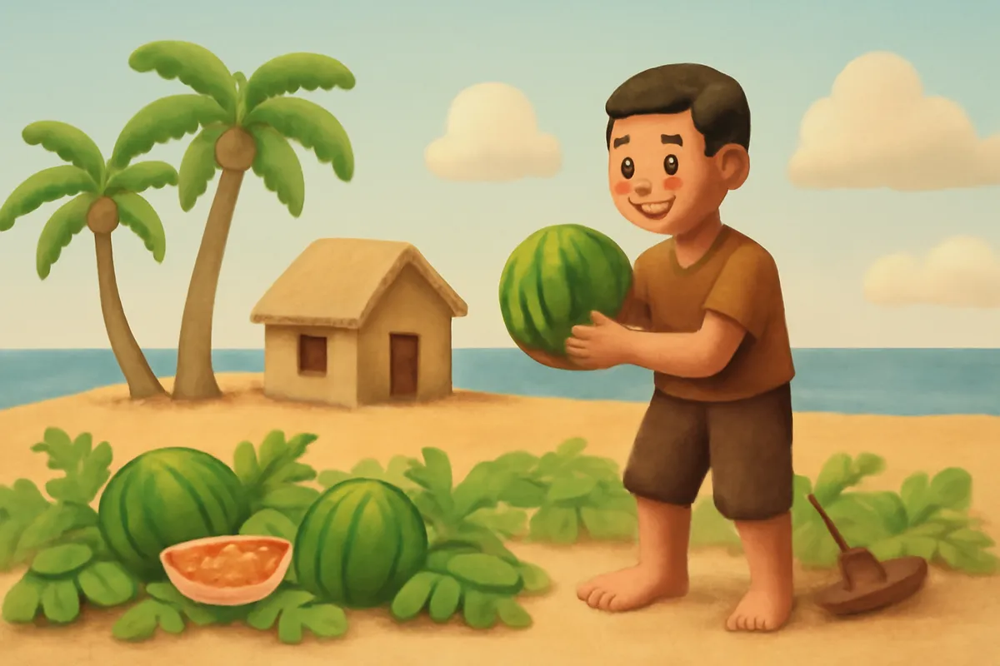

# Sự tích dưa hấu

| | |
| --- | --- |
| Mã truyện | `c677cca7-5c88-475c-af56-42c2cbbc7547` |
| Nhóm | Truyện thư viện |
| Nguồn | manual |
| Tạo lúc | 2026-10-15T14:34:09.448749+00:00 |
| Cập nhật | 2026-10-16T04:26:29.276419+00:00 |
| Số trang | 8 |
| Ngôn ngữ | vi |
| Tuổi | 5–9 |
| Giọng kể | Viên - Narrative, Warm and Clear (northern) |
| Trạng thái | published |
| Đã xoá | không |

**Giới thiệu:** Mai An Tiêm bị đưa ra đảo hoang vì một câu nói làm vua phật lòng. Nhờ chăm chỉ, vợ chồng An Tiêm trồng được thứ quả ruột đỏ ngọt mát, đổi lấy lương thực và được vua đón về.

**Bài học:** Chăm chỉ, tự lực thì ở đâu cũng sống tốt; biết nhận ra lỗi của mình.

## Nhân vật

- **Mai An Tiêm** — Con nuôi vua Hùng, chăm chỉ, tự lực (giọng: Quang — chú trầm ấm)
- **Vợ An Tiêm** — Người vợ đảm đang, luôn ở bên chồng (giọng: Tâm — cô kể chuyện cổ tích)
- **Vua Hùng** — Vua Hùng, nóng giận nhưng biết nhận lỗi (giọng: Thanh — ông hiền từ)

## Trang 1

Ngày xưa, vua Hùng có một người con nuôi tên là Mai An Tiêm. An Tiêm chăm chỉ, thông minh, được vua thương yêu, cho cưới vợ và ban nhiều của cải.

Một hôm, trong bữa tiệc, mọi người khen nhà An Tiêm giàu có. An Tiêm nói:

**Mai An Tiêm:** Những thứ con có đều nhờ đôi bàn tay con làm ra cả.

Vua nghe vậy, cho là An Tiêm không biết ơn.

🔊 [Nghe trang 1](../../../media/tts-cache/6b9f1c7a-8b4f-4932-a31d-e6f81a7de2ab-cbb6ad23-0199-4aad-be00-9d2ab27d0696.mp3)

## Trang 2

Vua giận lắm.

**Vua Hùng:** Ngươi nói tự làm ra được tất cả ư? Vậy ta cho ngươi ra đảo hoang mà tự lo lấy!

Thế là vợ chồng An Tiêm cùng đứa con nhỏ bị đưa ra một hòn đảo giữa biển. Trên đảo chỉ có cát trắng, đá xám, vài bụi cây và tiếng sóng vỗ rì rào suốt ngày đêm.

🔊 [Nghe trang 2](../../../media/tts-cache/74711a76-6329-4f98-8ec2-23cf20ceb857-346c1850-5328-484d-816c-0c77550d141c.mp3)

## Trang 3

**Vợ An Tiêm:** Mình ơi, ở đây hoang vắng quá, nhà mình biết sống thế nào?

**Mai An Tiêm:** Mình đừng lo. Còn đôi bàn tay là còn làm được. Mình cùng nhau cố gắng nhé.

An Tiêm dựng một túp lều nhỏ bằng cây và lá. Chàng bắt cá, hái rau, nhặt củi. Vợ chàng tìm nước ngọt, nấu cơm, chăm con. Ngày nào cũng vất vả, nhưng cả nhà vẫn ở bên nhau.

🔊 [Nghe trang 3](../../../media/tts-cache/9301f126-e610-4c27-8954-89f32889ffc1-5b1637f3-9e9d-4120-bdc7-68994f29852a.mp3)

## Trang 4

Một hôm, có một đàn chim bay từ phía tây tới. Chim thả xuống bãi cát mấy hạt nhỏ đen nhánh. Ít lâu sau, chỗ ấy mọc lên những dây leo xanh mướt, rồi ra những quả tròn to, vỏ xanh thẫm.

**Mai An Tiêm:** Chim ăn được thì người cũng ăn được. Mình thử xem nào!

**Vợ An Tiêm:** Quả to quá, chắc phải nặng lắm đây!

🔊 [Nghe trang 4](../../../media/tts-cache/d68f65b7-afd6-4139-8817-1a2a1a61a4e3-9e6a353b-4778-48f8-b4ae-e1a8b0992587.mp3)

## Trang 5

An Tiêm bổ quả ra. Bên trong ruột đỏ tươi, hạt đen nhánh, ăn vào thấy ngọt mát, thơm lừng.

**Vợ An Tiêm:** Ngon quá! Quả này vừa ngọt vừa mát, thật là quý!

**Mai An Tiêm:** Mình giữ hạt lại, đem gieo khắp đảo nhé.

Hai vợ chồng chăm chỉ gieo hạt, tưới cây. Chẳng bao lâu, dây xanh quả to đã mọc kín cả bãi cát.

🔊 [Nghe trang 5](../../../media/tts-cache/65276c1a-e8a9-4fa7-8783-71fa012ea508-f4269440-5d95-4c27-88f2-2de8b1f1a86d.mp3)

## Trang 6

Một ngày, An Tiêm khắc tên mình lên vỏ quả, rồi thả xuống biển. Sóng đưa những quả dưa trôi đi rất xa. Có thuyền buôn vớt được, ăn thử thấy ngon, liền tìm ra đảo.

Họ mang gạo, vải, đồ dùng đến đổi lấy quả. Cuộc sống của gia đình An Tiêm ngày càng đầy đủ.

**Vợ An Tiêm:** Nhờ chăm chỉ, nhà mình đã có cái ăn cái mặc rồi mình ạ.

🔊 [Nghe trang 6](../../../media/tts-cache/3bcc7ee8-109d-40de-907e-53e4a28aba59-5e34e288-f33e-4da5-a9ea-50e738ac8072.mp3)

## Trang 7

Ít lâu sau, có người mang thứ quả lạ ấy dâng lên vua Hùng. Vua cắn thử một miếng, thấy ngọt mát lạ thường. Vua thấy tên An Tiêm khắc trên vỏ, lại nghe kể chuyện gia đình An Tiêm chăm chỉ trên đảo, liền hiểu ra.

**Vua Hùng:** An Tiêm quả thật giỏi giang, chăm chỉ. Ta đã trách nhầm con rồi. Mau đón gia đình An Tiêm về đây!

🔊 [Nghe trang 7](../../../media/tts-cache/feea2c41-5aad-458a-941a-6ab630267b7d-00edd0f9-d6d2-4cbf-b333-97a85b881865.mp3)

## Trang 8

An Tiêm cùng vợ con trở về đất liền, mang theo thật nhiều hạt giống. Chàng dạy mọi người cách trồng loại quả ấy. Người ta gọi đó là quả dưa hấu.

Người dân vùng Nga Sơn, Thanh Hoá, vẫn kể rằng nơi An Tiêm trồng dưa năm xưa chính là quê hương mình.

**Mai An Tiêm:** Có chăm chỉ làm lụng, thì ở đâu cũng sống được, các con ạ.

🔊 [Nghe trang 8](../../../media/tts-cache/0c00b406-5019-4744-820c-ef64d7343968-1579f402-23af-4a66-a71a-1e05f89b84ea.mp3)

---

Bản đầy đủ (mọi cột trong cơ sở dữ liệu): [story.json](story.json)
