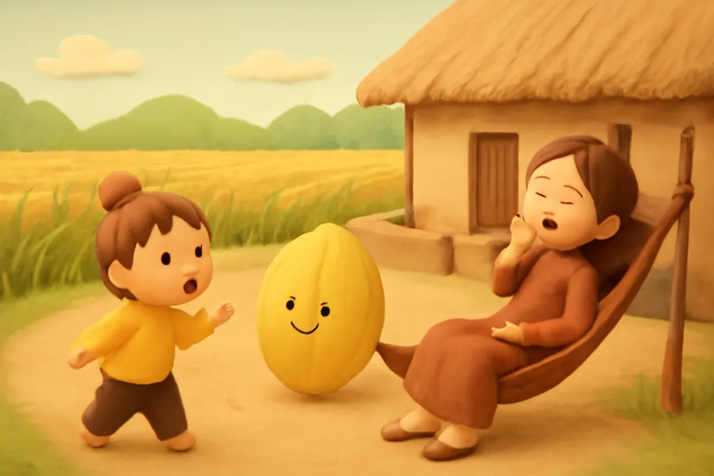
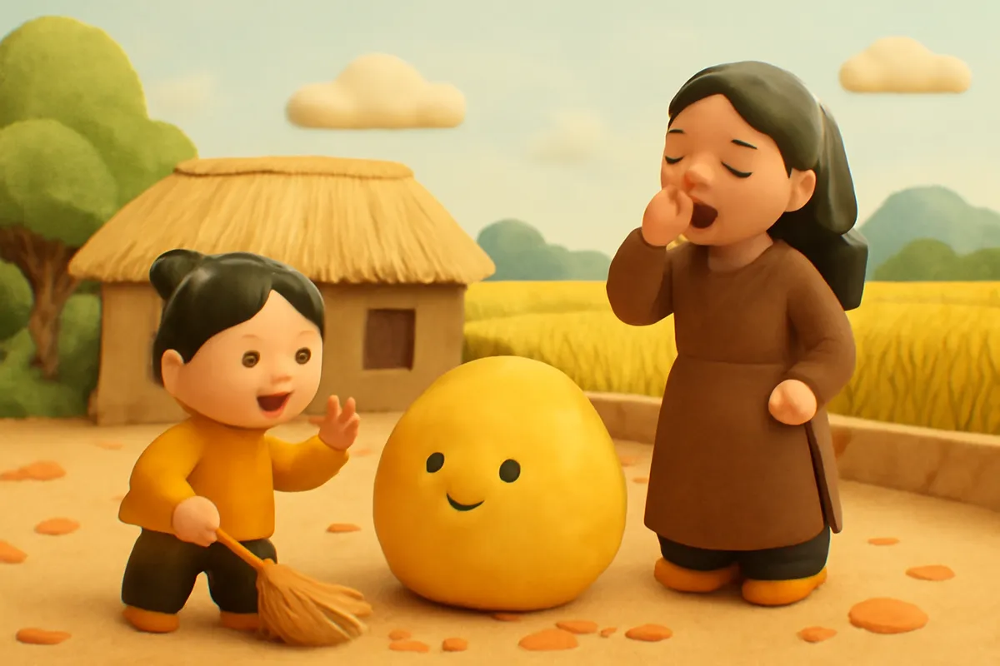
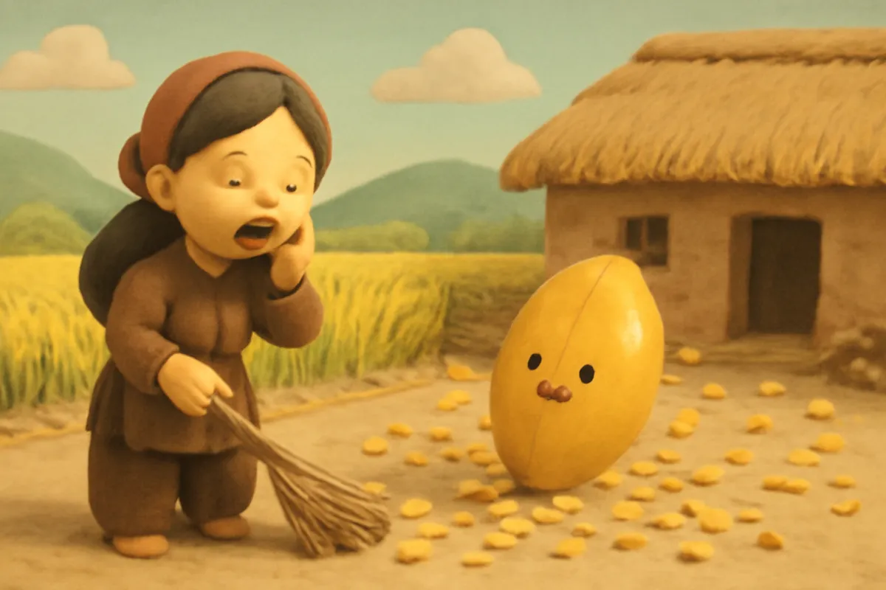
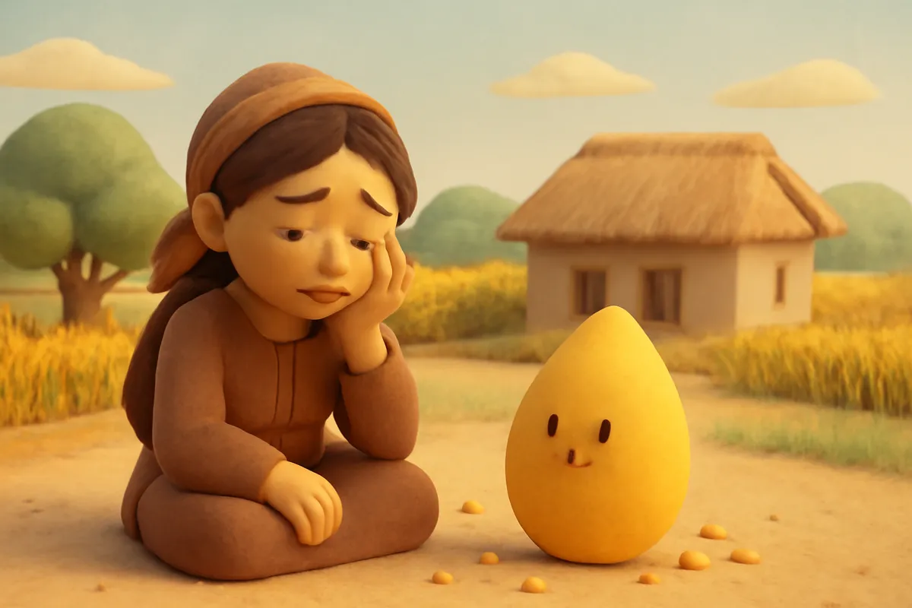
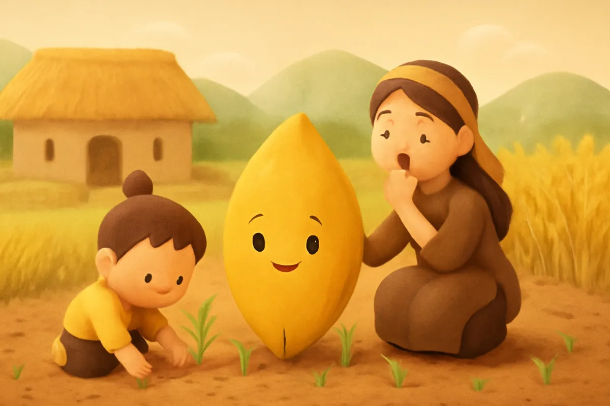
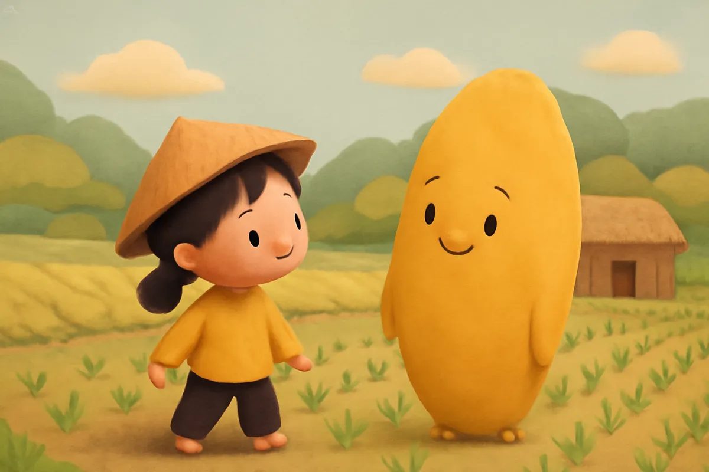
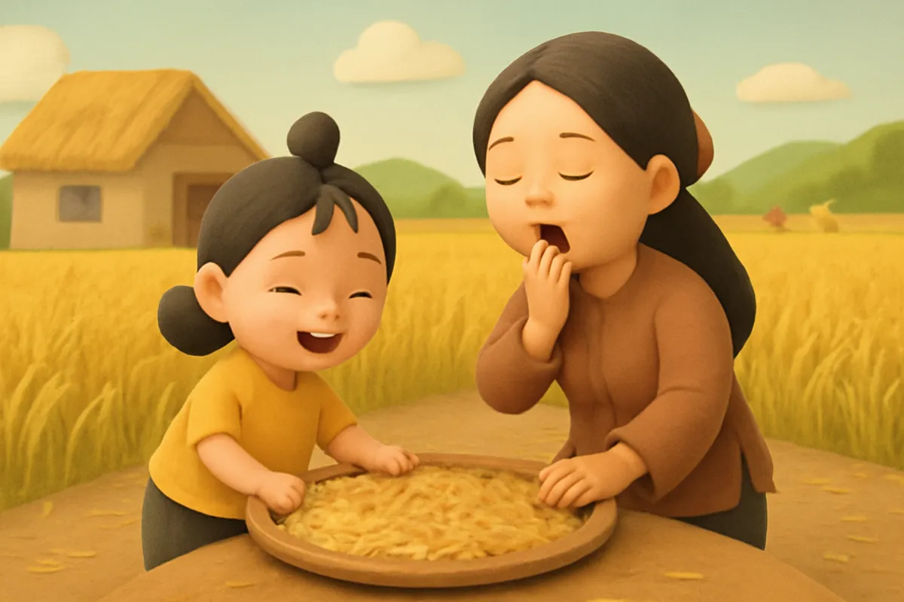
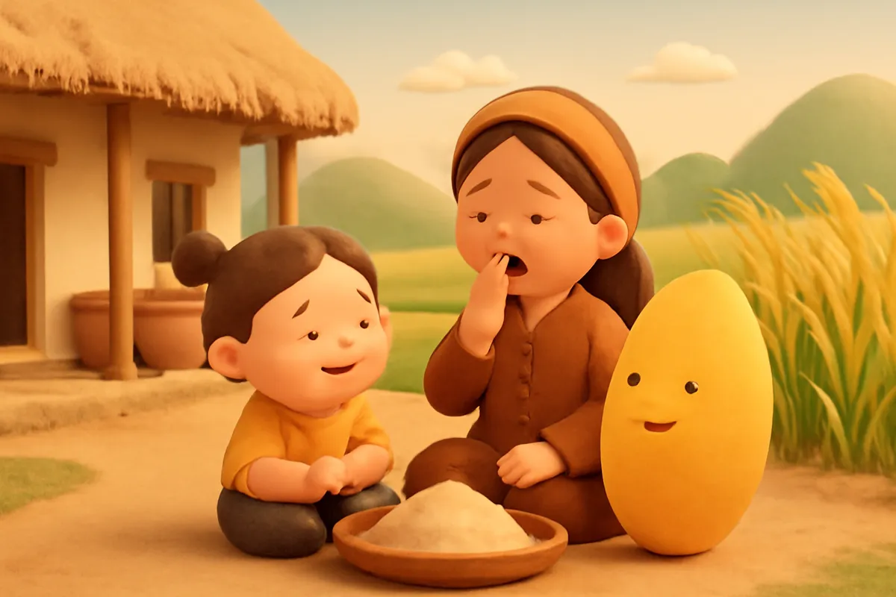

# Sự tích hạt lúa

| | |
| --- | --- |
| Mã truyện | `64c88860-052a-4dfa-b490-6dd62e56042f` |
| Nhóm | Truyện thư viện |
| Nguồn | manual |
| Tạo lúc | 2026-10-15T14:34:09.814347+00:00 |
| Cập nhật | 2026-10-16T04:28:21.238084+00:00 |
| Số trang | 8 |
| Ngôn ngữ | vi |
| Tuổi | 3–6 |
| Giọng kể | Viên - Narrative, Warm and Clear (northern) |
| Trạng thái | published |
| Đã xoá | không |

**Giới thiệu:** Ngày xưa hạt lúa to như quả bí, chín thì tự lăn về nhà. Chị Mít lười biếng phẩy chổi làm hạt lúa vỡ thành hạt nhỏ, từ đó Bé Cốm và chị phải học trồng lúa.

**Bài học:** Hạt gạo là công sức của người nông dân; hãy chăm chỉ và quý trọng từng hạt cơm.

## Nhân vật

- **Bé Cốm** — Cô bé chăm chỉ, hay giúp đỡ (giọng: Yuna — bé gái tinh nghịch)
- **Chị Mít** — Người chị lười biếng, sau biết lỗi và chăm chỉ (giọng: Kim — chị gái dịu dàng)
- **Hạt Lúa** — Hạt lúa thần biết nói (giọng: Tâm — cô kể chuyện cổ tích)

## Trang 1

Ngày xửa ngày xưa, hạt lúa to như quả bí ngô. Đến mùa chín, lúa tự lăn từ ngoài đồng về từng nhà. Mọi người chỉ cần quét sân thật sạch để đón lúa.

**Bé Cốm:** Chị Mít ơi, sắp đến ngày lúa về rồi. Mình quét sân đi chị!

**Chị Mít:** Ôi dào, để mai chị quét. Bây giờ chị buồn ngủ lắm.

Nói rồi, chị Mít lại nằm khểnh trên võng.

🔊 [Nghe trang 1](../../../media/tts-cache/70ac29b8-01ca-43d3-b0f8-4f739db2167a-6e5a4930-fab3-43e0-b78d-c10deb864e35.mp3)

## Trang 2

Sáng hôm sau, Bé Cốm dậy sớm. Bé quét được một góc sân thì chổi to quá, bé quét mãi không xong. Chị Mít vẫn ngủ say, sân còn đầy lá khô.

Bỗng có tiếng lộc cộc, lộc cộc ngoài ngõ. Một hạt lúa vàng óng, to tròn, đang lăn vào sân.

**Hạt Lúa:** Chào cả nhà! Lúa về đây!

**Bé Cốm:** A, lúa về rồi! Chị Mít ơi, dậy đi chị!

🔊 [Nghe trang 2](../../../media/tts-cache/f52e17b1-7602-4f19-8dea-424ee9eeb6f9-571d31e8-75b9-48ad-a1df-c73e4355583b.mp3)

## Trang 3

Chị Mít giật mình tỉnh giấc, bực bội vì bị đánh thức.

**Chị Mít:** Sao lúa về sớm thế! Sân chưa quét, người ta còn đang ngủ!

Chị vớ lấy cái chổi, phẩy mạnh vào hạt lúa cho nó lăn ra chỗ khác.

**Hạt Lúa:** Ối! Nhẹ tay thôi chị ơi!

Nhưng đã muộn rồi. Cốp một cái, hạt lúa to vỡ tan thành muôn nghìn hạt nhỏ li ti, văng khắp sân.

🔊 [Nghe trang 3](../../../media/tts-cache/f40f89ef-2956-413c-a7b3-a7690941ef43-46cc26ce-ff4e-4e54-8268-2d91b8530766.mp3)

## Trang 4

Từ những hạt nhỏ li ti, có tiếng nói khe khẽ cất lên.

**Hạt Lúa:** Chị Mít ơi, chị không quý lúa, nên lúa không tự lăn về nữa đâu. Từ nay, ai muốn có cơm ăn thì phải ra đồng trồng lúa, chăm lúa, gặt lúa.

Chị Mít ngồi thụp xuống, nhìn những hạt lúa bé xíu.

**Chị Mít:** Tại chị lười biếng quá. Chị biết lỗi rồi.

🔊 [Nghe trang 4](../../../media/tts-cache/f3ac4036-6dc8-427c-b3dc-5d394131513d-2fe5e881-4542-47c5-aaaa-3fb7108c42d3.mp3)

## Trang 5

Cả làng biết chuyện, ai cũng lo lắng. Bé Cốm nắm tay chị, nói thật dịu dàng.

**Bé Cốm:** Chị đừng buồn nữa. Mình cùng học trồng lúa nhé. Em sẽ làm cùng chị!

Hai chị em nhặt từng hạt lúa nhỏ cho vào thúng. Các bác nông dân dạy hai chị em cày đất, bừa cho đất tơi xốp, rồi gieo hạt thành những cây mạ non.

**Chị Mít:** Mạ xanh mướt, đẹp quá em ơi!

🔊 [Nghe trang 5](../../../media/tts-cache/2cfbe1a7-5128-4539-9bee-deafe4d8e93e-dc4732f1-e9e1-44fd-b9b8-f91bac597fd4.mp3)

## Trang 6

Mạ lớn lên, hai chị em nhổ mạ, mang ra ruộng cấy thành từng hàng thẳng tắp. Trời nắng, chị em đội nón. Trời mưa, chị em khoác áo tơi. Ngày ngày, hai chị em ra thăm đồng, nhổ cỏ, tháo nước.

**Bé Cốm:** Lúa ơi, lớn nhanh lên nhé!

**Hạt Lúa:** Cảm ơn hai chị em. Được chăm chỉ như thế, lúa sẽ trổ bông thật nhiều.

🔊 [Nghe trang 6](../../../media/tts-cache/e5da1d11-c5ab-4c43-9e09-e5681bc528e8-ce20a36a-291f-4dac-8b3f-36b893a785a5.mp3)

## Trang 7

Rồi đồng lúa chín vàng như một tấm thảm lớn. Cả làng ra đồng gặt lúa, ôm từng bó lúa về sân. Hai chị em phơi thóc cho khô, rồi xay, rồi giã thành những hạt gạo trắng tinh.

**Chị Mít:** Trồng lúa vất vả thật, nhưng vui quá!

**Bé Cốm:** Hạt gạo nhỏ thế này mà phải làm bao nhiêu việc mới có được!

🔊 [Nghe trang 7](../../../media/tts-cache/97e2cf9f-e8f0-43f2-91bd-0ffff496e4bc-8b21a096-ef78-4eb8-a2cc-7c212ee3ddca.mp3)

## Trang 8

Tối hôm ấy, nồi cơm mới thơm phức cả gian nhà. Hai chị em xới cơm ra bát, ăn thật ngon.

**Chị Mít:** Từ nay chị sẽ chăm chỉ, không lười biếng nữa.

**Bé Cốm:** Em sẽ ăn hết bát cơm, không để rơi hạt nào.

Người ta bảo, vì thế mà hạt lúa bây giờ bé xíu. Mỗi hạt cơm là công sức của người nông dân đấy.

🔊 [Nghe trang 8](../../../media/tts-cache/3cdcd22b-7c3a-4b86-b1da-975e2320e7d5-26ed53b7-1215-42cb-a34a-78a12edb1ab6.mp3)

---

Bản đầy đủ (mọi cột trong cơ sở dữ liệu): [story.json](story.json)
