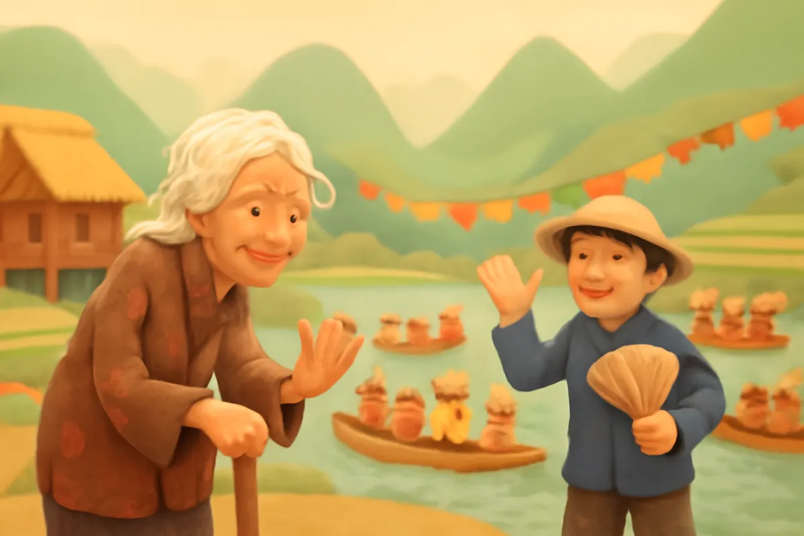
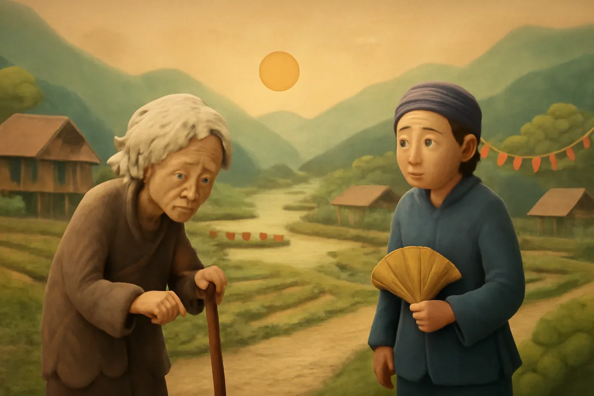
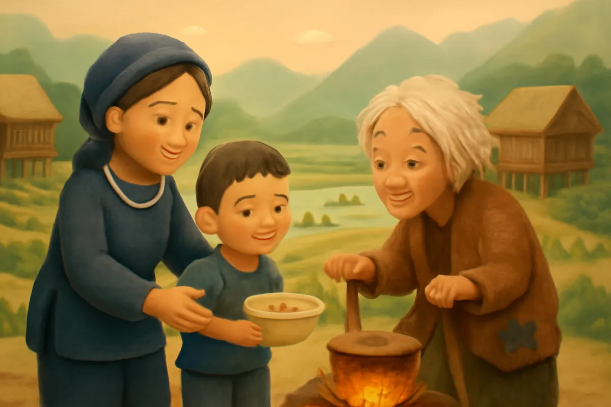
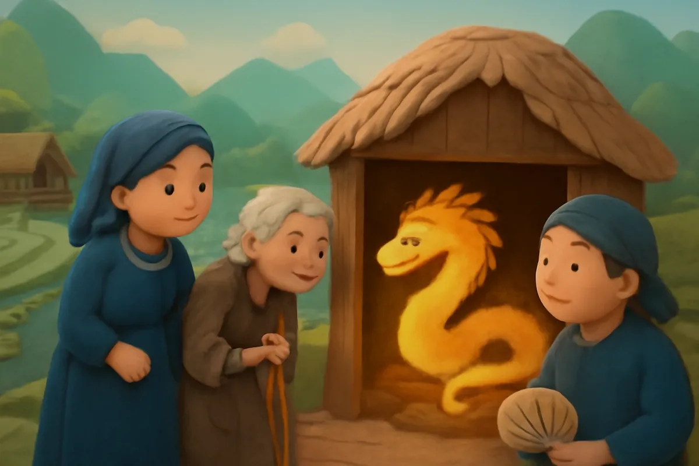
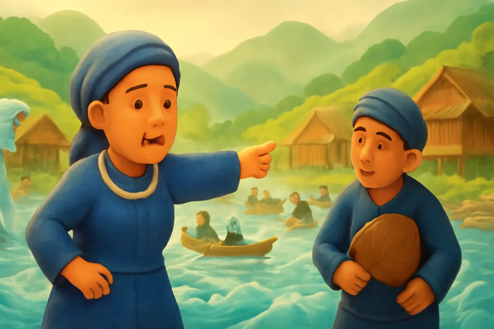
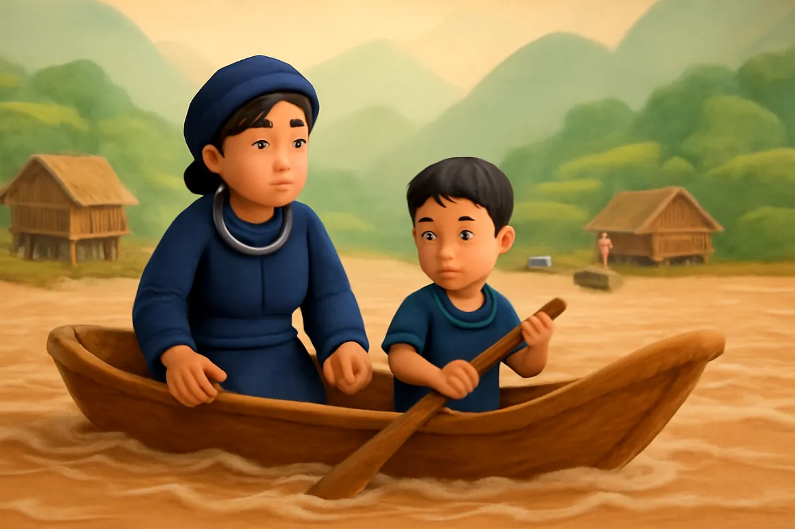
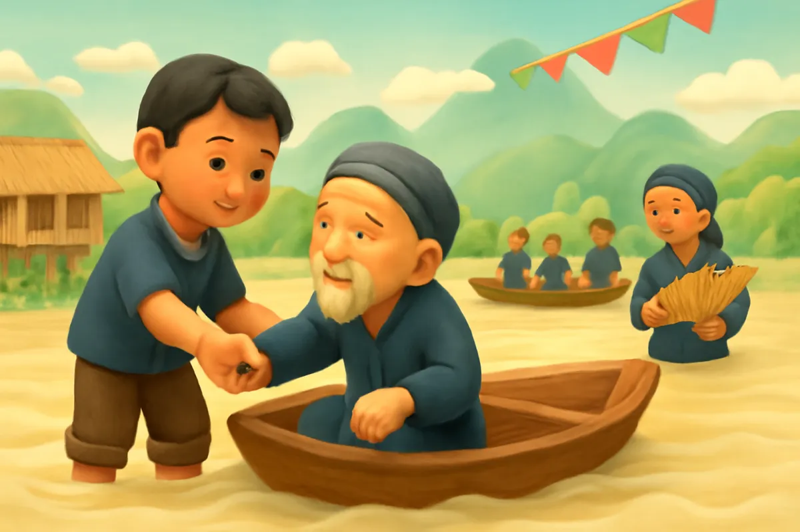
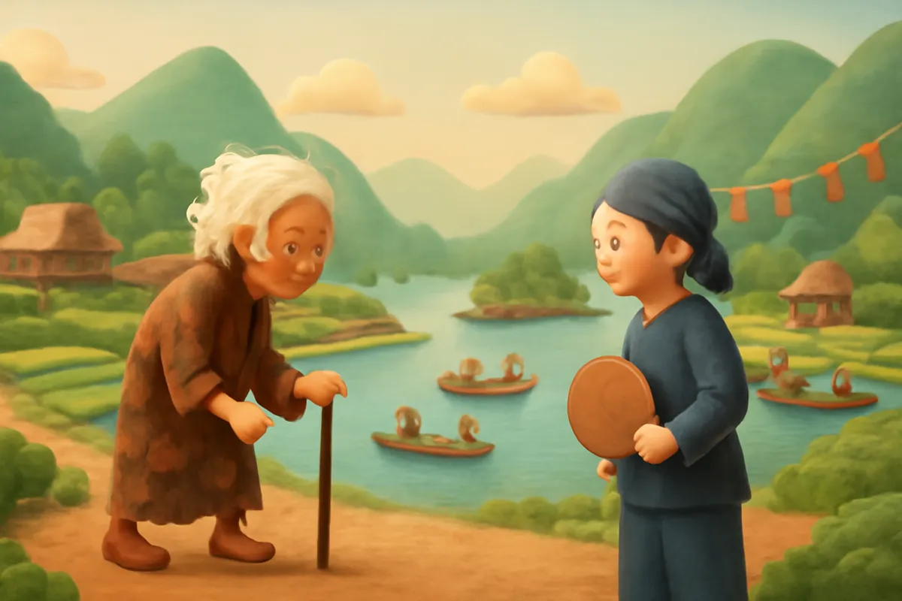

# Sự tích hồ Ba Bể

| | |
| --- | --- |
| Mã truyện | `19fed78d-4913-4098-8673-255b3e172a94` |
| Nhóm | Truyện thư viện |
| Nguồn | manual |
| Tạo lúc | 2026-10-15T14:34:09.814347+00:00 |
| Cập nhật | 2026-10-16T04:29:01.502845+00:00 |
| Số trang | 8 |
| Ngôn ngữ | vi |
| Tuổi | 5–8 |
| Giọng kể | Viên - Narrative, Warm and Clear (northern) |
| Trạng thái | published |
| Đã xoá | không |

**Giới thiệu:** Ngày hội, cả làng xua đuổi bà lão ăn xin, chỉ hai mẹ con nghèo cho bà ăn và ngủ nhờ. Bà lão là thần báo trước nước lớn. Hai mẹ con dùng thuyền vỏ trấu cứu cả làng, nơi ấy thành hồ Ba Bể.

**Bài học:** Thương người như thể thương thân; lòng tốt sẽ được đền đáp.

## Nhân vật

- **Bà Mẹ** — Người mẹ nghèo tốt bụng, hay giúp người (giọng: Tâm — cô kể chuyện cổ tích)
- **Con Trai** — Cậu con trai hiền lành, thương người (giọng: Bin — bé trai lém lỉnh)
- **Bà Lão Ăn Xin** — Bà cụ ăn xin, thật ra là thần hiện xuống thử lòng người (giọng: Hiền — bà hiền hậu)
- **Dân Làng** — Một người dân làng, lúc đầu xua đuổi bà lão, sau biết lỗi (giọng: Quang — chú trầm ấm)

## Trang 1

Ngày xưa, ở vùng núi Đông Bắc có một làng tên là Nam Mẫu. Năm ấy, làng mở hội lớn, cỗ bàn bày khắp sân, tiếng khèn tiếng sáo vang xa. Giữa ngày hội, có một bà lão ăn xin gầy gò, quần áo rách rưới, chống gậy đi đến.

**Bà Lão Ăn Xin:** Ai làm phúc, cho bà già này xin bát cơm với.

**Dân Làng:** Đi chỗ khác đi! Đừng làm bẩn ngày hội của làng!

## Trang 2

Bà lão đi hết nhà này sang nhà khác. Ai thấy bà cũng bịt mũi, xua tay. Có nhà còn đóng sập cửa lại.

**Dân Làng:** Nhà tôi đang bận cỗ, chẳng có gì cho bà đâu!

**Bà Lão Ăn Xin:** Cả một làng giàu có, mà chẳng ai có lấy một bát cơm cho người đói.

Trời tối dần. Bà lão lặng lẽ chống gậy đi ra cuối làng, nơi có túp lều nhỏ của hai mẹ con nghèo.

## Trang 3

Hai mẹ con vừa đi làm đồng về. Thấy bà lão run rẩy trước cửa, cậu con trai vội đỡ bà vào nhà.

**Con Trai:** Bà ơi, bà vào đây ngồi cho ấm. Mẹ ơi, nhà mình còn gạo không mẹ?

**Bà Mẹ:** Còn một ít, mẹ nấu cháo cho bà ăn. Bà cứ nghỉ lại đây đêm nay, nhà nghèo nhưng ấm áp.

**Bà Lão Ăn Xin:** Cảm ơn hai mẹ con. Lòng tốt của hai người, bà sẽ không quên.

## Trang 4

Đêm ấy, cậu bé thức giấc, thấy chỗ bà lão nằm sáng rực. Một con rồng vàng óng ánh đang cuộn mình ngủ ngon lành. Cậu dụi mắt nhìn lại, chỉ thấy bà lão nằm đó.

Sáng ra, bà lão gọi hai mẹ con lại.

**Bà Lão Ăn Xin:** Sắp có nước lớn. Đây là gói tro, hãy rắc quanh nhà. Còn đây là hai mảnh vỏ trấu, khi cần sẽ dùng đến. Nhớ báo cho dân làng biết.

**Bà Mẹ:** Vâng, mẹ con cháu xin nhớ lời bà.

## Trang 5

Bà lão chống gậy ra đầu làng, cắm cây gậy xuống đất rồi biến mất. Từ chỗ ấy, một dòng nước phun lên, mỗi lúc một mạnh.

**Bà Mẹ:** Bà con ơi, nước sắp lên to rồi! Mau mau lên chỗ cao!

**Dân Làng:** Nước ở đâu ra mà nhiều thế này? Chạy đi đâu bây giờ?

Nước dâng cao, tràn khắp đường làng. Mọi người hoảng hốt, bám vào cây, leo lên mái nhà.

🔊 [Nghe trang 5](../../../media/tts-cache/ef2a016d-75f2-44ad-bb32-9abd18a8c9e9-5bd42bb8-460d-45e4-b0e4-9adf7693358e.mp3)

## Trang 6

Riêng chỗ nhà hai mẹ con, nhờ có gói tro, nền đất cứ nổi cao lên mãi. Cậu bé nhớ lời bà lão, thả hai mảnh vỏ trấu xuống nước. Vỏ trấu bỗng hoá thành hai chiếc thuyền lớn.

**Con Trai:** Mẹ ơi, mình chèo thuyền đi cứu mọi người!

**Bà Mẹ:** Đúng rồi con. Cứu được ai thì cứu, không bỏ sót một người nào!

Hai mẹ con mỗi người một thuyền, chèo thẳng ra giữa dòng nước.

🔊 [Nghe trang 6](../../../media/tts-cache/fe3684b6-8c34-43df-b728-9af24c707c8e-53914aee-dde3-48e4-997c-6b43b5733fe0.mp3)

## Trang 7

Hai chiếc thuyền đi khắp nơi, đón từng người, từng em bé, từng cụ già lên thuyền. Đến tối, cả làng đều đã được cứu, không thiếu một ai.

**Dân Làng:** Hôm qua chúng tôi xua đuổi bà cụ, chỉ có hai mẹ con chị thương người. Chúng tôi xấu hổ quá.

**Con Trai:** Bác đừng buồn. Mọi người bình an là tốt rồi ạ.

Mọi người ngồi sát bên nhau trên thuyền, nhìn nước mênh mông.

🔊 [Nghe trang 7](../../../media/tts-cache/9e2ed431-b1e4-4a7e-aef3-032ce3692844-78ec0da1-1c41-4b92-a88a-6789d7527b52.mp3)

## Trang 8

Sáng hôm sau, nước không rút nữa mà đọng lại thành một cái hồ rộng mênh mông, xanh biếc. Người ta gọi đó là hồ Ba Bể. Nền nhà hai mẹ con nổi lên thành một hòn đảo nhỏ giữa hồ.

**Bà Lão Ăn Xin:** Thương người như thể thương thân. Ai biết sẻ chia thì sẽ được bình an.

Tiếng bà lão vang lên từ mặt hồ. Dân làng dựng làng mới bên hồ, từ đó ai cũng biết giúp đỡ người nghèo khó.

---

Bản đầy đủ (mọi cột trong cơ sở dữ liệu): [story.json](story.json)
