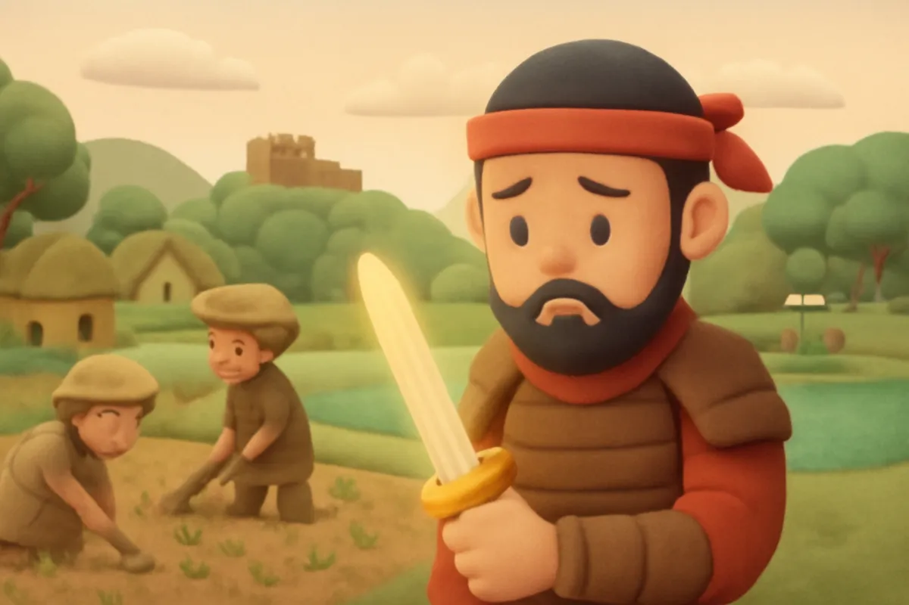
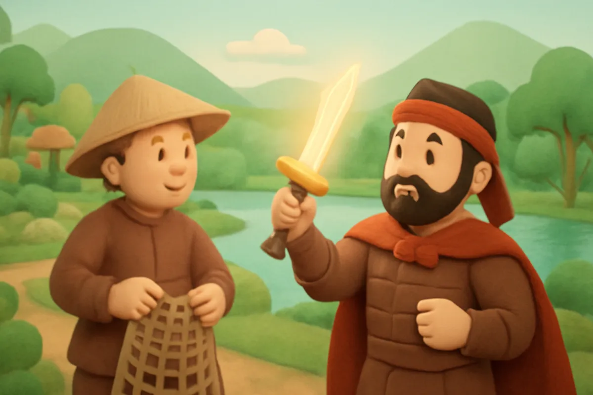
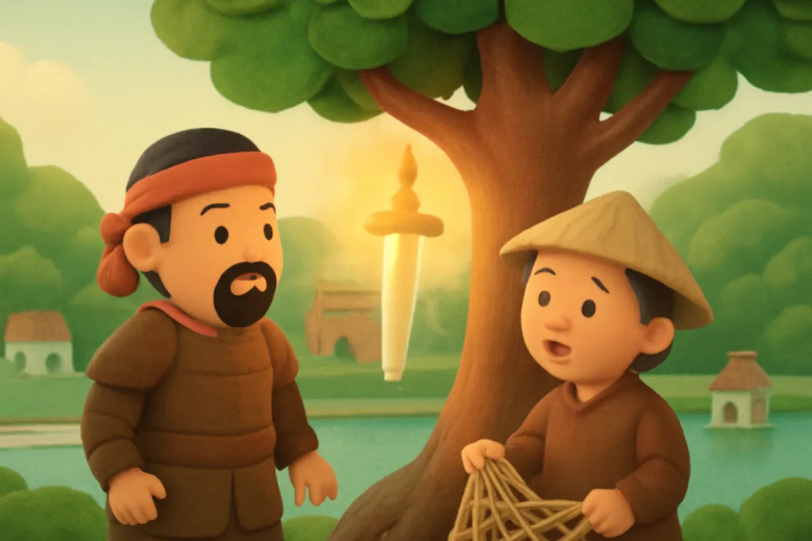
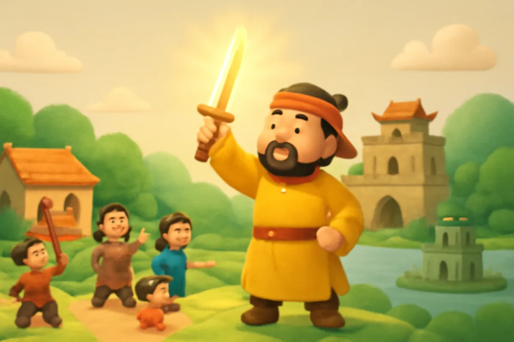
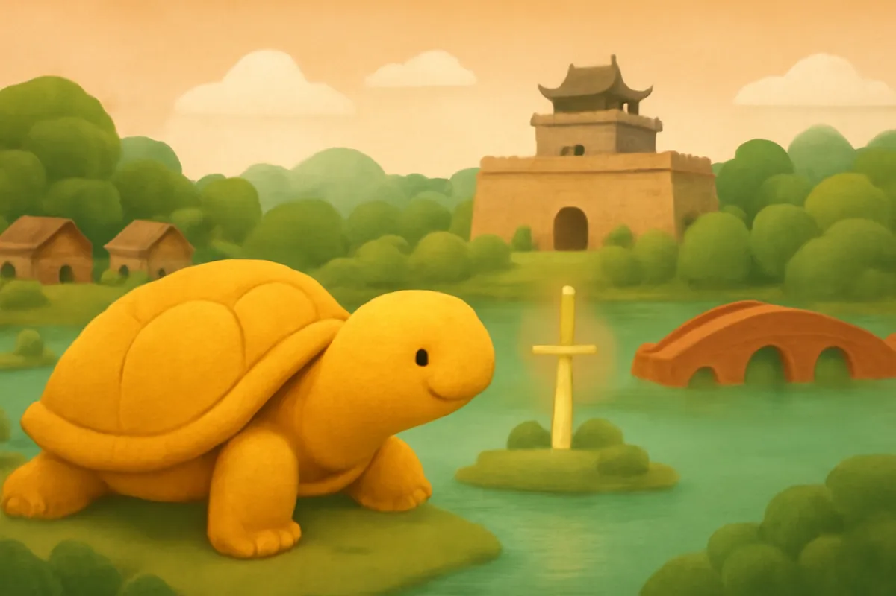

# Sự tích Hồ Gươm

| | |
| --- | --- |
| Mã truyện | `7d59c7b6-de4e-4890-a4cb-66b5b8251828` |
| Nhóm | Truyện thư viện |
| Nguồn | manual |
| Tạo lúc | 2026-10-15T14:34:09.448749+00:00 |
| Cập nhật | 2026-10-16T04:27:11.710913+00:00 |
| Số trang | 8 |
| Ngôn ngữ | vi |
| Tuổi | 5–9 |
| Giọng kể | Viên - Narrative, Warm and Clear (northern) |
| Trạng thái | published |
| Đã xoá | không |

**Giới thiệu:** Đức Long Quân cho nghĩa quân Lam Sơn mượn gươm thần: lưỡi gươm vào lưới Lê Thận, chuôi gươm trên ngọn cây đa. Đất nước yên bình, vua Lê Lợi trả gươm cho Rùa Vàng trên hồ Tả Vọng.

**Bài học:** Biết ơn và giữ lời hứa; đoàn kết để giữ gìn đất nước.

## Nhân vật

- **Lê Lợi** — Chủ tướng nghĩa quân Lam Sơn, về sau là vua (giọng: Quang — chú trầm ấm)
- **Lê Thận** — Người đánh cá thật thà, theo nghĩa quân (giọng: Thanh — ông hiền từ)
- **Rùa Vàng** — Sứ giả của Đức Long Quân dưới hồ (giọng: Thanh — ông hiền từ)

## Trang 1

Ngày xưa, giặc Minh sang đô hộ nước ta, làm cho người dân khổ cực trăm bề. Ở vùng Lam Sơn, nghĩa quân nổi lên chống giặc. Nhưng lúc đầu, nghĩa quân còn yếu, nhiều lần phải lui về rừng.

Dưới thuỷ cung, Đức Long Quân thấy vậy thì thương dân lắm. Ngài quyết định cho nghĩa quân mượn một thanh gươm thần.

🔊 [Nghe trang 1](../../../media/tts-cache/1444fa19-8645-448d-8179-4c191bbdbb3c-1e800f08-8370-4854-8799-9422921c354e.mp3)

## Trang 2

Ở Thanh Hoá có một người đánh cá tên là Lê Thận. Một đêm, Lê Thận thả lưới ở bến sông. Kéo lưới lên, chàng thấy nặng tay, ngỡ được mẻ cá to. Nhưng trong lưới chỉ có một thanh sắt dài.

**Lê Thận:** Lạ thật! Sao lại có thanh sắt ở đây?

Chàng thả thanh sắt xuống nước, quăng lưới chỗ khác. Lần thứ hai, rồi lần thứ ba, thanh sắt ấy vẫn chui vào lưới.

🔊 [Nghe trang 2](../../../media/tts-cache/2a9faec4-9f65-495b-bf10-b72056fd89cf-62b61860-b737-4f74-b4cf-f1131140b10d.mp3)

## Trang 3

Lê Thận đem thanh sắt về nhà. Về sau, chàng theo nghĩa quân Lam Sơn. Một hôm, chủ tướng Lê Lợi ghé thăm nhà chàng. Trong góc nhà tối, thanh sắt bỗng sáng rực lên.

**Lê Lợi:** Đây không phải thanh sắt thường. Đây là một lưỡi gươm!

Lê Lợi lau sạch, thấy trên lưỡi gươm có hai chữ Thuận Thiên, nghĩa là thuận theo ý trời.

🔊 [Nghe trang 3](../../../media/tts-cache/2f5e1a5e-16e3-40ed-8735-41ca17b0b43b-ce4ca1d5-2971-4cd1-b797-5f2f81c6b4ad.mp3)

## Trang 4

Một lần, Lê Lợi bị giặc đuổi, phải băng qua rừng. Bỗng ông thấy trên ngọn cây đa có ánh sáng lạ. Ông trèo lên, thì ra đó là một chuôi gươm nạm ngọc.

Ông mang chuôi gươm về, tra vào lưỡi gươm của Lê Thận. Thật kì lạ, vừa khít như in!

**Lê Thận:** Đây là ý trời! Xin chủ tướng nhận gươm thần để cứu nước!

🔊 [Nghe trang 4](../../../media/tts-cache/85a0dbee-5ad9-4893-b449-9f2bbecabde7-3ef68a52-9130-4e26-aa32-22622e85b06f.mp3)

## Trang 5

Từ khi có gươm thần, nghĩa quân càng ngày càng mạnh. Đi đến đâu, giặc thua đến đó. Cuối cùng, giặc Minh phải rút hết về nước.

**Lê Lợi:** Đất nước ta đã sạch bóng quân thù! Từ nay, bà con được sống yên vui.

Lê Lợi lên ngôi vua, đóng đô ở Thăng Long. Ruộng đồng lại xanh tốt, trẻ em lại nô đùa khắp xóm làng.

🔊 [Nghe trang 5](../../../media/tts-cache/53601926-7e65-4fa4-b823-17939a8e3253-de91529c-fb15-43b0-bedd-50e7a696fda0.mp3)

## Trang 6

Một năm sau, vào một ngày đẹp trời, vua Lê Lợi cưỡi thuyền rồng dạo chơi trên hồ Tả Vọng, giữa kinh thành Thăng Long. Bỗng một con rùa vàng lớn nổi lên mặt nước, vươn cổ về phía thuyền vua.

**Rùa Vàng:** Xin bệ hạ trả lại gươm thần cho Đức Long Quân!

Thanh gươm bên hông vua bỗng rung lên khe khẽ.

🔊 [Nghe trang 6](../../../media/tts-cache/2ae52a81-2fd1-4467-9ca7-3a81457fbe02-33cb0ba4-e7c3-4978-9556-069481756cf7.mp3)

## Trang 7

Vua hiểu rằng đất nước đã bình yên, đã đến lúc trả gươm.

**Lê Lợi:** Cảm ơn Đức Long Quân đã cho ta mượn gươm thần. Nay ta xin gửi lại.

Vua nâng gươm về phía rùa vàng. Rùa ngậm lấy thanh gươm, rồi lặn sâu xuống nước. Một lúc lâu sau, người ta vẫn thấy ánh sáng lấp lánh dưới mặt hồ xanh.

🔊 [Nghe trang 7](../../../media/tts-cache/243f318f-ea3a-4cf2-b84f-c4d331782489-80cf1e2b-511b-4756-be65-b9cc1d9ce373.mp3)

## Trang 8

Từ đó, hồ Tả Vọng được gọi là hồ Hoàn Kiếm, nghĩa là hồ trả gươm. Người ta còn gọi là Hồ Gươm.

Ngày nay, Hồ Gươm vẫn xanh biếc giữa lòng Hà Nội. Giữa hồ có tháp Rùa nhỏ xinh, bên bờ có cầu Thê Húc đỏ thắm. Các bạn nhỏ đến chơi, ai cũng nhớ câu chuyện rùa vàng và thanh gươm thần.

🔊 [Nghe trang 8](../../../media/tts-cache/82a839b5-4c22-4209-9bf2-c30a918ce0fb-db479b5e-11c5-41be-b3dc-a6d902ab1b81.mp3)

---

Bản đầy đủ (mọi cột trong cơ sở dữ liệu): [story.json](story.json)
