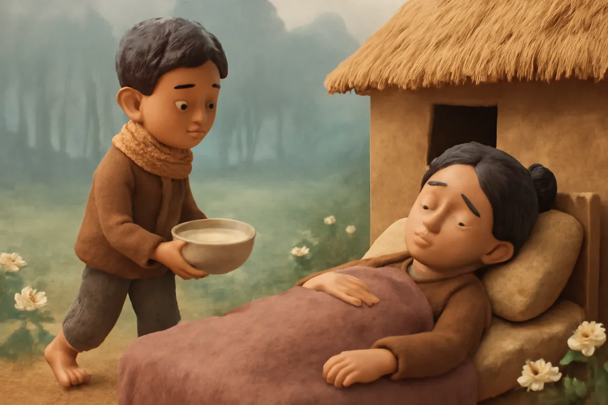
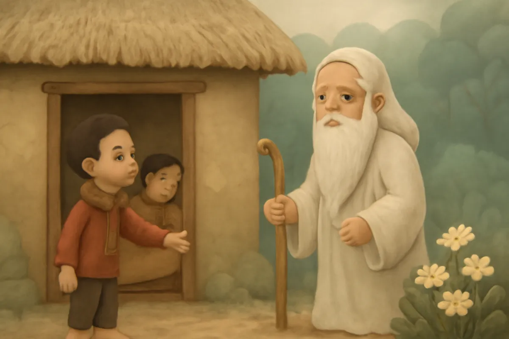
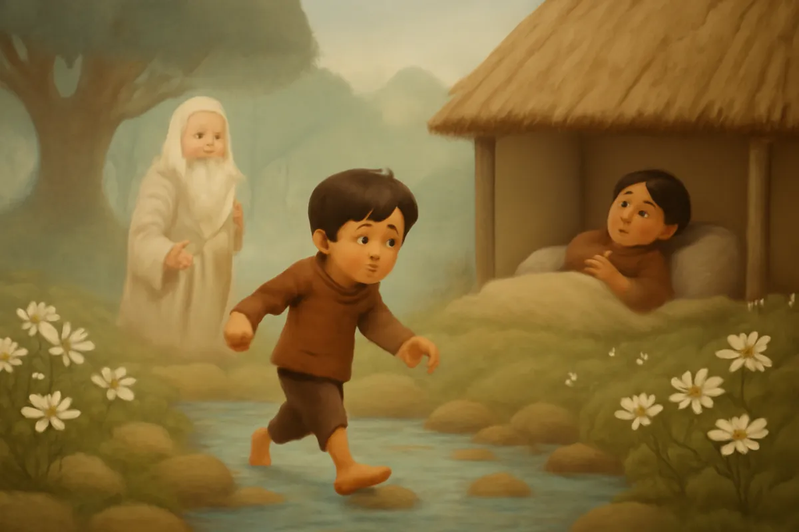
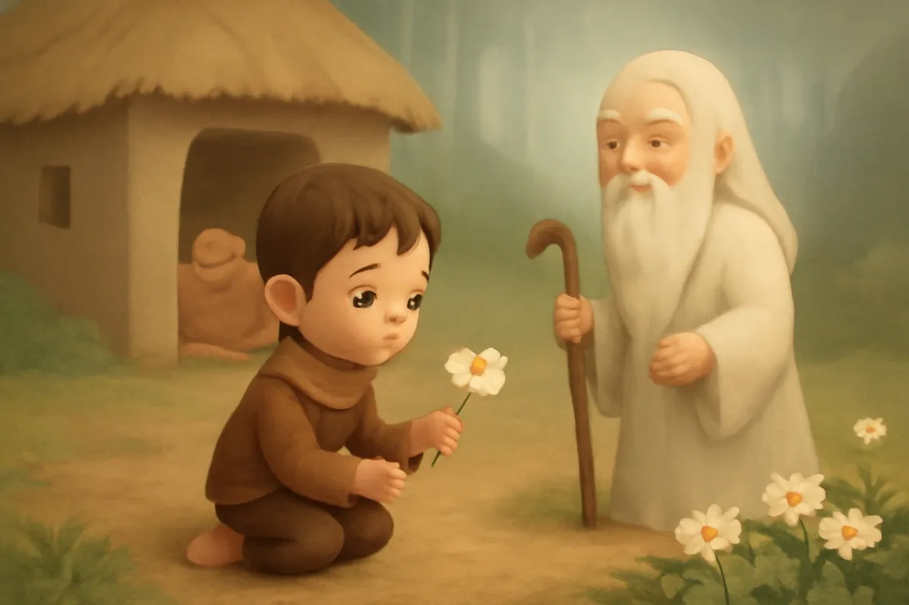
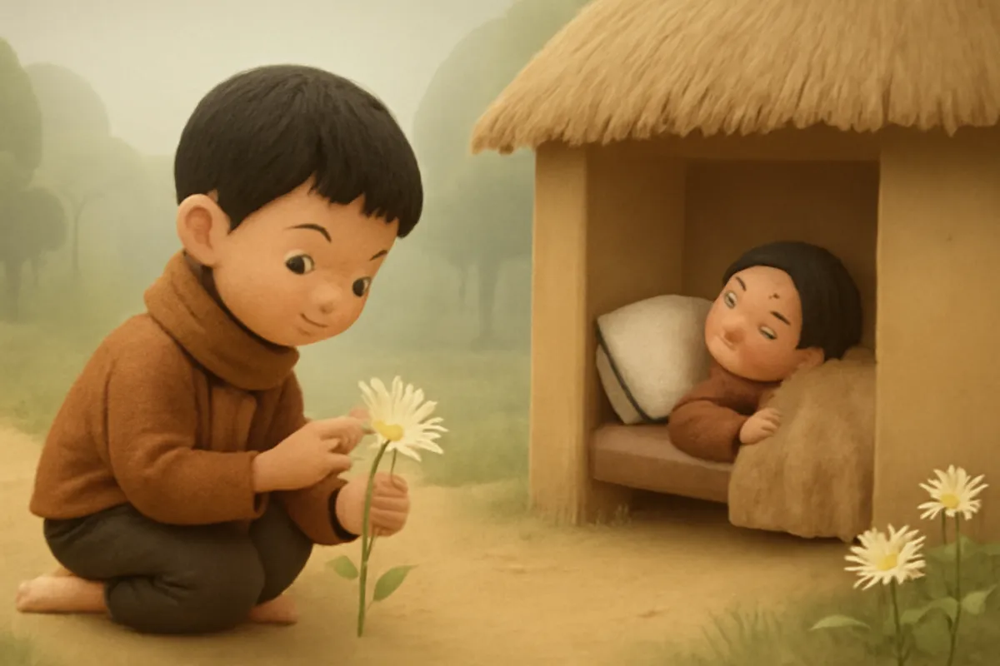
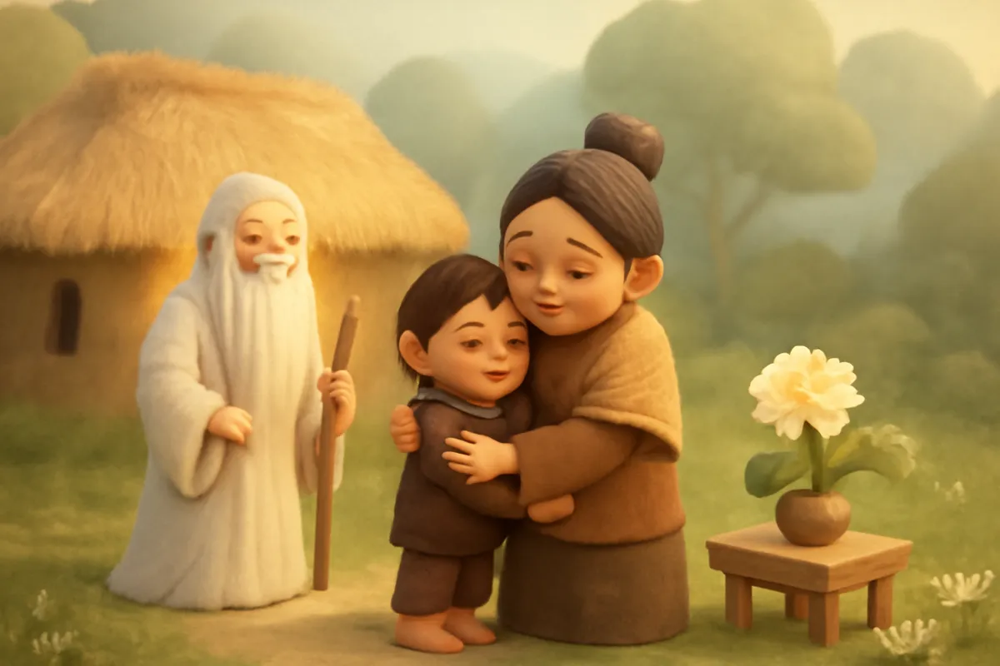
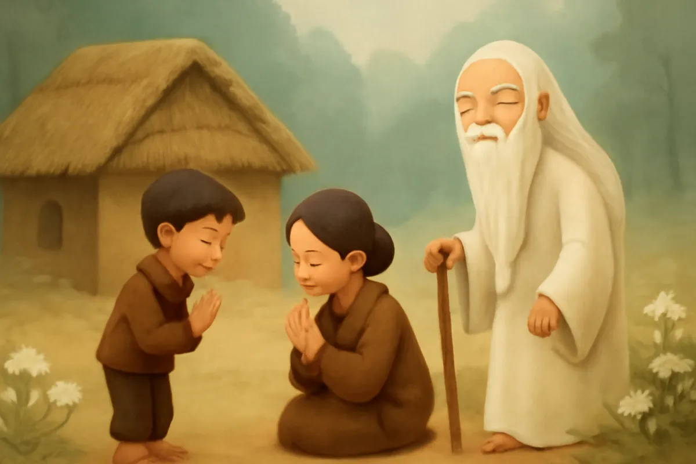
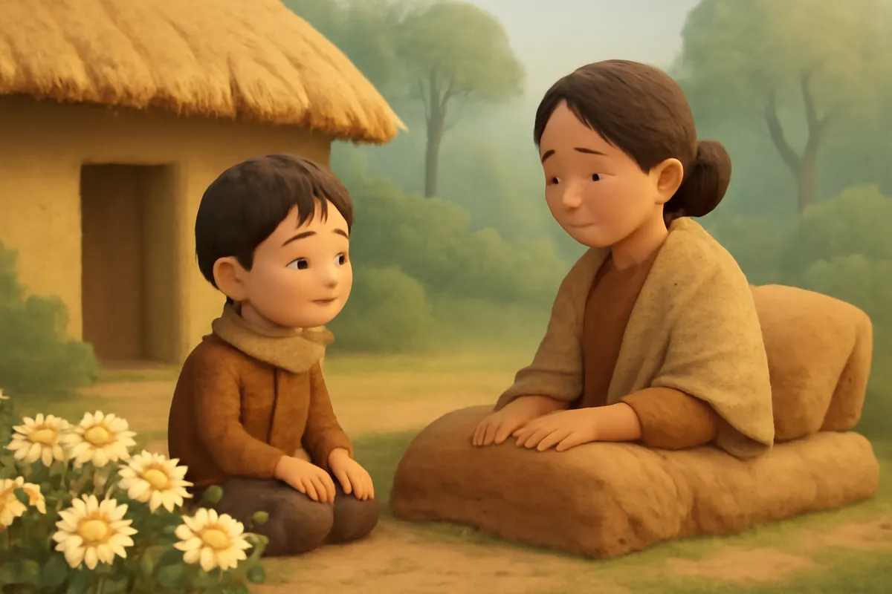

# Sự tích hoa cúc trắng

| | |
| --- | --- |
| Mã truyện | `513dda3e-4aa7-4eed-b113-eb8dea1cc5ed` |
| Nhóm | Truyện thư viện |
| Nguồn | manual |
| Tạo lúc | 2026-10-15T14:34:09.814347+00:00 |
| Cập nhật | 2026-10-16T04:29:42.754212+00:00 |
| Số trang | 8 |
| Ngôn ngữ | vi |
| Tuổi | 3–6 |
| Giọng kể | Viên - Narrative, Warm and Clear (northern) |
| Trạng thái | published |
| Đã xoá | không |

**Giới thiệu:** Mẹ ốm nặng, cậu bé vào rừng tìm bông hoa trắng làm thuốc. Hoa chỉ có bốn cánh, cậu khéo léo xé mỗi cánh thành thật nhiều cánh nhỏ để mẹ khoẻ mạnh thật lâu.

**Bài học:** Lòng hiếu thảo và sự thông minh có thể làm nên điều kỳ diệu.

## Nhân vật

- **Cậu Bé** — Cậu bé hiếu thảo, dũng cảm, thông minh (giọng: Bin — bé trai lém lỉnh)
- **Mẹ** — Người mẹ hiền bị ốm, được con chăm sóc (giọng: Tâm — cô kể chuyện cổ tích)
- **Ông Lão** — Ông lão tốt bụng chỉ đường tìm thuốc (giọng: Thanh — ông hiền từ)

## Trang 1

Ngày xưa, có hai mẹ con sống trong một túp lều nhỏ bên bìa rừng. Cậu bé rất thương mẹ. Một mùa đông, mẹ bị ốm nặng, nằm mãi trên giường không dậy được.

**Cậu Bé:** Mẹ ơi, con nấu cháo rồi. Mẹ ăn một chút cho khoẻ nhé.

**Mẹ:** Con ngoan của mẹ. Mẹ mệt lắm, nhưng có con bên cạnh, mẹ thấy ấm lòng.

🔊 [Nghe trang 1](../../../media/tts-cache/a0cccfdf-cc32-4c45-99b4-cf5bd686ecf8-b5d5cfe1-08b9-4c8f-a171-b837ce9b5ba8.mp3)

## Trang 2

Một hôm, có một ông lão râu tóc bạc phơ đi ngang qua, gõ cửa xin bát nước. Cậu bé vội mời ông vào nhà.

**Ông Lão:** Cháu ngoan lắm. Sao trông cháu buồn thế?

**Cậu Bé:** Mẹ cháu ốm nặng, cháu không biết làm sao cho mẹ khỏi bệnh.

**Ông Lão:** Cháu hãy vào rừng, đi mãi về phía mặt trời mọc. Dưới gốc cây đa cổ thụ có một bông hoa trắng. Hái hoa ấy về làm thuốc cho mẹ.

🔊 [Nghe trang 2](../../../media/tts-cache/7df8090b-199d-4f03-aa02-371f4ab67fc6-52c8959e-69ae-4eb6-9a83-d4985fea1b9a.mp3)

## Trang 3

Cậu bé cảm ơn ông lão rồi lên đường ngay. Cậu lội qua con suối lạnh buốt, vượt qua những bụi gai rậm rạp. Chân cậu mỏi nhừ, nhưng cậu không dừng lại.

**Cậu Bé:** Mẹ ơi, mẹ chờ con nhé. Con sẽ mang thuốc về cho mẹ!

Đến chiều, cậu bé nhìn thấy một cây đa cổ thụ, rễ buông dài như mái tóc ông tiên.

🔊 [Nghe trang 3](../../../media/tts-cache/3cdbcc00-ff5a-4727-9b27-e2975881d65b-032ca075-23f3-4cfd-93ab-ea6b11e3537e.mp3)

## Trang 4

Dưới gốc đa, có một bông hoa trắng muốt, chỉ có bốn cánh. Cậu bé vừa hái hoa lên thì nghe tiếng ông lão vang lên bên tai.

**Ông Lão:** Hoa có bao nhiêu cánh, mẹ cháu sẽ khoẻ mạnh thêm bấy nhiêu năm.

Cậu bé đếm từng cánh hoa.

**Cậu Bé:** Một, hai, ba, bốn... Chỉ có bốn năm thôi ư? Cháu muốn mẹ khoẻ mạnh mãi mãi cơ!

🔊 [Nghe trang 4](../../../media/tts-cache/880e0b2f-03de-4244-adc5-9b136715f41b-63813dab-e51e-45f3-83db-69058d0fea9c.mp3)

## Trang 5

Cậu bé ngồi xuống, nghĩ mãi. Rồi mắt cậu sáng lên. Cậu nhẹ nhàng xé mỗi cánh hoa thành thật nhiều sợi nhỏ, nhỏ như sợi tóc.

**Cậu Bé:** Mỗi sợi là một cánh. Nhiều cánh thế này, đếm mãi không hết, mẹ sẽ khoẻ mạnh thật lâu!

Bông hoa bốn cánh giờ đã thành một bông hoa với vô số cánh nhỏ, xoè tròn như một vầng trăng trắng.

🔊 [Nghe trang 5](../../../media/tts-cache/977b53db-aa8e-49d0-977d-beefcc82c928-7b6b07ca-db59-4f55-b366-78cb1da26c42.mp3)

## Trang 6

Cậu bé ôm bông hoa chạy một mạch về nhà. Cậu sắc thuốc theo lời ông lão dặn, rồi bón cho mẹ từng thìa.

**Cậu Bé:** Mẹ uống thuốc đi mẹ. Bông hoa này có nhiều cánh lắm!

Vài hôm sau, má mẹ hồng hào trở lại. Mẹ ngồi dậy được, rồi đứng dậy đi lại quanh nhà.

**Mẹ:** Mẹ khỏi bệnh rồi con ơi! Mẹ khoẻ lắm rồi!

🔊 [Nghe trang 6](../../../media/tts-cache/61aebf4b-9677-4b22-b303-f2ea68668121-eb88809c-dffd-40cb-9abd-0a1c8d328c5a.mp3)

## Trang 7

Hôm ấy, ông lão lại ghé qua túp lều nhỏ. Thấy hai mẹ con vui vẻ, ông mỉm cười hiền hậu.

**Ông Lão:** Lòng hiếu thảo của cháu đã làm bông hoa nở thêm muôn cánh đấy.

**Mẹ:** Tôi cảm ơn cụ đã chỉ đường cho con tôi.

**Cậu Bé:** Cháu cảm ơn ông nhiều lắm ạ!

Ông lão gật đầu rồi bước đi, khuất dần sau rặng tre.

🔊 [Nghe trang 7](../../../media/tts-cache/6486ac87-67ff-445d-a011-d56ea371fc75-5368946d-d9ea-4d75-8f96-6acacfa95fc0.mp3)

## Trang 8

Cậu bé trồng bông hoa ấy ở trước sân. Năm nào hoa cũng nở trắng muốt, cánh nhiều đếm không xuể. Người ta gọi đó là hoa cúc trắng.

**Mẹ:** Mỗi lần nhìn hoa cúc, mẹ lại nhớ tấm lòng của con.

**Cậu Bé:** Con sẽ chăm hoa, và chăm mẹ thật tốt, mẹ nhé!

Hai mẹ con ngồi bên khóm cúc, ngắm hoa trong nắng chiều.

🔊 [Nghe trang 8](../../../media/tts-cache/a07cc6cb-088d-420e-837e-bc2092da45ec-ffe2acfb-f32f-48a0-9a46-380c1a8a81ce.mp3)

---

Bản đầy đủ (mọi cột trong cơ sở dữ liệu): [story.json](story.json)
