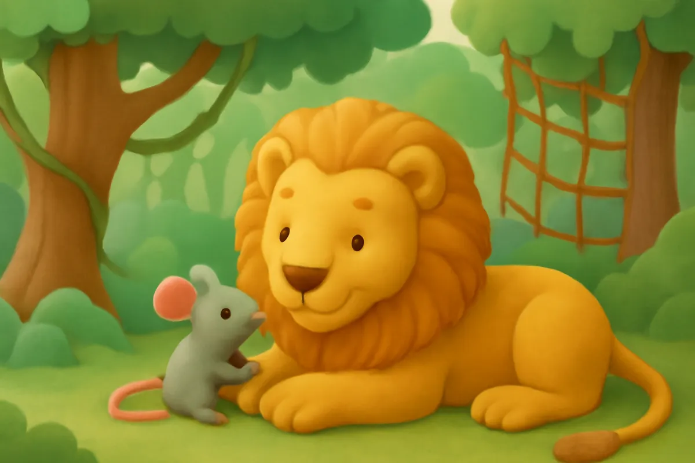
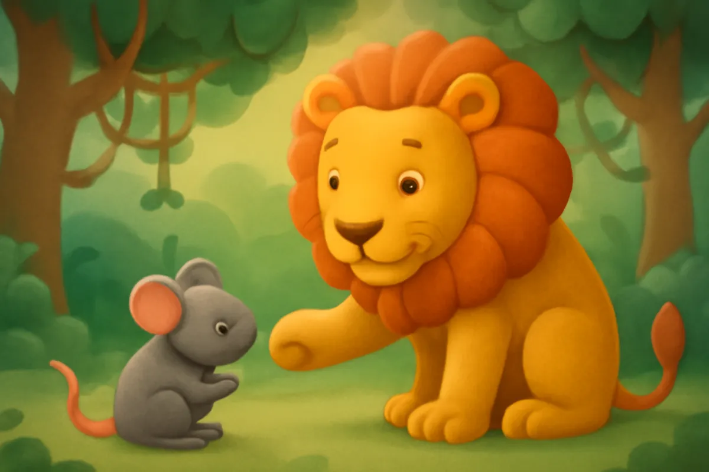
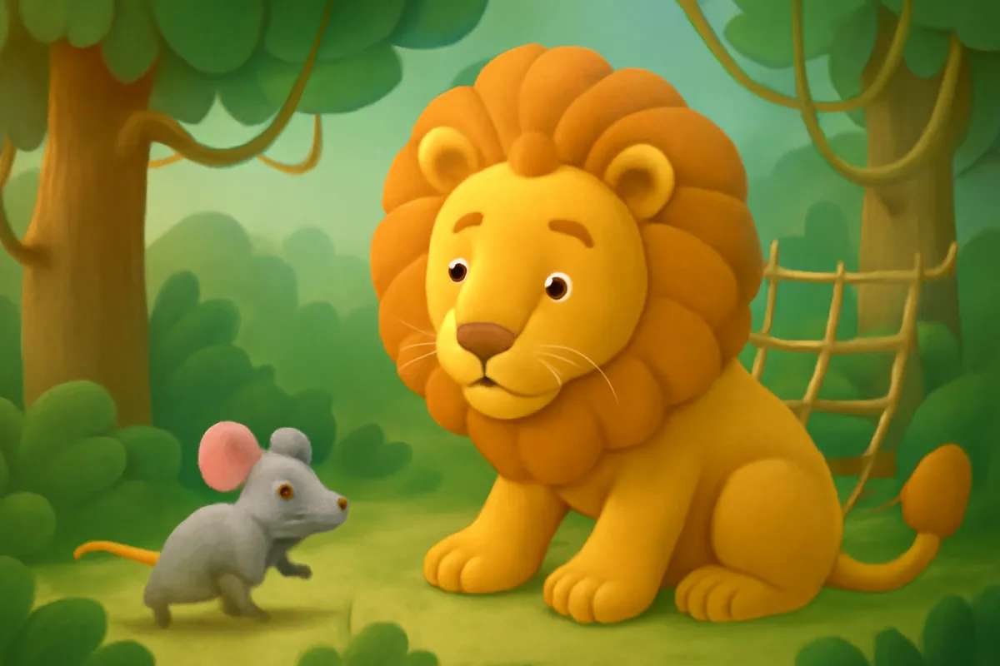
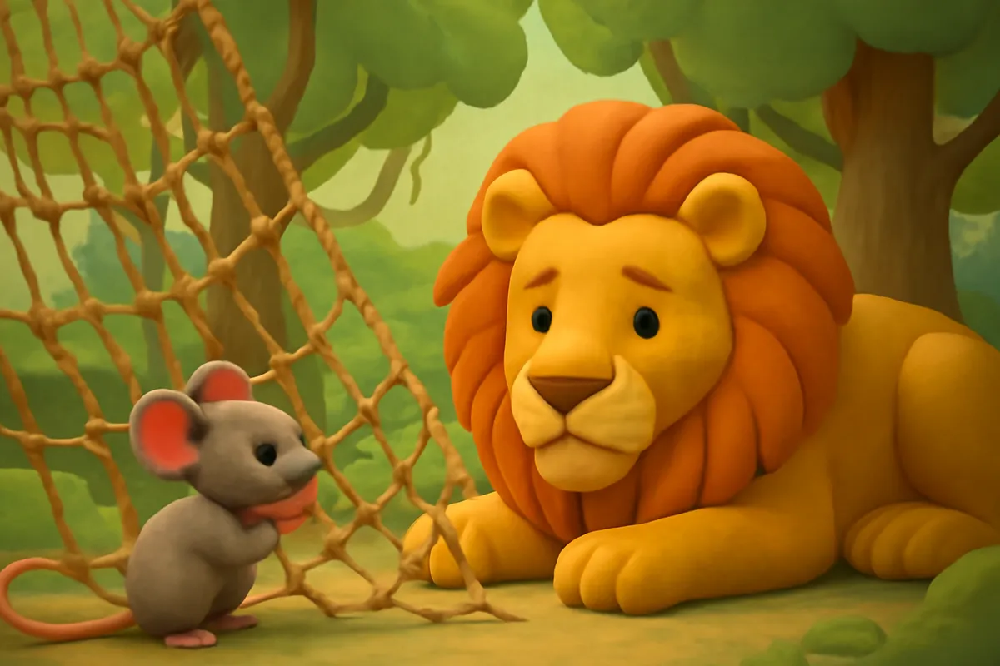
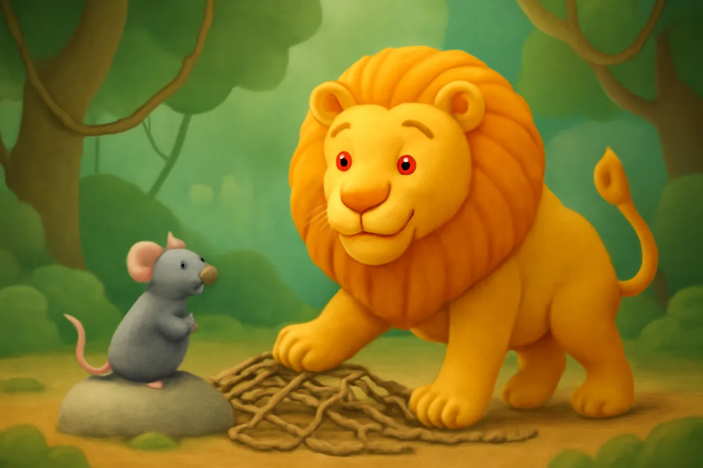
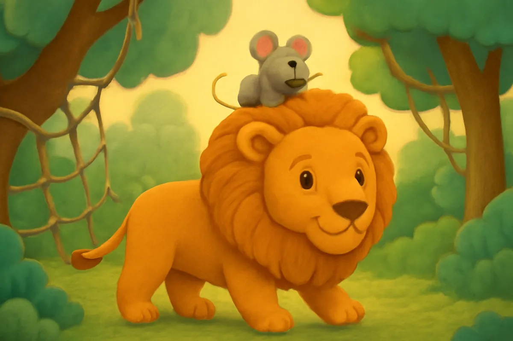

# Sư Tử và Chuột Nhắt

| | |
| --- | --- |
| Mã truyện | `2c73e294-9d65-4373-8e6a-e07e4a095cb8` |
| Nhóm | Truyện thư viện |
| Nguồn | manual |
| Tạo lúc | 2026-10-15T14:34:09.814347+00:00 |
| Cập nhật | 2026-10-16T04:30:26.004533+00:00 |
| Số trang | 8 |
| Ngôn ngữ | vi |
| Tuổi | 3–6 |
| Giọng kể | Viên - Narrative, Warm and Clear (northern) |
| Trạng thái | published |
| Đã xoá | không |

**Giới thiệu:** Chuột Nhắt lỡ làm Sư Tử thức giấc và được tha. Ít hôm sau, Sư Tử vướng vào tấm lưới cũ trong rừng, chính Chuột Nhắt bé nhỏ đã gặm đứt dây cứu bạn.

**Bài học:** Đừng coi thường người nhỏ bé; làm điều tốt thì sẽ nhận lại điều tốt.

## Nhân vật

- **Chuột Nhắt** — Cô chuột nhỏ bé, lễ phép, giữ lời hứa (giọng: Yuna — bé gái tinh nghịch)
- **Sư Tử** — Chúa sơn lâm oai vệ nhưng rộng lượng (giọng: Quang — chú trầm ấm)

## Trang 1

Giữa trưa hè, Sư Tử nằm ngủ dưới bóng cây to. Chuột Nhắt bé nhỏ đi tìm hạt dẻ, chạy lon ton thế nào lại trèo ngay lên mũi Sư Tử.

Sư Tử hắt xì một cái, mở mắt ra, đưa bàn chân to tướng giữ chặt lấy Chuột Nhắt.

**Sư Tử:** Ai dám làm ta mất giấc ngủ trưa thế này?

Chuột Nhắt run cầm cập, hai tai cụp xuống.

🔊 [Nghe trang 1](../../../media/tts-cache/277f204b-1884-44f5-a841-aa23c0074f85-e8f4023c-a04e-4dd3-838f-0d73ed57eba4.mp3)

## Trang 2

Chuột Nhắt lấy hết can đảm, ngước nhìn Sư Tử.

**Chuột Nhắt:** Thưa ngài Sư Tử, cháu xin lỗi. Cháu không cố ý đâu ạ. Ngài thả cháu ra nhé. Biết đâu sau này, cháu sẽ giúp được ngài.

Sư Tử nghe vậy thì phá lên cười, tiếng cười vang cả khu rừng.

**Sư Tử:** Ha ha! Bé tí như cháu mà đòi giúp ta ư? Ta là chúa sơn lâm cơ mà!

🔊 [Nghe trang 2](../../../media/tts-cache/06a58e9e-cbed-45f7-b102-299f649fe680-0eedfde5-9df6-435f-8dbf-f3904ea36112.mp3)

## Trang 3

Cười xong, Sư Tử thấy Chuột Nhắt nhỏ bé, đáng yêu quá. Sư Tử từ từ nhấc bàn chân lên.

**Sư Tử:** Thôi được, ta tha cho cháu. Lần sau nhớ nhìn đường mà đi nhé.

**Chuột Nhắt:** Cháu cảm ơn ngài! Cháu sẽ nhớ ơn ngài mãi mãi!

Chuột Nhắt cúi chào, rồi chạy tọt vào hang, vui mừng khôn xiết. Ngày hôm ấy, cả khu rừng lại yên ả như cũ.

🔊 [Nghe trang 3](../../../media/tts-cache/41c1c5b3-92de-4f43-86ea-f63f3856314b-c574403b-8230-4d0e-8012-e64f29518500.mp3)

## Trang 4

Vài hôm sau, Sư Tử đi dạo trong rừng. Bỗng sột soạt một tiếng, Sư Tử vướng phải một tấm lưới cũ ai bỏ quên giữa bụi cây. Sư Tử càng giãy, lưới càng quấn chặt.

**Sư Tử:** Gừ... Ai cứu ta với! Ta không ra được!

Tiếng gầm vang khắp khu rừng. Các con vật nghe thấy, nhưng chẳng ai dám lại gần.

🔊 [Nghe trang 4](../../../media/tts-cache/0ccf7460-090a-460e-a116-a69f5add0fd1-31365e6d-a821-4496-95a7-adb05256a3c1.mp3)

## Trang 5

Trong hang nhỏ, Chuột Nhắt cũng nghe thấy tiếng gầm. Chuột Nhắt dỏng tai lên nghe.

**Chuột Nhắt:** Đúng là tiếng ngài Sư Tử rồi! Chắc ngài đang gặp nạn. Mình phải đến giúp ngài ngay!

Chuột Nhắt chạy thật nhanh qua bụi rậm, qua gốc cây, đến bên Sư Tử.

**Chuột Nhắt:** Ngài đừng lo, có cháu đây rồi!

Sư Tử ngạc nhiên nhìn cô bạn bé xíu.

🔊 [Nghe trang 5](../../../media/tts-cache/37d26998-6276-4968-8dc3-5417bce379b5-d68ef70d-73a3-4467-a112-cdaa31367b8f.mp3)

## Trang 6

Chuột Nhắt leo lên tấm lưới, dùng những chiếc răng nhỏ mà sắc gặm từng sợi dây. Gặm mãi, gặm mãi, răng mỏi nhừ, nhưng Chuột Nhắt không bỏ cuộc.

**Sư Tử:** Cháu bé thế, liệu có gặm nổi không?

**Chuột Nhắt:** Ngài cứ nằm yên nhé. Từng sợi một, rồi sẽ xong thôi ạ!

Phựt, phựt! Từng sợi dây đứt ra. Sư Tử nằm im, hồi hộp chờ đợi.

🔊 [Nghe trang 6](../../../media/tts-cache/2deada34-ee3f-454b-93c6-a514f3e5370e-62def3eb-5d5d-4a85-b7c3-5976da877709.mp3)

## Trang 7

Cuối cùng, tấm lưới rách toạc ra một lỗ to. Sư Tử vươn mình, chui ra ngoài, rũ bờm thật mạnh.

**Sư Tử:** Ta thoát rồi! Cảm ơn cháu, Chuột Nhắt ạ. Hôm trước ta đã cười cháu. Ta thật là sai.

**Chuột Nhắt:** Ngài đã tha cho cháu, nay cháu giúp lại ngài. Bạn bè là thế mà!

Cả khu rừng reo vui khi thấy Sư Tử được tự do.

🔊 [Nghe trang 7](../../../media/tts-cache/98f5ac0a-c544-4382-bffe-59391e000d1e-1cf66c9a-13b1-47bd-be86-1e0bf19b5225.mp3)

## Trang 8

Từ hôm đó, Sư Tử và Chuột Nhắt trở thành đôi bạn thân. Chiều chiều, Chuột Nhắt ngồi trên bờm Sư Tử, hai bạn cùng đi dạo khắp khu rừng.

**Sư Tử:** Bây giờ ta mới hiểu, bạn nhỏ cũng có thể giúp được việc lớn.

**Chuột Nhắt:** Còn cháu biết rằng, làm điều tốt thì sẽ nhận lại điều tốt!

Ánh nắng chiều vàng óng chiếu qua tán lá.

🔊 [Nghe trang 8](../../../media/tts-cache/f114cd27-f356-43c8-8c45-0a1deb4f96e0-df72c29c-9f77-4394-81fb-966142043620.mp3)

---

Bản đầy đủ (mọi cột trong cơ sở dữ liệu): [story.json](story.json)
