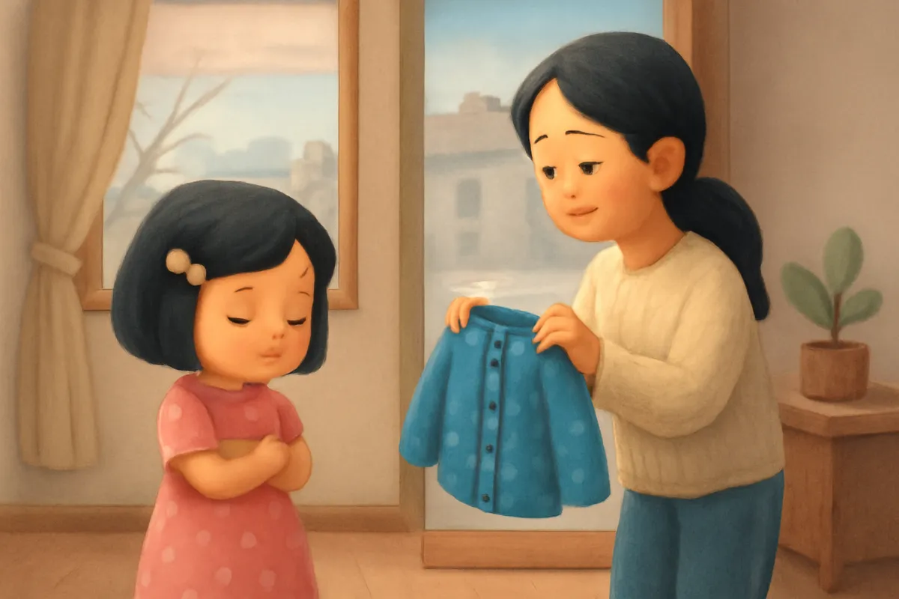
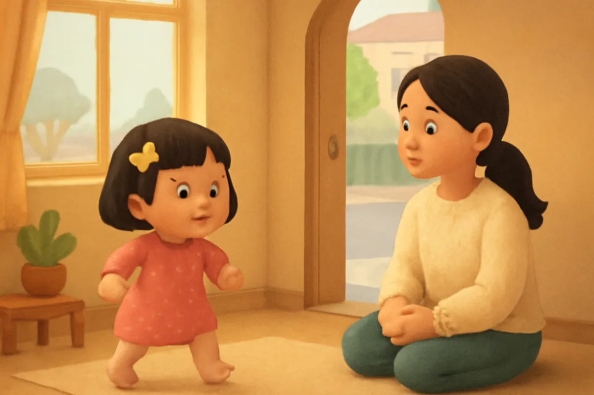
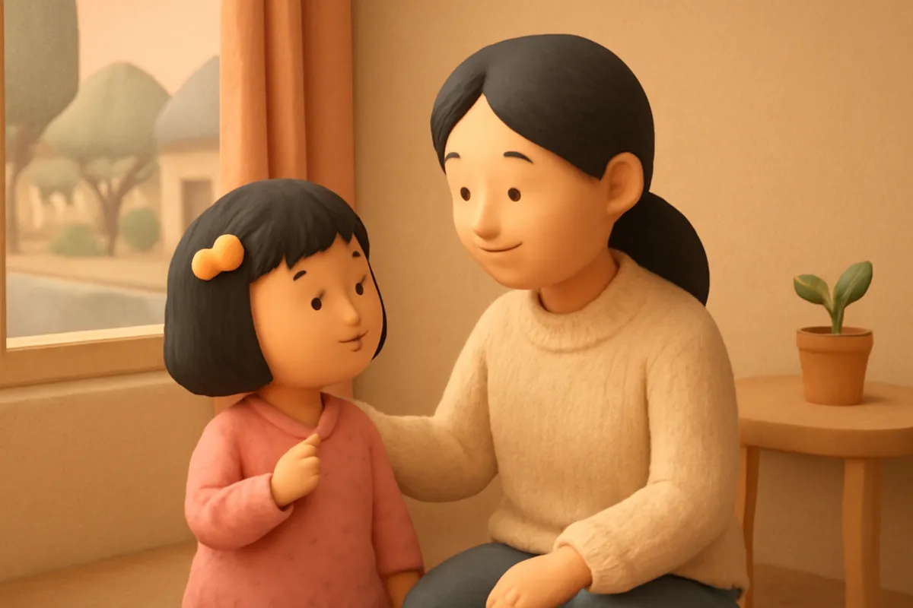
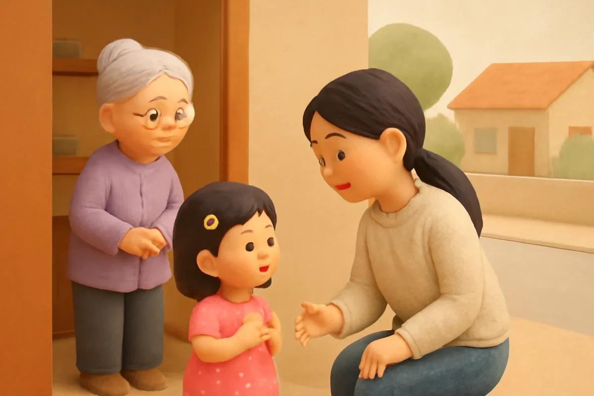
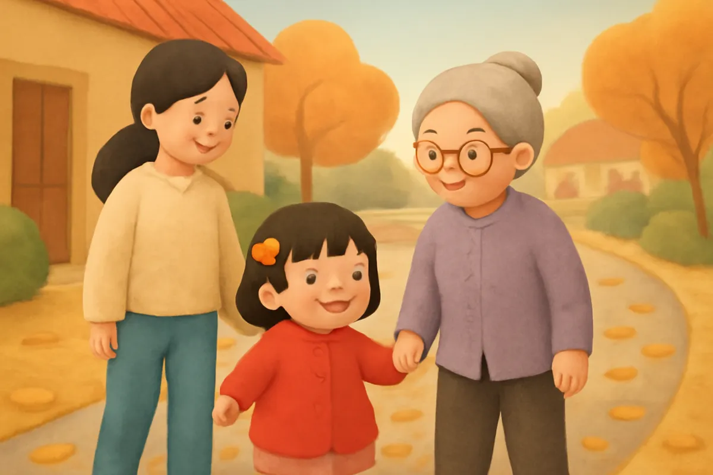
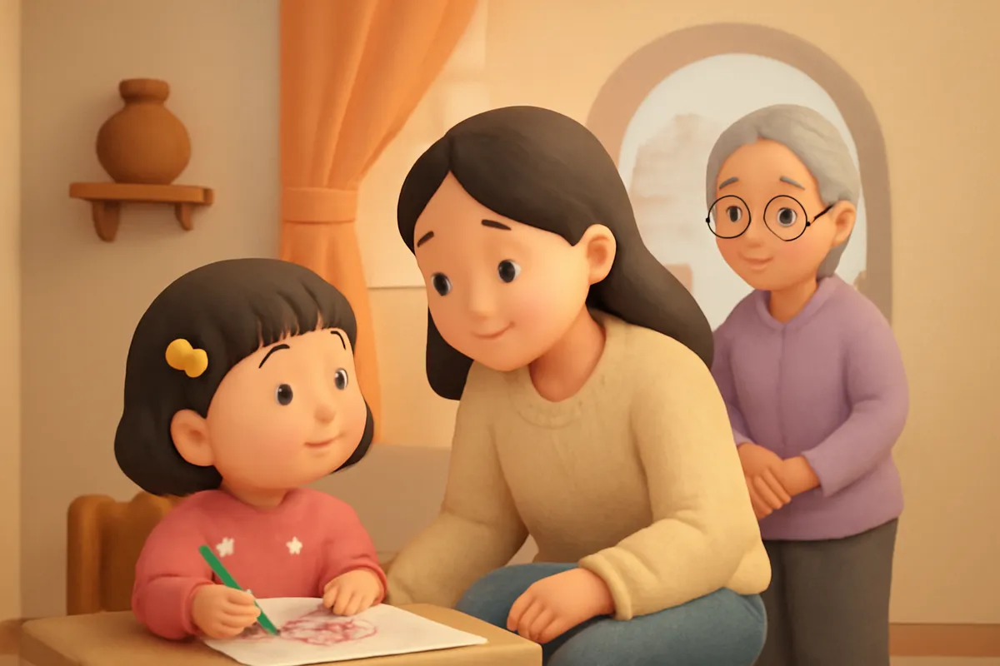
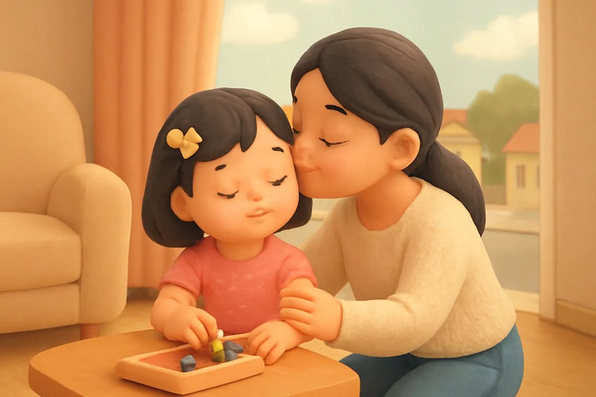
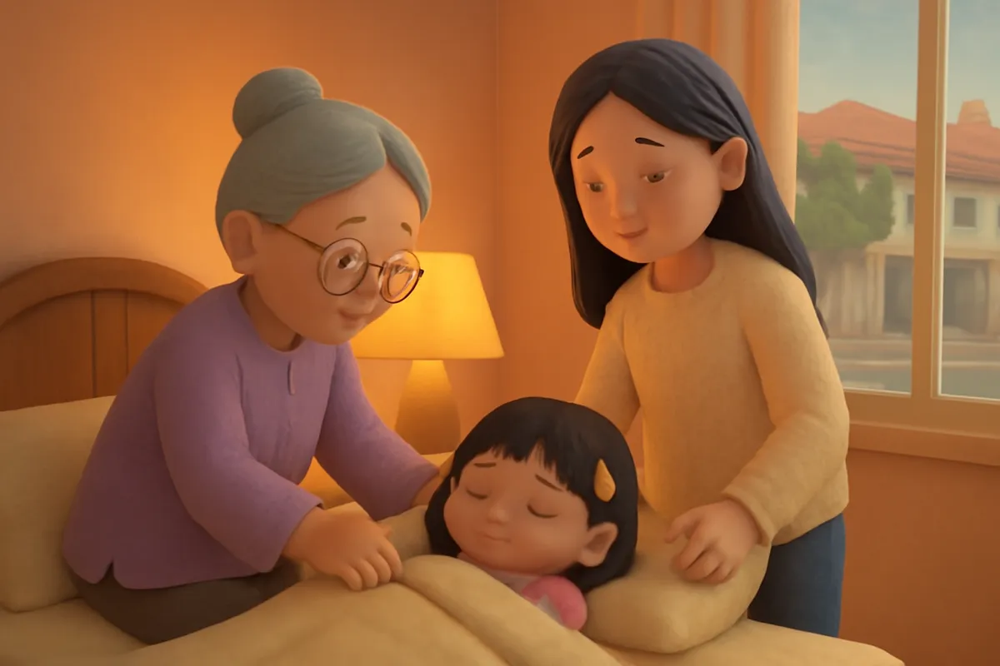

# Su và chiếc áo khoác

| | |
| --- | --- |
| Mã truyện | `404b6a06-2fd0-4f42-bd1c-b2409d643a7f` |
| Nhóm | Truyện thư viện |
| Nguồn | manual |
| Tạo lúc | 2026-10-15T14:34:10.193821+00:00 |
| Cập nhật | 2026-10-16T04:35:26.910242+00:00 |
| Số trang | 8 |
| Ngôn ngữ | vi |
| Tuổi | 3–6 |
| Giọng kể | Viên - Narrative, Warm and Clear (northern) |
| Trạng thái | published |
| Đã xoá | không |

**Giới thiệu:** Sáng lạnh, Su cãi lời mẹ, dậm chân không chịu mặc áo khoác. Mẹ bình tĩnh hỏi lý do, bà dạy Su cách nói khi không đồng ý. Su học cách lắng nghe và nói lễ phép.

**Bài học:** Biết lắng nghe bố mẹ; khi không đồng ý, hãy nói nhẹ nhàng, lễ phép để cả nhà hiểu nhau.

## Nhân vật

- **Su** — Em gái 4 tuổi của Bo, hay hỏi, thích vẽ (giọng: Yuna — bé gái tinh nghịch)
- **Mẹ** — Mẹ của Bo và Su, dịu dàng, kiên nhẫn (giọng: Tâm — cô kể chuyện cổ tích)
- **Bà** — Bà nội hiền hậu, kể chuyện hay (giọng: Hiền — bà hiền hậu)

## Trang 1

Sáng mùa đông, gió lạnh thổi vù vù ngoài cửa sổ. Mẹ lấy chiếc áo khoác len xanh đưa cho Su.

**Mẹ:** Su ơi, con mặc áo khoác vào kẻo lạnh nhé.

**Su:** Không! Con không mặc đâu! Áo này xấu lắm!

Su khoanh tay, quay mặt đi chỗ khác. Su chỉ muốn mặc chiếc váy hồng chấm bi mỏng tang thôi.

🔊 [Nghe trang 1](../../../media/tts-cache/6353a5bb-07e1-4281-bfd8-671a0e4b1bf7-5a9dc5e9-22f9-4cb0-bf6a-6d65974a71b3.mp3)

## Trang 2

Mẹ nhắc lại một lần nữa. Su dậm chân thình thịch, nói càng to hơn.

**Su:** Mẹ lúc nào cũng bắt con! Con không nghe đâu!

Mẹ không quát Su. Mẹ hít một hơi thật sâu, rồi ngồi xuống cho bằng Su, nhìn vào mắt Su.

**Mẹ:** Mẹ thấy con đang không vui. Con nói cho mẹ biết vì sao con không muốn mặc áo được không?

🔊 [Nghe trang 2](../../../media/tts-cache/63b4f27e-5897-443b-a1d5-82b73ca1f06e-98c1c348-3b4d-4b10-bd6d-ae3531584d4b.mp3)

## Trang 3

Su nhìn mẹ, giọng nhỏ dần.

**Su:** Áo len này ngứa cổ lắm ạ. Con mặc vào là gãi suốt.

**Mẹ:** À, hoá ra là thế! Khi con nói nhẹ nhàng, mẹ hiểu ngay. Lúc nãy con hét lên, mẹ chỉ nghe thấy là con đang giận thôi.

Su cúi đầu, ngón tay xoắn xoắn vạt váy.

🔊 [Nghe trang 3](../../../media/tts-cache/ad51e056-2e01-4792-8016-ee2b01f8dcca-daee634d-e387-48ce-b040-c61ff34f5729.mp3)

## Trang 4

Bà từ trong bếp đi ra, cười hiền.

**Bà:** Su ơi, khi không đồng ý, cháu nói thế này nhé: Mẹ ơi, con không thích vì..., con muốn... được không ạ?

Su nghĩ một chút rồi thử nói.

**Su:** Mẹ ơi, áo len ngứa cổ. Con mặc áo khoác đỏ được không ạ?

**Mẹ:** Được chứ! Cảm ơn con đã nói lễ phép.

🔊 [Nghe trang 4](../../../media/tts-cache/f869feb4-bc62-49f5-8eb9-f994cc1b519d-1fc20f9a-8f95-4e54-88e6-c463d6dd08e6.mp3)

## Trang 5

Su mặc chiếc áo khoác đỏ, nắm tay bà đi đến lớp. Gió lạnh thổi mạnh, lá vàng bay lả tả trên đường.

**Su:** Bà ơi, may mà cháu mặc áo ấm. Gió lạnh thế này cơ mà!

**Bà:** Mẹ nhắc là vì mẹ thương cháu đấy. Cháu biết lắng nghe, lại biết nói ý mình, giỏi lắm.

🔊 [Nghe trang 5](../../../media/tts-cache/fb0d2b8b-3d5b-4159-bf7e-d30d772bc876-5a1d6cfc-3f0e-4311-a036-66f2aae08924.mp3)

## Trang 6

Buổi tối, Su đang tô màu bông hoa thì mẹ gọi.

**Mẹ:** Su ơi, cất bút màu rồi đi tắm nhé.

Su suýt nữa lại hét lên: Không! Nhưng Su dừng lại, nhớ lời bà dặn.

**Su:** Dạ, con nghe ạ. Mẹ cho con tô nốt bông hoa này rồi con đi tắm được không ạ?

**Mẹ:** Được, con tô nốt nhé. Mẹ chờ con.

🔊 [Nghe trang 6](../../../media/tts-cache/9d88ee9b-def1-49dc-8983-4ff403bf7369-e8c85307-00db-47b8-bfc8-0067e242af8c.mp3)

## Trang 7

Su tô xong bông hoa, cất bút màu vào hộp, rồi đi tắm ngay như đã hứa.

**Mẹ:** Con nói lễ phép, lại giữ đúng lời hứa nữa. Mẹ vui lắm!

**Su:** Con thấy nói nhẹ nhàng thì mẹ con mình chẳng ai phải giận ai cả.

Mẹ cười, thơm lên má Su một cái thật kêu.

🔊 [Nghe trang 7](../../../media/tts-cache/39caaf6a-453d-4114-b2eb-7d7fe155dabe-4c38b84f-4a63-4176-81a5-063ea28e72a2.mp3)

## Trang 8

Đến giờ đi ngủ, bà ngồi bên giường, kéo chăn cho Su.

**Bà:** Biết lắng nghe bố mẹ, có gì không thích thì nói nhẹ nhàng. Thế là ngoan nhất nhà rồi.

**Su:** Dạ, cháu nhớ rồi ạ. Bà ngủ ngon ạ.

Bé ơi, khi không đồng ý với bố mẹ, bé sẽ nói thế nào cho lễ phép nhỉ? Bé thử nói cùng Su nhé.

🔊 [Nghe trang 8](../../../media/tts-cache/717fc18c-976f-4ece-9d5c-61751c405ca6-8b5e34dc-d081-4ef9-97cc-a899c836ab4f.mp3)

---

Bản đầy đủ (mọi cột trong cơ sở dữ liệu): [story.json](story.json)
