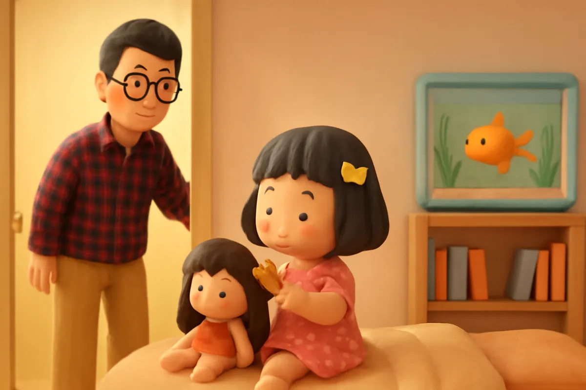
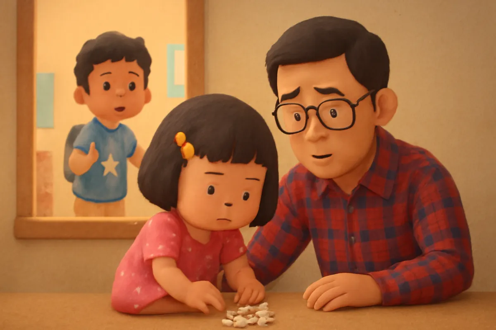
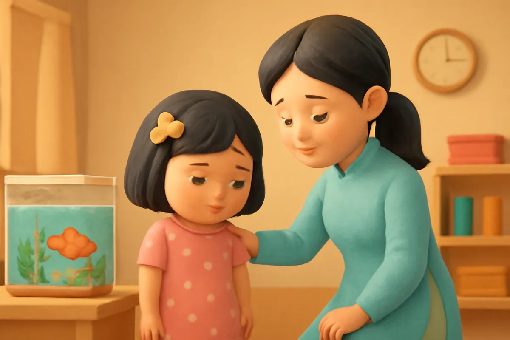
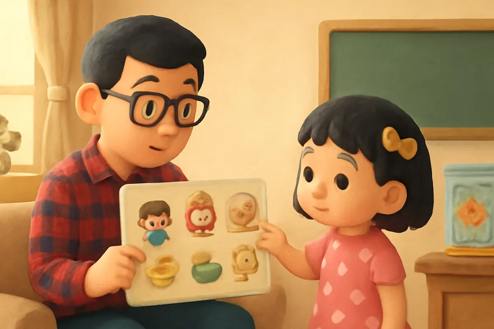
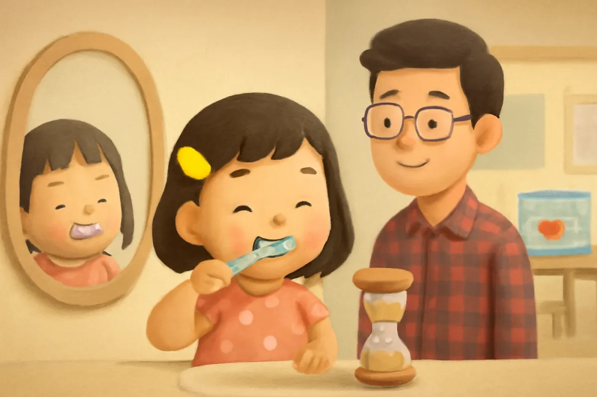
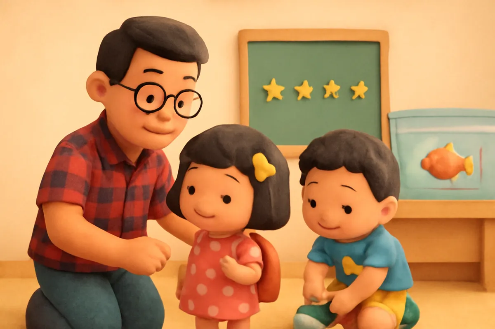
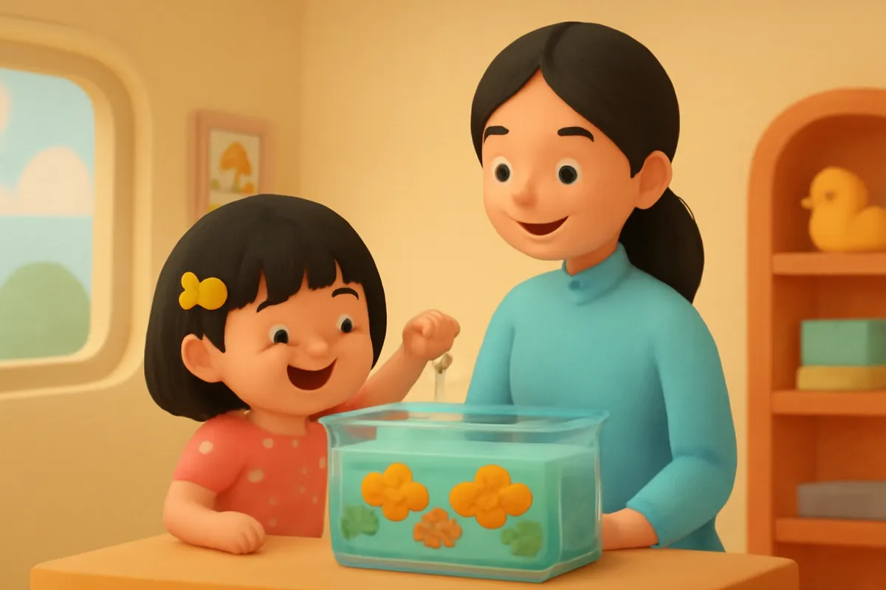
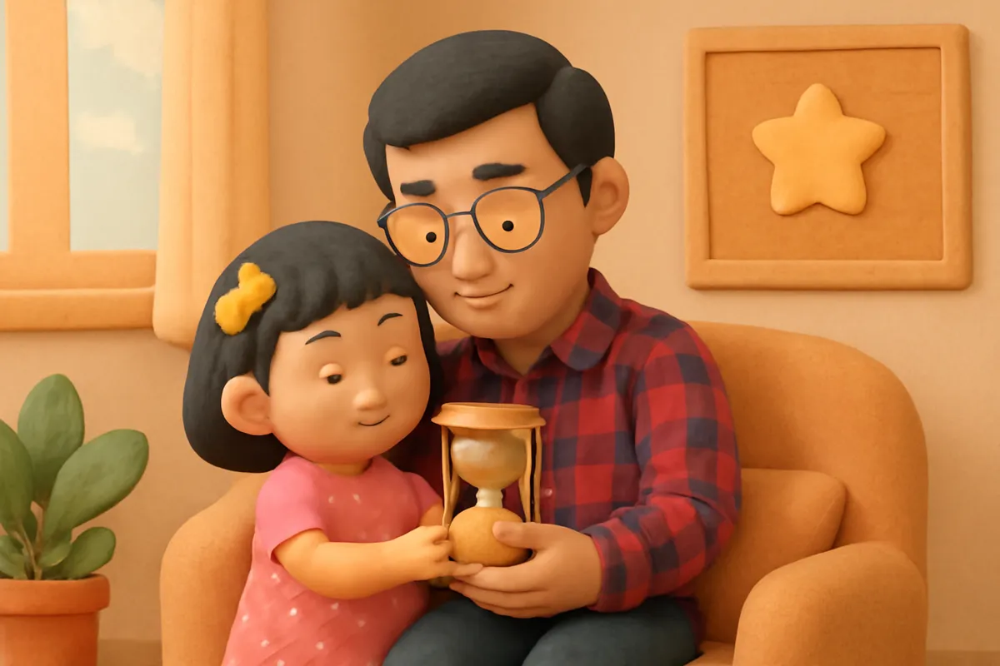

# Su và chiếc đồng hồ cát

| | |
| --- | --- |
| Mã truyện | `45943dd8-0b91-4e7f-9413-056c930d4712` |
| Nhóm | Truyện thư viện |
| Nguồn | manual |
| Tạo lúc | 2026-10-15T14:34:10.193821+00:00 |
| Cập nhật | 2026-10-16T04:46:34.435684+00:00 |
| Số trang | 8 |
| Ngôn ngữ | vi |
| Tuổi | 3–6 |
| Giọng kể | Viên - Narrative, Warm and Clear (northern) |
| Trạng thái | published |
| Đã xoá | không |

**Giới thiệu:** Su mải chơi lề mề mỗi sáng nên đến lớp muộn, lỡ giờ cho cá vàng ăn. Bố làm bảng tranh các việc buổi sáng và chiếc đồng hồ cát, Su chạy đua với cát và đến lớp thật sớm.

**Bài học:** Làm từng việc một, không mải chơi giữa chừng, thì việc gì cũng xong đúng giờ.

## Nhân vật

- **Su** — Em gái 4 tuổi của Bo, hay hỏi, thích vẽ (giọng: Yuna — bé gái tinh nghịch)
- **Bố** — Bố của Bo và Su, vui tính, hay bày trò (giọng: Quang — chú trầm ấm)
- **Bo** — Cậu bé 5 tuổi hiếu động, tốt bụng, đang tập thói quen tốt (giọng: Bin — bé trai lém lỉnh)
- **Cô Hoa** — Cô giáo mầm non dịu dàng (giọng: Tâm — cô kể chuyện cổ tích)

## Trang 1

Sáng nào bố cũng gọi Su dậy thật sớm. Nhưng Su cứ ngồi trên giường chải tóc cho búp bê, rồi ngắm chú chim ngoài cửa sổ. Một chân Su đã đi tất, chân kia vẫn chưa.

**Bố:** Su ơi, đánh răng rồi thay quần áo đi con.

**Su:** Dạ, con làm ngay đây ạ!

Nói vậy, nhưng Su lại mải chơi tiếp.

🔊 [Nghe trang 1](../../../media/tts-cache/74f00282-6172-4153-9ca8-24f1b88792f1-24f896be-d655-4f74-8e5f-29569e395609.mp3)

## Trang 2

Bữa sáng nguội dần. Bo đã đeo cặp, đứng chờ ở cửa từ lâu.

**Bo:** Su ơi, nhanh lên! Muộn học mất rồi!

Su vẫn thong thả ngắm từng hạt cơm, xếp chúng thành hình bông hoa. Đến khi ra khỏi nhà, kim đồng hồ đã chỉ quá giờ vào lớp. Bố phải vội vàng đưa hai anh em đi.

🔊 [Nghe trang 2](../../../media/tts-cache/a1d33c8f-74b4-4d22-9930-27362f01736a-f9d8fd8e-ade6-4dee-98e3-99d9c20d0ff6.mp3)

## Trang 3

Su đến lớp thì các bạn đã cho cá vàng ăn xong rồi. Việc cho cá ăn là việc Su thích nhất mỗi sáng.

**Su:** Cô ơi, hôm nay con không được cho cá vàng ăn ạ?

**Cô Hoa:** Các bạn cho cá ăn từ đầu giờ rồi con ạ. Mai con đến sớm, cô để phần con nhé.

Su buồn thiu, nhìn bể cá mãi.

🔊 [Nghe trang 3](../../../media/tts-cache/0d29aea3-9d61-467a-bd76-8c9c060be06e-a61b7b28-5700-4b44-94e5-29ec445026ad.mp3)

## Trang 4

Tối hôm ấy, bố bày ra một trò chơi mới. Bố vẽ một tấm bảng có năm bức tranh: đánh răng, rửa mặt, thay quần áo, ăn sáng, đeo cặp. Bên cạnh là một chiếc đồng hồ cát nhỏ.

**Bố:** Mỗi việc, con chạy đua với đồng hồ cát nhé. Cát chảy hết mà con làm xong là con thắng!

**Su:** Hay quá! Con sẽ thắng đồng hồ cát!

🔊 [Nghe trang 4](../../../media/tts-cache/7541579b-2272-49aa-bfc7-479fe341f49f-57867eea-b913-4c9f-a3ee-b0d5a71d9b57.mp3)

## Trang 5

Sáng hôm sau, Su vừa dậy đã chạy đến bên tấm bảng. Bố lật đồng hồ cát. Cát chảy xuống rào rào.

**Bố:** Việc thứ nhất: đánh răng! Bắt đầu nào!

Su đánh răng thật kỹ, súc miệng sạch sẽ. Cát vẫn còn một ít.

**Su:** Con thắng rồi! Con dán ngôi sao vào tranh đánh răng nhé!

🔊 [Nghe trang 5](../../../media/tts-cache/dfa938c4-754f-4ecd-9cc2-b060cd32e045-6833e59e-3579-44dc-92bf-f4468439c1fb.mp3)

## Trang 6

Su làm tiếp từng việc một: rửa mặt, thay quần áo, rồi ngồi vào bàn ăn sáng. Su không mải chơi giữa chừng nữa.

**Bo:** Su nhanh quá! Anh phải cố lên mới theo kịp em đấy!

**Su:** Em đeo cặp xong rồi! Năm ngôi sao, năm việc luôn!

**Bố:** Giỏi quá! Hôm nay cả nhà đi sớm rồi!

🔊 [Nghe trang 6](../../../media/tts-cache/a5d83aed-6e03-4d82-bfa7-930bfe9ce0fa-619b02a3-2005-4d26-a87b-62320bb7ca8e.mp3)

## Trang 7

Su đến lớp khi các bạn mới đến được vài người. Cô Hoa đưa cho Su hộp thức ăn của cá.

**Cô Hoa:** Hôm nay con đến sớm quá! Con cho cá vàng ăn nhé.

**Su:** Cá vàng ơi, hôm nay tớ đến sớm này! Ăn ngon nhé!

Đàn cá vàng bơi tung tăng, đớp những hạt thức ăn nhỏ xíu.

🔊 [Nghe trang 7](../../../media/tts-cache/773788ff-82ac-45b7-af73-ce4bcc39dde8-97a75366-a69d-4b05-b8e1-9b0d8db34133.mp3)

## Trang 8

Chiều về, Su kể cho bố nghe chuyện cho cá ăn.

**Bố:** Con tự làm từng việc một, không cần ai giục. Bố tự hào về con lắm.

**Su:** Con làm từng việc một, không mải chơi giữa chừng, thế là xong hết ạ!

Bé ơi, buổi sáng bé thường làm những việc gì? Bé thử đếm xem có mấy việc nào!

🔊 [Nghe trang 8](../../../media/tts-cache/5ccf5f2a-e5ba-4c8f-8924-471145a90249-84903c9c-d037-4404-9001-3f86387d9240.mp3)

---

Bản đầy đủ (mọi cột trong cơ sở dữ liệu): [story.json](story.json)
