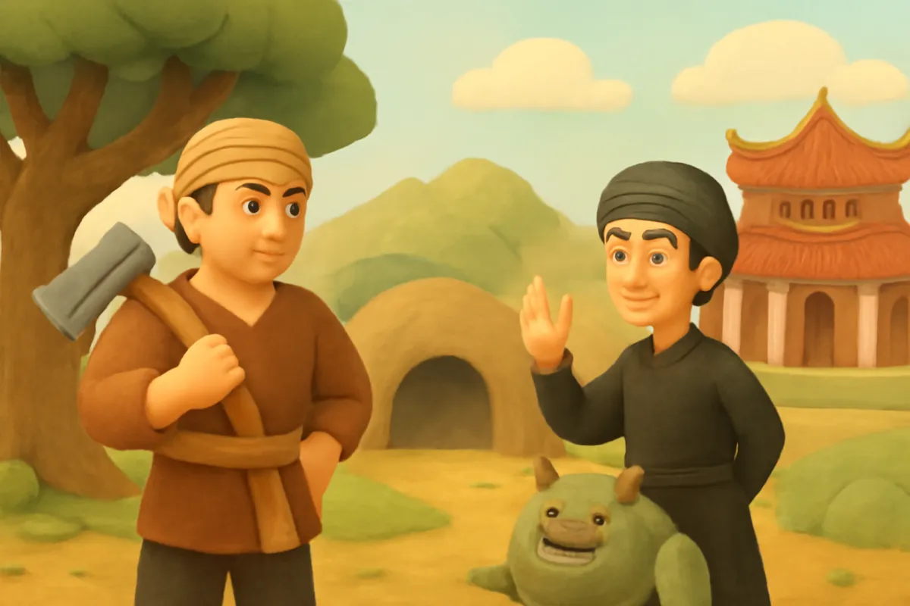
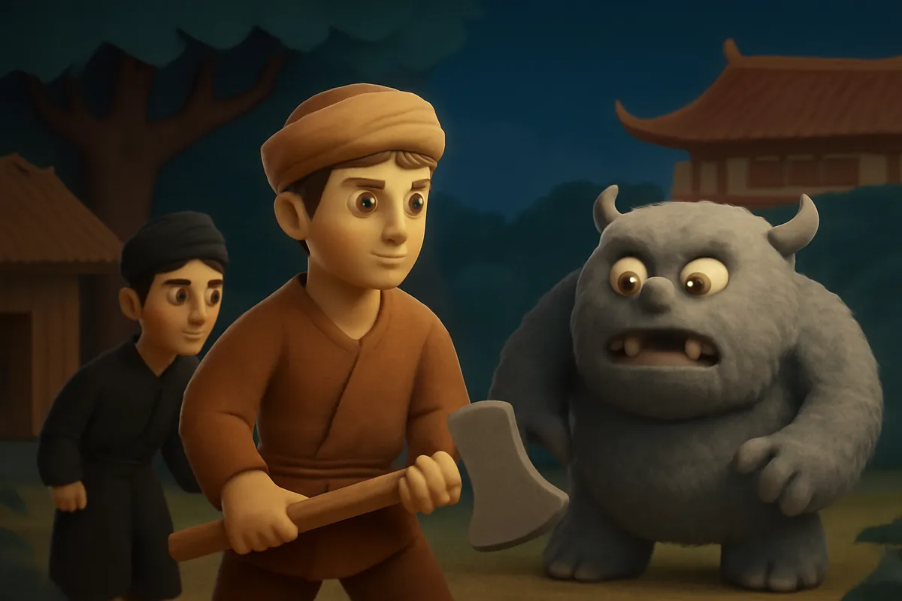
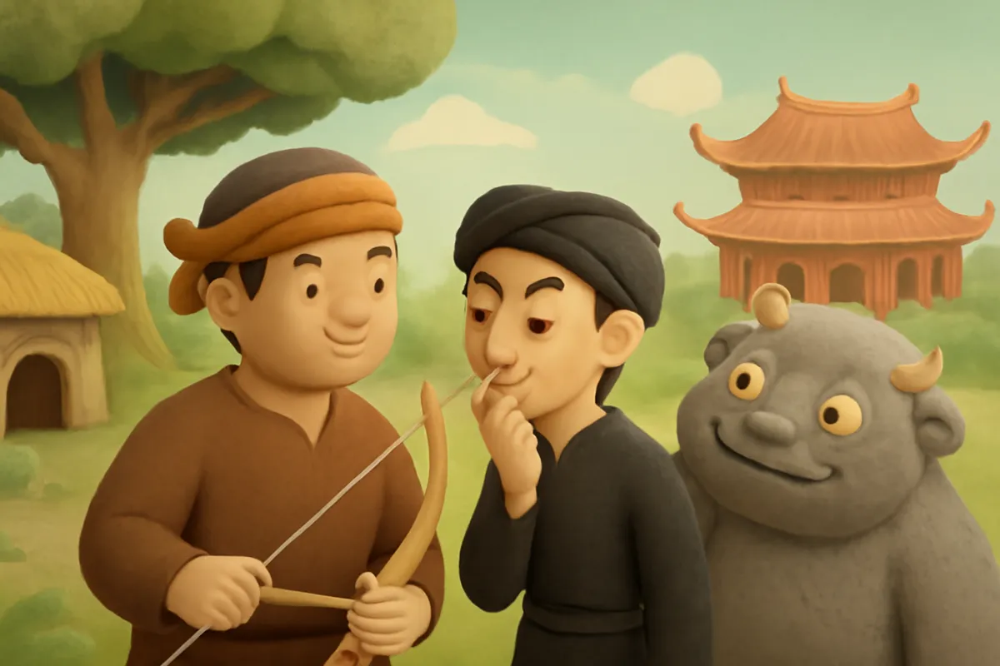
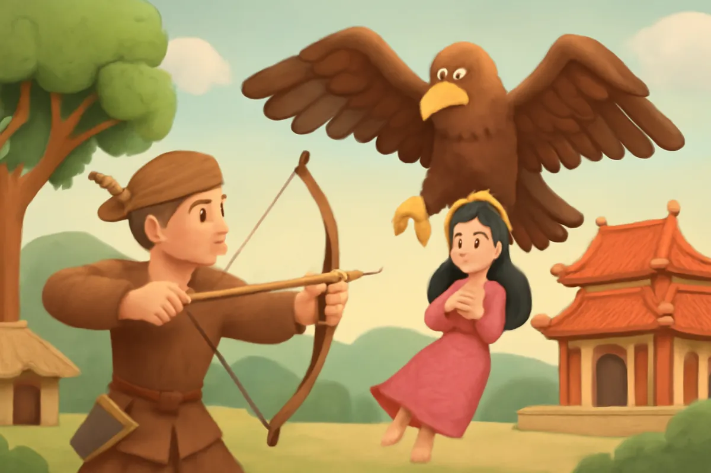
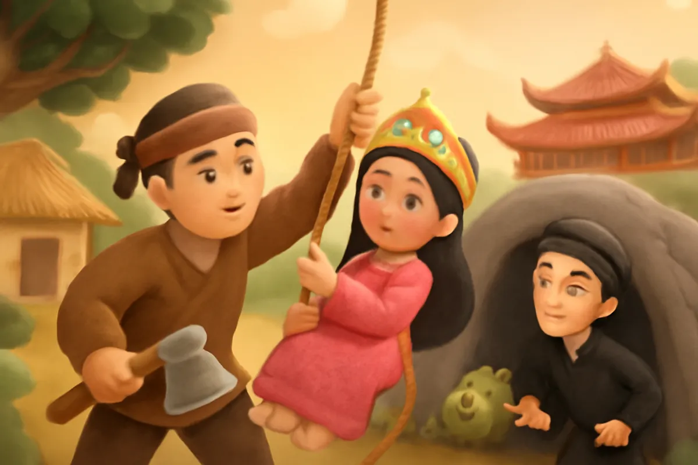
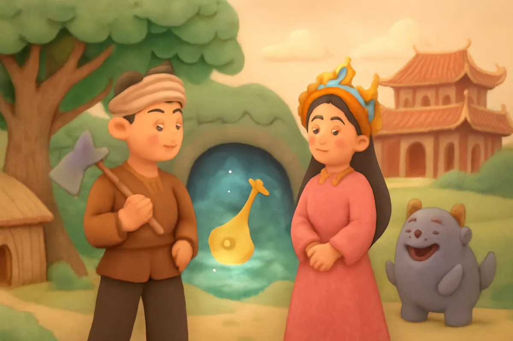
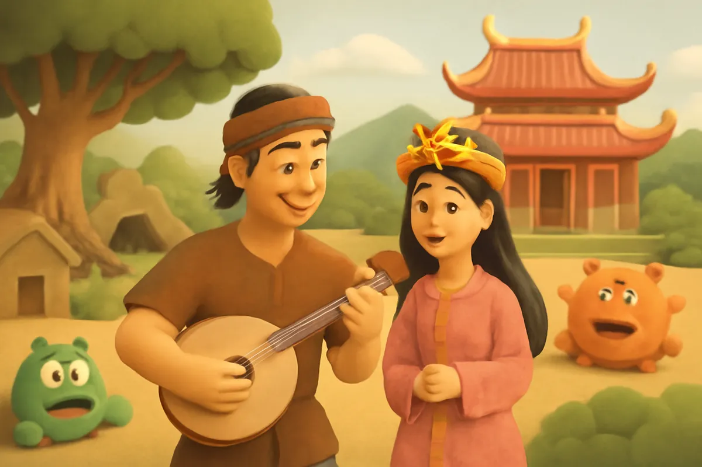
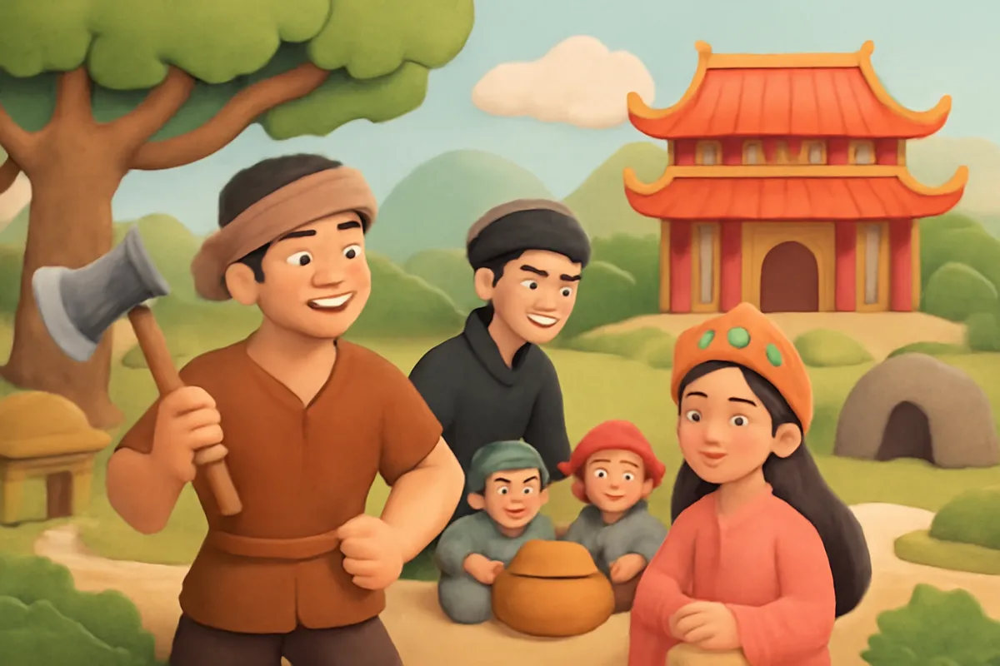

# Thạch Sanh

| | |
| --- | --- |
| Mã truyện | `7040a0fb-6032-472f-9f8e-fa1be92af405` |
| Nhóm | Truyện thư viện |
| Nguồn | manual |
| Tạo lúc | 2026-10-15T14:34:09.814347+00:00 |
| Cập nhật | 2026-10-16T04:31:49.416117+00:00 |
| Số trang | 8 |
| Ngôn ngữ | vi |
| Tuổi | 5–8 |
| Giọng kể | Viên - Narrative, Warm and Clear (northern) |
| Trạng thái | published |
| Đã xoá | không |

**Giới thiệu:** Chàng Thạch Sanh hiền lành bị Lý Thông lừa đi canh miếu chằn tinh rồi cướp công. Chàng cứu công chúa khỏi hang đại bàng, có cây đàn thần và niêu cơm ăn mãi không hết.

**Bài học:** Hiền lành, dũng cảm thì được đền đáp; gian dối sẽ phải xấu hổ.

## Nhân vật

- **Thạch Sanh** — Chàng trai hiền lành, thật thà, dũng cảm (giọng: Quang — chú trầm ấm)
- **Lý Thông** — Kẻ gian xảo cướp công, cuối truyện biết xấu hổ (giọng: Thanh — ông hiền từ)
- **Công Chúa** — Công chúa hiền dịu, được Thạch Sanh cứu (giọng: Kim — chị gái dịu dàng)
- **Chằn Tinh** — Con yêu tinh hung dữ trong miếu hoang (giọng: Quang — chú trầm ấm)

## Trang 1

Ngày xưa, có chàng Thạch Sanh sống một mình trong túp lều dưới gốc đa. Gia tài của chàng chỉ có một lưỡi búa. Hằng ngày, chàng vào rừng đốn củi. Chàng được thần tiên dạy cho võ nghệ.

Một hôm, có người buôn bán tên là Lý Thông đi ngang qua.

**Lý Thông:** Chú em khoẻ mạnh thế này, về ở với anh, hai ta kết làm anh em nhé!

**Thạch Sanh:** Có người anh, em mừng lắm. Em xin nghe lời anh.

🔊 [Nghe trang 1](../../../media/tts-cache/60416ded-2c64-457a-9c68-fc99cdd71cfb-01b1d94e-20b8-4e5e-83cc-ff2d5c9e4bbd.mp3)

## Trang 2

Trong vùng có con chằn tinh hung dữ. Mỗi năm, dân làng phải cử một người đi canh miếu. Đến lượt Lý Thông, hắn lại lừa Thạch Sanh đi thay.

**Lý Thông:** Em đi canh miếu giúp anh một đêm nhé. Anh bận việc nhà, sáng mai em về.

Nửa đêm, chằn tinh hiện ra, nhe nanh giơ vuốt.

**Chằn Tinh:** Kẻ nào dám vào miếu của ta?

Thạch Sanh vung búa đánh trả. Chằn tinh thua, bỏ chạy vào núi sâu, để lại bộ cung tên bằng vàng.

🔊 [Nghe trang 2](../../../media/tts-cache/ed42292a-51c8-4dea-9443-8f1f7bb6a645-3c9451e6-441a-47d6-9c19-18237c1f11c6.mp3)

## Trang 3

Thạch Sanh mang cung tên vàng về. Lý Thông sợ hãi, rồi nảy ra ý xấu.

**Lý Thông:** Chằn tinh là con vật nhà vua nuôi. Em làm nó bỏ đi, vua sẽ phạt đấy. Em trốn về gốc đa đi, mọi việc để anh lo.

**Thạch Sanh:** Vâng, em cảm ơn anh. Em về gốc đa đây.

Thạch Sanh thật thà trở về túp lều cũ. Còn Lý Thông vào cung, nhận là mình đã đuổi được chằn tinh, được vua phong làm quan to.

🔊 [Nghe trang 3](../../../media/tts-cache/43e1717f-d3dc-46b0-b0a1-b26e7ce5cbb1-bf45ba70-caa4-4178-93e2-35a9f4b716dd.mp3)

## Trang 4

Một hôm, công chúa đang dạo chơi trong vườn thì một con đại bàng khổng lồ sà xuống, quắp nàng bay đi. Ở gốc đa, Thạch Sanh nhìn thấy, liền giương cung vàng bắn trúng cánh đại bàng.

**Thạch Sanh:** Đại bàng trúng tên rồi! Mình phải theo dấu nó để cứu người!

Những chiếc lông vũ rơi lả tả trên đường bay. Chàng lần theo từng chiếc lông, đến tận một hang sâu trong núi.

🔊 [Nghe trang 4](../../../media/tts-cache/ab934c76-3781-4ef4-b5fc-cd608ab11778-ca4bcf6b-6b28-4b5f-9120-b94ad7e97580.mp3)

## Trang 5

Vua sai Lý Thông đi tìm công chúa. Lý Thông gặp Thạch Sanh, bèn nhờ chàng xuống hang. Thạch Sanh buộc dây vào người, tụt xuống hang tối, đánh đuổi đại bàng, tìm thấy công chúa.

**Công Chúa:** Cảm ơn chàng đã cứu ta! Chàng là ai vậy?

**Thạch Sanh:** Thần là Thạch Sanh. Công chúa lên trước đi, thần sẽ lên sau.

Nhưng khi công chúa vừa lên khỏi hang, Lý Thông liền sai quân lấp kín cửa hang, rồi đưa công chúa về cung.

🔊 [Nghe trang 5](../../../media/tts-cache/74d27b73-1883-4fcf-979f-3a5684de2358-595d58c6-b3ca-461c-92a8-9f611a315138.mp3)

## Trang 6

Bị nhốt dưới hang, Thạch Sanh không nản. Chàng tìm lối ra, và cứu được thái tử con vua Thủy Tề đang bị đại bàng nhốt trong cũi sắt. Vua Thủy Tề mời chàng xuống thủy cung, muốn tặng vàng bạc.

**Thạch Sanh:** Thần không cần vàng bạc, chỉ xin cây đàn này thôi.

Trở về gốc đa, chàng hay gảy đàn. Trong khi đó, ở cung vua, công chúa buồn bã, chẳng nói chẳng cười.

🔊 [Nghe trang 6](../../../media/tts-cache/ceb7bfd6-49d3-401f-a932-252849db6d92-4d7c6531-5aef-40c3-a7d2-0b8b54305de1.mp3)

## Trang 7

Một hôm, Thạch Sanh mang đàn đến kinh thành. Tiếng đàn vang lên trong trẻo, bay vào tận cung vua. Công chúa nghe thấy, bỗng bật cười, cất tiếng nói.

**Công Chúa:** Phụ vương ơi, người gảy đàn đã cứu con dưới hang sâu!

Vua cho gọi Thạch Sanh vào, nghe chàng kể lại mọi chuyện. Lý Thông đứng bên, mặt đỏ bừng vì xấu hổ.

**Lý Thông:** Tôi biết tội rồi. Xin cho tôi về quê làm ăn lương thiện.

🔊 [Nghe trang 7](../../../media/tts-cache/bc7bde1d-561d-4160-9ee0-b449493e990b-ca01d66b-63d8-44ba-a1ce-8dab49c858b0.mp3)

## Trang 8

Thạch Sanh xin vua tha cho Lý Thông. Vua gả công chúa cho Thạch Sanh. Nghe tin, quân mười tám nước chư hầu kéo đến đòi đánh. Thạch Sanh ôm đàn ra gảy. Tiếng đàn ngân vang, quân lính nghe thấy nhớ nhà, chẳng ai còn muốn đánh nhau.

**Thạch Sanh:** Mời các vị ăn cơm rồi hãy về.

Niêu cơm nhỏ xíu, mà ăn mãi không hết. Quân các nước phục lăn, kéo nhau về nước.

**Công Chúa:** Hiền lành và dũng cảm, chàng thật xứng đáng!

🔊 [Nghe trang 8](../../../media/tts-cache/864c7acb-988c-4ba9-b29b-24520c05ad03-6ef7e64e-0715-4dde-8a46-59c6e7f7fd58.mp3)

---

Bản đầy đủ (mọi cột trong cơ sở dữ liệu): [story.json](story.json)
