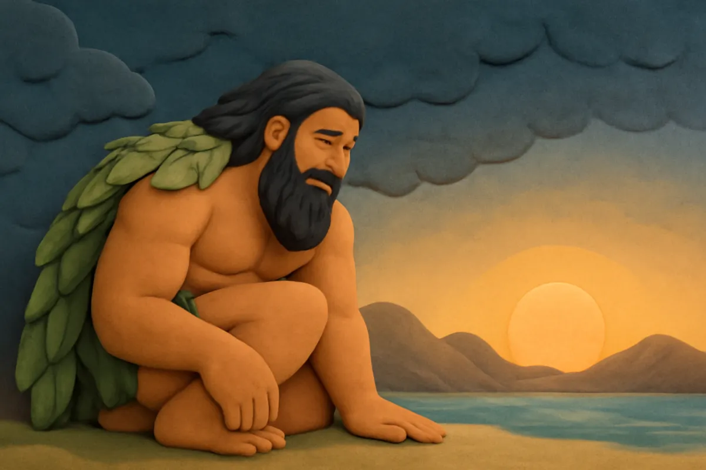
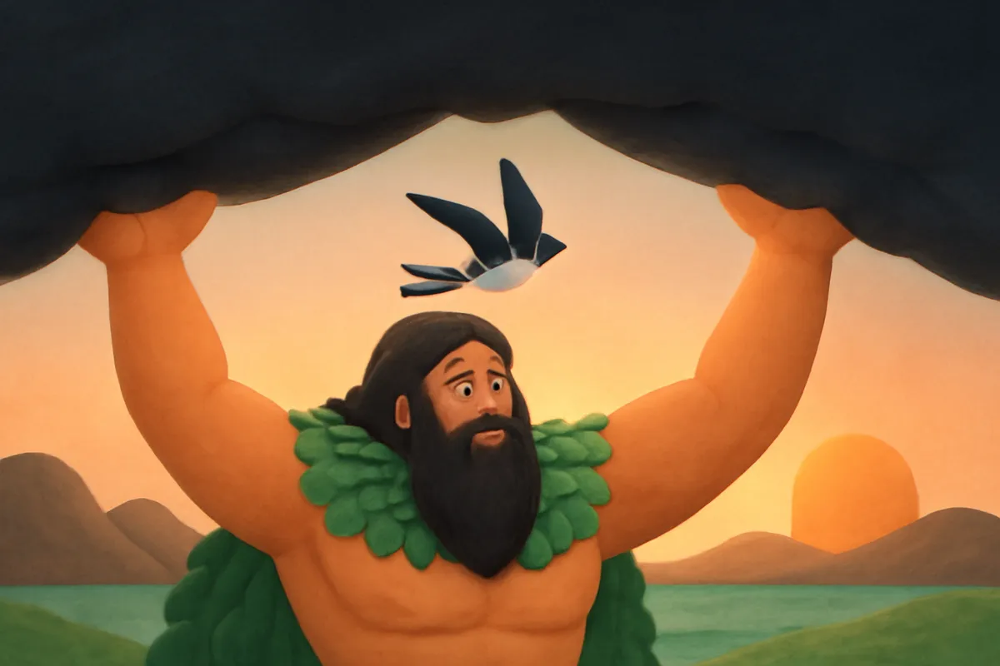
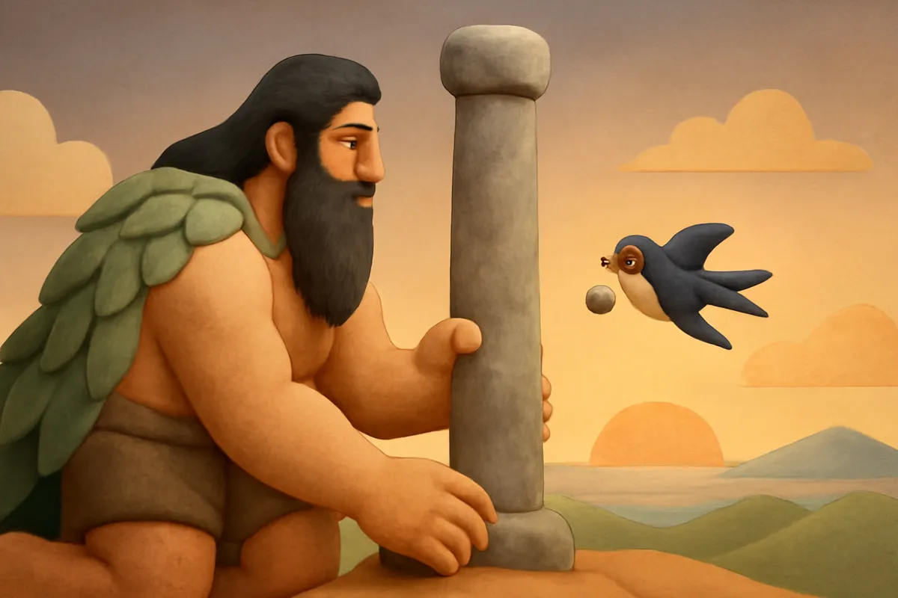
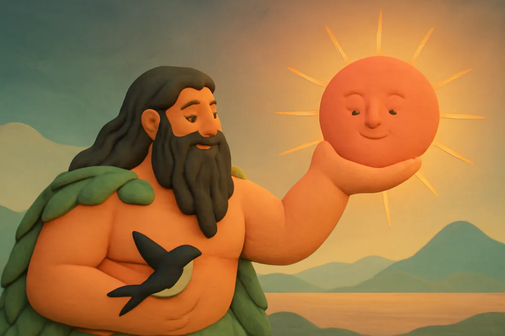
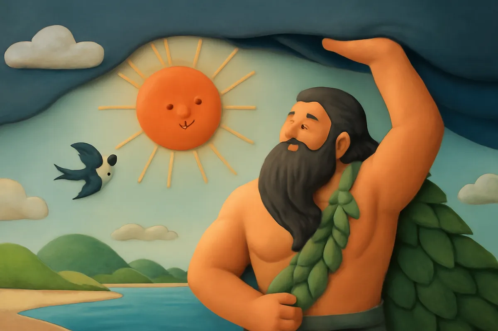
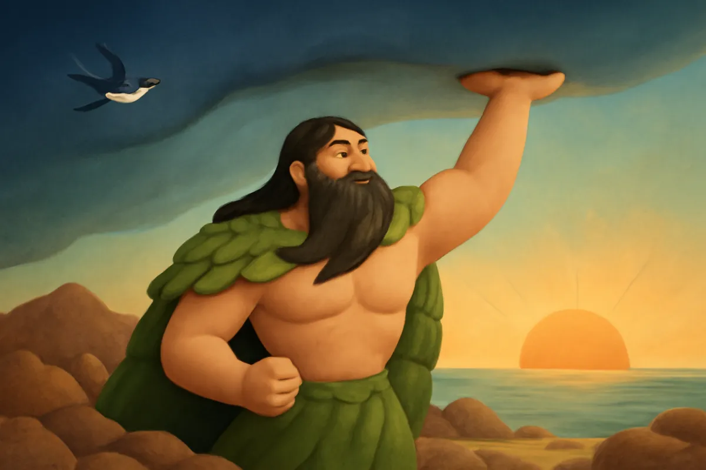

# Thần Trụ Trời

| | |
| --- | --- |
| Mã truyện | `8e80fd39-1266-4911-83c8-e172fe645597` |
| Nhóm | Truyện thư viện |
| Nguồn | manual |
| Tạo lúc | 2026-10-15T14:34:09.814347+00:00 |
| Cập nhật | 2026-10-16T04:32:30.915115+00:00 |
| Số trang | 8 |
| Ngôn ngữ | vi |
| Tuổi | 5–8 |
| Giọng kể | Viên - Narrative, Warm and Clear (northern) |
| Trạng thái | published |
| Đã xoá | không |

**Giới thiệu:** Thuở trời đất còn dính liền, tối tăm, Thần Trụ Trời đội trời lên, đắp cột chống trời. Có Chim Én giúp sức và Ông Mặt Trời toả sáng, thần phá cột thành núi non, sông biển.

**Bài học:** Kiên trì, chăm chỉ góp sức thì làm nên việc lớn; biết yêu quý trời đất quê hương.

## Nhân vật

- **Thần Trụ Trời** — Vị thần khổng lồ tách trời khỏi đất (giọng: Quang — chú trầm ấm)
- **Chim Én** — Cô chim én nhỏ chăm chỉ, báo tin mùa xuân (giọng: Yuna — bé gái tinh nghịch)
- **Ông Mặt Trời** — Ông Mặt Trời hiền hậu mang ánh sáng (giọng: Thanh — ông hiền từ)

## Trang 1

Thuở xa xưa, khi chưa có trời, chưa có đất, mọi thứ chỉ là một vùng hỗn độn tối tăm và lạnh lẽo. Trời và đất dính sát vào nhau, chẳng có ánh sáng, chẳng có cỏ cây.

Bỗng một vị thần khổng lồ xuất hiện. Thần cao lớn đến nỗi ngồi thôi mà đầu đã chạm trời.

**Thần Trụ Trời:** Tối quá, chật quá! Ta phải tách trời ra khỏi đất mới được.

## Trang 2

Thần đứng thẳng dậy, ngẩng đầu đội trời lên. Hai tay thần chống mạnh, đẩy trời lên cao từng chút một. Trời nặng lắm, thần đổ mồ hôi như mưa.

**Thần Trụ Trời:** Hây dô! Lên nào! Lên nữa nào!

Một kẽ sáng nhỏ hé ra. Từ kẽ sáng ấy, một cô chim nhỏ chao cánh bay vào.

**Chim Én:** Ông thần ơi, ông khoẻ quá! Cháu là Chim Én. Cháu giúp ông một tay nhé!

## Trang 3

Thần cúi xuống đào đất, khuân đá, đắp thành một cái cột vừa to vừa cao. Cột cao đến đâu, trời được đẩy lên đến đấy. Chim Én cũng tha từng hòn sỏi nhỏ xíu, đặt lên chân cột.

**Thần Trụ Trời:** Cảm ơn cháu. Hòn sỏi nhỏ thôi, nhưng góp lại cũng thành cột lớn.

**Chim Én:** Cháu bé nhưng chăm lắm ông ạ! Cột ơi, cao nữa lên!

## Trang 4

Cột đá cao mãi, cao mãi, đẩy trời lên tít trên cao. Ánh sáng tràn xuống khắp nơi. Ở phía đông, một quả cầu đỏ rực từ từ nhô lên. Đó là Ông Mặt Trời.

**Ông Mặt Trời:** Chào Thần Trụ Trời! Nhờ thần, bây giờ ta mới có chỗ để toả sáng.

**Chim Én:** Ôi, sáng quá! Ấm quá! Cháu nhìn thấy cả bầu trời rồi!

Trời đất đã tách đôi: trời tròn như cái vung úp, đất phẳng như cái mâm.

## Trang 5

**Ông Mặt Trời:** Từ nay, sáng sáng ta sẽ đi từ phía đông sang phía tây, mang ngày đến cho muôn loài. Tối đến, ta về nghỉ, nhường chỗ cho chị Trăng và các vì sao.

**Thần Trụ Trời:** Hay lắm! Có ngày, có đêm, muôn loài sẽ biết lúc làm, lúc nghỉ.

Chim Én bay lượn quanh cột đá, đếm từng tia nắng.

**Chim Én:** Một tia, hai tia, ba tia... nhiều quá, cháu đếm không xuể!

## Trang 6

Khi trời đã cao vững, thần phá cột đá đi. Đất đá văng ra khắp nơi, rơi xuống thành núi non, đồi gò, thành những hòn đảo nhỏ. Những chỗ thần đào đất ngày trước trũng xuống, nước đổ về thành sông, thành hồ, thành biển rộng.

**Thần Trụ Trời:** Trời đã cao rồi, cột đá không cần nữa. Từ nay, núi để cây mọc, sông để nước chảy.

**Chim Én:** Đẹp quá! Có núi xanh, có biển biếc rồi!

## Trang 7

Ông Mặt Trời chiếu nắng, mây đen kéo mưa về. Hạt giống nảy mầm, cỏ cây xanh mướt phủ kín núi đồi. Muông thú từ khắp nơi kéo về, cá tung tăng dưới sông, chim hót líu lo trên cành.

**Ông Mặt Trời:** Có nắng, có mưa, mọi thứ đều lớn lên. Thế gian thật là vui!

**Chim Én:** Cháu sẽ bay đi báo tin cho muôn loài: mùa xuân đến rồi!

## Trang 8

Thần Trụ Trời đi khắp nơi ngắm nhìn thế gian, rồi ngồi nghỉ trên đỉnh núi cao nhất. Thần mỉm cười hài lòng.

**Thần Trụ Trời:** Trời cao, đất rộng, muôn loài no ấm. Việc của ta xong rồi.

**Chim Én:** Mùa xuân nào cháu cũng sẽ bay về đây chào ông!

Người xưa kể rằng, những dãy núi cao vời vợi ngày nay chính là dấu tích cột trụ trời năm ấy. Mỗi độ xuân về, chim én lại bay về rợp trời.

---

Bản đầy đủ (mọi cột trong cơ sở dữ liệu): [story.json](story.json)
