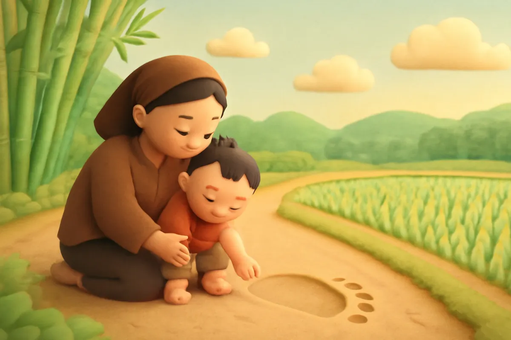
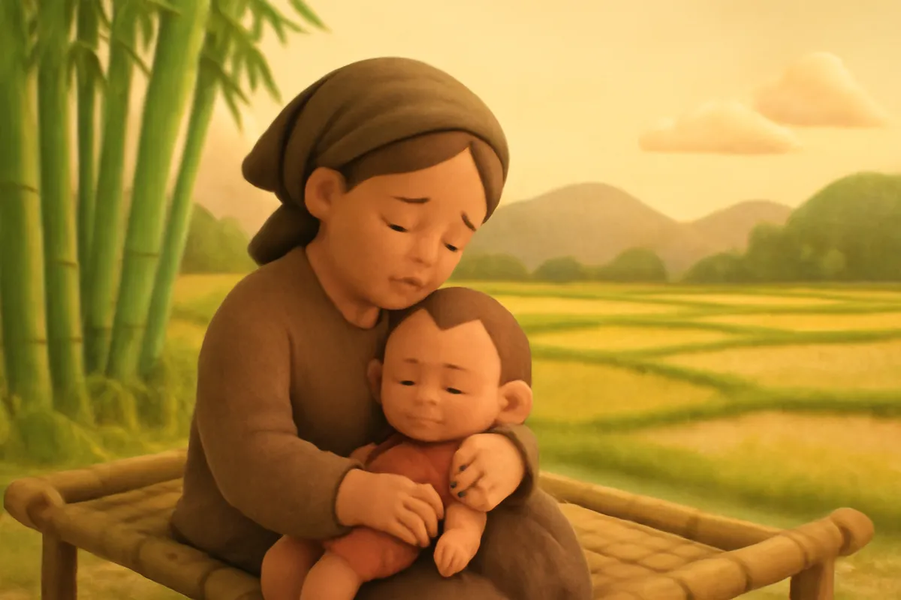
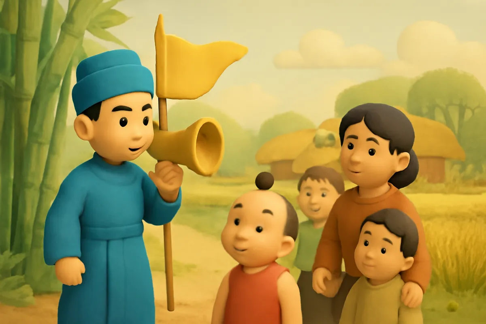
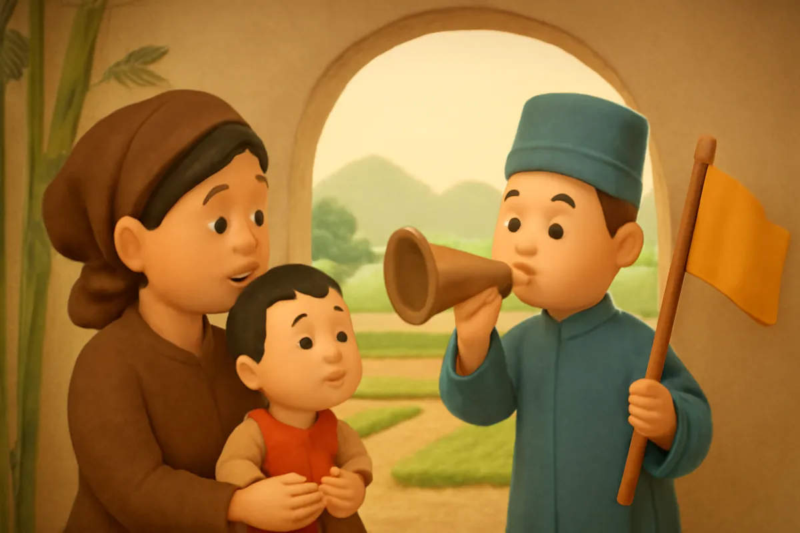
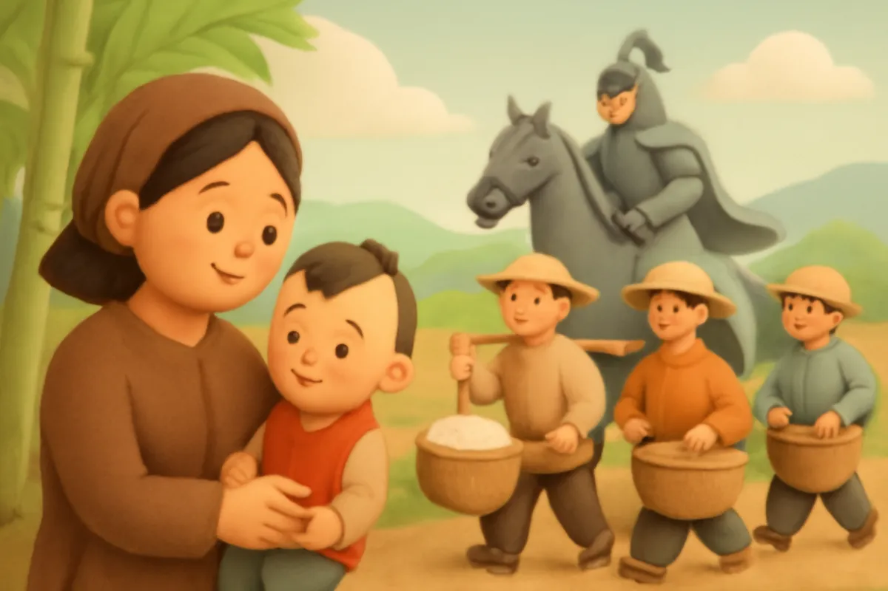
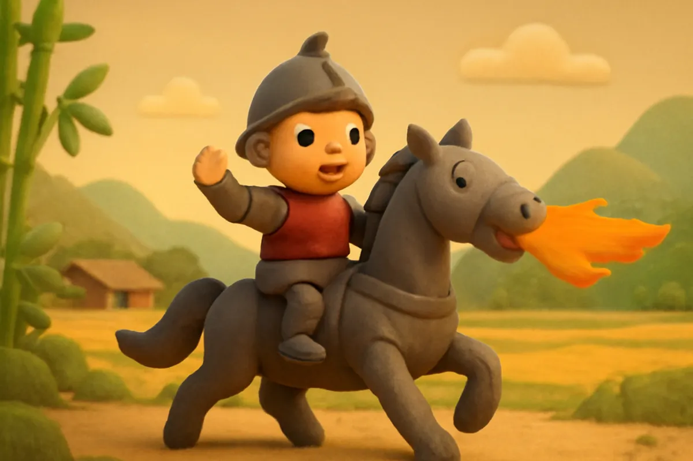
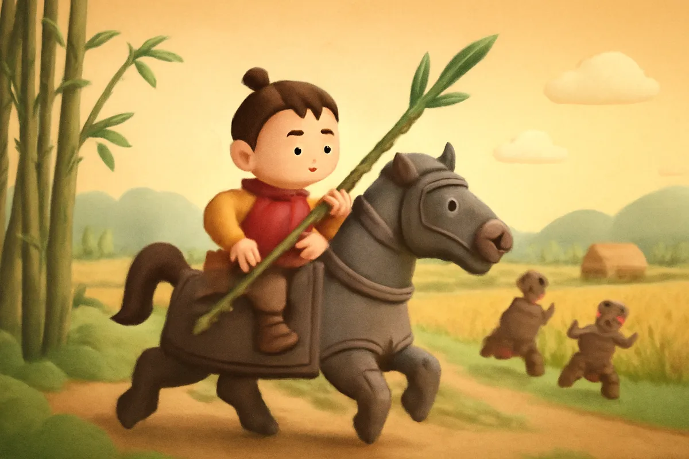
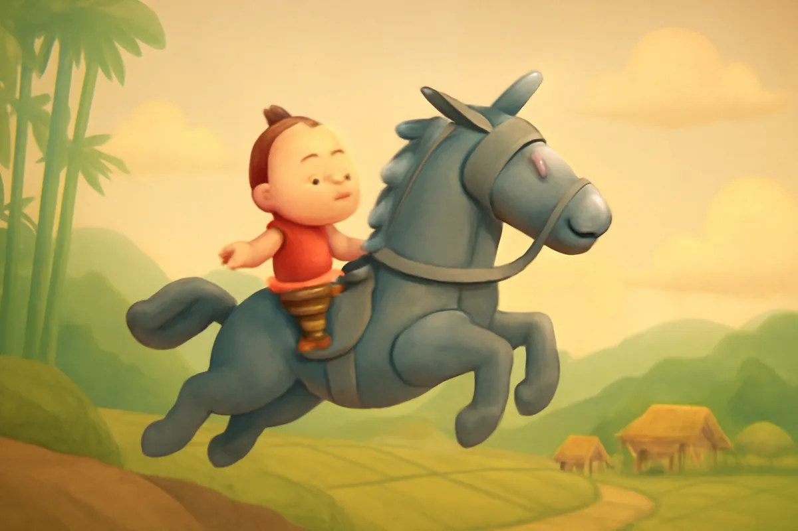

# Thánh Gióng

| | |
| --- | --- |
| Mã truyện | `c3303717-04d0-4414-842c-8787b09155a7` |
| Nhóm | Truyện thư viện |
| Nguồn | manual |
| Tạo lúc | 2026-10-15T14:34:09.448749+00:00 |
| Cập nhật | 2026-10-16T04:27:50.709963+00:00 |
| Số trang | 8 |
| Ngôn ngữ | vi |
| Tuổi | 5–9 |
| Giọng kể | Viên - Narrative, Warm and Clear (northern) |
| Trạng thái | published |
| Đã xoá | không |

**Giới thiệu:** Cậu bé làng Gióng ba tuổi chưa biết nói, nghe tiếng sứ giả tìm người đánh giặc liền cất tiếng xin đi. Cả làng góp gạo nuôi Gióng lớn nhanh như thổi, rồi Gióng đánh tan giặc Ân và bay về trời.

**Bài học:** Yêu quê hương; khi đất nước cần, mọi người cùng chung tay.

## Nhân vật

- **Gióng** — Cậu bé làng Gióng, lớn lên thành tráng sĩ (giọng: Bin — bé trai lém lỉnh)
- **Mẹ Gióng** — Người mẹ hiền, thương con (giọng: Tâm — cô kể chuyện cổ tích)
- **Sứ Giả** — Sứ giả của vua đi tìm người tài (giọng: Quang — chú trầm ấm)

## Trang 1

Đời Hùng Vương thứ sáu, ở làng Gióng có hai vợ chồng ông lão chăm chỉ làm ăn, nhưng mãi không có con.

Một hôm, bà lão ra đồng, thấy một vết chân rất to. Bà ướm thử chân mình vào. Không lâu sau, bà có mang, rồi sinh được một bé trai khôi ngô.

**Mẹ Gióng:** Con của mẹ đây rồi! Mẹ mừng quá, con ơi!

🔊 [Nghe trang 1](../../../media/tts-cache/ead1f777-326b-4595-9e1b-9a38e6d77194-53ea11f1-e955-4a71-9f1f-0bbc2bc28b77.mp3)

## Trang 2

Lạ thay, cậu bé lên ba tuổi mà vẫn chưa biết nói, chưa biết cười, đặt đâu nằm đấy. Mẹ cậu lo lắng lắm.

**Mẹ Gióng:** Con ơi, bao giờ con mới gọi được một tiếng mẹ?

Bà vẫn ngày ngày ru con, chăm con hết lòng. Cậu bé chỉ nằm im trên chiếc chõng tre, đôi mắt sáng long lanh nhìn mẹ, như đang chờ đợi một điều gì đó.

🔊 [Nghe trang 2](../../../media/tts-cache/9b541917-83ee-4a15-b4cc-96ae4e010124-1b1e6836-6ea5-4aaf-8f53-f0e664a63213.mp3)

## Trang 3

Bấy giờ, giặc Ân kéo đến xâm lược nước ta. Thế giặc rất mạnh. Vua lo lắng, sai sứ giả đi khắp nơi tìm người tài giỏi cứu nước.

Sứ giả đến làng Gióng, rao to:

**Sứ Giả:** Ai có tài đánh giặc, hãy ra giúp vua cứu nước!

Nghe tiếng rao, cậu bé bỗng cất tiếng nói đầu tiên.

**Gióng:** Mẹ ơi, mẹ mời sứ giả vào đây cho con!

🔊 [Nghe trang 3](../../../media/tts-cache/0e9cd575-728b-45d9-ba60-aa955bcf1720-8337c7f4-f1bc-4370-aab7-8306de510b3d.mp3)

## Trang 4

Mẹ Gióng vừa mừng vừa lo, vội mời sứ giả vào nhà. Cậu bé nói rõ ràng từng tiếng.

**Gióng:** Ông về tâu vua, rèn cho tôi một con ngựa sắt, một cây roi sắt và một tấm áo giáp sắt. Tôi sẽ đánh tan lũ giặc.

**Sứ Giả:** Cậu bé này thật lạ! Ta về tâu vua ngay.

Sứ giả vội vàng lên ngựa về kinh.

🔊 [Nghe trang 4](../../../media/tts-cache/f5a26bd8-c8c5-4ca4-9a95-892c9f5e95cc-ccaba9dd-e601-400e-97de-8095a9c845f6.mp3)

## Trang 5

Từ hôm ấy, Gióng lớn nhanh như thổi. Cơm ăn mấy cũng không no, áo vừa mặc xong đã chật. Mẹ Gióng làm lụng vất vả mà không đủ nuôi con.

Bà con trong làng thương lắm, ai cũng vui lòng góp gạo, góp cà, nuôi cậu bé.

**Mẹ Gióng:** Cảm ơn bà con. Con tôi lớn lên là nhờ cả làng đấy.

🔊 [Nghe trang 5](../../../media/tts-cache/877b0eed-a6a3-474c-9e1d-ac3634ff6bdc-3e857e2e-a13d-4d2e-848c-51bd9d51c81f.mp3)

## Trang 6

Giặc đã đến chân núi Trâu. Vừa lúc ấy, ngựa sắt, roi sắt, áo giáp sắt được mang tới. Gióng vươn vai một cái, bỗng thành một tráng sĩ cao lớn, oai phong.

**Gióng:** Mẹ ơi, con đi đánh giặc đây! Mẹ ở nhà chờ con nhé.

Gióng mặc áo giáp, cầm roi, nhảy lên lưng ngựa. Ngựa sắt hí vang, phun lửa, phi như bay ra trận.

🔊 [Nghe trang 6](../../../media/tts-cache/cfa38897-fade-4604-9a92-bc5e08784547-88f36d8a-66cc-4f77-94b6-1b47298a0687.mp3)

## Trang 7

Gióng xông thẳng vào đám giặc. Roi sắt vung lên, giặc chạy tán loạn. Bỗng roi sắt gãy, Gióng liền nhổ những bụi tre bên đường quật về phía giặc. Người ta kể, lửa ngựa sắt làm bụi tre cháy sém, từ đó có giống tre đằng ngà vàng óng.

Giặc Ân thua to, bỏ chạy về nước, không dám quay lại nữa.

**Gióng:** Đất nước yên bình rồi! Bà con ơi, hãy về làm ăn vui vẻ nhé!

🔊 [Nghe trang 7](../../../media/tts-cache/16177d26-4fca-4e94-8ec9-a8a033670339-fc68e9d7-10f4-42f9-8c2d-3b71f3004ecf.mp3)

## Trang 8

Đánh tan giặc rồi, Gióng một mình một ngựa lên đỉnh núi Sóc. Chàng cởi áo giáp sắt để lại, rồi cả người lẫn ngựa từ từ bay lên trời.

Vua nhớ công ơn, phong cho Gióng là Phù Đổng Thiên Vương. Hằng năm, vào tháng Tư âm lịch, làng Gióng lại mở hội để nhớ ơn người anh hùng nhỏ tuổi.

---

Bản đầy đủ (mọi cột trong cơ sở dữ liệu): [story.json](story.json)
