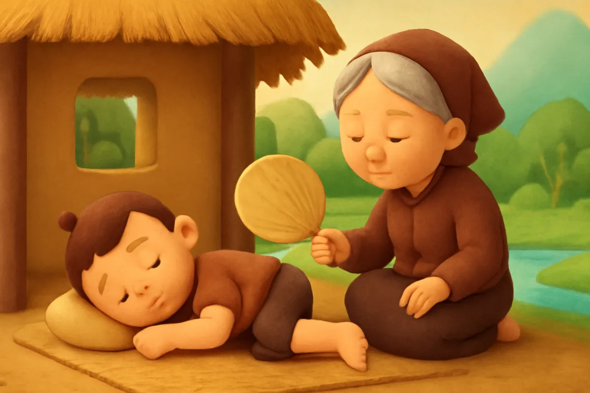
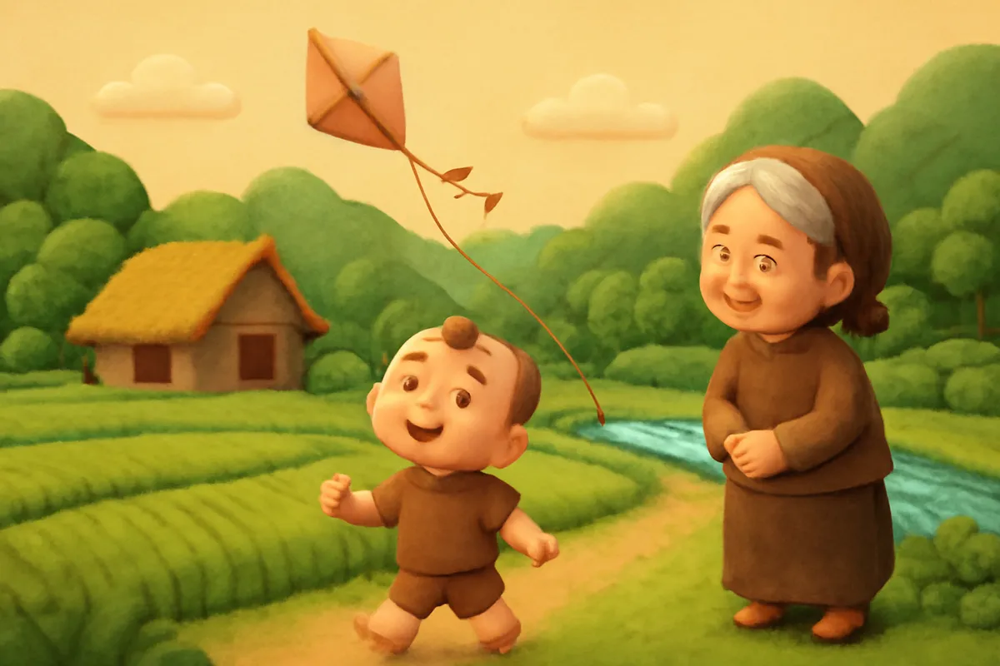
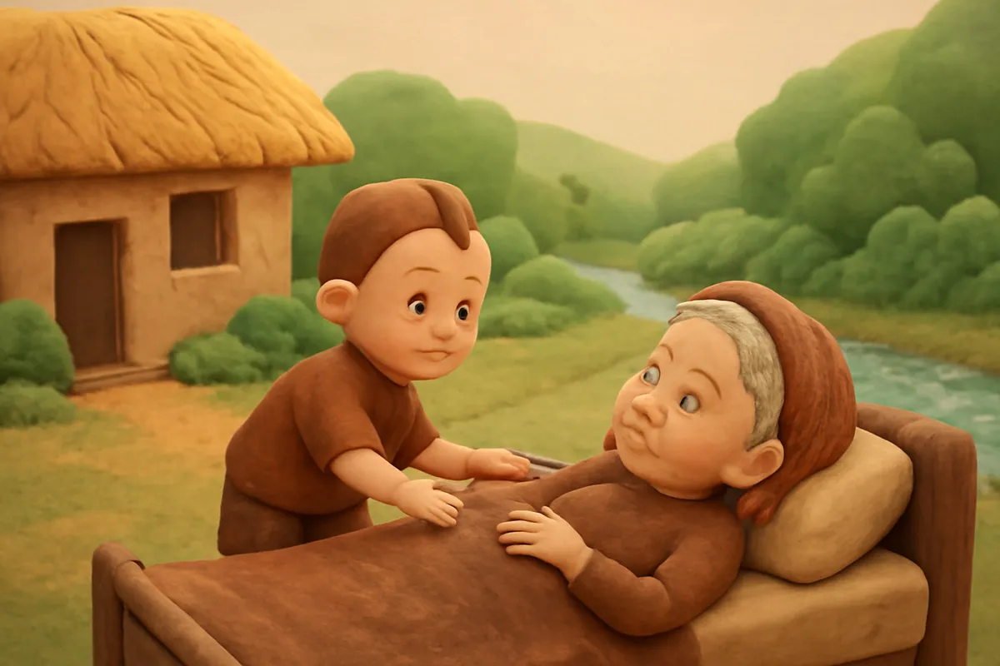
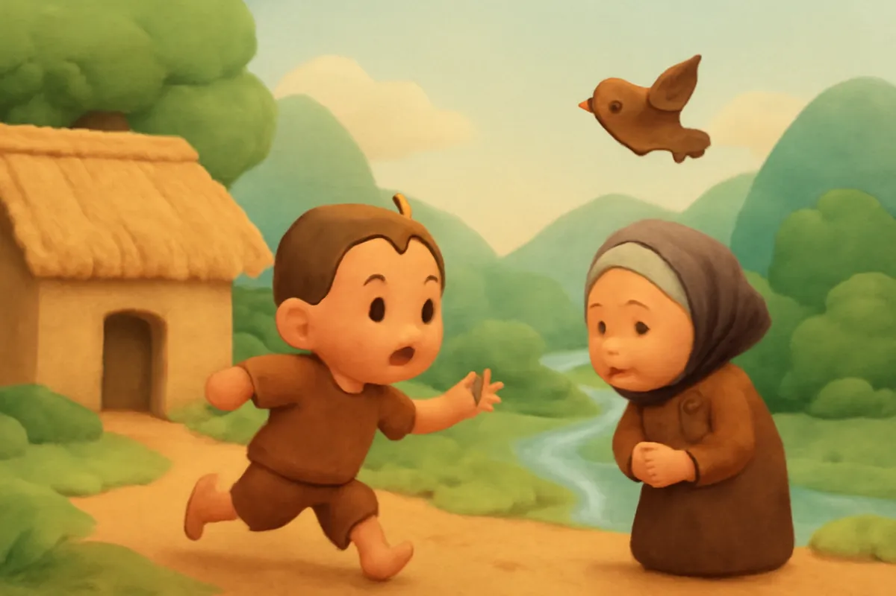
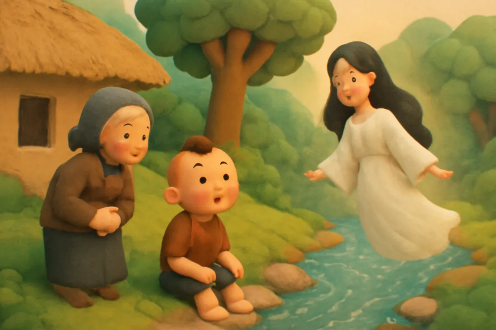
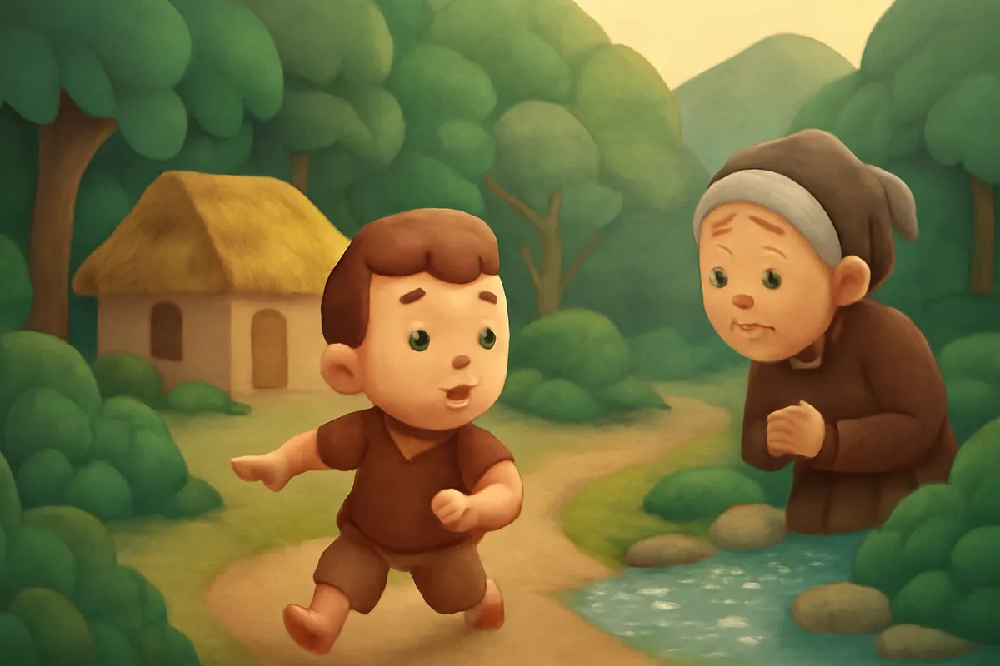
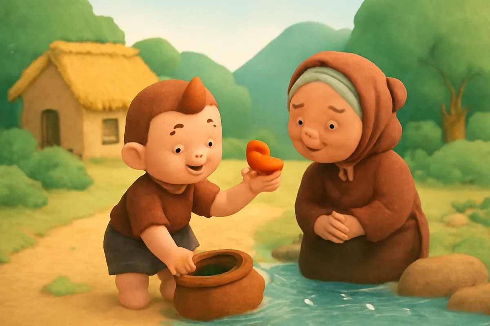
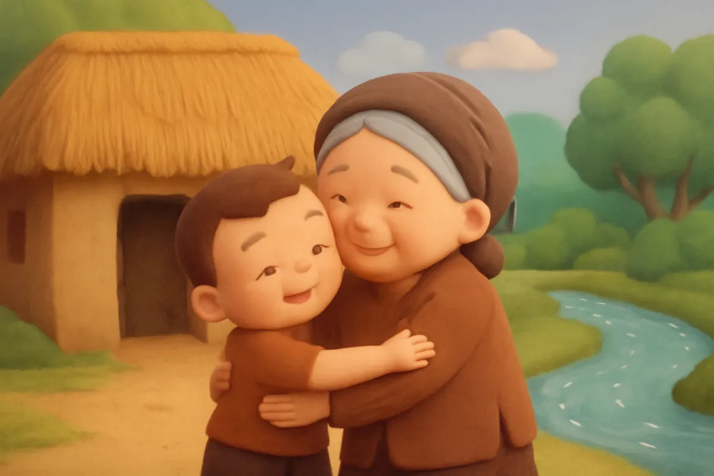

# Tích Chu

| | |
| --- | --- |
| Mã truyện | `5f244e86-52af-44c0-b746-2438ff25af68` |
| Nhóm | Truyện thư viện |
| Nguồn | manual |
| Tạo lúc | 2026-10-15T14:34:09.448749+00:00 |
| Cập nhật | 2026-10-16T04:28:36.397339+00:00 |
| Số trang | 8 |
| Ngôn ngữ | vi |
| Tuổi | 3–6 |
| Giọng kể | Viên - Narrative, Warm and Clear (northern) |
| Trạng thái | published |
| Đã xoá | không |

**Giới thiệu:** Cậu bé Tích Chu mải chơi, quên lấy nước cho bà. Bà hoá thành chim bay đi, Tích Chu phải vượt rừng tìm nước suối tiên để đưa bà trở về.

**Bài học:** Thương yêu, quan tâm ông bà ngay khi ông bà cần mình.

## Nhân vật

- **Tích Chu** — Cậu bé mải chơi nhưng thương bà (giọng: Bin — bé trai lém lỉnh)
- **Bà** — Bà của Tích Chu, hiền hậu, tóc bạc (giọng: Hiền — bà hiền hậu)
- **Bà Tiên** — Bà tiên tốt bụng chỉ đường cho Tích Chu (giọng: Tâm — cô kể chuyện cổ tích)

## Trang 1

Ngày xưa, ở một làng nhỏ ven sông, có cậu bé tên là Tích Chu. Tích Chu sống cùng bà trong một ngôi nhà mái lá.

Bà thương Tích Chu nhất trên đời. Có miếng ngon, bà để dành cho cháu. Trời nóng, bà ngồi quạt cho cháu ngủ. Đêm lạnh, bà ôm cháu thật chặt cho ấm.

**Bà:** Cháu ngoan của bà, ngủ đi nào. Bà quạt cho cháu nhé.

## Trang 2

Tích Chu lớn dần lên. Bà thì già đi, lưng còng xuống, tóc bạc trắng như mây. Nhưng Tích Chu chỉ mải chơi.

Sáng, cậu thả diều ngoài đồng. Chiều, cậu bắt chuồn chuồn bên bờ ao. Tối về, cậu lăn ra ngủ, chẳng nhớ hỏi han bà.

**Tích Chu:** Diều ơi, bay cao nữa đi! Chơi thêm chút nữa thôi mà!

🔊 [Nghe trang 2](../../../media/tts-cache/64d1e8d3-9c78-4e55-ba67-cb16880918e8-d35e6930-e52b-4acb-b096-12f5019a5c5f.mp3)

## Trang 3

Một trưa hè nắng chang chang, bà bị ốm. Bà nằm trên giường, người nóng hầm hập, cổ họng khô rát.

**Bà:** Tích Chu ơi, cháu lấy cho bà ngụm nước. Bà khát lắm cháu ạ.

Nhưng Tích Chu đang mải đá cầu với các bạn ngoài ngõ.

**Tích Chu:** Bà chờ cháu một lát. Cháu chơi xong ván này đã!

Bà gọi mãi, gọi mãi, mà Tích Chu vẫn chưa về.

## Trang 4

Bà khát quá. Bà ước giá mình là chim, bà sẽ bay đi tìm nước uống. Thế là bà hoá thành một con chim nhỏ, vỗ cánh phành phạch bay qua cửa sổ.

Lúc ấy Tích Chu mới chạy về. Cậu thấy con chim bay vụt lên trời.

**Tích Chu:** Bà ơi! Bà đi đâu đấy? Cháu biết lỗi rồi, bà về với cháu đi!

**Bà:** Bà khát lắm, bà phải bay đi tìm nước. Bà không về được nữa rồi.

## Trang 5

Tích Chu ngồi khóc nức nở dưới gốc cây. Bỗng có ánh sáng lấp lánh, một bà tiên hiện ra.

**Bà Tiên:** Cháu bé, vì sao cháu khóc?

**Tích Chu:** Bà cháu hoá thành chim bay đi mất rồi. Cháu muốn bà về. Cháu sẽ không mải chơi nữa đâu.

**Bà Tiên:** Nếu cháu thương bà thật, hãy đến suối tiên ở cuối khu rừng. Lấy nước suối về cho bà uống, bà sẽ trở lại thành người.

🔊 [Nghe trang 5](../../../media/tts-cache/75d8e193-fa3b-41c2-a113-7de9d677480d-79fbdb71-03f9-4285-8cc3-69cdcb81352e.mp3)

## Trang 6

Tích Chu đi ngay. Cậu trèo qua đồi cao, lội qua ruộng sâu, băng qua khu rừng rậm. Gai cào xước chân, cậu vẫn đi.

Trời tối dần. Cậu hơi sợ, nhưng nghĩ đến bà, cậu lại bước tiếp.

**Tích Chu:** Bà ơi, chờ cháu nhé. Cháu sắp đến rồi!

Cuối cùng, cậu nghe tiếng nước chảy róc rách. Suối tiên kia rồi!

🔊 [Nghe trang 6](../../../media/tts-cache/440f03ee-1722-4471-9d19-704c05b7cb64-a80c4d7d-ece3-4fb9-9e49-633d6067f4f7.mp3)

## Trang 7

Nước suối trong veo, mát lạnh. Tích Chu cẩn thận múc đầy một bình nước, ôm chặt vào lòng. Cậu chạy một mạch về nhà, vừa chạy vừa gọi.

**Tích Chu:** Bà ơi! Cháu có nước suối tiên đây rồi! Bà về uống nước đi bà!

Con chim nhỏ nghe thấy, liền bay sà xuống, đậu trên tay Tích Chu. Chim uống một ngụm, hai ngụm, rồi ba ngụm nước mát.

🔊 [Nghe trang 7](../../../media/tts-cache/07f0a87b-ef5c-4f35-84a9-26295a8487e7-030a6361-2bf9-440c-b3a9-da3bd164b4bc.mp3)

## Trang 8

Phép màu đã đến! Con chim nhỏ biến mất, bà hiện ra, vẫn mái tóc bạc và nụ cười hiền như ngày nào. Tích Chu ôm chầm lấy bà.

**Tích Chu:** Bà ơi, cháu thương bà lắm. Từ nay cháu sẽ chăm sóc bà thật tốt.

**Bà:** Bà biết cháu ngoan mà. Cháu của bà giỏi lắm.

Từ hôm đó, Tích Chu luôn ở bên bà, lấy nước, quạt mát cho bà mỗi ngày.

---

Bản đầy đủ (mọi cột trong cơ sở dữ liệu): [story.json](story.json)
